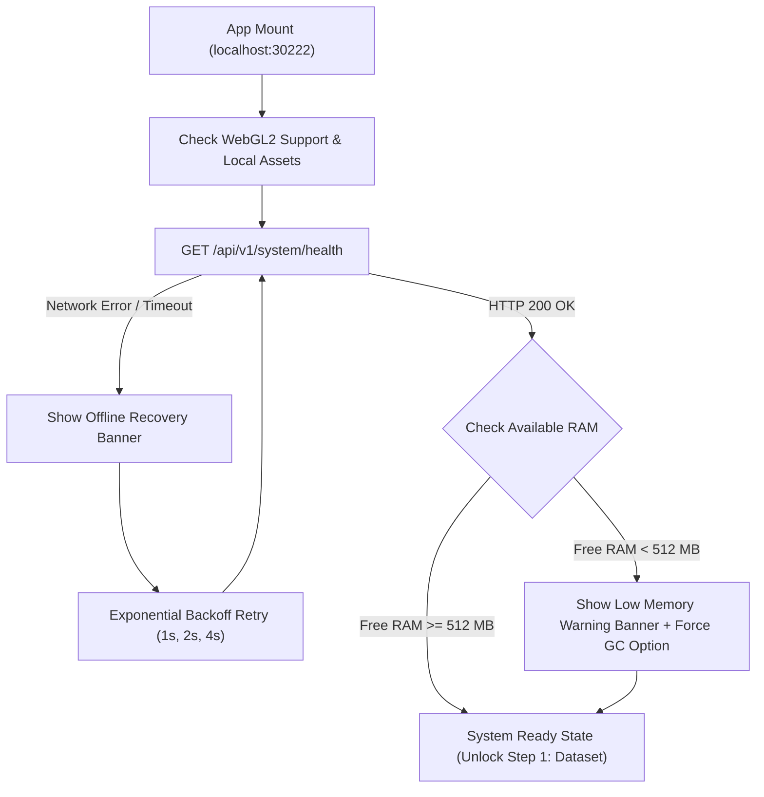

# Phase 01: Project Scaffolding, Monorepo (`backend/` & `frontend/`), 2-Port Config & DDD Shared Core

## 1. วัตถุประสงค์และขอบเขตของเฟส (Objective & Scope)
วางรากฐานสถาปัตยกรรมหลักของระบบ **Easy ML Viewer (3D Interactive Machine Learning Explainability & Simulation Studio)** ในรูปแบบ **Monorepo 2 โฟลเดอร์แยกอิสระ** ได้แก่ `backend/` (Python 3.11+ FastAPI รันบนพอร์ต `30211`) และ `frontend/` (React 19 + Vite + TypeScript + Tailwind CSS v4 รันบนพอร์ต `30222`) โดยออกแบบตามหลักการ **Domain-Driven Design (DDD)** ที่มี **Shared `core/` Kernel** เป็นแกนกลาง พร้อมระบบตรวจสอบทรัพยากรเครื่อง (RAM, CPU, GPU, Disk Cache) แบบเรียลไทม์ และรับประกันการทำงานแบบ **100% Offline (Air-Gapped Ready)** บนทั้งระบบปฏิบัติการ **Windows, macOS, และ Linux**

### ขอบเขตงานในเฟสนี้ (In-Scope)
- การจัดโครงสร้างไดเรกทอรี Monorepo มาตรฐาน (`backend/`, `frontend/`, `scripts/`, `.cache/`, `samples/`)
- การสร้าง Shared Core Kernel ในฝั่ง Backend (`config.py`, `exceptions.py`, `events.py`, `memory_monitor.py`, `logging.py`)
- การสร้าง Shared Core Kernel ในฝั่ง Frontend (`client.ts`, `rootStore.ts`, `theme/`, `SystemStatusBar.tsx`, `ErrorBoundary.tsx`)
- การสร้าง REST API Endpoint `/api/v1/system/health` และ `/api/v1/system/clear-cache` สำหรับตรวจสอบความพร้อมของฮาร์ดแวร์และจัดการพื้นที่แคชชั่วคราว
- การสร้าง App Shell Layout หลักแบบ Sci-Fi Dark Studio พร้อม Navigation Stepper 5 ขั้นตอน (`1. Dataset` -> `2. Model` -> `3. Mapping` -> `4. Data Queue` -> `5. 3D Studio`)

---

## 2. UI Feature List อย่างละเอียด (Detailed UI Feature List)

### 2.1 Top Studio Header & Workflow Stepper (`StudioHeader.tsx`)
- **Brand Identity & Offline Badge**:
  - โลโก้ `Easy ML Viewer` พร้อมป้ายสถานะ `100% OFFLINE STUDIO` (สีเขียว Emerald `#10B981` เมื่อเชื่อมต่อ Local Backend สำเร็จ หรือสีแดง Rose `#F43F5E` เมื่อ Backend ไม่ตอบสนอง)
  - Tooltip เมื่อนำเมาส์ไปชี้ที่ป้ายสถานะ: แสดง URL ที่เชื่อมต่อ (`http://127.0.0.1:30211`), Latency (ms), และ OS ของเครื่องแม่ข่าย
- **5-Step Workflow Stepper**:
  - แถบนำทางแสดงขั้นตอนการทำงานหลัก: `[1. Dataset]` -> `[2. Model]` -> `[3. Column Mapping]` -> `[4. Trajectory Queue]` -> `[5. 3D Stage & VCR]`
  - สถานะของแต่ละ Step Badge: `Locked` (สีเทามืด กดไม่ได้หากยังไม่ผ่านขั้นก่อนหน้า), `Active` (ขอบเรืองแสงสีฟ้า Cyan `#06B6D4`), `Completed` (มีไอคอนเครื่องหมายถูกสีเขียว)
- **Quick Action Toolbar**:
  - ปุ่ม `System Diagnostics` (ไอคอน CPU/Activity): เปิด Modal แสดงรายละเอียดฮาร์ดแวร์และกราฟการใช้ RAM
  - ปุ่ม `Clear Temp Cache` (ไอคอน Trash): ล้างไฟล์ชั่วคราวใน `.cache/` พร้อมแสดงขนาดพื้นที่ที่ได้คืน
  - ปุ่ม `Keyboard Shortcuts (?)`: เปิดแผ่นสรุปคีย์ลัดทั้งหมดของระบบ

### 2.2 Bottom System Telemetry Status Bar (`SystemStatusBar.tsx`)
- **Backend Connection Indicator**: จุดไฟกะพริบสีเขียว (`Connected: 127.0.0.1:30211`) พร้อมปุ่ม `Retry Now` เมื่อหลุดการเชื่อมต่อ
- **Memory Usage Meter (RAM Guard Gauge)**:
  - แถบ Progress Bar ขนาดกะทัดรัดแสดงการใช้ RAM ของโปรเซส Python Backend และ System RAM รวม เช่น `Backend RAM: 342 MB / Limit: 4,096 MB (8.3%) | System Free: 9.2 GB`
  - เปลี่ยนสีอัตโนมัติ: `< 60%` (สีเขียว), `60% - 85%` (สีเหลือง Amber), `> 85%` (สีแดงแจ้งเตือนพร้อมปุ่มกด Force GC)
- **CPU & Thread Pool Indicator**: แสดงจำนวน Logical Cores และจำนวน Worker Threads ที่ตั้งค่าไว้ (เช่น `CPU: 8 Cores (OMP=4)`)
- **WebGL2 Context Capability Badge**: ตรวจจับ GPU Renderer จากเบราว์เซอร์ (เช่น `WebGL2: NVIDIA GeForce RTX 3060`)

### 2.3 System Diagnostics Modal (`SystemDiagnosticsModal.tsx`)
- แสดงตารางข้อมูลเชิงลึก: OS Platform, Python Version, Scikit-learn/NumPy/PyArrow Versions, Directory Paths (`CACHE_DIR`, `SAMPLE_DIR`), ปุ่ม `Run Garbage Collection (GC)` และปุ่ม `Copy Diagnostic JSON`

### 2.4 States & Feedback Components
- **Loading Skeleton**: โครงร่างสีเทาเข้มกะพริบ (`animate-pulse`) ขณะรอผล Health Check ครั้งแรกตอนเปิดแอป
- **Empty State**: หน้าจอต้อนรับเมื่อยังไม่ได้โหลดโปรเจกต์ มีปุ่ม `Start New Session` และ `Load Sample Project`
- **Error State (Backend Offline Banner)**: แบนเนอร์เต็มความกว้างด้านบนพร้อมคำแนะนำคำสั่งรัน Backend (`uvicorn app.main:app --port 30211`) และปุ่ม `Copy Command`
- **Keyboard Shortcuts**:
  - `Shift + ?`: เปิด/ปิดหน้าต่าง Keyboard Shortcuts
  - `Ctrl + Shift + D` (หรือ `Cmd + Shift + D` บน Mac): เปิดหน้าต่าง System Diagnostics Modal
  - `Alt + 1..5`: สลับไปยังขั้นตอนที่ 1 ถึง 5 (เฉพาะขั้นตอนที่ปลดล็อกแล้ว)

---

## 3. UX Flow & User Journey (Step-by-Step UX Flow & ASCII Wireframe)

### 3.1 ลำดับการทำงาน (Step-by-Step User Journey)
1. **การเปิดระบบครั้งแรก (Application Bootstrapping)**:
   - ผู้ใช้รัน Backend (`port 30211`) และ Frontend (`port 30222`) แล้วเปิดเบราว์เซอร์เข้าสู่ `http://localhost:30222`
   - Frontend โหลดฟอนต์และไอคอนจาก Local Bundle ทันทีโดยไม่มีการร้องขอเครือข่ายภายนอก (Zero External Requests)
2. **การตรวจสอบระบบอัตโนมัติ (Automated Health & Hardware Handshake)**:
   - `useSystemHealthPoller` ยิงคำขอ `GET /api/v1/system/health` ไปยัง Backend
   - Backend ตรวจสอบสถานะ RAM ด้วย `psutil`, ตรวจสอบสิทธิ์การเขียนโฟลเดอร์ `.cache/`, และส่ง JSON กลับมาภายใน `< 20ms`
   - Frontend อัปเดตแถบสถานะด้านล่าง (RAM Bar, OS Badge) และตรวจสอบการรองรับ `WebGL2RenderingContext` ของการ์ดจอ
3. **การจัดการกรณีเกิดข้อผิดพลาด (Error Handling Flow)**:
   - หากพอร์ต `30211` ไม่ตอบสนอง ระบบจะเข้าสู่โหมด `Reconnecting` (Exponential Backoff: 1s, 2s, 4s) พร้อมแสดงหน้าจอแนะนำวิธีเปิดเซิร์ฟเวอร์ Backend
   - หากพบว่า System RAM เหลือต่ำกว่าเกณฑ์ขั้นต่ำ (`< 512 MB`) ระบบจะแสดง Warning Toast เตือนผู้ใช้ให้ปิดโปรแกรมอื่นก่อนโหลดชุดข้อมูลขนาดใหญ่

### 3.2 ASCII Wireframe: Studio App Shell & Diagnostics View
```text
+--------------------------------------------------------------------------------------------------+
| [Easy ML Viewer] (● 100% OFFLINE)  |  (1.Dataset) -> (2.Model) -> [3.Map] -> [4.Queue] -> [5.3D] |
|                                                                      [Diagnostics] [Clear Cache] |
+--------------------------------------------------------------------------------------------------+
|                                                                                                  |
|   +------------------------------------------------------------------------------------------+   |
|   |  WORKSPACE STAGE CONTAINER (Active Step View Renders Here)                               |   |
|   |                                                                                          |   |
|   |  +------------------------------------------------------------------------------------+  |   |
|   |  |  SYSTEM DIAGNOSTICS & HARDWARE READINESS (Modal Overlay: Ctrl+Shift+D)             |  |   |
|   |  |  --------------------------------------------------------------------------------  |  |   |
|   |  |  OS Platform     : Windows 11 (AMD64)       Python Engine : 3.11.9 (FastAPI)       |  |   |
|   |  |  Process RAM     : [████░░░░░░░░░░░░] 310 MB / 4,096 MB Budget (7.5%)              |  |   |
|   |  |  System Free RAM : 11,420 MB / 16,384 MB    Disk Cache    : 12.4 MB (.cache/)      |  |   |
|   |  |  WebGL2 GPU      : ANGLE (NVIDIA RTX 3060)  Max Texture   : 16384 x 16384 px       |  |   |
|   |  |                                                                                    |  |   |
|   |  |  [ Force Python GC ]   [ Purge .cache/ Directory ]                [ Close (Esc) ]  |  |   |
|   |  +------------------------------------------------------------------------------------+  |   |
|   |                                                                                          |   |
|   +------------------------------------------------------------------------------------------+   |
|                                                                                                  |
+--------------------------------------------------------------------------------------------------+
| ● Backend: Online (6ms) | RAM: [██░░░░░░] 310/4096 MB | CPU: 8 Cores (OMP=4) | GPU: WebGL2 Ready |
+--------------------------------------------------------------------------------------------------+
```

### 3.3 State Transition Diagram (Mermaid Flowchart)


---

## 4. สถาปัตยกรรม DDD แยกรายชั้นพร้อมชื่อไฟล์และ Class/Method Signatures (DDD Architecture & Code Blueprint)

### 4.1 โครงสร้างไฟล์ในเฟสที่ 1 (Directory Structure)
```text
easy-ml-viewer/
├── backend/
│   ├── pyproject.toml
│   ├── .env.example
│   └── app/
│       ├── main.py
│       ├── core/
│       │   ├── config.py
│       │   ├── exceptions.py
│       │   ├── events.py
│       │   ├── memory_monitor.py
│       │   └── logging.py
│       ├── domains/
│       │   └── system/
│       │       ├── entities.py
│       │       └── value_objects.py
│       ├── application/
│       │   └── system_service.py
│       ├── infrastructure/
│       │   └── filesystem/
│       │       └── cache_manager.py
│       └── presentation/
│           ├── api_router.py
│           ├── exception_handlers.py
│           └── endpoints/
│               └── system_endpoints.py
└── frontend/
    ├── package.json
    ├── vite.config.ts
    ├── index.html
    └── src/
        ├── main.tsx
        ├── App.tsx
        ├── core/
        │   ├── api/
        │   │   └── client.ts
        │   ├── store/
        │   │   └── useSystemStore.ts
        │   ├── theme/
        │   │   └── studio.css
        │   └── components/
        │       ├── StudioHeader.tsx
        │       ├── SystemStatusBar.tsx
        │       ├── SystemDiagnosticsModal.tsx
        │       └── GlobalErrorBoundary.tsx
        └── domains/
```

### 4.2 Backend Shared Core Layer (`backend/app/core/`)
```python
# backend/app/core/config.py
from pathlib import Path
from pydantic_settings import BaseSettings, SettingsConfigDict

class AppSettings(BaseSettings):
    APP_NAME: str = "Easy ML Viewer Backend"
    APP_VERSION: str = "1.0.0"
    HOST: str = "127.0.0.1"
    PORT: int = 30211
    FRONTEND_ORIGINS: list[str] = ["http://localhost:30222", "http://127.0.0.1:30222"]
    
    BASE_DIR: Path = Path(__file__).resolve().parent.parent.parent
    CACHE_DIR: Path = BASE_DIR / ".cache"
    DATASET_CACHE_DIR: Path = CACHE_DIR / "datasets"
    MODEL_CACHE_DIR: Path = CACHE_DIR / "models"
    
    MAX_PROCESS_RAM_MB: int = 4096
    MIN_SYSTEM_FREE_RAM_MB: int = 512
    MAX_UPLOAD_SIZE_MB: int = 1024
    OMP_NUM_THREADS: int = 4

    model_config = SettingsConfigDict(env_file=".env", env_file_encoding="utf-8")

settings = AppSettings()
```

```python
# backend/app/core/exceptions.py
from typing import Any

class DomainException(Exception):
    def __init__(self, code: str, message: str, details: dict[str, Any] | None = None, http_status: int = 400) -> None:
        super().__init__(message)
        self.code = code
        self.message = message
        self.details = details or {}
        self.http_status = http_status

class MemoryLimitExceededError(DomainException):
    def __init__(self, required_mb: float, available_mb: float) -> None:
        super().__init__(
            code="MEMORY_LIMIT_EXCEEDED",
            message=f"หน่วยความจำไม่เพียงพอ (ต้องการ {required_mb:.1f} MB แต่เหลือให้ใช้งาน {available_mb:.1f} MB)",
            details={"required_mb": required_mb, "available_mb": available_mb},
            http_status=413,
        )

class ModelLoadError(DomainException): ...
class SchemaMismatchError(DomainException): ...
```

```python
# backend/app/core/events.py
from typing import Callable, Type, TypeVar
from dataclasses import dataclass, field
from datetime import datetime, timezone

@dataclass(frozen=True)
class DomainEvent:
    occurred_at: datetime = field(default_factory=lambda: datetime.now(timezone.utc))

TEvent = TypeVar("TEvent", bound=DomainEvent)

class InMemoryEventBus:
    def __init__(self) -> None:
        self._subscribers: dict[Type[DomainEvent], list[Callable[[ Any ], None]]] = {}

    def subscribe(self, event_type: Type[TEvent], handler: Callable[[TEvent], None]) -> None:
        self._subscribers.setdefault(event_type, []).append(handler)

    def publish(self, event: DomainEvent) -> None:
        for handler in self._subscribers.get(type(event), []):
            handler(event)

event_bus = InMemoryEventBus()
```

### 4.3 Domain, Application & Infrastructure Layers (`backend/app/domains/system/`)
```python
# backend/app/domains/system/value_objects.py
from pydantic import BaseModel

class MemorySnapshot(BaseModel):
    process_rss_mb: float
    process_budget_mb: float
    process_usage_percent: float
    system_total_mb: float
    system_available_mb: float
    is_low_memory: bool

class SystemHealthStatus(BaseModel):
    status: str  # "healthy" | "degraded"
    os_platform: str
    python_version: str
    cpu_logical_cores: int
    omp_threads: int
    memory: MemorySnapshot
    cache_size_mb: float
```

```python
# backend/app/application/system_service.py
import gc
import platform
import os
from app.core.config import settings
from app.core.memory_monitor import MemoryMonitor
from app.infrastructure.filesystem.cache_manager import CacheManager
from app.domains.system.value_objects import SystemHealthStatus

class SystemOrchestratorService:
    def __init__(self, memory_monitor: MemoryMonitor, cache_manager: CacheManager) -> None:
        self._memory_monitor = memory_monitor
        self._cache_manager = cache_manager

    def get_health_status(self) -> SystemHealthStatus:
        mem = self._memory_monitor.capture_snapshot()
        cache_mb = self._cache_manager.get_total_cache_size_mb()
        return SystemHealthStatus(
            status="degraded" if mem.is_low_memory else "healthy",
            os_platform=f"{platform.system()} {platform.release()} ({platform.machine()})",
            python_version=platform.python_version(),
            cpu_logical_cores=os.cpu_count() or 1,
            omp_threads=settings.OMP_NUM_THREADS,
            memory=mem,
            cache_size_mb=cache_mb,
        )

    def force_garbage_collection(self) -> MemorySnapshot:
        gc.collect()
        return self._memory_monitor.capture_snapshot()
```

### 4.4 Presentation REST API Layer (`backend/app/presentation/endpoints/system_endpoints.py`)
- **`GET /api/v1/system/health`**
  - **Response `200 OK` Schema**:
    ```json
    {
      "status": "healthy",
      "os_platform": "Windows 11 (AMD64)",
      "python_version": "3.11.9",
      "cpu_logical_cores": 8,
      "omp_threads": 4,
      "memory": {
        "process_rss_mb": 148.5,
        "process_budget_mb": 4096.0,
        "process_usage_percent": 3.62,
        "system_total_mb": 16384.0,
        "system_available_mb": 9820.4,
        "is_low_memory": false
      },
      "cache_size_mb": 14.2
    }
    ```
- **`POST /api/v1/system/gc`**: สั่งรัน `gc.collect()` ทันทีและคืนค่า `MemorySnapshot` ล่าสุด
- **`DELETE /api/v1/system/cache`**: ล้างไฟล์ชั่วคราวใน `.cache/` และคืนค่าขนาดพื้นที่ที่ถูกลบ (`freed_mb`)

### 4.5 Frontend Core & State Slice (`frontend/src/core/`)
```typescript
// frontend/src/core/store/useSystemStore.ts
import { create } from 'zustand';

export interface MemorySnapshot {
  process_rss_mb: number;
  process_budget_mb: number;
  process_usage_percent: number;
  system_total_mb: number;
  system_available_mb: number;
  is_low_memory: boolean;
}

export interface SystemHealth {
  status: 'healthy' | 'degraded' | 'offline';
  os_platform: string;
  python_version: string;
  cpu_logical_cores: number;
  omp_threads: number;
  memory: MemorySnapshot;
  cache_size_mb: number;
  latency_ms: number;
  webgl2_renderer: string | null;
}

interface SystemState {
  activeStep: 1 | 2 | 3 | 4 | 5;
  unlockedMaxStep: 1 | 2 | 3 | 4 | 5;
  health: SystemHealth | null;
  isDiagnosticsOpen: boolean;
  setActiveStep: (step: 1 | 2 | 3 | 4 | 5) => void;
  unlockStep: (step: 1 | 2 | 3 | 4 | 5) => void;
  refreshHealth: () => Promise<void>;
  triggerGarbageCollection: () => Promise<void>;
  clearDiskCache: () => Promise<void>;
}
```

---

## 5. แผนการตรวจสอบหน่วยความจำและเพิ่มประสิทธิภาพทรัพยากรเครื่อง (Memory Check Plan & Process Resource Optimization)

### 5.1 Backend Memory Check (`app/core/memory_monitor.py`)
- **Process & System RAM Telemetry**: ใช้ `psutil.Process(os.getpid()).memory_info().rss` ร่วมกับ `psutil.virtual_memory().available` เพื่อวัดขนาด RAM จริงของโปรเซสเทียบกับเพดาน `MAX_PROCESS_RAM_MB` (ค่าเริ่มต้น `4,096 MB`)
- **Pre-allocation Budget Gate**: สร้างฟังก์ชัน `assert_memory_budget(required_bytes: int)` ให้ทุก Bounded Context เรียกใช้ก่อนโหลดไฟล์หรือจอง Array ขนาดใหญ่ หาก `rss + required > MAX_PROCESS_RAM_MB` หรือทำให้ System RAM เหลือต่ำกว่า `MIN_SYSTEM_FREE_RAM_MB (512 MB)` ระบบจะเรียก `gc.collect()` อัตโนมัติ 1 รอบ และถ้ายังไม่พอจะโยน `MemoryLimitExceededError` ทันทีเพื่อป้องกันเครื่องค้าง (OS OOM Freeze)

### 5.2 Frontend & WebGL Memory Optimization
- **WebGL2 Capability Probe Cleanup**: ตอนตรวจสอบชื่อการ์ดจอด้วย `WEBGL_debug_renderer_info` ตอนเปิดแอป ต้องเรียก `gl.getExtension('WEBGL_lose_context')?.loseContext()` และลบ `<canvas>` ชั่วคราวทิ้งทันที เพื่อไม่ให้เสียโควตา WebGL Context ของเบราว์เซอร์ (ซึ่งจำกัดไว้เพียง 8-16 contexts ต่อแท็บ)
- **Zustand Selective Subscription**: ใน `SystemStatusBar` ใช้ selector ย่อย (`useSystemStore(s => s.health?.memory)`) เพื่อป้องกันไม่ให้หน้าจอหลัก Re-render ทุกครั้งที่ผล Health Poll อัปเดตทุก 10 วินาที

### 5.3 Process & CPU/GPU Resource Optimization
- **Thread Pool & BLAS Thread Pinning**: ตั้งค่า Environment Variables ใน `main.py` ก่อนโหลด NumPy/Scikit-learn:
  - `os.environ["OMP_NUM_THREADS"] = str(settings.OMP_NUM_THREADS)`
  - `os.environ["MKL_NUM_THREADS"] = str(settings.OMP_NUM_THREADS)`
  - `os.environ["OPENBLAS_NUM_THREADS"] = str(settings.OMP_NUM_THREADS)`
  เพื่อป้องกันปัญหา Thread Oversubscription ที่ทำให้ CPU พุ่ง 100% จน UI กระตุก
- **Non-blocking Health Polling**: ตั้งรอบการเช็กสถานะ `/api/v1/system/health` ทุกๆ `10,000 ms` และหยุดเช็กชั่วคราวเมื่อแท็บเบราว์เซอร์ไม่ได้เปิดอยู่ (`document.visibilityState === 'hidden'`)

---

## 6. ไลบรารีที่ใช้และการตั้งค่า Offline 100% (Libraries & Offline Configuration)

### 6.1 รายการไลบรารี (Tech Stack Versions)
- **Backend (`Python 3.11+`)**:
  - `fastapi>=0.115.0`, `uvicorn[standard]>=0.30.0`, `pydantic>=2.9.0`, `pydantic-settings>=2.5.0`, `psutil>=6.0.0`, `python-multipart>=0.0.12`
- **Frontend (`Node 20+`)**:
  - `react@^19.0.0`, `react-dom@^19.0.0`, `typescript@^5.6.0`, `vite@^6.0.0`, `@tailwindcss/vite@^4.0.0`, `tailwindcss@^4.0.0`, `zustand@^5.0.0`, `lucide-react@^0.460.0`

### 6.2 การตั้งค่า 100% Offline & Cross-Platform
- **Local Font Bundling**: เก็บไฟล์ฟอนต์ `Inter-Regular.woff2`, `Inter-SemiBold.woff2`, และ `JetBrainsMono-Regular.woff2` ไว้ใน `frontend/public/fonts/` และประกาศ `@font-face` ใน `src/core/theme/studio.css` ห้ามมีลิงก์ `fonts.googleapis.com` ใน `index.html` เด็ดขาด
- **Cross-Platform Path Resolution**: บังคับใช้ `pathlib.Path` ในทุกโมดูลของ Python และใช้ `.resolve()` เพื่อรองรับทั้ง Path แบบ `E:\easy-ml-viewer` บน Windows และ `/Users/...` บน macOS/Linux

---

## 7. ตารางข้อควรระวังและ Edge Cases (Caveats & Edge Case Matrix)

| ลำดับ | เคสปัญหา (Edge Case) | สาเหตุทางเทคนิค (Root Cause) | วิธีป้องกันและแก้ไขแบบเจาะจง (Mitigation Strategy) |
| :--- | :--- | :--- | :--- |
| **1** | **แอปค้างตอนเปิดในเครื่องที่ตัดอินเทอร์เน็ต (Air-gapped Freeze)** | มีการแอบโหลด Google Fonts, CDN Icons หรือ Telemetry Script ใน `index.html` | ตรวจสอบด้วย Network Inspector ว่าทุก Request ชี้ไปที่ `localhost:30222` หรือ `127.0.0.1:30211` เท่านั้น และ Bundle ฟอนต์ `.woff2` ในโปรเจกต์ |
| **2** | **พอร์ต `30211` หรือ `30222` ชนกับโปรแกรมอื่นในเครื่อง** | เครื่องผู้ใช้มีบริการอื่นรันอยู่บนพอร์ตเริ่มต้น | อ่านค่า `PORT` และ `VITE_API_BASE_URL` จากไฟล์ `.env` เสมอ พร้อมแสดงข้อความแจ้งเตือนชัดเจนเมื่อเกิด `EADDRINUSE` |
| **3** | **CORS Blocked ระหว่าง `localhost` กับ `127.0.0.1`** | เบราว์เซอร์มองว่า `http://localhost:30222` กับ `http://127.0.0.1:30222` เป็นคนละ Origin กัน | ตั้งค่า `CORSMiddleware` ใน FastAPI ให้เปิดรับทั้งสอง Origin รวมถึงรองรับพอร์ตที่กำหนดผ่าน `.env` |
| **4** | **Path พังบน Windows เนื่องจาก Backslash (`\`)** | การต่อ String ด้วย `"/"` หรือ `"\\"` ตรงๆ ทำให้เกิดปัญหาเมื่อย้ายข้าม OS | ห้ามใช้ `os.path.join` แบบต่อสตริงเอง ให้ใช้ `pathlib.Path` และส่งค่าผ่าน JSON เป็น `.as_posix()` เสมอ |
| **5** | **โฟลเดอร์ `.cache/` ไม่มีอยู่จริงหรือติด Permission Read-only** | โคลนโปรเจกต์มาใหม่หรือรันในโฟลเดอร์ระบบที่จำกัดสิทธิ์ | ให้ `CacheManager.ensure_directories()` สร้างโฟลเดอร์ด้วย `mkdir(parents=True, exist_ok=True)` ตอน Startup และทำ Fallback ไปที่ `tempfile.gettempdir()` หากเขียนไม่ได้ |
| **6** | **WebGL Context Lost จากการเช็ก GPU ซ้ำๆ** | สร้าง `<canvas>` ใหม่เพื่ออ่านชื่อ GPU ทุกครั้งที่เปิด Modal | อ่านค่า `webgl2_renderer` เพียงครั้งเดียวตอนโหลดแอป เก็บไว้ใน `useSystemStore` และทำลาย Temporary Context ทันที |
| **7** | **CPU พุ่ง 100% เมื่อ NumPy/Scikit-learn ทำงานพร้อม FastAPI** | OpenBLAS/OMP จองทุกคอร์ของ CPU ชนกับ Event Loop | บังคับตั้งค่า `OMP_NUM_THREADS`, `MKL_NUM_THREADS`, `OPENBLAS_NUM_THREADS` ตั้งบรรทัดแรกของ `app/main.py` |

---

## 8. เกณฑ์การตรวจรับงาน (Definition of Done Checklist)
- [ ] โครงสร้างโฟลเดอร์ `backend/` และ `frontend/` ถูกรันขึ้นได้พร้อมกันบนพอร์ต `30211` และ `30222` โดยไม่มี Error
- [ ] เมื่อปิด Wi-Fi / ถอดสาย LAN (Offline 100%) หน้าเว็บโหลดขึ้นภายใน `< 1 วินาที` โดยไม่มี Failed Network Request ไปยังอินเทอร์เน็ตภายนอกแม้แต่รายการเดียว
- [ ] Endpoint `GET /api/v1/system/health` คืนค่า OS, CPU Cores, Process RAM, System Available RAM และขนาดโฟลเดอร์ `.cache/` ได้อย่างถูกต้อง
- [ ] แถบ `SystemStatusBar` ด้านล่างของ UI แสดงปริมาณการใช้ RAM แบบเรียลไทม์ และปุ่ม `Force Python GC` / `Purge .cache/` ในหน้าต่าง Diagnostics ทำงานได้จริง
- [ ] ระบบจัดการ Domain Exceptions (`MemoryLimitExceededError`, `ModelLoadError`, `SchemaMismatchError`) แปลงเป็น JSON Error มาตรฐานเดียวกันทั้งหมด
