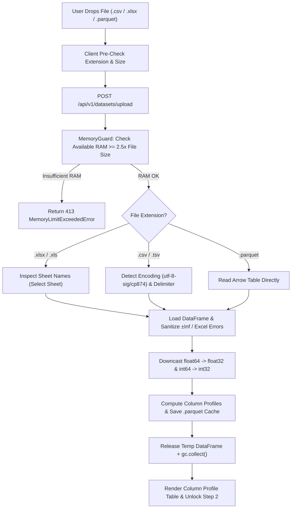

# Phase 02: Dataset Domain — CSV/XLSX/Parquet Ingestion, Profiling & `float32` Memory Guard

## 1. วัตถุประสงค์และขอบเขตของเฟส (Objective & Scope)
สร้าง Bounded Context **`domains/dataset/`** และระบบป้องกันหน่วยความจำล้น **`core/memory_guard.py`** สำหรับการอัปโหลด อ่าน ตรวจสอบรหัสอักขระ (Encoding Detection) วิเคราะห์สถิติเชิงลึกของแต่ละคอลัมน์ (Data Profiling) และบีบอัดข้อมูลตัวเลขให้ประหยัด RAM สูงสุดด้วย **`float32` / `int32` Downcasting** ก่อนจัดเก็บลงในรูปแบบ **Apache Parquet / Arrow Memory-Mapped Cache** เพื่อให้ทุกขั้นตอนถัดไปดึงข้อมูลระดับแสนแถวได้ในระดับมิลลิวินาที

### ขอบเขตงานในเฟสนี้ (In-Scope)
- ระบบอัปโหลดและอ่านไฟล์ตารางหลายนามสกุล: `.csv`, `.tsv`, `.xlsx`, `.xls`, และ `.parquet`
- ระบบตรวจจับ Delimiter (`,`, `;`, `\t`, `|`) และ Encoding อัตโนมัติ (`utf-8-sig`, `utf-8`, `cp874`, `tis-620`, `latin1`) รองรับข้อมูลภาษาไทยจาก Excel สมบูรณ์แบบ
- ระบบเลือก Sheet สำหรับไฟล์ Excel ที่มีหลายแผ่นงาน (Multi-sheet Workbook Inspector)
- ระบบ `float32` Memory Guard ลดขนาดหน่วยความจำของ DataFrame ลง 50% ทันทีที่โหลด พร้อมจัดการค่า `inf`, `-inf`, `#DIV/0!`, `#N/A`
- ระบบคำนวณ Column Profile (ชนิดข้อมูล, จำนวนค่าว่าง, เปอร์เซ็นต์ค่าว่าง, จำนวนค่าไม่ซ้ำ, `min`, `max`, `mean`, `std`, `median`, ฮิสโตแกรม 10 bins และตัวอย่างข้อมูล 5 แถวแรก)
- หน้าจอ UI สำหรับอัปโหลดไฟล์, เลือก Sheet, แสดงผล Memory Savings Banner, และตารางสำรวจโครงสร้างคอลัมน์ (Schema & Distribution Inspector)

---

## 2. UI Feature List อย่างละเอียด (Detailed UI Feature List)

### 2.1 Drag-and-Drop Dataset Ingestion Zone (`DatasetDropzone.tsx`)
- **Interactive Drop Area**:
  - รองรับการลากไฟล์มาวางหรือคลิกเพื่อเปิด File Dialog (จำกัดนามสกุล `.csv, .tsv, .xlsx, .xls, .parquet`)
  - แสดงขนาดไฟล์สูงสุดที่อนุญาต (เช่น `Max File Size: 1,024 MB`) และปริมาณ RAM ที่ว่างอยู่ในปัจจุบัน
- **Sample Dataset Quick-Loader Bar**:
  - ปุ่มลัดโหลดชุดข้อมูลตัวอย่างในเครื่องทันทีโดยไม่ต้องหาไฟล์เอง (เช่น `Load Sample: House Prices (Regression)` หรือ `Load Sample: Iris / Customer Churn`)
- **Excel Sheet Selector Modal / Dropdown (`SheetSelectorBar.tsx`)**:
  - แสดงขึ้นอัตโนมัติเมื่ออัปโหลดไฟล์ `.xlsx` ที่มีมากกว่า 1 Sheet ให้ผู้ใช้เลือก Sheet ที่ต้องการพร้อมแสดงจำนวนแถวคร่าวๆ ของแต่ละ Sheet

### 2.2 Memory Guard & Ingestion Telemetry Card (`MemorySavingsBanner.tsx`)
- **RAM Optimization Badge**:
  - แสดงผลการบีบอัดหน่วยความจำเปรียบเทียบก่อนและหลังทำ `float32` Downcast เช่น:
    `Original RAM: 128.4 MB -> Optimized float32 RAM: 64.2 MB (Saved 50.0% / -64.2 MB)`
- **Encoding & Format Badges**:
  - แสดงป้ายกำกับ `Encoding: UTF-8-SIG` (หรือ `CP874 Thai`), `Delimiter: Comma (,)`, `Storage: Arrow Parquet Cache`
- **Sanitization Alert Badge**:
  - แจ้งเตือนหากระบบพบและทำความสะอาดค่าผิดปกติอัตโนมัติ เช่น `Sanitized 14 Infinity/#DIV/0! values -> NaN`

### 2.3 Column Profile & Schema Inspector Table (`ColumnProfileTable.tsx`)
- **Search & Filter Bar**:
  - ช่องค้นหาชื่อคอลัมน์ (`Search column name...`) และปุ่มกรองตามชนิดข้อมูล (`All`, `Numeric (float32/int32)`, `Categorical`, `Boolean`, `Datetime`)
- **Column Detail Rows**:
  - แสดงลำดับคอลัมน์ (`#`), ชื่อคอลัมน์, ป้ายชนิดข้อมูล (`DType Badge`), หลอดแสดงสัดส่วนค่าว่าง (`Null % Bar`), จำนวนค่าไม่ซ้ำ (`Unique Count`), ค่าสถิติ (`Min`, `Max`, `Mean ± SD`), กราฟแท่งจิ๋วแสดงการกระจายตัว (`Mini Sparkline Histogram 10 Bins`), และตัวอย่างข้อมูล (`Sample Values`)
- **Preview Sample Data Drawer (`DatasetSamplePreview.tsx`)**:
  - ตารางแสดงข้อมูลจริง 10 แถวแรก (`Head 10 Rows`) เพื่อตรวจสอบความถูกต้องของภาษาไทยและทศนิยม
- **Navigation CTA**:
  - ปุ่ม `Proceed to Step 2: Load ML Model ->` (ปลดล็อกทันทีเมื่อโหลด Dataset สำเร็จและมีอย่างน้อย 1 คอลัมน์ตัวเลข)

### 2.4 States & Keyboard Shortcuts
- **Loading Skeleton**: แสดง Progress ขั้นตอนย่อย (`1. Uploading Stream` -> `2. Detecting Encoding` -> `3. Downcasting to float32` -> `4. Computing Column Profiles`)
- **Error State**: แสดงกล่องข้อความสีแดงพร้อมคำแนะนำเมื่อไฟล์เสีย, ไฟล์ว่างเปล่า (0 แถว), หรือขนาดเกิน RAM Budget
- **Keyboard Shortcuts**:
  - `Ctrl + O`: เปิดหน้าต่างเลือกไฟล์ Dataset
  - `Ctrl + F`: โฟกัสช่องค้นหาชื่อคอลัมน์ในตาราง Schema Inspector
  - `Enter`: ไปยังขั้นตอนที่ 2 (เมื่อโหลด Dataset เสร็จสมบูรณ์แล้ว)

---

## 3. UX Flow & User Journey (Step-by-Step UX Flow & ASCII Wireframe)

### 3.1 ลำดับการทำงาน (Step-by-Step User Journey)
1. **การเลือกไฟล์ (File Selection)**: ผู้ใช้ลากไฟล์ `thai_housing_data.csv` (ขนาด 85 MB) ลงในกรอบ Dropzone
2. **การตรวจสอบเบื้องต้นฝั่ง Client (Client Pre-flight Check)**: ตรวจสอบนามสกุลไฟล์และขนาดไฟล์เทียบกับ `system.health.memory.system_available_mb`
3. **การสตรีมและประมวลผลฝั่ง Backend (Chunked Upload & Memory Guard)**:
   - Backend รับไฟล์แบบ Stream ลงไฟล์ชั่วคราว ตรวจวัด RAM ด้วย `MemoryGuard.verify_ingestion_budget(file_size_bytes)`
   - ตรวจจับ Encoding จาก 64 KB แรก (ตรวจพบ `cp874` หรือ `utf-8-sig`) และตรวจจับตัวคั่นหลัก
   - อ่านข้อมูลและแปลงคอลัมน์ `float64` -> `float32`, แทนที่ `±inf` ด้วย `np.nan`, คำนวณสถิติรายคอลัมน์ และบันทึกเป็น `.cache/datasets/{dataset_id}.parquet`
   - ลบตัวแปร DataFrame ชั่วคราวออกจาก RAM และเรียก `gc.collect()`
4. **การแสดงผลลัพธ์ (Profile Visualization)**: Frontend แสดงการ์ดสรุปการประหยัด RAM, ตาราง Column Profiles พร้อม Mini Histogram และปลดล็อกปุ่มไปต่อยัง Step 2

### 3.2 ASCII Wireframe: Step 1 Dataset Ingestion & Profiling Studio
```text
+--------------------------------------------------------------------------------------------------+
| STEP 1: DATASET INGESTION & PROFILING                           [Load Sample: House Prices (.csv)]|
+--------------------------------------------------------------------------------------------------+
| +----------------------------------------------+ +---------------------------------------------+ |
| |  Drop CSV / XLSX / Parquet file here         | | FILE: thai_housing_data.csv (125,000 rows)  | |
| |  or [ Browse Local Files (Ctrl+O) ]          | | ENC : UTF-8-SIG | DELIM: Comma (,) | 12 Cols| |
| |  Supported: .csv, .tsv, .xlsx, .parquet      | | RAM : 11.4 MB -> 5.7 MB (float32 Saved 50%) | |
| +----------------------------------------------+ | WARN: 8 Infinity values sanitized to NaN    | |
|                                                  +---------------------------------------------+ |
| COLUMN SCHEMA & STATISTICAL PROFILE ([Search columns...      ] [All(12)] [Numeric(9)] [Cat(3)])  |
| +---+------------------+------------+----------+-------------+------------------+--------------+ |
| | # | Column Name      | Type       | Null (%) | Min .. Max  | Mean ± SD        | Distribution | |
| +---+------------------+------------+----------+-------------+------------------+--------------+ |
| | 0 | area_sqm         | float32    | 0 (0.0%) | 22.0..450.0 | 84.5 ± 32.1      | ▂▄▇█▆▃▂▁▁▁   | |
| | 1 | bedrooms         | int32      | 12(0.01%)| 1 .. 6      | 2.8 ± 0.9        | ▃█▇▄▂▁       | |
| | 2 | distance_bts_km  | float32    | 45(0.03%)| 0.1 .. 25.4 | 4.2 ± 3.8        | █▆▄▃▂▁▁▁     | |
| | 3 | district_name    | categorical| 0 (0.0%) | 50 unique   | Top: "Chatuchak" | [Text Col]   | |
| | 4 | selling_price    | float32    | 0 (0.0%) | 1.2M..45.0M | 5.4M ± 3.1M      | ▃█▆▄▂▂▁▁     | |
| +---+------------------+------------+----------+-------------+------------------+--------------+ |
| [ v Show Raw Sample Rows (First 10 Rows) ]                    [ Proceed to Step 2: Model -> ]   |
+--------------------------------------------------------------------------------------------------+
```

### 3.3 State Transition Diagram (Mermaid Flowchart)


---

## 4. สถาปัตยกรรม DDD แยกรายชั้นพร้อมชื่อไฟล์และ Class/Method Signatures (DDD Architecture & Code Blueprint)

### 4.1 โครงสร้างไฟล์ในเฟสที่ 2 (Directory Structure)
```text
backend/app/
├── core/
│   └── memory_guard.py
├── domains/
│   └── dataset/
│       ├── entities.py
│       ├── value_objects.py
│       ├── services.py
│       └── repository.py
├── application/
│   └── dataset_use_case.py
├── infrastructure/
│   └── storage/
│       ├── tabular_reader.py
│       └── parquet_dataset_repository.py
└── presentation/
    └── endpoints/
        └── dataset_endpoints.py
```

### 4.2 Backend Core Memory Guard (`backend/app/core/memory_guard.py`)
```python
# backend/app/core/memory_guard.py
import gc
import numpy as np
import pandas as pd
import psutil
from app.core.config import settings
from app.core.exceptions import MemoryLimitExceededError

class MemoryGuard:
    @staticmethod
    def assert_can_ingest_file(file_size_bytes: int, multiplier: float = 2.5) -> None:
        estimated_ram_mb = (file_size_bytes * multiplier) / (1024 * 1024)
        vm = psutil.virtual_memory()
        available_mb = vm.available / (1024 * 1024)
        proc_mb = psutil.Process().memory_info().rss / (1024 * 1024)
        budget_remaining_mb = min(
            available_mb - settings.MIN_SYSTEM_FREE_RAM_MB,
            settings.MAX_PROCESS_RAM_MB - proc_mb,
        )
        if estimated_ram_mb > budget_remaining_mb:
            gc.collect()
            if estimated_ram_mb > budget_remaining_mb:
                raise MemoryLimitExceededError(required_mb=estimated_ram_mb, available_mb=max(0.0, budget_remaining_mb))

    @staticmethod
    def downcast_dataframe(df: pd.DataFrame) -> tuple[pd.DataFrame, float, float, int]:
        """แปลง float64 -> float32, int64 -> int32 และล้างค่า ±inf ให้เป็น NaN"""
        orig_bytes = float(df.memory_usage(deep=True).sum())
        inf_sanitized_count = 0

        for col in df.columns:
            col_dtype = df[col].dtype
            if pd.api.types.is_float_dtype(col_dtype):
                inf_mask = np.isinf(df[col].to_numpy(na_value=0.0))
                inf_sanitized_count += int(inf_mask.sum())
                if inf_mask.any():
                    df[col] = df[col].replace([np.inf, -np.inf], np.nan)
                df[col] = pd.to_numeric(df[col], downcast="float")
            elif pd.api.types.is_integer_dtype(col_dtype):
                df[col] = pd.to_numeric(df[col], downcast="integer")

        opt_bytes = float(df.memory_usage(deep=True).sum())
        return df, orig_bytes / (1024**2), opt_bytes / (1024**2), inf_sanitized_count
```

### 4.3 Domain Entities, Value Objects & Services (`backend/app/domains/dataset/`)
```python
# backend/app/domains/dataset/value_objects.py
from typing import Literal, Any
from pydantic import BaseModel, Field

ColumnLogicalType = Literal["numeric", "categorical", "boolean", "datetime"]

class ColumnProfile(BaseModel):
    index: int
    name: str
    logical_type: ColumnLogicalType
    storage_dtype: str
    null_count: int
    null_percentage: float
    unique_count: int
    min_value: float | None = None
    max_value: float | None = None
    mean_value: float | None = None
    std_value: float | None = None
    median_value: float | None = None
    histogram_bins: list[float] = Field(default_factory=list)
    histogram_counts: list[int] = Field(default_factory=list)
    sample_values: list[Any] = Field(default_factory=list)
```

```python
# backend/app/domains/dataset/entities.py
from pathlib import Path
from pydantic import BaseModel
from app.domains.dataset.value_objects import ColumnProfile

class DatasetEntity(BaseModel):
    dataset_id: str
    filename: str
    file_format: str
    detected_encoding: str
    detected_delimiter: str | None
    selected_sheet: str | None
    available_sheets: list[str]
    row_count: int
    column_count: int
    original_ram_mb: float
    optimized_ram_mb: float
    inf_sanitized_count: int
    columns: list[ColumnProfile]
    parquet_cache_path: Path
    sample_rows: list[dict[str, Any]]
```

### 4.4 Presentation REST API Layer (`backend/app/presentation/endpoints/dataset_endpoints.py`)
- **`POST /api/v1/datasets/upload`** (`multipart/form-data`: `file`, `sheet_name: Optional[str]`)
  - **Response `200 OK` Schema**:
    ```json
    {
      "dataset_id": "ds_8f92a1c4",
      "filename": "thai_housing_data.csv",
      "file_format": "csv",
      "detected_encoding": "utf-8-sig",
      "detected_delimiter": ",",
      "selected_sheet": null,
      "available_sheets": [],
      "row_count": 125000,
      "column_count": 12,
      "original_ram_mb": 11.44,
      "optimized_ram_mb": 5.72,
      "inf_sanitized_count": 8,
      "columns": [
        {
          "index": 0,
          "name": "area_sqm",
          "logical_type": "numeric",
          "storage_dtype": "float32",
          "null_count": 0,
          "null_percentage": 0.0,
          "unique_count": 840,
          "min_value": 22.0,
          "max_value": 450.0,
          "mean_value": 84.5,
          "std_value": 32.1,
          "median_value": 78.0,
          "histogram_bins": [22.0, 64.8, 107.6, 150.4, 193.2, 236.0, 278.8, 321.6, 364.4, 407.2, 450.0],
          "histogram_counts": [12000, 45000, 38000, 18000, 7000, 3000, 1200, 500, 200, 100],
          "sample_values": [55.0, 82.5, 120.0, 46.0, 95.0]
        }
      ],
      "sample_rows": [{"area_sqm": 55.0, "selling_price": 3250000.0}]
    }
    ```
- **`POST /api/v1/datasets/load-sample/{sample_name}`**: โหลดชุดข้อมูลตัวอย่างที่มีอยู่ในเครื่องโดยตรง

### 4.5 Frontend Domain Architecture (`frontend/src/domains/dataset/`)
```typescript
// frontend/src/domains/dataset/store/useDatasetStore.ts
import { create } from 'zustand';

export interface ColumnProfile {
  index: number;
  name: string;
  logical_type: 'numeric' | 'categorical' | 'boolean' | 'datetime';
  storage_dtype: string;
  null_count: number;
  null_percentage: number;
  unique_count: number;
  min_value: number | null;
  max_value: number | null;
  mean_value: number | null;
  std_value: number | null;
  median_value: number | null;
  histogram_bins: number[];
  histogram_counts: number[];
  sample_values: Array<string | number | boolean | null>;
}

export interface DatasetProfileResponse {
  dataset_id: string;
  filename: string;
  row_count: number;
  column_count: number;
  original_ram_mb: number;
  optimized_ram_mb: number;
  inf_sanitized_count: number;
  available_sheets: string[];
  selected_sheet: string | null;
  columns: ColumnProfile[];
  sample_rows: Record<string, unknown>[];
}

interface DatasetStoreState {
  currentDataset: DatasetProfileResponse | null;
  isUploading: boolean;
  uploadError: string | null;
  searchQuery: string;
  typeFilter: 'all' | 'numeric' | 'categorical' | 'boolean' | 'datetime';
  uploadDataset: (file: File, sheetName?: string) => Promise<void>;
  loadSampleDataset: (sampleName: string) => Promise<void>;
  setSearchQuery: (q: string) => void;
  setTypeFilter: (t: DatasetStoreState['typeFilter']) => void;
}
```

---

## 5. แผนการตรวจสอบหน่วยความจำและเพิ่มประสิทธิภาพทรัพยากรเครื่อง (Memory Check Plan & Process Resource Optimization)

### 5.1 Backend Memory Check & Parquet Cache Eviction
- **Zero Persistent Full-DataFrame in Python Dict**: ห้ามเก็บ `pd.DataFrame` ทั้งก้อนค้างไว้ในหน่วยความจำหลักตลอดอายุเซิร์ฟเวอร์ เมื่อทำ `downcast_dataframe()` และคำนวณ `ColumnProfile` เสร็จ ให้บันทึกลงไฟล์ `.cache/datasets/{dataset_id}.parquet` ด้วย `pyarrow` (`compression='snappy'`) แล้วสั่ง `del df` ตามด้วย `gc.collect()` ทันที
- **Single-Slot Active Memory-Mapped Cache**: เก็บไฟล์ `.parquet` ในโฟลเดอร์ `.cache/datasets/` สูงสุดไม่เกิน 3 ชุดข้อมูลล่าสุด (LRU Eviction) เมื่อเปิดอ่านในเฟสถัดไปจะใช้ `pyarrow.parquet.read_table(..., memory_map=True)` ซึ่งใช้ OS Page Cache โดยไม่กิน Heap RAM ของ Python

### 5.2 Frontend & WebGL Memory Optimization
- **Strict Payload Bounding**: API `/api/v1/datasets/upload` จะส่งกลับเฉพาะ Metadata ของคอลัมน์และ `sample_rows` เพียง 10 แถวแรกเท่านั้น (ขนาด JSON `< 50 KB` แม้ไฟล์จริงจะมี 500,000 แถว) ป้องกันไม่ให้เบราว์เซอร์ต้องถือ JSON ก้อนยักษ์ไว้ใน JS Heap
- **Pure SVG Sparkline Histograms**: วาดกราฟแท่ง `Mini Sparkline Histogram` ในแต่ละแถวด้วย `<svg>` น้ำหนักเบาเพียง 10 `<rect>` ต่อคอลัมน์ ไม่โหลดไลบรารี Chart ขนาดใหญ่ที่สร้าง Canvas/DOM นับพันโหนด

### 5.3 Process & CPU/GPU Resource Optimization
- **Fast Sampled Encoding & Delimiter Detection**: อ่านเฉพาะ `65,536 bytes (64 KB)` แรกของไฟล์ `.csv` มาเข้า `charset_normalizer` และ `csv.Sniffer()` แทนการสแกนไฟล์ขนาดหลายร้อย MB ทั้งไฟล์ ลดเวลาตรวจจับจากหลายวินาทีเหลือ `< 5 ms`
- **ThreadPool Offloading**: รันงานอ่านไฟล์และแปลง Parquet ภายใต้ `fastapi.concurrency.run_in_threadpool` เพื่อไม่ให้บล็อก Async Event Loop ของ FastAPI

---

## 6. ไลบรารีที่ใช้และการตั้งค่า Offline 100% (Libraries & Offline Configuration)
- **Backend**:
  - `pandas>=2.2.0`, `numpy>=1.26.0`, `pyarrow>=17.0.0` (จัดการ Parquet และ Memory-map), `openpyxl>=3.1.5` (อ่าน `.xlsx`), `charset-normalizer>=3.3.0` (ตรวจจับ Encoding ภาษาไทย/สากล)
- **Frontend**:
  - Native HTML5 Drag-and-Drop API (ไม่พึ่งพา External Dropzone ที่ซับซ้อน), `lucide-react`, `zustand`

---

## 7. ตารางข้อควรระวังและ Edge Cases (Caveats & Edge Case Matrix)

| ลำดับ | เคสปัญหา (Edge Case) | สาเหตุทางเทคนิค (Root Cause) | วิธีป้องกันและแก้ไขแบบเจาะจง (Mitigation Strategy) |
| :--- | :--- | :--- | :--- |
| **1** | **ภาษาไทยกลายเป็นภาษาต่างดาว (Mojibake)** | ไฟล์ CSV ที่ Save จาก Excel บน Windows มักใช้ `cp874` (TIS-620) หรือติด `utf-8-sig` (BOM) | ทดสอบอ่าน Header ด้วยลำดับ Fallback: `['utf-8-sig', 'utf-8', 'cp874', 'tis-620', 'latin1']` จนกว่าจะ Decode ผ่านโดยไม่มี `UnicodeDecodeError` |
| **2** | **JSON Serialization พังเพราะค่า `NaN` หรือ `Infinity`** | มาตรฐาน RFC 8259 JSON ไม่รองรับ `NaN`, `Infinity`, `-Infinity` ทำให้ FastAPI โยน `ValueError: Out of range float values` | แปลง `±inf` ใน DataFrame ให้เป็น `np.nan` ตอนโหลด และแปลง `np.nan` ใน `ColumnProfile` / `sample_rows` ให้เป็น `None` (`null` ใน JSON) เสมอ |
| **3** | **สูตร Excel ติด Error (`#DIV/0!`, `#VALUE!`, `#N/A`)** | ทำให้คอลัมน์ที่ควรจะเป็นตัวเลขถูก Pandas มองเป็นชนิดข้อความ (`object`) ทั้งคอลัมน์ | กำหนด `na_values=['#DIV/0!', '#VALUE!', '#N/A', '#REF!', '#NAME?', 'NULL', 'null', '-', '']` ใน `pd.read_csv` และ `pd.read_excel` |
| **4** | **ตัวเลขที่อยู่ในช่วงเกินขีดจำกัด `float32` (`> 3.4e38`)** | การบังคับ `.astype(np.float32)` ตรงๆ กับตัวเลขขนาดใหญ่มากจะทำให้ค่ากลายเป็น `inf` | ใช้ `pd.to_numeric(col, downcast='float')` หรือเช็กว่า `col.abs().max() < np.finfo(np.float32).max` ก่อนแปลง |
| **5** | **ชื่อคอลัมน์ซ้ำกันหรือมีช่องว่างนำหน้า/ต่อท้าย** | ไฟล์ Excel ที่ผู้ใช้ทำเองมักมีช่องว่าง เช่น `" age "` หรือมีชื่อคอลัมน์ซ้ำกัน | ทำ `.strip()` ชื่อคอลัมน์ทั้งหมดอัตโนมัติ และหากมีชื่อซ้ำให้เติม Suffix `_1`, `_2` พร้อมแจ้งเตือนใน UI |
| **6** | **คอลัมน์ ID (เช่น `customer_id`, `phone_no`) ถูกแปลงเป็น `float32` จนเลขท้ายเพี้ยน** | `float32` มีความละเอียดแม่นยำเพียง 7 หลักนัยสำคัญ (เกิน `16,777,216` จะปัดเศษ) | คอลัมน์จำนวนเต็ม (`int64`) ให้ใช้ `downcast='integer'` (เป็น `int8/int16/int32` ตามช่วงค่าจริง) ห้ามแปลงจำนวนเต็มขนาดใหญ่เป็น `float32` ตอนเก็บลง Parquet |
| **7** | **ไฟล์ว่างเปล่าหรือมีแต่บรรทัด Header (0 แถวข้อมูล)** | ผู้ใช้อัปโหลดไฟล์เทมเพลตที่ยังไม่มีข้อมูล | ตรวจสอบ `len(df) == 0` ทันทีหลังอ่านไฟล์ และคืนค่า HTTP 400 `EMPTY_DATASET_ERROR` พร้อมคำอธิบายชัดเจน |

---

## 8. เกณฑ์การตรวจรับงาน (Definition of Done Checklist)
- [ ] อัปโหลดไฟล์ `.csv` (ทั้ง `utf-8`, `utf-8-sig`, และ `cp874` ภาษาไทย), `.xlsx` (เลือก Sheet ได้), และ `.parquet` ได้ครบถ้วน
- [ ] `MemoryGuard.downcast_dataframe()` บีบอัดคอลัมน์ทศนิยมเป็น `float32` และแสดงเปอร์เซ็นต์ RAM ที่ประหยัดได้บน `MemorySavingsBanner`
- [ ] ค่า `inf`, `-inf`, และ `#DIV/0!` ถูกแปลงเป็นค่าว่างอย่างปลอดภัย และไม่ทำให้ JSON API พัง
- [ ] ตาราง `ColumnProfileTable` แสดงชื่อคอลัมน์, ชนิดข้อมูล, `% Null`, `Min/Max/Mean/SD`, และกราฟ `Mini Sparkline Histogram` ครบทุกคอลัมน์
- [ ] ข้อมูลที่ผ่านการประมวลผลถูกจัดเก็บเป็นไฟล์ `.parquet` ใน `.cache/datasets/` และคืน RAM ของ DataFrame ชั่วคราวทันทีหลังจบคำขอ
