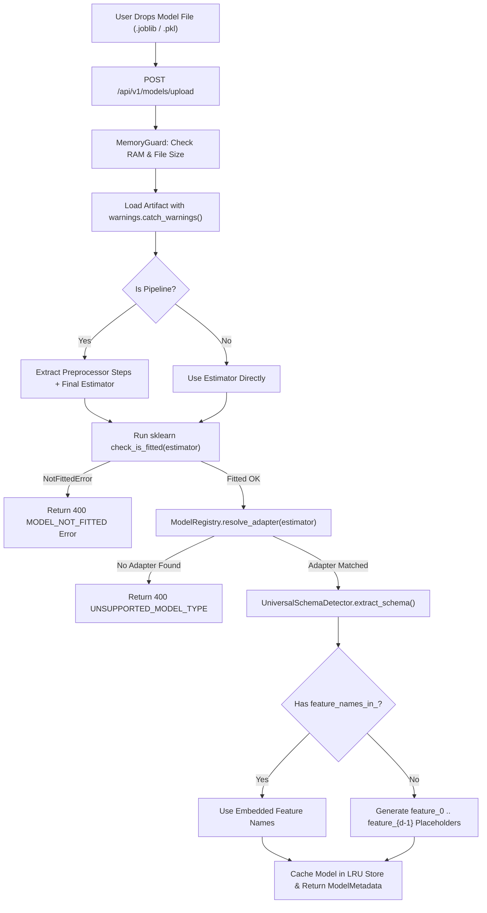

# Phase 03: Model Engine Core — Abstract Adapter Contract, Plugin Registry & Schema Detector

## 1. วัตถุประสงค์และขอบเขตของเฟส (Objective & Scope)
ออกแบบและพัฒนาหัวใจหลักของ Bounded Context **`domains/model_engine/`** ด้วยสถาปัตยกรรม **Plugin Registry + Strategy Adapter Pattern** ที่ยืดหยุ่นตามหลักการ **Open-Closed Principle (OCP)** เพื่อให้ระบบสามารถรองรับโมเดลเริ่มต้น (`LinearRegression`) ในเฟสที่ 4 และขยายรองรับโมเดลทั้ง **20+ อัลกอริทึม** (Linear, Tree, Ensemble, Boosting, Distance, Kernel, Probabilistic, Neural Network, Clustering, Anomaly Detection) ในเฟสถัดๆ ไปได้โดยไม่ต้องแก้ไขโค้ดแกนกลาง พร้อมระบบ **Universal Schema Detector** สำหรับสกัดโครงสร้าง Input Features, ชนิดงาน (`TaskType`), และรูปแบบการแสดงผล 3 มิติ (`Visual3DType`) โดยอัตโนมัติ

### ขอบเขตงานในเฟสนี้ (In-Scope)
- การกำหนด Abstract Base Class `BaseModelAdapter` ที่เป็นสัญญามาตรฐาน (Contract) สำหรับทุกโมเดลในระบบ
- การสร้าง `ModelRegistry` พร้อมระบบ Decorator `@ModelRegistry.register(...)` และการค้นหา Adapter อัตโนมัติจากอ็อบเจกต์โมเดลที่อัปโหลด
- การสร้าง `UniversalSchemaDetector` ที่อ่าน `feature_names_in_`, `n_features_in_`, `classes_`, หรือแกะจำนวนตัวแปรจาก `coef_ / estimators_` พร้อมสร้างชื่อ Placeholder (`feature_0`, `feature_1`, ...) อัตโนมัติเมื่อโมเดลถูกเทรนด้วย NumPy Array เปล่า
- การตรวจจับ Scikit-Learn Pipeline (เช่น `StandardScaler -> LinearRegression`) เพื่อแยกขั้นตอน Preprocessing ออกจากตัว Estimator หลัก
- การดักจับ `InconsistentVersionWarning` และ `NotFittedError` อย่างปลอดภัยพร้อมรายงานผลบนหน้าจอ UI
- การสร้างหน้าจอ UI Step 2 (`Model Upload & Architecture Inspector`) สำหรับอัปโหลดไฟล์ `.joblib` / `.pkl` และตรวจสอบ Schema ของโมเดล

---

## 2. UI Feature List อย่างละเอียด (Detailed UI Feature List)

### 2.1 Model Artifact Upload Zone (`ModelUploadDropzone.tsx`)
- **Drag & Drop Model Box**:
  - รองรับการลากไฟล์โมเดล `.joblib`, `.pkl`, `.pickle` (และเตรียมพร้อมสำหรับ `.onnx`, `.json`, `.cbm` ในอนาคต)
  - ปุ่ม `Load Sample Model (House Price Linear Regression)` สำหรับทดลองใช้งานได้ทันทีใน 1 คลิก
- **Security & Integrity Banner**:
  - ป้ายเตือนมาตรฐานความปลอดภัย Local Pickle Loading พร้อมแสดงแฮช `SHA-256` ของไฟล์โมเดลที่โหลดสำเร็จ

### 2.2 Model Architecture & Metadata Card (`ModelArchitectureCard.tsx`)
- **Algorithm & Family Badges**:
  - ป้ายแสดงชื่ออัลกอริทึม (`LinearRegression`), ตระกูลโมเดล (`Family: Linear Models`), และไลบรารีต้นทาง (`scikit-learn v1.5.2`)
- **Task Type & 3D Metaphor Badges**:
  - ป้ายระบุประเภทงาน: `Regression` (สีฟ้า Cyan), `Binary Classification` (สีม่วง Indigo), `Multiclass Classification` (สีชมพู Fuchsia), `Clustering / Unsupervised` (สีส้ม Amber)
  - ป้ายระบุรูปแบบการจำลอง 3 มิติ: เช่น `3D Metaphor: Tilted Hyperplane & Residual Drops`
- **Pipeline Inspector Strip (แสดงเมื่อโมเดลเป็น `sklearn.pipeline.Pipeline`)**:
  - แผนภาพลำดับขั้นแนวนอน เช่น `[Step 1: StandardScaler] -> [Step 2: SimpleImputer] -> [Final Estimator: LinearRegression]`
- **Version Compatibility Warning Box**:
  - กล่องแจ้งเตือนสีเหลือง Amber หากตรวจพบว่าโมเดลถูกบันทึกมาจาก `scikit-learn` คนละเวอร์ชันกับที่รันอยู่ใน Backend พร้อมระบุเวอร์ชันต้นทางและเวอร์ชันปัจจุบัน

### 2.3 Expected Feature Schema Inspector (`ModelFeatureSchemaTable.tsx`)
- **Feature Requirements List**:
  - ตารางแสดงรายการตัวแปรที่โมเดลต้องการเรียงตามลำดับ `index (0 .. d-1)` อย่างเคร่งครัด:
    - `Index (#)`: ลำดับที่โมเดลใช้คูณเมทริกซ์
    - `Feature Name`: ชื่อตัวแปร (หากสร้างอัตโนมัติจะมีป้าย `Auto-Generated Placeholder` สีเหลืองกำกับ)
    - `Expected DType`: `float32`
    - `Learned Parameter Preview`: ค่าสัมประสิทธิ์ (`Weight / Coef`) หรือค่าความสำคัญ (`Feature Importance`) เบื้องต้นของตัวแปรนั้น
- **Hyperparameters Accordion (`HyperparameterAccordion.tsx`)**:
  - ลิ้นชักพับเก็บได้แสดงผลลัพธ์จาก `model.get_params()` ในรูปแบบตารางคู่ Key-Value
- **Navigation CTA**:
  - ปุ่ม `<- Back to Step 1 (Dataset)` และปุ่ม `Proceed to Step 3: Column Mapping ->`

### 2.4 States & Keyboard Shortcuts
- **Loading Skeleton**: แสดงแอนิเมชันขณะ Deserializing ไฟล์โมเดลและตรวจสอบ `check_is_fitted()`
- **Error State (`NotFittedError` / `UnsupportedModelError`)**: แสดงการ์ดสีแดงอธิบายสาเหตุชัดเจน เช่น โมเดลยังไม่ได้สั่ง `.fit(X, y)` หรือเป็นคลาสที่ไม่อยู่ในรายการรองรับ พร้อมรายชื่อโมเดลที่ระบบรองรับทั้งหมด
- **Keyboard Shortcuts**:
  - `Ctrl + M`: เปิดหน้าต่างเลือกไฟล์โมเดล
  - `Alt + H`: เปิด/ปิดลิ้นชักดูค่า Hyperparameters

---

## 3. UX Flow & User Journey (Step-by-Step UX Flow & ASCII Wireframe)

### 3.1 ลำดับการทำงาน (Step-by-Step User Journey)
1. **การอัปโหลดไฟล์โมเดล**: ผู้ใช้ลากไฟล์ `house_price_ols.joblib` ลงในหน้า Step 2 หรือกดปุ่มโหลด Sample Model
2. **การตรวจสอบและแกะรอยโครงสร้าง (Backend Deserialization & Introspection)**:
   - Backend ตรวจสอบขนาดไฟล์และ RAM Budget ด้วย `MemoryGuard`
   - โหลดอ็อบเจกต์ด้วย `joblib.load()` ภายใต้บริบท `warnings.catch_warnings(record=True)` เพื่อดักจับ `InconsistentVersionWarning`
   - ตรวจสอบว่าเป็น `Pipeline` หรือไม่ หากใช่ให้แยก `preprocessor_steps` และดึง `final_estimator` ออกมาตรวจสอบ `check_is_fitted()`
   - ค้นหา Adapter ที่ตรงกันจาก `ModelRegistry.resolve_adapter(estimator)`
   - เรียก `adapter.extract_schema(model_obj)` เพื่อสกัดรายการ `FeatureRequirement`, `TaskType`, `Visual3DType`, และค่าพารามิเตอร์ภายใน
3. **การแสดงผลบนหน้าจอ**: Frontend แสดงป้ายชื่อโมเดล, โครงสร้าง Pipeline, คำเตือนเวอร์ชัน (ถ้ามี), และตาราง Input Features ที่โมเดลต้องการเรียงตาม Index พร้อมปลดล็อก Step 3

### 3.2 ASCII Wireframe: Step 2 Model Upload & Schema Introspection
```text
+--------------------------------------------------------------------------------------------------+
| STEP 2: MODEL ENGINE & SCHEMA INTROSPECTION                  [Load Sample: House Price (.joblib)]|
+--------------------------------------------------------------------------------------------------+
| +----------------------------------------------+ +---------------------------------------------+ |
| |  Drop .joblib / .pkl model file here         | | MODEL : LinearRegression (Ordinary Least Sq)| |
| |  or [ Browse Model Artifact (Ctrl+M) ]       | | FAMILY: Linear Models | TASK: Regression    | |
| |  SHA-256: 4a8b...91e2 (Verified Local File)  | | 3D VIZ: Flat Tilted Hyperplane Surface      | |
| +----------------------------------------------+ | STATUS: ● Fitted & Ready (3 Input Features) | |
|                                                  +---------------------------------------------+ |
| [!] WARNING: Model was trained on scikit-learn 1.4.2, running on 1.5.2 (Compatible Mode Active)  |
|                                                                                                  |
| EXPECTED INPUT FEATURE SCHEMA (Strict Matrix Column Order: 0 -> 2)                               |
| +-------+------------------------+----------------+-----------------------+--------------------+ |
| | Index | Expected Feature Name  | Name Source    | Required DType        | Learned Coef / Imp | |
| +-------+------------------------+----------------+-----------------------+--------------------+ |
| |   0   | area_sqm               | Embedded Name  | float32 (Continuous)  | +42,500.00 / unit  | |
| |   1   | bedrooms               | Embedded Name  | float32 (Numeric)     | +350,000.00 / unit | |
| |   2   | distance_bts_km        | Embedded Name  | float32 (Continuous)  | -185,000.00 / unit | |
| +-------+------------------------+----------------+-----------------------+--------------------+ |
| [ > Inspect Model Hyperparameters (fit_intercept=True, copy_X=True, n_jobs=None) ]               |
| [ <- Back to Step 1 ]                                    [ Proceed to Step 3: Column Mapping -> ]|
+--------------------------------------------------------------------------------------------------+
```

### 3.3 State Transition Diagram (Mermaid Flowchart)


---

## 4. สถาปัตยกรรม DDD แยกรายชั้นพร้อมชื่อไฟล์และ Class/Method Signatures (DDD Architecture & Code Blueprint)

### 4.1 โครงสร้างไฟล์ในเฟสที่ 3 (Directory Structure)
```text
backend/app/
├── domains/
│   └── model_engine/
│       ├── entities.py
│       ├── value_objects.py
│       ├── base_adapter.py
│       ├── registry.py
│       ├── schema_detector.py
│       └── repository.py
├── application/
│   └── model_use_case.py
├── infrastructure/
│   └── ml_loaders/
│       └── joblib_model_repository.py
└── presentation/
    └── endpoints/
        └── model_endpoints.py
```

### 4.2 Domain Value Objects (`backend/app/domains/model_engine/value_objects.py`)
```python
# backend/app/domains/model_engine/value_objects.py
from enum import Enum
from typing import Any
from pydantic import BaseModel, Field

class TaskType(str, Enum):
    REGRESSION = "regression"
    BINARY_CLASSIFICATION = "binary_classification"
    MULTICLASS_CLASSIFICATION = "multiclass_classification"
    CLUSTERING = "clustering"
    ANOMALY_DETECTION = "anomaly_detection"
    DIMENSIONALITY_REDUCTION = "dimensionality_reduction"

class Visual3DType(str, Enum):
    FLAT_HYPERPLANE = "flat_hyperplane"
    PROBABILITY_SIGMOID_SURFACE = "probability_sigmoid_surface"
    STEPPED_AXIS_BLOCKS = "stepped_axis_blocks"
    ENSEMBLE_SMOOTH_TERRAIN = "ensemble_smooth_terrain"
    VORONOI_KNN_PROXIMITY = "voronoi_knn_proximity"
    SVM_MARGIN_TUBE = "svm_margin_tube"
    GAUSSIAN_ELLIPSOID_DOMES = "gaussian_ellipsoid_domes"
    NEURAL_MORPHING_MANIFOLD = "neural_morphing_manifold"
    CLUSTER_CENTROID_VORONOI = "cluster_centroid_voronoi"
    ANOMALY_ISOLATION_DEPTH = "anomaly_isolation_depth"

class FeatureRequirement(BaseModel):
    index: int
    name: str
    expected_dtype: str = "float32"
    is_auto_generated_name: bool = False
    learned_weight_or_importance: float | None = None

class GridSpec3D(BaseModel):
    axis_x_feature_index: int
    axis_y_feature_index: int
    x_min: float
    x_max: float
    y_min: float
    y_max: float
    resolution: int = 50
    fixed_feature_medians: dict[int, float] = Field(default_factory=dict)

class PredictionBatchResult(BaseModel):
    predictions: list[float | int | str]
    probabilities: list[list[float]] | None = None
    confidences: list[float] | None = None

class InternalFlowRowTrace(BaseModel):
    row_index: int
    base_value: float
    final_prediction: float | int | str
    feature_contributions: dict[str, float]
    extra_ mechanics: dict[str, Any] = Field(default_factory=dict)

class SurfaceMesh3DData(BaseModel):
    visual_type: Visual3DType
    resolution: int
    x_grid: list[float]
    y_grid: list[float]
    z_values: list[float]
    extra_overlays: dict[str, Any] = Field(default_factory=dict)
```

### 4.3 Abstract Model Adapter & Plugin Registry (`base_adapter.py` & `registry.py`)
```python
# backend/app/domains/model_engine/base_adapter.py
from abc import ABC, abstractmethod
from typing import Any
import numpy as np
from app.domains.model_engine.value_objects import (
    GridSpec3D,
    InternalFlowRowTrace,
    PredictionBatchResult,
    SurfaceMesh3DData,
    TaskType,
    Visual3DType,
    FeatureRequirement,
)

class BaseModelAdapter(ABC):
    algorithm_key: str
    display_name: str
    family_name: str
    task_type: TaskType
    visual_3d_type: Visual3DType

    @classmethod
    @abstractmethod
    def can_handle(cls, estimator: Any, file_ext: str = ".joblib") -> bool:
        """ตรวจสอบว่า Adapter นี้รองรับอ็อบเจกต์โมเดลที่ส่งเข้ามาหรือไม่"""

    @abstractmethod
    def extract_feature_weights(self, estimator: Any, n_features: int) -> list[float | None]:
        """ดึงค่าสัมประสิทธิ์หรือความสำคัญของแต่ละตัวแปรตามลำดับ Index"""

    @abstractmethod
    def predict_batch(self, model_obj: Any, X_float32: np.ndarray) -> PredictionBatchResult:
        """คำนวณผลลัพธ์การทำนายแบบเวกเตอร์ด้วยข้อมูลชนิด float32"""

    @abstractmethod
    def trace_internal_flow(
        self, model_obj: Any, X_float32: np.ndarray, row_indices: list[int], feature_names: list[str]
    ) -> list[InternalFlowRowTrace]:
        """สกัดกลไกการตัดสินใจภายในรายแถว (เช่น w_i * x_i, เส้นทางโหนดของต้นไม้, หรือระยะห่างเพื่อนบ้าน)"""

    @abstractmethod
    def compute_3d_surface(self, model_obj: Any, grid_spec: GridSpec3D, n_features: int) -> SurfaceMesh3DData:
        """คำนวณพิกัดพื้นผิว 3 มิติจากตาราง Grid (resolution x resolution)"""
```

```python
# backend/app/domains/model_engine/registry.py
from typing import Any, Type
from app.core.exceptions import ModelLoadError
from app.domains.model_engine.base_adapter import BaseModelAdapter

class ModelRegistry:
    _adapters: dict[str, Type[BaseModelAdapter]] = {}

    @classmethod
    def register(cls, key: str):
        def decorator(adapter_cls: Type[BaseModelAdapter]) -> Type[BaseModelAdapter]:
            adapter_cls.algorithm_key = key
            cls._adapters[key] = adapter_cls
            return adapter_cls
        return decorator

    @classmethod
    def resolve_adapter(cls, estimator: Any, file_ext: str = ".joblib") -> BaseModelAdapter:
        for adapter_cls in cls._adapters.values():
            if adapter_cls.can_handle(estimator, file_ext):
                return adapter_cls()
        supported = ", ".join(cls._adapters.keys())
        raise ModelLoadError(
            code="UNSUPPORTED_MODEL_TYPE",
            message=f"ไม่รองรับคลาสโมเดล '{type(estimator).__name__}' (รายการที่รองรับ: {supported})",
        )
```

### 4.4 Presentation REST API Layer (`backend/app/presentation/endpoints/model_endpoints.py`)
- **`POST /api/v1/models/upload`** (`multipart/form-data`: `file`)
  - **Response `200 OK` Schema**:
    ```json
    {
      "model_id": "mdl_3c71e80b",
      "filename": "house_price_ols.joblib",
      "sha256_hash": "4a8b9c12...91e2",
      "algorithm_key": "linear_regression",
      "display_name": "Linear Regression (OLS)",
      "family_name": "Linear Models",
      "task_type": "regression",
      "visual_3d_type": "flat_hyperplane",
      "is_pipeline": false,
      "pipeline_steps": [],
      "n_features_in": 3,
      "classes": null,
      "intercept_or_base": 150000.0,
      "features": [
        {
          "index": 0,
          "name": "area_sqm",
          "expected_dtype": "float32",
          "is_auto_generated_name": false,
          "learned_weight_or_importance": 42500.0
        }
      ],
      "hyperparameters": {"fit_intercept": true, "copy_X": true},
      "warnings": []
    }
    ```
- **`GET /api/v1/models/supported`**: คืนค่ารายชื่ออัลกอริทึมและตระกูลโมเดลทั้งหมดที่ลงทะเบียนอยู่ใน `ModelRegistry`

### 4.5 Frontend Domain Store (`frontend/src/domains/model_engine/store/useModelStore.ts`)
```typescript
// frontend/src/domains/model_engine/store/useModelStore.ts
import { create } from 'zustand';

export interface FeatureRequirement {
  index: number;
  name: string;
  expected_dtype: string;
  is_auto_generated_name: boolean;
  learned_weight_or_importance: number | null;
}

export interface ModelMetadataResponse {
  model_id: string;
  filename: string;
  sha256_hash: string;
  algorithm_key: string;
  display_name: string;
  family_name: string;
  task_type: string;
  visual_3d_type: string;
  is_pipeline: boolean;
  pipeline_steps: string[];
  n_features_in: number;
  classes: Array<string | number> | null;
  intercept_or_base: number | null;
  features: FeatureRequirement[];
  hyperparameters: Record<string, unknown>;
  warnings: string[];
}

interface ModelStoreState {
  currentModel: ModelMetadataResponse | null;
  isLoadingModel: boolean;
  modelError: string | null;
  uploadModel: (file: File) => Promise<void>;
  loadSampleModel: (sampleKey: string) => Promise<void>;
}
```

---

## 5. แผนการตรวจสอบหน่วยความจำและเพิ่มประสิทธิภาพทรัพยากรเครื่อง (Memory Check Plan & Process Resource Optimization)

### 5.1 Backend Memory Check & LRU Model Store
- **Memory-Mapped Deserialization (`mmap_mode='r'`)**: เมื่อโหลดไฟล์ `.joblib` ที่มีขนาดใหญ่ (เช่น Random Forest หรือ KNN ที่มี Array ข้อมูลฝึกสอนขนาดใหญ่ฝังอยู่ภายใน) ให้เรียก `joblib.load(file_path, mmap_mode='r')` เพื่อให้ NumPy Arrays ภายในโมเดลถูกแมปเข้ากับไฟล์บนดิสก์โดยไม่คัดลอกซ้ำลงใน Private Heap RAM
- **Bounded LRU Model Cache**: เก็บอ็อบเจกต์โมเดลในหน่วยความจำสูงสุดเพียง `2 โมเดลล่าสุด` (Active Model และ Comparison Model) เมื่อมีการอัปโหลดโมเดลใหม่เกินโควตา ระบบจะสั่ง `del old_model` และเรียก `gc.collect()` ทันที

### 5.2 Frontend & WebGL Memory Optimization
- **Truncated Hyperparameter & Weight Payload**: หากโมเดลมีจำนวนตัวแปรมากหรือมีโครงสร้างภายในขนาดใหญ่ API `/api/v1/models/upload` จะส่งเฉพาะสเกลาร์ (`learned_weight_or_importance`) ต่อ Feature เท่านั้น ห้ามส่งเมทริกซ์น้ำหนักภายในทั้งหมดมาพร้อมกับ Metadata

### 5.3 Process & CPU/GPU Resource Optimization
- **Single-Thread Inference Enforcement (`n_jobs=1`)**: ทันทีที่โหลดโมเดลตระกูล Scikit-learn สำเร็จ หากอ็อบเจกต์มีแอตทริบิวต์ `n_jobs` (เช่น `RandomForest`, `KNN`, `LinearRegression`) ให้ปรับค่าในหน่วยความจำเป็น `estimator.n_jobs = 1` สำหรับการทำนายระดับ Interactive Batch ขนาดเล็ก เพื่อหลีกเลี่ยง Overhead จากการแตก प्रोเซสย่อยของ `loky/multiprocessing` ซึ่งกินเวลานานกว่าการคำนวณจริงบน Windows

---

## 6. ไลบรารีที่ใช้และการตั้งค่า Offline 100% (Libraries & Offline Configuration)
- **Backend**:
  - `scikit-learn>=1.5.0`, `joblib>=1.4.0`, `numpy>=1.26.0`, `pydantic>=2.9.0`
- **Frontend**:
  - React 19, `zustand`, `lucide-react`, Tailwind CSS v4 (Local Bundled)

---

## 7. ตารางข้อควรระวังและ Edge Cases (Caveats & Edge Case Matrix)

| ลำดับ | เคสปัญหา (Edge Case) | สาเหตุทางเทคนิค (Root Cause) | วิธีป้องกันและแก้ไขแบบเจาะจง (Mitigation Strategy) |
| :--- | :--- | :--- | :--- |
| **1** | **เกิด `InconsistentVersionWarning` ตอนโหลดไฟล์ `.pkl` / `.joblib`** | ผู้ใช้เทรนโมเดลจาก Google Colab หรือเครื่องอื่นที่ใช้ `scikit-learn` คนละเวอร์ชันย่อย | ใช้ `warnings.catch_warnings(record=True)` ดักจับ `InconsistentVersionWarning` แปลงเป็นข้อความในฟิลด์ `warnings: list[str]` ส่งไปแสดงแถบสีเหลืองบน UI โดยไม่ให้เกิด Exception |
| **2** | **ผู้ใช้อัปโหลดโมเดลเปล่าที่ยังไม่ได้เทรน (`NotFittedError`)** | ผู้ใช้เผลอรัน `joblib.dump(LinearRegression(), 'model.pkl')` ก่อนสั่ง `.fit(X, y)` | เรียก `sklearn.utils.validation.check_is_fitted(estimator)` ทันทีหลังโหลด หากไม่ผ่านให้โยน `ModelLoadError(code="MODEL_NOT_FITTED")` พร้อมข้อความแนะนำวิธีแก้ไข |
| **3** | **โมเดลไม่มี `feature_names_in_` (เทรนจาก `np.ndarray` ล้วน)** | Scikit-learn จะบันทึก `feature_names_in_` เฉพาะเมื่อเทรนด้วย `pd.DataFrame` เท่านั้น | `UniversalSchemaDetector` อ่านค่า `n_features_in_` (หรือ `coef_.shape[-1]`) แล้วสร้างชื่อ `feature_0`, `feature_1`, ... พร้อมตั้ง `is_auto_generated_name=True` |
| **4** | **โมเดลถูกห่ออยู่ใน `sklearn.pipeline.Pipeline` หรือ `GridSearchCV`** | ผู้ใช้เซฟทั้ง `Pipeline` หรือเซฟอ็อบเจกต์ `GridSearchCV` มาทั้งก้อน | หากเป็น `GridSearchCV` / `RandomizedSearchCV` ให้ดึง `.best_estimator_` ออกมาอัตโนมัติ และหากเป็น `Pipeline` ให้ดึง `pipeline.steps[-1][1]` มาตรวจชนิดโมเดล แต่เวลาทำนายให้รันผ่าน `pipeline` ทั้งก้อน |
| **5** | **ผู้ใช้อัปโหลดไฟล์ `.pkl` ที่ไม่ใช่โมเดล แต่เป็น DataFrame หรือ Dict** | ผู้ใช้เลือกไฟล์ผิดในโฟลเดอร์โปรเจกต์ | ตรวจสอบก่อนว่าอ็อบเจกต์มีเมธอด `.predict` หรือ `.transform` หรือไม่ หากเป็น `pd.DataFrame` หรือ `dict` ให้แจ้งเตือนชัดเจนว่า `"ไฟล์นี้เป็นข้อมูลตาราง ไม่ใช่โมเดล กรุณาอัปโหลดใน Step 1"` |
| **6** | **โมเดลมี `n_jobs=-1` ติดมา ทำให้เครื่องค้างเวลาเรียกทำนายถี่ๆ** | การเรียก `.predict()` รัวๆ จาก Slider แบบ Real-time เมื่อ `n_jobs=-1` จะสั่ง Spawn Worker Threads ซ้ำซ้อนบน Windows | ปรับค่า `estimator.n_jobs = 1` ในหน่วยความจำทันทีที่โหลดเข้าสู่ `JoblibModelRepository` |

---

## 8. เกณฑ์การตรวจรับงาน (Definition of Done Checklist)
- [ ] `BaseModelAdapter` และ `ModelRegistry` สามารถลงทะเบียนและค้นหา Adapter อัตโนมัติได้ตามหลัก Open-Closed Principle
- [ ] `UniversalSchemaDetector` สามารถสกัดรายชื่อ Features ได้ทั้งกรณีมี `feature_names_in_` และกรณีเทรนจาก NumPy Array เปล่า (`feature_0`, `feature_1`, ...)
- [ ] ระบบคลี่ `Pipeline` และ `GridSearchCV.best_estimator_` ออกมาตรวจสอบชนิดโมเดลและแสดงลำดับ Pipeline Steps บนหน้าจอ UI ได้
- [ ] ดักจับ `NotFittedError` และ `InconsistentVersionWarning` พร้อมแสดงผลบน UI Step 2 ได้อย่างถูกต้องโดยระบบไม่ล่ม
- [ ] บังคับใช้ `mmap_mode='r'` และจำกัดจำนวนโมเดลในหน่วยความจำด้วย LRU Cache เพื่อรักษาเพดานการใช้ RAM
