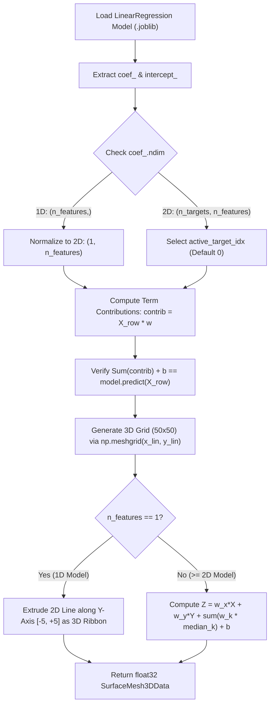

# Phase 04: First Simple Model (Linear Regression) — End-to-End Vertical Slice Proof of Concept

## 1. วัตถุประสงค์และขอบเขตของเฟส (Objective & Scope)
พัฒนา Adapter ตัวที่ 1 ที่เป็นรากฐานสำคัญที่สุดของระบบคือ **`LinearRegressionAdapter` (Ordinary Least Squares - OLS)** เพื่อใช้เป็น **โมเดลต้นแบบสำหรับการเชื่อมต่อครบวงจร (End-to-End Vertical Slice Proof of Concept)** ตั้งแต่การคำนวณสมการเชิงเส้น $\hat{y} = \sum_{i=1}^{d} w_i x_i + b$, การแยกส่วนประกอบผลคูณรายตัวแปร ($\text{Contribution}_i = w_i \cdot x_i$), การคำนวณค่าความคลาดเคลื่อน ($\text{Residual Error } e = y_{\text{actual}} - \hat{y}$), ไปจนถึงการสร้างพิกัดพื้นผิวระนาบเอียง 3 มิติ (**3D Flat Tilted Hyperplane Surface**) พร้อมสคริปต์สร้างชุดข้อมูลและโมเดลตัวอย่างในเครื่องเพื่อให้สามารถทดสอบทุกฟีเจอร์ใน Phase 04 - 17 ได้อย่างสมบูรณ์

### ขอบเขตงานในเฟสนี้ (In-Scope)
- การพัฒนาคลาส `LinearRegressionAdapter` ที่สืบทอดจาก `BaseModelAdapter` และลงทะเบียนเข้ากับ `@ModelRegistry.register("linear_regression")`
- การคำนวณสมการภายในรายแถว (`trace_internal_flow`): แยกค่าตั้งต้น (`intercept`), ค่าตัวแปรนำเข้า ($x_i$), น้ำหนัก ($w_i$), ผลคูณรายตัวแปร ($w_i \cdot x_i$), และผลรวมสะสม (Cumulative Sum) จนได้ค่าทำนายสุดท้าย ($\hat{y}$)
- การสร้างพื้นผิวระนาบ 3 มิติ (`compute_3d_surface`): คำนวณตารางกริด $Z(X, Y) = w_x X + w_y Y + \left(\sum_{k \neq x, y} w_k \bar{x}_k + b\right)$ ด้วย NumPy Vectorization (`np.meshgrid`) ในระดับ `< 5 ms`
- การสร้างสคริปต์ `backend/scripts/generate_sample_linear.py` เพื่อผลิตไฟล์ตัวอย่าง `sample_house_price_linear.joblib` และ `sample_houses.csv` เก็บไว้ในโฟลเดอร์ `samples/`
- การสร้างหน้าจอ UI Sandbox Inspector เบื้องต้นสำหรับทดสอบการคำนวณสมการเชิงเส้นและตรวจสอบ JSON Payload ก่อนเชื่อมต่อเข้ากับ 3D Stage

---

## 2. UI Feature List อย่างละเอียด (Detailed UI Feature List)

### 2.1 Linear Equation Formula Banner (`LinearFormulaBanner.tsx`)
- **Interactive Mathematical Formula Display**:
  - แสดงสมการที่โมเดลเรียนรู้มาในรูปแบบที่อ่านเข้าใจง่าย เช่น:
    $$\hat{y} = (42,500 \times \text{area\_sqm}) + (350,000 \times \text{bedrooms}) - (185,000 \times \text{distance\_bts\_km}) + 150,000$$
  - เมื่อผู้ใช้คลิกเลือกแถวข้อมูลสมมติ ตัวแปรในสมการจะแทนค่าตัวเลขจริงของแถวนั้นลงไปพร้อมไฮไลต์สีเขียวสำหรับพจน์ที่ช่วยเพิ่มค่า (`+`) และสีแดงสำหรับพจน์ที่หักลบค่า (`-`)
- **Multi-Target Output Selector Dropdown**:
  - แสดงขึ้นเฉพาะกรณีที่โมเดล Linear Regression ถูกเทรนแบบหลายคำตอบ (`coef_.ndim == 2 and coef_.shape[0] > 1`) ให้ผู้ใช้เลือกสลับดูสมการของ `Target 0`, `Target 1`, ... ได้

### 2.2 Term-by-Term Contribution Breakdown Card (`LinearContributionCard.tsx`)
- **Waterfall Equation Table**:
  - ตารางแจกแจงการคำนวณทีละบรรทัดของแถวข้อมูลที่เลือก:
    - แถวฐาน: `Base Intercept (b)` = `+150,000.00`
    - แถวตัวแปรที่ $i$: `Feature Name` | `Input (x_i)` | `× Weight (w_i)` | `= Contribution (w_i * x_i)` | `% Impact Bar`
    - แถวสรุปผลรวม: `Predicted Output (ŷ)` = `3,842,500.00`
    - แถวเปรียบเทียบค่าจริง (ถ้ามี): `Actual Value (y)` = `3,900,000.00` | `Residual Error (y - ŷ)` = `+57,500.00 (Under-predicted 1.47%)`

### 2.3 3D Surface Preview & Slice Sandbox (`LinearSurfaceSandbox.tsx`)
- **Axis X & Axis Y Selector Dropdowns**:
  - เลือกตัวแปร 2 ตัวที่จะนำมาวางเป็นแกน $X$ และแกน $Y$ ของระนาบ 3 มิติ (เช่น $X = \text{area\_sqm}$, $Y = \text{distance\_bts\_km}$)
  - แสดงค่าคงที่ของตัวแปรอื่นๆ ที่เหลือ (Fixed Background Features at Median) เช่น `bedrooms fixed at median = 3.0`
- **Mesh Statistics & JSON Telemetry Drawer**:
  - แสดงขนาดกริด (`50 x 50 = 2,500 vertices`), ความชันของระนาบตามแนวแกน $X$ และ $Y$ (`Slope dZ/dX`, `Slope dZ/dY`), ช่วงค่าความสูง `Z Min .. Z Max`, และเวลาที่ใช้คำนวณใน Backend (`Compute Time: 1.2 ms`)

### 2.4 States & Keyboard Shortcuts
- **Loading State**: แสดง Skeleton ขณะคำนวณพื้นผิวระนาบใหม่เมื่อเปลี่ยนแกน $X/Y$
- **Empty / 1D Notice Banner**: หากโมเดลมีเพียง 1 Feature ระบบจะแสดงป้ายแจ้งว่า `"1D Linear Model Detected: Axis Y is locked to Constant Depth (0.0) to project a 2D regression line onto a 3D ribbon"`
- **Keyboard Shortcuts**:
  - `Ctrl + Shift + S`: สลับเปิด/ปิด JSON Telemetry Drawer เพื่อดูโครงสร้างข้อมูลดิบ

---

## 3. UX Flow & User Journey (Step-by-Step UX Flow & ASCII Wireframe)

### 3.1 ลำดับการทำงาน (Step-by-Step User Journey)
1. **การเตรียมไฟล์ตัวอย่าง (Sample Bootstrapping)**:
   - เมื่อเริ่มต้นระบบ หากยังไม่มีไฟล์ใน `samples/` ระบบสามารถรัน `generate_sample_linear.py` เพื่อสร้างไฟล์ `sample_houses.csv` (1,000 แถว) และ `sample_house_price_linear.joblib` ได้ทันที
2. **การเรียกดูสมการและการแกะรอยรายแถว (Single-Row Equation Trace)**:
   - ผู้ใช้กดปุ่ม `Test Slice with Sample Data`
   - Frontend ส่งคำขอ `POST /api/v1/models/{model_id}/trace-preview`
   - `LinearRegressionAdapter` คำนวณผลคูณรายตัวแปร $w_i \cdot x_i$ ด้วย `float32` และส่งรายการ Contributions กลับมาแสดงเป็นตารางสมการและกราฟแท่งเปรียบเทียบขนาดผลกระทบ
3. **การสร้างพิกัดระนาบ 3 มิติ (3D Hyperplane Mesh Generation)**:
   - Frontend ส่ง `GridSpec3D` ไปที่ `POST /api/v1/models/{model_id}/surface-preview`
   - Backend สร้างตารางกริด `50 x 50` คำนวณค่า $Z$ ของทุกจุดบนระนาบพร้อมกันด้วยเมทริกซ์ NumPy แล้วส่งพิกัดกลับไปยัง Frontend

### 3.2 ASCII Wireframe: Linear Regression Vertical Slice Inspector
```text
+--------------------------------------------------------------------------------------------------+
| LINEAR REGRESSION (OLS) — EQUATION & 3D HYPERPLANE INSPECTOR     [Target Output: 0 (price_thb) v]|
+--------------------------------------------------------------------------------------------------+
| LEARNED LINEAR EQUATION:                                                                         |
|   ŷ = (+42,500.0 * area_sqm) + (+350,000.0 * bedrooms) + (-185,000.0 * distance_bts_km) + 150,000|
+--------------------------------------------------------------------------------------------------+
| ROW #0 INTERNAL FLOW BREAKDOWN (Input Row -> Weighted Terms -> Final Prediction)                 |
| +------------------+-------------+----------------+-------------------+------------------------+ |
| | Term / Feature   | Input (x_i) | Weight (w_i)   | Contribution      | Impact Direction       | |
| +------------------+-------------+----------------+-------------------+------------------------+ |
| | [Base Intercept] | 1.00        | +150,000.00    |    +150,000.00    | ██░░░░░░░░ (+3.9%)     | |
| | area_sqm         | 80.00       | +42,500.00     |  +3,400,000.00    | █████████░ (+88.5%)    | |
| | bedrooms         | 2.00        | +350,000.00    |    +700,000.00    | ███░░░░░░░ (+18.2%)    | |
| | distance_bts_km  | 2.20        | -185,000.00    |    -407,000.00    | ▓▓░░░░░░░░ (-10.6%)    | |
| +------------------+-------------+----------------+-------------------+------------------------+ |
| | FINAL PREDICTION (ŷ): 3,843,000.00 THB | ACTUAL (y): 3,900,000.00 | RESIDUAL (e): +57,000.00 | |
+--------------------------------------------------------------------------------------------------+
| 3D FLAT HYPERPLANE SURFACE SPEC: [Axis X: area_sqm v] [Axis Y: distance_bts_km v] (50x50 Grid)   |
| Status: 2,500 float32 vertices ready | Z Range: [410,000 .. 18,950,000] | Compute Time: 0.9 ms   |
+--------------------------------------------------------------------------------------------------+
```

### 3.3 State Transition Diagram (Mermaid Flowchart)


---

## 4. สถาปัตยกรรม DDD แยกรายชั้นพร้อมชื่อไฟล์และ Class/Method Signatures (DDD Architecture & Code Blueprint)

### 4.1 โครงสร้างไฟล์ในเฟสที่ 4 (Directory Structure)
```text
backend/
├── scripts/
│   └── generate_sample_linear.py
└── app/
    └── domains/
        └── model_engine/
            └── adapters/
                ├── __init__.py
                └── linear/
                    ├── __init__.py
                    └── linear_regression_adapter.py
```

### 4.2 Domain Adapter Implementation (`backend/app/domains/model_engine/adapters/linear/linear_regression_adapter.py`)
```python
# backend/app/domains/model_engine/adapters/linear/linear_regression_adapter.py
from typing import Any
import numpy as np
from sklearn.linear_model import LinearRegression
from app.domains.model_engine.base_adapter import BaseModelAdapter
from app.domains.model_engine.registry import ModelRegistry
from app.domains.model_engine.value_objects import (
    GridSpec3D,
    InternalFlowRowTrace,
    PredictionBatchResult,
    SurfaceMesh3DData,
    TaskType,
    Visual3DType,
)

@ModelRegistry.register("linear_regression")
class LinearRegressionAdapter(BaseModelAdapter):
    display_name = "Linear Regression (Ordinary Least Squares)"
    family_name = "Linear Models"
    task_type = TaskType.REGRESSION
    visual_3d_type = Visual3DType.FLAT_HYPERPLANE

    @classmethod
    def can_handle(cls, estimator: Any, file_ext: str = ".joblib") -> bool:
        return isinstance(estimator, LinearRegression)

    @staticmethod
    def _extract_weights_and_intercept(estimator: LinearRegression, target_idx: int = 0) -> tuple[np.ndarray, float]:
        coef = np.asarray(estimator.coef_, dtype=np.float32)
        if coef.ndim == 2:
            weights = coef[min(target_idx, coef.shape[0] - 1)]
        else:
            weights = coef.ravel()

        intercept_raw = getattr(estimator, "intercept_", 0.0)
        if np.ndim(intercept_raw) >= 1:
            intercept = float(np.asarray(intercept_raw, dtype=np.float32).ravel()[min(target_idx, len(intercept_raw) - 1)])
        else:
            intercept = float(intercept_raw)
        return weights, intercept

    def extract_feature_weights(self, estimator: Any, n_features: int) -> list[float | None]:
        weights, _ = self._extract_weights_and_intercept(estimator)
        return [float(w) for w in weights[:n_features]]

    def predict_batch(self, model_obj: Any, X_float32: np.ndarray) -> PredictionBatchResult:
        X_clean = np.ascontiguousarray(X_float32, dtype=np.float32)
        preds = np.asarray(model_obj.predict(X_clean), dtype=np.float32)
        if preds.ndim == 2:
            preds = preds[:, 0]
        return PredictionBatchResult(predictions=[float(v) for v in preds])

    def trace_internal_flow(
        self, model_obj: Any, X_float32: np.ndarray, row_indices: list[int], feature_names: list[str]
    ) -> list[InternalFlowRowTrace]:
        estimator = model_obj.steps[-1][1] if hasattr(model_obj, "steps") else model_obj
        weights, intercept = self._extract_weights_and_intercept(estimator)
        X_trans = model_obj[:-1].transform(X_float32) if hasattr(model_obj, "steps") else X_float32
        X_trans = np.asarray(X_trans, dtype=np.float32)

        traces: list[InternalFlowRowTrace] = []
        for idx, row_id in enumerate(row_indices):
            x_vec = X_trans[idx]
            contribs = x_vec * weights
            pred_val = float(np.sum(contribs) + intercept)
            contrib_map = {feature_names[i]: float(contribs[i]) for i in range(len(feature_names))}
            traces.append(
                InternalFlowRowTrace(
                    row_index=row_id,
                    base_value=intercept,
                    final_prediction=pred_val,
                    feature_contributions=contrib_map,
                    extra_mechanics={
                        "transformed_inputs": [float(v) for v in x_vec],
                        "weights": [float(w) for w in weights],
                    },
                )
            )
        return traces

    def compute_3d_surface(self, model_obj: Any, grid_spec: GridSpec3D, n_features: int) -> SurfaceMesh3DData:
        res = grid_spec.resolution
        x_lin = np.linspace(grid_spec.x_min, grid_spec.x_max, res, dtype=np.float32)
        y_lin = np.linspace(grid_spec.y_min, grid_spec.y_max, res, dtype=np.float32)
        xx, yy = np.meshgrid(x_lin, y_lin, indexing="xy")

        n_points = res * res
        grid_matrix = np.zeros((n_points, n_features), dtype=np.float32)
        for feat_idx, med_val in grid_spec.fixed_feature_medians.items():
            if 0 <= feat_idx < n_features:
                grid_matrix[:, feat_idx] = np.float32(med_val)

        grid_matrix[:, grid_spec.axis_x_feature_index] = xx.ravel()
        if n_features > 1 and grid_spec.axis_y_feature_index != grid_spec.axis_x_feature_index:
            grid_matrix[:, grid_spec.axis_y_feature_index] = yy.ravel()

        z_preds = np.asarray(model_obj.predict(grid_matrix), dtype=np.float32)
        if z_preds.ndim == 2:
            z_preds = z_preds[:, 0]

        return SurfaceMesh3DData(
            visual_type=self.visual_3d_type,
            resolution=res,
            x_grid=[float(v) for v in x_lin],
            y_grid=[float(v) for v in y_lin],
            z_values=[float(v) for v in z_preds.ravel()],
        )
```

### 4.3 Sample Generator Script (`backend/scripts/generate_sample_linear.py`)
```python
# backend/scripts/generate_sample_linear.py
from pathlib import Path
import joblib
import numpy as np
import pandas as pd
from sklearn.linear_model import LinearRegression

def generate_house_price_sample(output_dir: Path) -> None:
    output_dir.mkdir(parents=True, exist_ok=True)
    rng = np.random.default_rng(42)
    n_samples = 1000

    area_sqm = rng.uniform(25.0, 250.0, size=n_samples).astype(np.float32)
    bedrooms = rng.integers(1, 6, size=n_samples).astype(np.int32)
    distance_bts_km = rng.uniform(0.2, 18.0, size=n_samples).astype(np.float32)
    noise = rng.normal(0.0, 180000.0, size=n_samples).astype(np.float32)

    selling_price = (
        150000.0
        + (42500.0 * area_sqm)
        + (350000.0 * bedrooms)
        - (185000.0 * distance_bts_km)
        + noise
    ).astype(np.float32)

    df = pd.DataFrame({
        "area_sqm": np.round(area_sqm, 2),
        "bedrooms": bedrooms,
        "distance_bts_km": np.round(distance_bts_km, 2),
        "selling_price": np.round(selling_price, 2),
    })
    df.to_csv(output_dir / "sample_houses.csv", index=False, encoding="utf-8")

    X = df[["area_sqm", "bedrooms", "distance_bts_km"]]
    y = df["selling_price"]
    model = LinearRegression()
    model.fit(X, y)
    joblib.dump(model, output_dir / "sample_house_price_linear.joblib", compress=3)
```

### 4.4 Presentation REST API Layer (`backend/app/presentation/endpoints/model_endpoints.py`)
- **`POST /api/v1/models/{model_id}/trace-preview`**
  - **Request JSON**:
    ```json
    {
      "rows": [[80.0, 2.0, 2.2]],
      "row_indices": [0],
      "actual_targets": [3900000.0]
    }
    ```
  - **Response `200 OK` Schema**:
    ```json
    {
      "traces": [
        {
          "row_index": 0,
          "base_value": 150000.0,
          "final_prediction": 3843000.0,
          "actual_target": 3900000.0,
          "residual_error": 57000.0,
          "feature_contributions": {
            "area_sqm": 3400000.0,
            "bedrooms": 700000.0,
            "distance_bts_km": -407000.0
          }
        }
      ]
    }
    ```

---

## 5. แผนการตรวจสอบหน่วยความจำและเพิ่มประสิทธิภาพทรัพยากรเครื่อง (Memory Check Plan & Process Resource Optimization)

### 5.1 Backend Memory Check & Pre-allocated Surface Buffer
- **Contiguous `float32` Grid Allocation**: ใน `compute_3d_surface()` สำหรับความละเอียดมาตรฐาน `50 x 50 = 2,500 จุด` เมทริกซ์ `grid_matrix` มีขนาดเพียง `2500 * n_features * 4 bytes` (เช่น 10 Features ใช้เพียง `100 KB`) และบังคับจำกัด `resolution <= 100` เสมอเพื่อป้องกันการส่งค่า `resolution` สูงผิดปกติที่อาจทำให้เกิด Memory Spike
- **Vectorized BLAS Dot Product**: คำนวณค่าทำนายและผลคูณรายตัวแปรด้วย NumPy Vectorized Broadcast (`X_trans * weights`) แทนการใช้ `for` loop ซ้อนกันใน Python

### 5.2 Frontend & WebGL Memory Optimization
- **`Float32Array` Direct Conversion**: ทันทีที่ Frontend ได้รับ `z_values` ของพื้นผิว 3 มิติ ให้แปลงเป็น `new Float32Array(surface.z_values)` เพื่อส่งเข้า `THREE.BufferAttribute` โดยตรงและทิ้ง Reference ของ JSON Array ชั่วคราวทันที

### 5.3 Process & CPU/GPU Resource Optimization
- **Surface Memoization Cache**: เก็บผลลัพธ์ `SurfaceMesh3DData` ไว้ใน LRU Cache ฝั่ง Backend โดยใช้ Key `(model_id, axis_x, axis_y, resolution, tuple(fixed_medians))` หากผู้ใช้สลับมุมมองกลับมาแกนเดิมจะตอบกลับได้ใน `< 0.5 ms` โดยไม่ต้องคำนวณใหม่

---

## 6. ไลบรารีที่ใช้และการตั้งค่า Offline 100% (Libraries & Offline Configuration)
- **Backend**: `scikit-learn>=1.5.0`, `numpy>=1.26.0`, `joblib>=1.4.0`, `pandas>=2.2.0`
- **Frontend**: React 19, `zustand`, `lucide-react`

---

## 7. ตารางข้อควรระวังและ Edge Cases (Caveats & Edge Case Matrix)

| ลำดับ | เคสปัญหา (Edge Case) | สาเหตุทางเทคนิค (Root Cause) | วิธีป้องกันและแก้ไขแบบเจาะจง (Mitigation Strategy) |
| :--- | :--- | :--- | :--- |
| **1** | **Multi-Target Linear Regression (`coef_` เป็น 2D Array)** | เมื่อเทรนด้วย $Y$ ที่มีหลายคอลัมน์ `model.coef_` จะมี Shape `(n_targets, n_features)` และ `intercept_` เป็น 1D Array | ใช้ `_extract_weights_and_intercept()` ตรวจสอบ `coef.ndim == 2` เสมอ และดึงเฉพาะแถว `target_idx` ที่ผู้ใช้เลือก |
| **2** | **โมเดลตั้งค่า `fit_intercept=False` ตอนเทรน** | `model.intercept_` จะมีค่าเป็น `0.0` (หรือ `np.zeros`) | แปลงค่า `intercept_` ด้วย `float(intercept)` อย่างปลอดภัย และแสดงป้าย `No Intercept (Origin-Locked: b = 0)` บน UI |
| **3** | **โมเดลมีเพียง 1 ตัวแปรนำเข้า (`n_features_in_ == 1`)** | ไม่สามารถเลือกแกน $X$ และแกน $Y$ เป็นคนละ Feature กันได้ | หาก `n_features == 1` ให้ล็อกแกน $X$ เป็น `feature_0` และกำหนดให้แกน $Y$ เป็นค่าคงที่ (`Depth Ribbon`) ताकिวาดเป็นแถบระนาบใน 3 มิติได้โดยไม่พัง |
| **4** | **โมเดลอยู่ใน Pipeline ที่มี `StandardScaler`** | ค่า `estimator.coef_` เป็นน้ำหนักของค่าที่ถูก Scale แล้ว ($z\text{-score}$) ถ้านำไปคูณกับค่าดิบ $x_{\text{raw}}$ ตรงๆ ผลรวมจะไม่ตรงกับ `.predict()` | ใน `trace_internal_flow` ต้องนำ `X_float32` ไปผ่าน `pipeline[:-1].transform(X)` ก่อนนำมาคูณกับ `weights` เพื่อให้ผลรวม $\sum w_i x'_i + b$ ตรงกับค่า `.predict()` 100% |
| **5** | **ค่า Collinearity สูงทำให้สัมประสิทธิ์มีค่าบวกลบสลับกันระดับล้าน** | ข้อมูลมีตัวแปรซ้ำซ้อนกันทำให้ `coef_` มีขนาดใหญ่มากแต่หักล้างกันเอง | ใช้สัดส่วน $|w_i x_i| / \sum |w_j x_j|$ ในการคำนวณความยาวหลอด `% Impact Bar` เพื่อไม่ให้กราฟทะลุกรอบ UI |
| **6** | **ผู้ใช้เลือกตัวแปรเดียวกันเป็นทั้งแกน X และแกน Y** | ทำให้ `grid_matrix[:, axis_x]` และ `grid_matrix[:, axis_y]` เขียนทับคอลัมน์เดียวกัน | ใน UI บังคับให้เมื่อเลือกแกน $X$ เป็นตัวแปรใดแล้วและเลือกแกน $Y$ ซ้ำ ระบบจะสลับแกนให้อัตโนมัติ (Swap X <-> Y) |

---

## 8. เกณฑ์การตรวจรับงาน (Definition of Done Checklist)
- [ ] สคริปต์ `generate_sample_linear.py` สร้างไฟล์ `sample_houses.csv` และ `sample_house_price_linear.joblib` ได้สำเร็จแบบ Offline 100%
- [ ] `LinearRegressionAdapter` ลงทะเบียนใน `ModelRegistry` และผ่านการทดสอบทั้งโมเดล 1D, 2D+, Multi-Target, และโมเดลใน `Pipeline`
- [ ] ผลรวมของ `base_value + sum(feature_contributions.values())` ใน `trace_internal_flow` มีค่าเท่ากับ `final_prediction` ของ `.predict()` ทุกแถว (ความคลาดเคลื่อน `< 1e-4`)
- [ ] `compute_3d_surface` สร้างตารางพิกัด `50 x 50` ชนิด `float32` เสร็จภายใน `< 10 ms`
