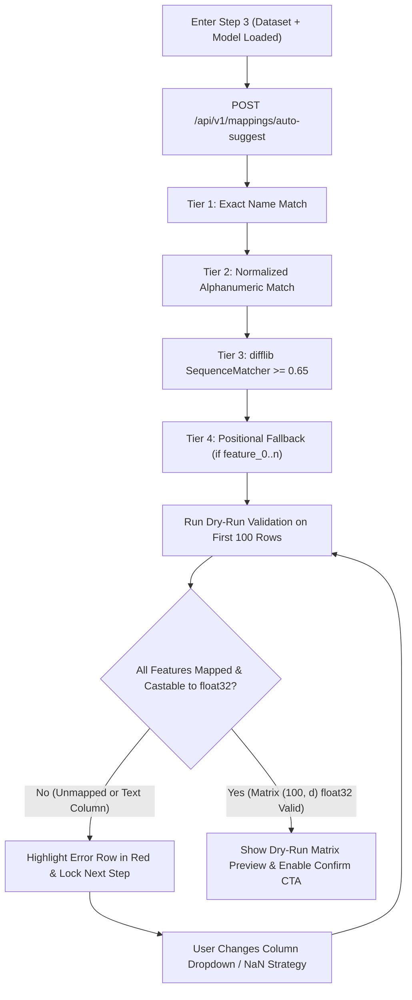

# Phase 05: Mapping Domain — Fuzzy Auto-Matcher, Type Casting Engine & Interactive Mapper UI

## 1. วัตถุประสงค์และขอบเขตของเฟส (Objective & Scope)
สร้าง Bounded Context **`domains/mapping/`** และหน้าจอ **Interactive Column Mapper UI (Step 3)** สำหรับทำหน้าที่เป็นสะพานเชื่อมระหว่าง **"คอลัมน์ในชุดข้อมูล (Dataset Columns จาก Phase 02)"** กับ **"ตัวแปรนำเข้าที่โมเดลต้องการตามลำดับ Index (Model Feature Schema จาก Phase 03)"** พร้อมระบบจับคู่อัตโนมัติอัจฉริยะ 3 ระดับ (**3-Tier Fuzzy Auto-Matcher**), ระบบแปลงชนิดข้อมูลและทำความสะอาดตัวเลข (**Type Casting & String Numeric Sanitizer**), ระบบจัดการค่าว่าง (**Missing Value `NaN` Imputation Strategy**), และการตรวจสอบความถูกต้องล่วงหน้ากับข้อมูลตัวอย่าง 100 แถวแรก (**Dry-Run Matrix Validator**) ก่อนอนุญาตให้เข้าสู่ขั้นตอนการคัดเลือกแถวข้อมูล

### ขอบเขตงานในเฟสนี้ (In-Scope)
- การพัฒนา `FuzzyColumnMatcherService` สำหรับจับคู่ชื่อตัวแปรโมเดลกับชื่อคอลัมน์ใน CSV อัตโนมัติ (Exact Match, Normalized Match, Fuzzy Sequence Similarity, และ Positional Fallback สำหรับ `feature_0..n`)
- การพัฒนา `TypeCastingAndImputationEngine` รองรับการแปลง `bool -> 0.0/1.0`, การล้างสตริงตัวเลขมีลูกน้ำหรือสัญลักษณ์สกุลเงิน (`"฿1,250.50"` -> `1250.50`), และการเติมค่าว่าง (`Zero`, `Column Mean`, `Column Median`, `Custom Constant`, `Pass NaN`)
- การระบุคอลัมน์คำตอบจริง (**Optional Ground-Truth / Actual Target Column**) เพื่อนำไปใช้วัดความแม่นยำและคำนวณ Residual Error ใน Phase 07
- การรับประกันลำดับคอลัมน์เมทริกซ์ (`Strict Feature Index Ordering 0 .. d-1`) ให้ตรงกับตอนที่โมเดลถูกเทรน 100%

---

## 2. UI Feature List อย่างละเอียด (Detailed UI Feature List)

### 2.1 Auto-Match Control & Confidence Summary Bar (`MappingHeaderBar.tsx`)
- **Match Summary Counter Badges**:
  - ป้ายสรุปสถานะการจับคู่ทั้งหมด เช่น: `Mapped: 3 / 3 Features` | `Exact/High Confidence: 2` | `Fuzzy Review Needed: 1` | `Unmapped/Error: 0`
- **Action Buttons**:
  - ปุ่ม `Re-Run Smart Auto-Match (Ctrl+M)`: สั่งจับคู่อัตโนมัติใหม่ทั้งหมด
  - ปุ่ม `Map by Column Order (0..N)`: จับคู่ตามลำดับคอลัมน์ใน CSV ตรงๆ (มีประโยชน์มากเมื่อทั้งโมเดลและ CSV ไม่มีหัวตารางชื่อคอลัมน์)
  - ปุ่ม `Global NaN Strategy Dropdown`: ตั้งค่าวิธีจัดการค่าว่าง (`NaN`) ให้กับทุกฟีเจอร์พร้อมกันในคลิกเดียว (`Default: Fill with Column Median`)

### 2.2 Interactive Feature-to-Column Mapping Rows (`FeatureMappingRowCard.tsx`)
- **Left Panel — Model Expected Feature Slot**:
  - แสดงลำดับ `Index Badge (#0, #1, ...)`, ชื่อตัวแปรที่โมเดลต้องการ (`area_sqm`), ชนิดข้อมูล (`float32`), และค่าสัมประสิทธิ์ของโมเดล (`Coef: +42,500`)
- **Center Indicator — Match Confidence & Type Cast Status Badge**:
  - `100% Exact Match` (สีเขียว Emerald)
  - `95% Normalized Match` (สีฟ้า Cyan เช่น `Area_SQM` <-> `area_sqm`)
  - `78% Fuzzy Match - Verify` (สีเหลือง Amber เช่น `dist_bts` <-> `distance_bts_km`)
  - `Positional Fallback` (สีม่วง Indigo เมื่อโมเดลใช้ชื่อ `feature_0`)
  - `Type Incompatible Error` (สีแดง Rose เมื่อเลือกคอลัมน์ข้อความล้วนที่ไม่สามารถแปลงเป็นตัวเลขได้)
- **Right Panel — Dataset Column Selector & Imputation Controls**:
  - **Column Dropdown**: เลือกคอลัมน์จาก Dataset พร้อมแสดงชนิดข้อมูลเดิม, `% Null`, และตัวอย่างค่าจริง (`Sample: 55.0, 82.5, 120.0`)
  - **Missing Value (`NaN`) Strategy Selector**: Dropdown เลือกวิธีเติมค่าว่างเฉพาะคอลัมน์นั้น (`Fill Median (78.0)`, `Fill Mean (84.5)`, `Fill Zero (0.0)`, `Custom Value`, `Keep NaN`)

### 2.3 Optional Ground-Truth (Actual Target) Selector Card (`TargetColumnSelectorCard.tsx`)
- Dropdown สำหรับเลือกคอลัมน์คำตอบจริงจากไฟล์ CSV (เช่น `selling_price`) หรือเลือก `None (Unlabeled Inference Only)`
- หากเป็นงาน Classification และค่าในคอลัมน์เป็นข้อความ (เช่น `"Yes" / "No"`) แต่ `model.classes_` เป็น `[0, 1]` จะแสดงตารางย่อย **Class Label Mapper** ให้จับคู่ `"No" -> 0`, `"Yes" -> 1` ทันที

### 2.4 Dry-Run Matrix Preview & Validation Drawer (`DryRunValidationDrawer.tsx`)
- แสดงตารางเมทริกซ์ `X_float32` ขนาด `5 แถวแรก x d คอลัมน์` หลังจากผ่านการแปลงชนิดข้อมูลและเติมค่าว่างแล้ว เพื่อให้ผู้ใช้มั่นใจ 100% ก่อนกดปุ่ม `Confirm Mapping & Proceed to Step 4 ->`

### 2.5 States & Keyboard Shortcuts
- **Duplicate Column Warning Toast**: แจ้งเตือนสีเหลืองเมื่อผู้ใช้เลือกคอลัมน์ CSV เดียวกันใส่ใน 2 ช่องของโมเดล
- **Keyboard Shortcuts**:
  - `Ctrl + Shift + A`: สั่ง Auto-Match ใหม่ทั้งหมด
  - `Ctrl + Enter`: ยืนยันผลการจับคู่และไปสู่ขั้นตอนที่ 4

---

## 3. UX Flow & User Journey (Step-by-Step UX Flow & ASCII Wireframe)

### 3.1 ลำดับการทำงาน (Step-by-Step User Journey)
1. **การจับคู่อัตโนมัติทันทีที่เปิดหน้า Step 3 (Zero-Click Initial Auto-Match)**:
   - ทันทีที่เข้าสู่ Step 3 ระบบส่ง `dataset_id` และ `model_id` ไปยัง `POST /api/v1/mappings/auto-suggest`
   - Backend รันอัลกอริทึม 3-Tier Fuzzy Matching และตรวจสอบความเข้ากันได้ของชนิดข้อมูล แล้วส่งร่างการจับคู่กลับมาแสดงทันที
2. **การปรับแก้และตรวจสอบผลลัพธ์ (Interactive Refinement & Dry-Run)**:
   - หากมีช่องที่ขึ้นสีเหลือง (`Fuzzy Match`) หรือผู้ใช้ต้องการเปลี่ยนคอลัมน์ เมื่อเลือก Dropdown ใหม่ ระบบจะยิง `POST /api/v1/mappings/validate-preview` เพื่อทดสอบแปลงข้อมูล 100 แถวแรกเป็น `np.ndarray(dtype=np.float32)`
   - หากพบคอลัมน์ที่มีข้อความปนตัวเลข เช่น `"1,200.50"` ระบบจะแสดงป้าย `Auto-Parsed Formatted Numeric String` แต่หากเป็นข้อความล้วน เช่น `"Chatuchak"` จะขึ้นสีแดงและล็อกปุ่มไปต่อจนกว่าจะเปลี่ยนคอลัมน์
3. **การบันทึกโครงสร้าง Mapping (Commit Mapping Configuration)**:
   - ผู้ใช้กดปุ่ม `Confirm Mapping & Proceed ->` ระบบบันทึก `MappingConfiguration` และปลดล็อก Step 4

### 3.2 ASCII Wireframe: Step 3 Interactive Column Mapper & Dry-Run Validator
```text
+--------------------------------------------------------------------------------------------------+
| STEP 3: COLUMN MAPPING & TYPE CASTING      [Re-Run Auto-Match] [Map by Order 0..N] [NaN: Median] |
+--------------------------------------------------------------------------------------------------+
| STATUS: ● 3/3 Required Features Mapped | 0 Type Errors | 1 Duplicate Warning: None               |
| +-----------------------------------+------------------+---------------------------------------+ |
| | MODEL EXPECTED FEATURE (Order)    | MATCH & CASTING  | DATASET SOURCE COLUMN & NaN POLICY    | |
| +-----------------------------------+------------------+---------------------------------------+ |
| | [#0] area_sqm          (float32)  | [100% Exact   ]  | [ area_sqm (float32)             v ]  | |
| |      Weight: +42,500.0            |  Direct float32  | Sample: 55.0, 82.5 | NaN: [Median v]  | |
| +-----------------------------------+------------------+---------------------------------------+ |
| | [#1] bedrooms          (float32)  | [100% Exact   ]  | [ bedrooms (int32)               v ]  | |
| |      Weight: +350,000.0           |  Cast int->f32   | Sample: 2, 3, 1    | NaN: [Median v]  | |
| +-----------------------------------+------------------+---------------------------------------+ |
| | [#2] distance_bts_km   (float32)  | [82% Fuzzy  ! ]  | [ dist_bts_km (float32)          v ]  | |
| |      Weight: -185,000.0           |  Direct float32  | Sample: 2.2, 0.8   | NaN: [Median v]  | |
| +-----------------------------------+------------------+---------------------------------------+ |
| OPTIONAL ACTUAL TARGET (GROUND TRUTH FOR ERROR EVALUATION IN STEP 4):                            |
|   Target Column: [ selling_price (float32) | Min: 1.2M .. Max: 45.0M                        v ]  |
+--------------------------------------------------------------------------------------------------+
| DRY-RUN FLOAT32 MATRIX PREVIEW (First 100 Rows Verified OK -> Shape: (100, 3), DType: float32)   |
| [ <- Back to Step 2 ]                                 [ Confirm Mapping & Go to Step 4 Queue -> ]|
+--------------------------------------------------------------------------------------------------+
```

### 3.3 State Transition Diagram (Mermaid Flowchart)


---

## 4. สถาปัตยกรรม DDD แยกรายชั้นพร้อมชื่อไฟล์และ Class/Method Signatures (DDD Architecture & Code Blueprint)

### 4.1 โครงสร้างไฟล์ในเฟสที่ 5 (Directory Structure)
```text
backend/app/
├── domains/
│   └── mapping/
│       ├── entities.py
│       ├── value_objects.py
│       ├── matcher_service.py
│       ├── casting_service.py
│       └── repository.py
├── application/
│   └── mapping_use_case.py
├── infrastructure/
│   └── persistence/
│       └── in_memory_mapping_repository.py
└── presentation/
    └── endpoints/
        └── mapping_endpoints.py
```

### 4.2 Domain Value Objects & Entities (`backend/app/domains/mapping/`)
```python
# backend/app/domains/mapping/value_objects.py
from enum import Enum
from pydantic import BaseModel, Field

class MatchTier(str, Enum):
    EXACT = "exact"
    NORMALIZED = "normalized"
    FUZZY = "fuzzy"
    POSITIONAL = "positional"
    MANUAL = "manual"
    UNMAPPED = "unmapped"

class ImputationStrategy(str, Enum):
    ZERO = "zero"
    MEAN = "mean"
    MEDIAN = "median"
    CUSTOM = "custom"
    PASS_NAN = "pass_nan"

class FeatureMappingItem(BaseModel):
    feature_index: int
    model_feature_name: str
    dataset_column_name: str | None
    match_tier: MatchTier
    match_confidence: float
    imputation_strategy: ImputationStrategy = ImputationStrategy.MEDIAN
    custom_fill_value: float = 0.0
    resolved_fill_value: float | None = None
    is_type_compatible: bool = True
    cast_warning_or_error: str | None = None

class DryRunValidationReport(BaseModel):
    is_valid: bool
    tested_row_count: int
    output_shape: tuple[int, int]
    duplicate_columns_used: list[str] = Field(default_factory=list)
    feature_errors: dict[int, str] = Field(default_factory=dict)
    preview_matrix_head: list[list[float | None]] = Field(default_factory=list)
```

### 4.3 Domain Services: 3-Tier Fuzzy Matcher & Type Casting Engine
```python
# backend/app/domains/mapping/matcher_service.py
import re
from difflib import SequenceMatcher
from app.domains.dataset.value_objects import ColumnProfile
from app.domains.model_engine.value_objects import FeatureRequirement
from app.domains.mapping.value_objects import FeatureMappingItem, ImputationStrategy, MatchTier

class FuzzyColumnMatcherService:
    @staticmethod
    def _normalize(name: str) -> str:
        return re.sub(r"[^a-z0-9]", "", name.lower().strip())

    def auto_match(
        self, features: list[FeatureRequirement], columns: list[ColumnProfile]
    ) -> list[FeatureMappingItem]:
        numeric_cols = [c for c in columns if c.logical_type in ("numeric", "boolean")]
        col_by_name = {c.name: c for c in columns}
        col_by_norm = {self._normalize(c.name): c for c in columns}

        mapped_items: list[FeatureMappingItem] = []
        for feat in sorted(features, key=lambda f: f.index):
            matched_col: ColumnProfile | None = None
            tier = MatchTier.UNMAPPED
            conf = 0.0

            if feat.name in col_by_name:
                matched_col = col_by_name[feat.name]
                tier, conf = MatchTier.EXACT, 1.0
            elif self._normalize(feat.name) in col_by_norm:
                matched_col = col_by_norm[self._normalize(feat.name)]
                tier, conf = MatchTier.NORMALIZED, 0.95
            elif feat.is_auto_generated_name and feat.index < len(numeric_cols):
                matched_col = numeric_cols[feat.index]
                tier, conf = MatchTier.POSITIONAL, 0.80
            else:
                best_ratio = 0.0
                for cand in columns:
                    ratio = SequenceMatcher(None, self._normalize(feat.name), self._normalize(cand.name)).ratio()
                    if ratio > best_ratio:
                        best_ratio = ratio
                        matched_col = cand
                if best_ratio >= 0.65 and matched_col is not None:
                    tier, conf = MatchTier.FUZZY, round(best_ratio, 2)
                else:
                    matched_col = None

            fill_val = matched_col.median_value if matched_col and matched_col.median_value is not None else 0.0
            mapped_items.append(
                FeatureMappingItem(
                    feature_index=feat.index,
                    model_feature_name=feat.name,
                    dataset_column_name=matched_col.name if matched_col else None,
                    match_tier=tier,
                    match_confidence=conf,
                    imputation_strategy=ImputationStrategy.MEDIAN,
                    resolved_fill_value=fill_val,
                    is_type_compatible=matched_col.logical_type in ("numeric", "boolean") if matched_col else False,
                )
            )
        return mapped_items
```

```python
# backend/app/domains/mapping/casting_service.py
import numpy as np
import pandas as pd
from app.domains.mapping.value_objects import FeatureMappingItem, ImputationStrategy

class TypeCastingEngine:
    @staticmethod
    def build_float32_matrix(df_slice: pd.DataFrame, items: list[FeatureMappingItem]) -> np.ndarray:
        """สร้างเมทริกซ์ (N, d) ชนิด float32 เรียงตาม feature_index อย่างเคร่งครัด"""
        ordered_items = sorted(items, key=lambda x: x.feature_index)
        n_rows = len(df_slice)
        n_features = len(ordered_items)
        matrix = np.empty((n_rows, n_features), dtype=np.float32)

        for idx, item in enumerate(ordered_items):
            if not item.dataset_column_name or item.dataset_column_name not in df_slice.columns:
                raise ValueError(f"Feature #{item.feature_index} ({item.model_feature_name}) ยังไม่ได้จับคู่คอลัมน์")

            series = df_slice[item.dataset_column_name]
            if series.dtype == object or pd.api.types.is_string_dtype(series.dtype):
                cleaned = series.astype(str).str.replace(r"[,฿$%\s]", "", regex=True)
                numeric_series = pd.to_numeric(cleaned, errors="coerce")
            elif pd.api.types.is_bool_dtype(series.dtype):
                numeric_series = series.astype(np.float32)
            else:
                numeric_series = pd.to_numeric(series, errors="coerce")

            if item.imputation_strategy != ImputationStrategy.PASS_NAN:
                fill_val = item.resolved_fill_value if item.resolved_fill_value is not None else item.custom_fill_value
                numeric_series = numeric_series.fillna(np.float32(fill_val))

            matrix[:, idx] = numeric_series.to_numpy(dtype=np.float32, copy=False)

        return np.ascontiguousarray(matrix, dtype=np.float32)
```

### 4.4 Presentation REST API Layer (`backend/app/presentation/endpoints/mapping_endpoints.py`)
- **`POST /api/v1/mappings/auto-suggest`**: รับ `{ "dataset_id": "...", "model_id": "..." }` คืนค่าร่าง `MappingConfiguration` พร้อมผล `DryRunValidationReport`
- **`POST /api/v1/mappings/validate-and-save`**: รับรายการ `items: list[FeatureMappingItem]` และ `target_column_name: Optional[str]` ทำการรัน Dry-Run กับ 100 แถวแรก และบันทึกสถานะพร้อมคืนค่า `mapping_id`

### 4.5 Frontend Domain Store (`frontend/src/domains/mapping/store/useMappingStore.ts`)
```typescript
// frontend/src/domains/mapping/store/useMappingStore.ts
import { create } from 'zustand';

export interface FeatureMappingItem {
  feature_index: number;
  model_feature_name: string;
  dataset_column_name: string | null;
  match_tier: 'exact' | 'normalized' | 'fuzzy' | 'positional' | 'manual' | 'unmapped';
  match_confidence: number;
  imputation_strategy: 'zero' | 'mean' | 'median' | 'custom' | 'pass_nan';
  custom_fill_value: number;
  resolved_fill_value: number | null;
  is_type_compatible: boolean;
  cast_warning_or_error: string | null;
}

interface MappingStoreState {
  mappingId: string | null;
  items: FeatureMappingItem[];
  targetColumnName: string | null;
  targetLabelMap: Record<string, number> | null;
  isValid: boolean;
  duplicateColumns: string[];
  previewMatrixHead: Array<Array<number | null>>;
  requestAutoSuggest: (datasetId: string, modelId: string) => Promise<void>;
  updateFeatureMapping: (featureIndex: number, patch: Partial<FeatureMappingItem>) => Promise<void>;
  commitMapping: () => Promise<boolean>;
}
```

---

## 5. แผนการตรวจสอบหน่วยความจำและเพิ่มประสิทธิภาพทรัพยากรเครื่อง (Memory Check Plan & Process Resource Optimization)

### 5.1 Backend Memory Check & Zero-Copy Projection
- **Column-Selective Parquet Projection**: ในตอนทำ Dry-Run Validation (100 แถวแรก) หรือตอนดึงข้อมูลจริงในเฟสถัดไป ให้ใช้ `pyarrow.parquet.read_table(path, columns=required_cols, memory_map=True)` เพื่อโหลดเฉพาะคอลัมน์ที่ถูกเลือกใช้งานใน `MappingConfiguration` เท่านั้น (เช่น หาก CSV มี 200 คอลัมน์ แต่โมเดลใช้แค่ 5 คอลัมน์ ระบบจะอ่านขึ้นมาเพียง 5 คอลัมน์ ประหยัด RAM ได้ถึง 97.5%)
- **Pre-allocated Contiguous `float32` Matrix**: ใน `TypeCastingEngine.build_float32_matrix()` จองพื้นที่ด้วย `np.empty((n_rows, n_features), dtype=np.float32)` เพียงก้อนเดียวและเขียนทับทีละคอลัมน์ (`matrix[:, idx] = ...`) แทนการสร้าง list ของ array แล้วสั่ง `np.column_stack()` ซึ่งจะกิน RAM เป็น 2 เท่าชั่วขณะ

### 5.2 Frontend & WebGL Memory Optimization
- **Debounced Validation Calls**: เมื่อผู้ใช้ปรับค่า `custom_fill_value` หรือสลับ Dropdown หลายช่องติดกัน ให้หน่วงเวลา (`debounce 250ms`) ก่อนยิง API `/api/v1/mappings/validate-and-save`

---

## 6. ไลบรารีที่ใช้และการตั้งค่า Offline 100% (Libraries & Offline Configuration)
- **Backend**: `difflib` (Python Standard Library), `re`, `numpy>=1.26.0`, `pandas>=2.2.0`, `pyarrow>=17.0.0`
- **Frontend**: React 19, `zustand`, `lucide-react`, Tailwind CSS v4

---

## 7. ตารางข้อควรระวังและ Edge Cases (Caveats & Edge Case Matrix)

| ลำดับ | เคสปัญหา (Edge Case) | สาเหตุทางเทคนิค (Root Cause) | วิธีป้องกันและแก้ไขแบบเจาะจง (Mitigation Strategy) |
| :--- | :--- | :--- | :--- |
| **1** | **ลำดับคอลัมน์สลับกันทำให้ผลทำนายเพี้ยนโดยไม่เกิด Error** | ใน CSV เรียงคอลัมน์เป็น `[bedrooms, area_sqm]` แต่โมเดลเทรนด้วย `[area_sqm, bedrooms]` | บังคับ `sorted(items, key=lambda x: x.feature_index)` ทุกครั้งใน `build_float32_matrix()` เพื่อรับประกันว่าคอลัมน์ที่ `idx` ในเมทริกซ์ตรงกับ `FeatureRequirement.index` เสมอ |
| **2** | **ตัวเลขใน CSV มีลูกน้ำหรือสกุลเงิน (`"1,250,000"`, `"฿450"`)** | Pandas อ่านเป็น `object/string` ทำให้แปลงเป็น `float32` ตรงๆ ไม่ได้ | ใช้ Regex `.str.replace(r"[,฿$%\s]", "", regex=True)` ล้างสัญลักษณ์ก่อนเข้า `pd.to_numeric(..., errors="coerce")` |
| **3** | **คอลัมน์ที่เป็นข้อความล้วนถูกเลือกแล้วกลายเป็น `NaN` ทั้งคอลัมน์หลัง `coerce`** | การใช้ `errors="coerce"` กับคอลัมน์ชื่อเขต `"Chatuchak"` จะได้ `NaN` 100% แล้วถูกแทนที่ด้วย `0.0` โดยผู้ใช้ไม่รู้ตัว | ใน Dry-Run Validator ต้องเช็กว่าหากเดิมคอลัมน์ไม่ได้ว่างเปล่า แต่หลังแปลงเป็นตัวเลขแล้วเกิด `NaN` เพิ่มขึ้นเกิน `20%` ให้ฟ้อง `Type Incompatible Error` สีแดงทันที |
| **4** | **ผู้ใช้เผลอเลือกคอลัมน์คำตอบ (`Target Column`) มาเป็นหนึ่งใน Input Features** | เกิด Data Leakage หรือเลือกซ้ำโดยไม่ตั้งใจ | यदि `dataset_column_name == target_column_name` ให้แสดงป้ายเตือนสีส้ม `Target Leakage Warning: This column is also selected as Actual Target!` |
| **5** | **โมเดลไม่รองรับค่า `NaN` แต่ผู้ใช้เลือก `Pass NaN directly`** | โมเดลส่วนใหญ่ใน Scikit-learn (เช่น `LinearRegression`, `SVC`, `MLP`) จะโยน `ValueError: Input X contains NaN` ทันที | ตรวจสอบ Property `adapter.supports_nan_input` หากเป็น `False` ให้ปิดตัวเลือก `Pass NaN directly` ใน Dropdown พร้อมแสดง Tooltip อธิบาย |
| **6** | **ผู้ใช้เลือกคอลัมน์ CSV เดียวกันให้กับ 2 Features ของโมเดล** | อาจเกิดจาก Auto-Match แบบ Fuzzy จับคู่คำคล้ายไปหาคอลัมน์เดียวกัน | ตรวจจับชื่อคอลัมน์ซ้ำใน `duplicate_columns_used` และแสดงกรอบสีเหลืองเตือนให้ผู้ใช้ตรวจสอบ |

---

## 8. เกณฑ์การตรวจรับงาน (Definition of Done Checklist)
- [ ] ระบบ 3-Tier Fuzzy Auto-Matcher จับคู่คอลัมน์แบบ Exact, Normalized, Fuzzy, และ Positional Fallback ได้อย่างแม่นยำ
- [ ] `TypeCastingEngine.build_float32_matrix()` สร้างเมทริกซ์ `float32` ที่เรียงตาม `feature_index` ของโมเดลอย่างเคร่งครัด 100%
- [ ] รองรับการแปลง `bool`, สตริงตัวเลขมีลูกน้ำ (`"1,250.50"`), และการเติมค่าว่างด้วย `Zero / Mean / Median / Custom`
- [ ] Dry-Run Validator ตรวจจับคอลัมน์ข้อความที่ไม่สามารถแปลงเป็นตัวเลขได้และบล็อกการไปต่อพร้อมแจ้งเตือนสีแดงชัดเจน
