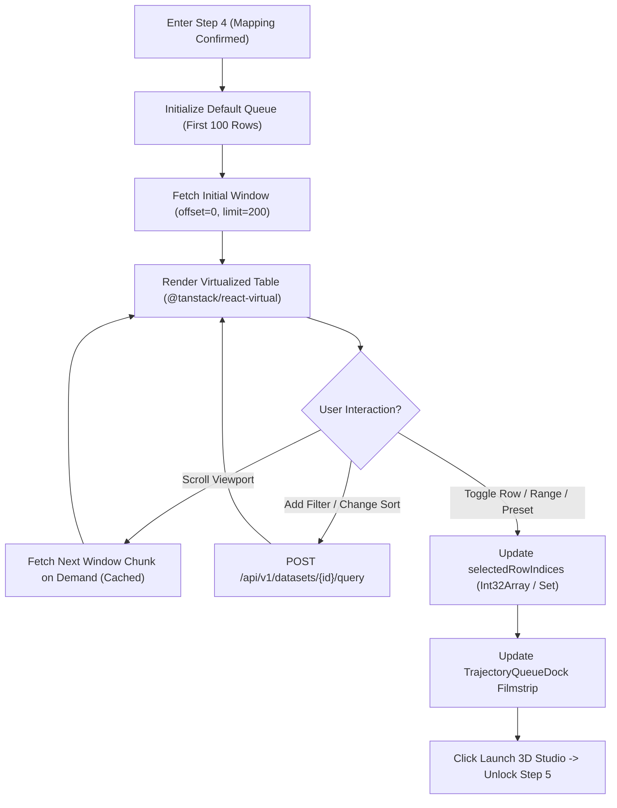

# Phase 06: Data Selector Studio — Virtualized Table, Multi-Select, Query Filter & Trajectory Queue

## 1. วัตถุประสงค์และขอบเขตของเฟส (Objective & Scope)
สร้างระบบคัดเลือกและจัดคิวแถวข้อมูลความเร็วสูง (**Data Selector Studio & Trajectory Playback Queue - Step 4**) เพื่อให้ผู้ใช้สามารถสำรวจ ค้นหา กรองตามเงื่อนไข เรียงลำดับ และเลือกแถวข้อมูลจากไฟล์ CSV/Parquet (ไม่ว่าจะเลือกทีละแถว เลือกเป็นช่วง เลือกแบบสุ่ม หรือเลือกทั้งชุดข้อมูล) เพื่อส่งเข้าสู่ **เครื่องเล่นวิดีโอ 3 มิติ (3D VCR Trajectory Player)** โดยออกแบบตารางด้วยเทคโนโลยี **Windowed Virtualization (`@tanstack/react-virtual`)** ที่เรนเดอร์เฉพาะแถวที่มองเห็นอยู่ในหน้าจอ ทำให้เลื่อนดูข้อมูลระดับ `100,000+ แถว` ได้ที่ความลื่นไหล **60 FPS** โดยไม่ทำให้เบราว์เซอร์ค้าง

### ขอบเขตงานในเฟสนี้ (In-Scope)
- การพัฒนา **Virtualized High-Speed Data Table** ที่แสดงทั้งหมายเลขแถวต้นฉบับ (`Original CSV Row #`), ค่าของตัวแปรที่ถูกจับคู่แล้ว (`Mapped Features`), และค่าคำตอบจริง (`Actual Target` ถ้ามี)
- การพัฒนาระบบเลือกแถวหลายโหมด (**Multi-Mode Row Selection**): เลือกทีละแถว (`Checkbox Toggle`), เลือกเป็นช่วง (`Shift + Click` หรือระบุช่วง `Start Row .. End Row` พร้อม `Step Stride`), และปุ่มลัด (`First 100`, `Random 100`, `All Filtered Rows`, `Clear Selection`)
- การพัฒนา **Safe Query Filter & Trajectory Sorter**: กรองข้อมูลด้วยเงื่อนไขเปรียบเทียบ (`>`, `>=`, `<`, `<=`, `==`, `!=`, `BETWEEN`) และเรียงลำดับคิวการเล่นตามคอลัมน์ที่ต้องการ (เช่น เรียงตาม `area_sqm` จากน้อยไปมาก เพื่อให้เห็นลูกบอลข้อมูลวิ่งไต่ระดับขึ้นไปบนระนาบ 3D อย่างมีระเบียบ)
- การพัฒนา **Trajectory Queue Preview Strip** ด้านล่างของหน้าจอสำหรับตรวจสอบลำดับเฟรม (`Frame 0 .. T-1`) ก่อนเข้าสู่ 3D Studio

---

## 2. UI Feature List อย่างละเอียด (Detailed UI Feature List)

### 2.1 Smart Filter, Range & Preset Toolbar (`DataSelectorToolbar.tsx`)
- **Quick Selection Presets Group**:
  - ปุ่ม `Select First 100` (ค่าเริ่มต้นอัตโนมัติเมื่อเปิดหน้า Step 4 ครั้งแรก)
  - ปุ่ม `Select Random 100 (Seeded)`
  - ปุ่ม `Select Range [From: ___ To: ___ Step: _]` (เช่น แถวที่ `0` ถึง `1000` ข้ามทีละ `5` แถว = `200 frames`)
  - ปุ่ม `Select All Matching (Max 10,000 Animated / 50,000 Static Cloud)`
  - ปุ่ม `Clear Queue (Esc)`
- **Interactive Condition Filter Builder (`FilterConditionBar.tsx`)**:
  - สร้างเงื่อนไขการกรองแบบไม่ต้องพิมพ์โค้ดเอง (Visual Rule Chips) เช่น `[area_sqm] [>=] [50.0] AND [bedrooms] [==] [3]`
  - ปุ่ม `+ Add Filter Rule` และปุ่ม `Apply Filters (Enter)`
- **Trajectory Playback Order Sorter (`TrajectorySortSelector.tsx`)**:
  - Dropdown เลือกการเรียงลำดับคิวเมื่อนำไปเล่นเป็นวิดีโอ 3D:
    - `Original CSV Row Order` (ตามลำดับแถวในไฟล์จริง)
    - `Sort by Feature Ascending / Descending` (เช่น เรียงตาม `area_sqm (Low -> High)`)
    - `Sort by Prediction / Residual Error` (เชื่อมต่อกับ Phase 07)

### 2.2 Virtualized High-Speed Data Grid (`VirtualizedDatasetTable.tsx`)
- **Sticky Header & Column Indicators**:
  - คอลัมน์ที่ 1: `Checkbox` + `Queue Frame #Badge` (แสดงว่าแถวนี้อยู่เป็นเฟรมที่เท่าไหร่ในคิว เช่น `Frame #14`)
  - คอลัมน์ที่ 2: `Original Row #` (หมายเลขแถวอ้างอิงตามไฟล์ CSV ต้นฉบับ เริ่มจาก `Row 0` และแสดงเลขบรรทัด Excel `Line 2`)
  - คอลัมน์ถัดไป: เฉพาะคอลัมน์ที่เป็น **Mapped Model Features** (มีป้าย `#0`, `#1`, `#2` สีฟ้า Cyan) และ **Actual Target** (ป้ายสีม่วง) พร้อมตัวเลือกเปิดดู `Show Unmapped Columns`
- **Viewport Windowing**:
  - เรนเดอร์ DOM `<tr>` เพียง `~25-35 แถว` ที่อยู่ใน Viewport เสมอ ไม่ว่าตารางจะมีกี่แสนแถวก็ตาม

### 2.3 Trajectory Queue Filmstrip Dock (`TrajectoryQueueDock.tsx`)
- แถบด้านล่างแสดงจำนวนเฟรมที่อยู่ในคิวปัจจุบัน เช่น `Active Trajectory Queue: 150 Frames Selected (Estimated Playback @ 1x: 15.0s)`
- แสดงรายการเฟรมย่อยแบบแนวนอน (`[Frame 0: Row #5] -> [Frame 1: Row #12] -> [Frame 2: Row #48] ...`) สามารถคลิกปุ่ม `x` เพื่อลบเฟรมออก หรือลากสลับลำดับได้
- ปุ่ม CTA หลัก: `Launch 3D Simulation Studio (150 Frames) ->`

### 2.4 States & Keyboard Shortcuts
- **Empty Filter Result State**: แสดงข้อความเมื่อเงื่อนไขการกรองไม่ตรงกับแถวใดเลย พร้อมปุ่ม `Reset Filters`
- **Keyboard Shortcuts**:
  - `Shift + Click`: เลือกแถวทั้งหมดตั้งแต่แถวล่าสุดที่คลิกจนถึงแถวปัจจุบัน
  - `Ctrl + A`: เลือกแถวที่ผ่านการกรองทั้งหมด (ภายใต้เพดานปลอดภัย)
  - `Delete / Backspace`: ลบแถวที่ไฮไลต์ออกจากคิวการเล่น

---

## 3. UX Flow & User Journey (Step-by-Step UX Flow & ASCII Wireframe)

### 3.1 ลำดับการทำงาน (Step-by-Step User Journey)
1. **การโหลดหน้าตารางครั้งแรกพร้อมค่าเริ่มต้น (Initial Paginated Window & Default Queue)**:
   - เมื่อเข้าสู่ Step 4 ระบบเลือกแถว `First 100 Rows` เข้าคิวให้อัตโนมัติ ताकिผู้ใช้ที่ต้องการดูผลเร็วๆ สามารถกดปุ่มเข้าสู่หน้า 3D Studio ได้ทันทีในคลิกเดียว
   - ตาราง Virtualized ดึงข้อมูลหน้าแรก (`offset=0, limit=200`) จาก Backend ผ่าน `POST /api/v1/datasets/{id}/query`
2. **การกรองและจัดเรียงคิว (Filtering & Trajectory Ordering)**:
   - ผู้ใช้เพิ่มตัวกรอง `area_sqm >= 60` และตั้งค่าเรียงลำดับคิวตาม `area_sqm (Ascending)`
   - Backend ประมวลผลด้วย PyArrow/Pandas คืนค่า `matching_row_indices` และหน้าข้อมูลชุดใหม่ภายใน `< 15 ms`
3. **การเลือกแถวเฉพาะเจาะจงและส่งเข้า 3D Studio**:
   - ผู้ใช้ติ๊กเลือกแถวที่สนใจเพิ่มเติมในตาราง หรือกดปุ่ม `Select Range [0..250]`
   - แถบ `TrajectoryQueueDock` ด้านล่างอัปเดตจำนวนเฟรมทันที เมื่อผู้ใช้กด `Launch 3D Simulation Studio ->` ระบบจะส่ง `row_indices` ของคิวนี้ไปยังขั้นตอนการจำลอง 3 มิติ

### 3.2 ASCII Wireframe: Step 4 Virtualized Data Selector & Trajectory Queue Studio
```text
+--------------------------------------------------------------------------------------------------+
| STEP 4: DATA SELECTOR & TRAJECTORY QUEUE                                 Total Rows: 125,000     |
+--------------------------------------------------------------------------------------------------+
| PRESETS: [First 100] [Random 100] [Range: 0..500 Step 2] [Select Filtered (1,420)] [Clear Queue] |
| FILTER : [area_sqm v] [>= v] [ 60.0 ]  [+ Add Rule]  |  PLAYBACK ORDER: [area_sqm (Low->High) v] |
+--------------------------------------------------------------------------------------------------+
| VIRTUALIZED DATA TABLE (Rendering 24 DOM rows in viewport @ 60 FPS)                              |
| +--------+------------+--------------+------------------+---------------+----------------------+ |
| | Select | Orig Row # | [#0]area_sqm | [#1]bedrooms     | [#2]dist_bts  | [Target]selling_price| |
| +--------+------------+--------------+------------------+---------------+----------------------+ |
| | [x] F0 | Row #14    |        60.50 |                2 |          4.10 |         2,980,000.00 | |
| | [x] F1 | Row #89    |        62.00 |                2 |          1.50 |         3,450,000.00 | |
| | [ ] -- | Row #203   |        64.20 |                1 |          8.20 |         2,150,000.00 | |
| | [x] F2 | Row #412   |        68.00 |                3 |          2.10 |         3,890,000.00 | |
| | [x] F3 | Row #519   |        75.50 |                3 |          0.90 |         4,520,000.00 | |
| +--------+------------+--------------+------------------+---------------+----------------------+ |
| TRAJECTORY PLAYBACK QUEUE (100 Frames Ready): [F0: #14] -> [F1: #89] -> [F2: #412] -> [F3: #519] |
| [ <- Back to Step 3 Mapping ]                           [ Launch 3D Simulation Studio (100) -> ] |
+--------------------------------------------------------------------------------------------------+
```

### 3.3 State Transition Diagram (Mermaid Flowchart)


---

## 4. สถาปัตยกรรม DDD แยกรายชั้นพร้อมชื่อไฟล์และ Class/Method Signatures (DDD Architecture & Code Blueprint)

### 4.1 โครงสร้างไฟล์ในเฟสที่ 6 (Directory Structure)
```text
backend/app/
├── domains/
│   └── dataset/
│       └── query_service.py
└── presentation/
    └── endpoints/
        └── dataset_query_endpoints.py

frontend/src/domains/trajectory_queue/
├── components/
│   ├── DataSelectorToolbar.tsx
│   ├── FilterConditionBar.tsx
│   ├── VirtualizedDatasetTable.tsx
│   └── TrajectoryQueueDock.tsx
└── store/
    └── useTrajectoryQueueStore.ts
```

### 4.2 Backend Domain Query Value Objects & Service (`backend/app/domains/dataset/query_service.py`)
```python
# backend/app/domains/dataset/query_service.py
from typing import Literal, Any
import numpy as np
import pandas as pd
from pydantic import BaseModel, Field

FilterOperator = Literal["eq", "neq", "gt", "gte", "lt", "lte", "between"]

class FilterRule(BaseModel):
    column: str
    operator: FilterOperator
    value: float | str | bool
    value_to: float | None = None

class DatasetQueryRequest(BaseModel):
    filters: list[FilterRule] = Field(default_factory=list)
    sort_by: str | None = None
    sort_ascending: bool = True
    offset: int = Field(default=0, ge=0)
    limit: int = Field(default=200, ge=1, le=1000)
    columns: list[str] | None = None

class DatasetQueryResponse(BaseModel):
    total_dataset_rows: int
    total_filtered_rows: int
    offset: int
    limit: int
    rows: list[dict[str, Any]]
    matching_row_indices_preview: list[int]

class DatasetQueryService:
    @staticmethod
    def execute_query(df: pd.DataFrame, req: DatasetQueryRequest) -> DatasetQueryResponse:
        mask = pd.Series(True, index=df.index)
        for rule in req.filters:
            if rule.column not in df.columns:
                continue
            col_s = df[rule.column]
            if rule.operator == "eq":
                mask &= col_s == rule.value
            elif rule.operator == "neq":
                mask &= col_s != rule.value
            elif rule.operator == "gt":
                mask &= col_s > float(rule.value)
            elif rule.operator == "gte":
                mask &= col_s >= float(rule.value)
            elif rule.operator == "lt":
                mask &= col_s < float(rule.value)
            elif rule.operator == "lte":
                mask &= col_s <= float(rule.value)
            elif rule.operator == "between" and rule.value_to is not None:
                mask &= (col_s >= float(rule.value)) & (col_s <= float(rule.value_to))

        filtered_df = df.loc[mask]
        if req.sort_by and req.sort_by in filtered_df.columns:
            filtered_df = filtered_df.sort_values(by=req.sort_by, ascending=req.sort_ascending, kind="mergesort")

        total_filtered = len(filtered_df)
        matching_indices = [int(i) for i in filtered_df.index[:10000]]

        window_df = filtered_df.iloc[req.offset : req.offset + req.limit]
        if req.columns:
            valid_cols = [c for c in req.columns if c in window_df.columns]
            window_df = window_df[valid_cols]

        records: list[dict[str, Any]] = []
        for orig_idx, row in window_df.iterrows():
            rec = {"_original_row_index": int(orig_idx)}
            for k, v in row.items():
                rec[k] = None if pd.isna(v) else (float(v) if isinstance(v, (np.floating, float)) else v)
            records.append(rec)

        return DatasetQueryResponse(
            total_dataset_rows=len(df),
            total_filtered_rows=total_filtered,
            offset=req.offset,
            limit=req.limit,
            rows=records,
            matching_row_indices_preview=matching_indices,
        )
```

### 4.3 Presentation REST API Layer (`backend/app/presentation/endpoints/dataset_query_endpoints.py`)
- **`POST /api/v1/datasets/{dataset_id}/query`**: รับ `DatasetQueryRequest` และคืนค่าหน้าต่างข้อมูลพร้อม `_original_row_index`
- **`POST /api/v1/datasets/{dataset_id}/resolve-selection`**: รับโหมดการเลือก (`first_n`, `random_n`, `range`, `filtered_all`) และคืนค่ารายการ `row_indices: list[int]` ที่เรียงตามลำดับการเล่นที่ต้องการ

### 4.4 Frontend Domain Store (`frontend/src/domains/trajectory_queue/store/useTrajectoryQueueStore.ts`)
```typescript
// frontend/src/domains/trajectory_queue/store/useTrajectoryQueueStore.ts
import { create } from 'zustand';

export interface FilterRule {
  id: string;
  column: string;
  operator: 'eq' | 'neq' | 'gt' | 'gte' | 'lt' | 'lte' | 'between';
  value: number | string;
  value_to?: number;
}

interface TrajectoryQueueState {
  selectedRowIndices: number[];
  selectedLookupSet: Set<number>;
  lastClickedRowIndex: number | null;
  filters: FilterRule[];
  sortBy: string | null;
  sortAscending: boolean;
  totalFilteredRows: number;
  toggleRowSelection: (origRowIndex: number, shiftKey?: boolean, visibleIndices?: number[]) => void;
  selectPreset: (preset: 'first_100' | 'random_100' | 'filtered_all' | 'clear') => Promise<void>;
  selectRange: (startRow: number, endRow: number, step: number) => void;
  reorderQueue: (fromIdx: number, toIdx: number) => void;
}
```

---

## 5. แผนการตรวจสอบหน่วยความจำและเพิ่มประสิทธิภาพทรัพยากรเครื่อง (Memory Check Plan & Process Resource Optimization)

### 5.1 Backend Memory Check & Safe Expression Filtering
- **Structured Filter Rules Only (Zero `df.eval()` Injection)**: ใช้ `FilterRule` เชิงโครงสร้างแทนการรัน `df.query(raw_string)` เพื่อป้องกันทั้งช่องโหว่ Code Execution และการสร้างสำเนาเมทริกซ์ชั่วคราวขนาดใหญ่ใน `numexpr`
- **Column-Pruned Parquet Slice**: เมื่อดึงข้อมูลมาแสดงในตาราง ให้โหลดเฉพาะคอลัมน์ที่จำเป็นต่อการแสดงผล (Mapped Features + Target) จากไฟล์ `.parquet` ด้วย `memory_map=True`

### 5.2 Frontend & WebGL Memory Optimization
- **Strict DOM Virtualization (`@tanstack/react-virtual`)**: จำกัดจำนวน `<tr>` ใน DOM ไม่ให้เกิน `40 แถว` ตลอดเวลา (`overscan: 8`) ทำให้ใช้ DOM Memory คงที่ต่ำกว่า `5 MB` แม้เปิดไฟล์ 500,000 แถว
- **$O(1)$ Selection Membership Lookup**: เก็บ `selectedLookupSet: Set<number>` ควบคู่กับ `selectedRowIndices: number[]` เพื่อให้แต่ละแถวใน Virtualized Table เช็กสถานะ Checkbox (`selectedLookupSet.has(row._original_row_index)`) ได้ในเวลา $O(1)$ แทนการใช้ `.includes()` ซึ่งเป็น $O(N)$

### 5.3 Process & CPU/GPU Resource Optimization
- **Windowed Fetch Caching & Scroll Throttling**: แบ่งหน้าข้อมูลทีละ `200 แถว` ต่อ Page และเก็บแคชสูงสุด `10 Pages (2,000 แถว)` ใน Frontend LRU Map หากเลื่อนตารางเร็วๆ จะใช้ `AbortController` ยกเลิก Request ของหน้าที่เลื่อนผ่านไปแล้วทันที

---

## 6. ไลบรารีที่ใช้และการตั้งค่า Offline 100% (Libraries & Offline Configuration)
- **Backend**: `pandas>=2.2.0`, `pyarrow>=17.0.0`, `numpy>=1.26.0`
- **Frontend**: `@tanstack/react-virtual@^3.10.0` (ขนาดเพียง ~3KB, 0 External Dependencies, 100% Offline), `zustand`, `lucide-react`

---

## 7. ตารางข้อควรระวังและ Edge Cases (Caveats & Edge Case Matrix)

| ลำดับ | เคสปัญหา (Edge Case) | สาเหตุทางเทคนิค (Root Cause) | วิธีป้องกันและแก้ไขแบบเจาะจง (Mitigation Strategy) |
| :--- | :--- | :--- | :--- |
| **1** | **หมายเลขแถวหลัง Filter/Sort ไม่ตรงกับแถวในไฟล์ CSV ต้นฉบับ** | หากใช้ Index ใหม่หลัง `.reset_index(drop=True)` ผู้ใช้จะสับสนเมื่อเทียบกับไฟล์ Excel ของตัวเอง | ห้ามรีเซ็ต Index เดิมทิ้ง ให้ส่งฟิลด์ `_original_row_index` ติดไปกับทุกแถว และแสดงทั้ง `Orig Row #` และ `Excel Line # (Row + 2)` |
| **2** | **เบราว์เซอร์ค้างเมื่อผู้ใช้กด `Select All` กับไฟล์ 500,000 แถว** | การสร้างคิวแอนิเมชันรายเฟรม 500,000 เฟรมพร้อมกันจะใช้ RAM สูงเกินไปในฝั่ง 3D Trajectory | แยกเพดานเป็น 2 โหมด: `Max Active Animated Trajectory = 10,000 Frames` (หากเกินจะทำ Stratified/Stride Subsampling อัตโนมัติ) และ `Max Background Point Cloud = 50,000 Points` |
| **3** | **การเรียงลำดับ (`sort_values`) ทำให้ลำดับของแถวที่มีค่าเท่ากันสลับไปมา** | `quicksort` เริ่มต้นของ Pandas ไม่ใช่ Stable Sort | บังคับระบุ `kind="mergesort"` ใน `filtered_df.sort_values(..., kind="mergesort")` เพื่อให้ลำดับคงที่ (Deterministic) เสมอ |
| **4** | **ผู้ใช้กด `Shift + Click` ข้ามช่วงที่ถูกกรองออกไปแล้ว** | หากใช้การบวกเลข `start..end` ตรงๆ จะเผลอเลือกแถวที่ถูกซ่อนโดย Filter ติดมาด้วย | เมื่อทำ `Shift + Click` ในขณะที่เปิด Filter อยู่ ให้เลือกเฉพาะแถวที่อยู่ในรายการ `matching_row_indices` ระหว่างจุดเริ่มต้นและจุดสิ้นสุดเท่านั้น |
| **5** | **ผู้ใช้เผลอกดปุ่มไปต่อโดยที่มี `0 แถว` ในคิว** | เผลอกด `Clear Queue` แล้วกดไปต่อ | ปิดการใช้งานปุ่ม `Launch 3D Simulation Studio ->` เมื่อ `selectedRowIndices.length === 0` พร้อมแสดง Tooltip ให้เลือกอย่างน้อย 1 แถว |
| **6** | **คอลัมน์ที่ใช้ Sort มีค่า `NaN` ปนอยู่** | ค่า `NaN` อาจไปกองอยู่ด้านบนสุดหรือล่างสุดโดยไม่ชัดเจน | กำหนด `na_position="last"` เสมอใน `sort_values()` เพื่อให้แถวที่มีข้อมูลครบถ้วนถูกเล่นก่อนในคิว 3D |

---

## 8. เกณฑ์การตรวจรับงาน (Definition of Done Checklist)
- [ ] ตาราง `VirtualizedDatasetTable` เลื่อนดูข้อมูลระดับ `100,000 แถว` ได้ที่ 60 FPS โดยจำนวน `<tr>` ใน DOM ไม่เกิน 40 โหนด
- [ ] รองรับการเลือกแถวแบบ Checkbox ทีละแถว, `Shift + Click`, การระบุ Range + Step Stride, และปุ่มลัด `First 100` / `Random 100`
- [ ] ระบบกรองข้อมูล (`FilterConditionBar`) และการเรียงลำดับคิวการเล่น (`TrajectorySortSelector`) ทำงานร่วมกันโดยยังคงรักษา `_original_row_index` ได้อย่างถูกต้อง
- [ ] แถบ `TrajectoryQueueDock` แสดงรายการเฟรมที่เลือกไว้พร้อมส่งเข้าสู่หน้าจอ Global Evaluation / 3D Studio ได้ทันที
