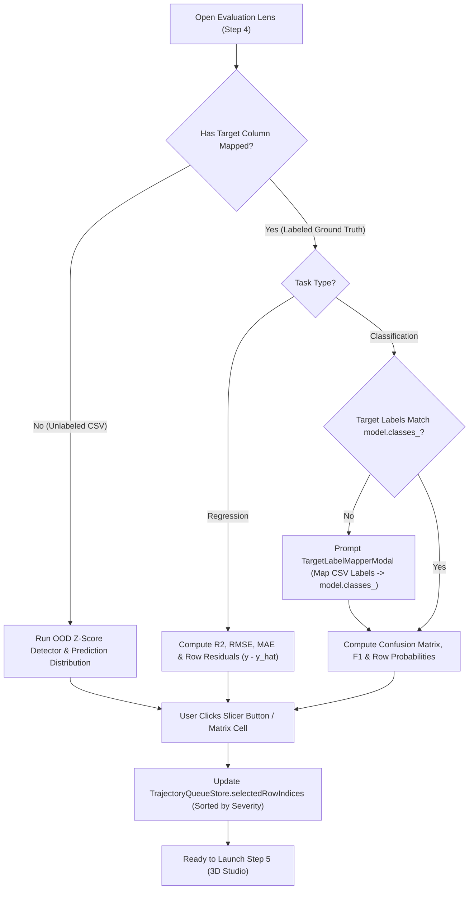

# Phase 07: Global Evaluation Lens — Interactive Confusion Matrix, Residual Slicer & Error Auto-Queue

## 1. วัตถุประสงค์และขอบเขตของเฟส (Objective & Scope)
เชื่อมโยงมุมมองการประเมินผลโมเดลระดับมหภาคทั้งชุดข้อมูล (**Macro Global Evaluation Lens**) เข้ากับการคัดเลือกแถวข้อมูลเข้าคิวระดับจุลภาค (**Micro Trajectory Queue ใน Phase 06**) เมื่อผู้ใช้ระบุคอลัมน์คำตอบจริง (`Actual Target / Ground Truth`) ในขั้นตอน Mapping หรือแม้ในกรณีที่ไม่มีคอลัมน์คำตอบจริง (**Unlabeled OOD / Outlier Slicer**) เพื่อให้ผู้ใช้สามารถคลิกเลือกเฉพาะ **"กลุ่มตัวอย่างที่โมเดลทำนายผิดพลาดรุนแรงที่สุด (Top Worst Residuals / False Positives / False Negatives)"** หรือ **"ข้อมูลสุดโต่งนอกขอบเขตปกติ (Out-of-Distribution $> 3\text{ SD}$)"** ส่งตรงเข้าสู่เครื่องเล่นวิดีโอ 3 มิติได้ในคลิกเดียวโดยไม่ต้องสุ่มหาแถวที่มีปัญหาด้วยตนเอง

### ขอบเขตงานในเฟสนี้ (In-Scope)
- การพัฒนา **Regression Global Evaluation Service**: คำนวณค่า $R^2$, $\text{RMSE}$, $\text{MAE}$, $\text{MAPE}$, กราฟการกระจายความคลาดเคลื่อน ($\text{Residual } e = y - \hat{y}$), และปุ่มลัดคัดเลือกแถวที่ทายผิดมากที่สุด (`Queue Top 50 Worst Errors`, `Top Over-predictions`, `Top Under-predictions`)
- การพัฒนา **Classification Global Evaluation Service**: คำนวณตาราง **Interactive Confusion Matrix**, ค่า $\text{Accuracy}$, $\text{Macro/Weighted Precision}$, $\text{Recall}$, $\text{F1-Score}$ พร้อมฟีเจอร์ **Click-Cell-to-Queue** (คลิกช่อง `False Positives` หรือ `False Negatives` เพื่อส่งแถวในช่องนั้นเข้าคิว 3D ทันที) และตัวคัดกรองแถวที่โมเดลไม่มั่นใจ (`Low Confidence / Boundary Uncertainty Near 50%`)
- การพัฒนา **Target Label Harmonizer**: ระบบจับคู่ค่าคำตอบใน CSV (เช่น `"Yes"/"No"` หรือ `"Churn"/"Stay"`) ให้ตรงกับ `model.classes_` (เช่น `[1, 0]`) โดยอัตโนมัติหรือให้ผู้ใช้ปรับแก้ได้
- การพัฒนา **Out-of-Distribution (OOD) & Statistical Outlier Detector**: ค้นหาแถวที่มีค่าตัวแปรนำเข้าหลุดขอบเขต $|z\text{-score}| > 3.0$ (ทำงานได้แม้ไฟล์ CSV ไม่มีคอลัมน์คำตอบจริง)

---

## 2. UI Feature List อย่างละเอียด (Detailed UI Feature List)

### 2.1 Global Metrics KPI Ribbon (`GlobalMetricsRibbon.tsx`)
- **สำหรับงาน Regression (`TaskType == 'regression'`)**:
  - การ์ดแสดงค่า `R² Score` (พร้อมแถบสีบอกระดับคุณภาพ), `RMSE (Root Mean Squared Error)`, `MAE (Mean Absolute Error)`, `Max Absolute Error`, และจำนวนแถวที่ประเมินทั้งหมด
- **สำหรับงาน Classification (`binary` / `multiclass`)**:
  - การ์ดแสดงค่า `Overall Accuracy (%)`, `Macro F1-Score`, `Precision`, `Recall`, และจำนวนแถวที่ทายถูก vs ทายผิด (`Correct: 9,420 | Misclassified: 580`)
- **สำหรับชุดข้อมูลที่ไม่มีคอลัมน์คำตอบ (`Unlabeled Mode`)**:
  - แสดงสถิติการกระจายของค่าทำนาย (`Prediction Min / Max / Mean / SD`) และจำนวนแถวที่เป็น `Statistical Outliers (> 3 SD)`

### 2.2 Regression Residual Slicer & Actual-vs-Predicted Widget (`ResidualSlicerPanel.tsx`)
- **Interactive Actual vs. Predicted SVG Scatter & Residual Histogram**:
  - กราฟแสดงจุดเปรียบเทียบค่าจริง ($y$) กับค่าทำนาย ($\hat{y}$) พร้อมเส้นทแยงมุมอุดมคติ ($y = \hat{y}$) และโซนแรเงาความคลาดเคลื่อนสูง (สีแดง Rose)
- **1-Click Error Auto-Queue Buttons**:
  - ปุ่ม `[🔥 Queue Top 50 Worst Absolute Errors (|y - ŷ|)]`: คัด 50 แถวที่ทายผิดหนักที่สุดเรียงจากผิดมากไปน้อยเข้าคิวทันที
  - ปุ่ม `[⬆️ Queue Top 50 Over-predicted (ŷ >> y)]`: คัดเฉพาะแถวที่โมเดลประเมินสูงเกินจริง
  - ปุ่ม `[⬇️ Queue Top 50 Under-predicted (ŷ << y)]`: คัดเฉพาะแถวที่โมเดลประเมินต่ำเกินจริง
  - ปุ่ม `[🎯 Queue Top 50 Best Predictions (|y - ŷ| ≈ 0)]`: คัดแถวที่โมเดลทายแม่นที่สุดเพื่อใช้เปรียบเทียบ

### 2.3 Interactive Confusion Matrix Grid (`InteractiveConfusionMatrix.tsx`)
- ตารางขนาด $K \times K$ (สำหรับ Binary $2 \times 2$ และ Multiclass สูงสุด $10 \times 10$):
  - ช่องแนวทแยงมุม (`True Positives / True Negatives`): พื้นหลังโทนสีเขียว Emerald
  - ช่องนอกแนวทแยงมุม (`False Positives / False Negatives`): พื้นหลังโทนสีแดง/ส้ม Rose-Amber พร้อมแสดงจำนวนแถว (`Count`) และสัดส่วน (`%`)
  - **Click-to-Queue Interaction**: เมื่อคลิกที่ช่องใดในตาราง (เช่น คลิกช่อง `Actual: Class 1, Predicted: Class 0 (42 rows)`) ระบบจะโหลดเฉพาะ 42 แถวนั้นเข้าสู่ `TrajectoryQueue` ทันที!
- **Borderline Uncertainty Slicer**:
  - ปุ่ม `[⚖️ Queue 50 Most Uncertain Rows (Prob ≈ 0.50)]`: คัดแถวที่ตกอยู่ใกล้เส้นแบ่งเขตการตัดสินใจ (Decision Boundary) มากที่สุด

### 2.4 Out-of-Distribution (OOD) & Outlier Slicer (`OutlierSlicerCard.tsx`)
- ปุ่ม `[⚠️ Queue Extreme Feature Outliers (|Z-Score| > 3.0)]`: คัดกรองแถวที่มีค่าตัวแปรนำเข้าสุดโต่งเพื่อดูว่าจุดเหล่านั้นลอยออกไปนอกกลุ่มข้อมูลใน 3 มิติอย่างไร

### 2.5 States & Keyboard Shortcuts
- **Label Mismatch Modal (`TargetLabelMapperModal.tsx`)**: เด้งขึ้นอัตโนมัติเมื่อชนิดข้อมูลของคอลัมน์คำตอบใน CSV ไม่ตรงกับ `model.classes_`
- **Keyboard Shortcuts**:
  - `Alt + E`: กดปุ่มลัด `Queue Top 50 Worst Errors` ทันที

---

## 3. UX Flow & User Journey (Step-by-Step UX Flow & ASCII Wireframe)

### 3.1 ลำดับการทำงาน (Step-by-Step User Journey)
1. **การคำนวณผลประเมินภาพรวม (Batch Evaluation Computation)**:
   - เมื่อผู้ใช้เข้าสู่หน้า Data Selector & Evaluation (Step 4) ระบบเรียก `POST /api/v1/evaluations/compute`
   - Backend อ่านไฟล์ Parquet แบบแบ่งก้อน (`Chunk Size = 25,000 rows`), รัน `adapter.predict_batch()`, คำนวณค่าความคลาดเคลื่อนรายแถว และสรุปเป็น Global Metrics ส่งกลับมาภายใน `< 150 ms`
2. **การคลิกเลือกกลุ่มข้อผิดพลาดเข้าคิว (1-Click Error Slicing -> Trajectory Queue)**:
   - ผู้ใช้เห็นว่ามีจุดที่โมเดลทายราคาบ้านผิดไปถึง `1.8 ล้านบาท` จึงกดปุ่ม `[🔥 Queue Top 50 Worst Absolute Errors]`
   - ระบบอัปเดต `useTrajectoryQueueStore` ด้วยรายการ `row_indices` ของ 50 แถวนั้นเรียงจากความผิดพลาดสูงสุดลงมา พร้อมไฮไลต์แถวในตาราง Virtualized Table
3. **การส่งเข้าสู่หน้า 3D Studio**:
   - ผู้ใช้กดปุ่ม `Launch 3D Studio (50 Worst Error Frames) ->` เพื่อไปดูเส้นดิ่งสีแดง (`Residual Error Drop-lines`) ของทั้ง 50 แถวในฉาก 3 มิติ

### 3.2 ASCII Wireframe: Global Evaluation Lens & Error Auto-Queue Panel
```text
+--------------------------------------------------------------------------------------------------+
| GLOBAL EVALUATION LENS & ERROR SLICER (Target: selling_price)          [Re-Map Target Labels]    |
+--------------------------------------------------------------------------------------------------+
| KPI SUMMARY: [ R² Score: 0.894 (Excellent) ] [ RMSE: 245,120 ] [ MAE: 182,400 ] [ Outliers: 34 ] |
+--------------------------------------------------------------------------------------------------+
| +--------------------------------------------------+ +-----------------------------------------+ |
| | RESIDUAL ERROR DISTRIBUTION (e = y_actual - ŷ)   | | 1-CLICK ERROR AUTO-QUEUE PRESETS        | |
| |                                                  | |                                         | |
| |      Under-Predicted    0     Over-Predicted     | | [🔥 Queue Top 50 Worst Errors (|e|)   ] | |
| |          (-1.5M)        |        (+1.6M)         | | [⬆️ Queue Top 50 Over-Predicted (ŷ>y) ] | |
| |             ▁▂▃▄▆█▇▄▂▁  |  ▁▂▄▆█▆▄▂▁             | | [⬇️ Queue Top 50 Under-Predicted(ŷ<y) ] | |
| |      [Click Red Tails to Slice Extreme Errors]   | | [🎯 Queue Top 50 Most Accurate (e≈0)  ] | |
| |                                                  | | [⚠️ Queue 34 OOD Feature Outliers(>3σ)] | |
| +--------------------------------------------------+ +-----------------------------------------+ |
| ACTIVE SLICER STATUS: Queued 50 Worst Error Rows (Row #812: Err=+1.62M -> Row #104: Err=-1.48M)  |
+--------------------------------------------------------------------------------------------------+
```

### 3.3 State Transition Diagram (Mermaid Flowchart)


---

## 4. สถาปัตยกรรม DDD แยกรายชั้นพร้อมชื่อไฟล์และ Class/Method Signatures (DDD Architecture & Code Blueprint)

### 4.1 โครงสร้างไฟล์ในเฟสที่ 7 (Directory Structure)
```text
backend/app/
├── domains/
│   └── simulation/
│       ├── evaluation_value_objects.py
│       └── evaluation_service.py
├── application/
│   └── evaluation_use_case.py
└── presentation/
    └── endpoints/
        └── evaluation_endpoints.py

frontend/src/domains/evaluation/
├── components/
│   ├── GlobalMetricsRibbon.tsx
│   ├── ResidualSlicerPanel.tsx
│   ├── InteractiveConfusionMatrix.tsx
│   └── OutlierSlicerCard.tsx
└── store/
    └── useEvaluationStore.ts
```

### 4.2 Backend Domain Evaluation Value Objects & Service (`backend/app/domains/simulation/`)
```python
# backend/app/domains/simulation/evaluation_value_objects.py
from pydantic import BaseModel, Field

class RegressionEvaluationReport(BaseModel):
    r2_score: float
    rmse: float
    mae: float
    max_abs_error: float
    residual_hist_bins: list[float]
    residual_hist_counts: list[int]
    top_worst_abs_error_indices: list[int]
    top_over_predicted_indices: list[int]
    top_under_predicted_indices: list[int]
    top_accurate_indices: list[int]

class ConfusionMatrixCell(BaseModel):
    actual_class_idx: int
    predicted_class_idx: int
    actual_label: str
    predicted_label: str
    row_count: int
    percentage: float
    sample_row_indices: list[int] = Field(default_factory=list)

class ClassificationEvaluationReport(BaseModel):
    accuracy: float
    macro_precision: float
    macro_recall: float
    macro_f1: float
    class_labels: list[str]
    cells: list[ConfusionMatrixCell]
    all_misclassified_indices: list[int]
    most_uncertain_indices: list[int]

class GlobalEvaluationSummary(BaseModel):
    task_type: str
    evaluated_row_count: int
    ood_outlier_indices: list[int]
    regression: RegressionEvaluationReport | None = None
    classification: ClassificationEvaluationReport | None = None
```

```python
# backend/app/domains/simulation/evaluation_service.py
import numpy as np
from sklearn.metrics import mean_absolute_error, mean_squared_error, r2_score
from app.domains.simulation.evaluation_value_objects import (
    GlobalEvaluationSummary,
    RegressionEvaluationReport,
)

class GlobalEvaluationService:
    @staticmethod
    def compute_ood_outliers(X_float32: np.ndarray, top_k: int = 50) -> list[int]:
        mean = np.nanmean(X_float32, axis=0, dtype=np.float64)
        std = np.nanstd(X_float32, axis=0, dtype=np.float64)
        std[std < 1e-8] = 1.0
        z_scores = np.abs((X_float32 - mean) / std)
        max_z_per_row = np.nanmax(z_scores, axis=1)
        outlier_mask = np.where(max_z_per_row > 3.0)[0]
        sorted_outliers = outlier_mask[np.argsort(-max_z_per_row[outlier_mask])]
        return [int(i) for i in sorted_outliers[:top_k]]

    @staticmethod
    def evaluate_regression(
        y_true: np.ndarray, y_pred: np.ndarray, top_k: int = 50
    ) -> RegressionEvaluationReport:
        valid_mask = ~(np.isnan(y_true) | np.isnan(y_pred))
        valid_indices = np.where(valid_mask)[0]
        yt = y_true[valid_mask].astype(np.float64)
        yp = y_pred[valid_mask].astype(np.float64)

        residuals = yt - yp
        abs_err = np.abs(residuals)

        r2 = float(r2_score(yt, yp)) if len(yt) > 1 else 0.0
        rmse = float(np.sqrt(mean_squared_error(yt, yp)))
        mae = float(mean_absolute_error(yt, yp))
        max_err = float(np.max(abs_err)) if len(abs_err) > 0 else 0.0

        counts, bins = np.histogram(residuals, bins=16)
        worst_idx = valid_indices[np.argsort(-abs_err)[:top_k]]
        over_idx = valid_indices[np.argsort(residuals)[:top_k]]   # y - y_hat < 0 => y_hat > y
        under_idx = valid_indices[np.argsort(-residuals)[:top_k]] # y - y_hat > 0 => y_hat < y
        best_idx = valid_indices[np.argsort(abs_err)[:top_k]]

        return RegressionEvaluationReport(
            r2_score=round(r2, 4),
            rmse=round(rmse, 4),
            mae=round(mae, 4),
            max_abs_error=round(max_err, 4),
            residual_hist_bins=[round(float(b), 4) for b in bins],
            residual_hist_counts=[int(c) for c in counts],
            top_worst_abs_error_indices=[int(i) for i in worst_idx],
            top_over_predicted_indices=[int(i) for i in over_idx],
            top_under_predicted_indices=[int(i) for i in under_idx],
            top_accurate_indices=[int(i) for i in best_idx],
        )
```

### 4.3 Presentation REST API Layer (`backend/app/presentation/endpoints/evaluation_endpoints.py`)
- **`POST /api/v1/evaluations/compute`**: รับ `{ "dataset_id": "...", "model_id": "...", "mapping_id": "...", "top_k": 50 }` คืนค่า `GlobalEvaluationSummary`

### 4.4 Frontend Store (`frontend/src/domains/evaluation/store/useEvaluationStore.ts`)
```typescript
// frontend/src/domains/evaluation/store/useEvaluationStore.ts
import { create } from 'zustand';

interface EvaluationStoreState {
  summary: GlobalEvaluationSummary | null;
  isComputing: boolean;
  activeSlicerTag: string | null;
  computeGlobalEvaluation: (datasetId: string, modelId: string, mappingId: string) => Promise<void>;
  applyErrorSliceToQueue: (sliceType: 'worst_abs' | 'over_pred' | 'under_pred' | 'accurate' | 'ood' | 'misclassified' | 'uncertain') => void;
  applyConfusionCellToQueue: (actualIdx: number, predictedIdx: number) => void;
}
```

---

## 5. แผนการตรวจสอบหน่วยความจำและเพิ่มประสิทธิภาพทรัพยากรเครื่อง (Memory Check Plan & Process Resource Optimization)

### 5.1 Backend Memory Check & Chunked Evaluation Pipeline
- **Chunked Batch Prediction (`CHUNK_SIZE = 25,000 rows`)**: หากไฟล์ข้อมูลมีขนาดใหญ่ (เช่น `200,000 แถว`) ห้ามสร้างเมทริกซ์ `X_float32` ทั้ง 200,000 แถวในคราวเดียว ให้วนลูปอ่านจาก Parquet ทีละ `25,000 แถว`, คำนวณ `y_pred_chunk`, เก็บเฉพาะเวกเตอร์ 1 มิติ `y_pred (float32)` และ `max_z_per_row (float32)` แล้วลบ `X_chunk` ทิ้งในทุกรอบลูป
- **Partial Heap Sort (`np.argpartition`)**: เมื่อต้องการหา Top $K$ ($K=50$) แถวที่ผิดพลาดสูงสุดจากข้อมูลนับแสนแถว ให้ใช้ `np.argpartition(-abs_err, kth=min(top_k, len(abs_err)-1))` ซึ่งใช้เวลา $O(N)$ แทนการทำ Full Sort $O(N \log N)$

### 5.2 Frontend & WebGL Memory Optimization
- **Pre-Aggregated Histogram & Cell Indices**: Backend ส่งเฉพาะค่าสถิติที่สรุปแล้ว (`residual_hist_counts` 16 แท่ง และ `sample_row_indices` ไม่เกินช่องละ 500 แถว) ทำให้ Payload มีขนาดเล็กกว่า `25 KB` เสมอ

---

## 6. ไลบรารีที่ใช้และการตั้งค่า Offline 100% (Libraries & Offline Configuration)
- **Backend**: `scikit-learn>=1.5.0` (`metrics`), `numpy>=1.26.0`
- **Frontend**: Pure Interactive `<svg>` Components (ไม่ใช้ External Charting CDN), `zustand`, `lucide-react`

---

## 7. ตารางข้อควรระวังและ Edge Cases (Caveats & Edge Case Matrix)

| ลำดับ | เคสปัญหา (Edge Case) | สาเหตุทางเทคนิค (Root Cause) | วิธีป้องกันและแก้ไขแบบเจาะจง (Mitigation Strategy) |
| :--- | :--- | :--- | :--- |
| **1** | **ค่าในคอลัมน์ `Actual Target` ไม่ตรงกับชนิดของ `model.classes_`** | ใน CSV เป็น `"Yes"/"No"` หรือ `"1"/"0"` (string) แต่ `model.classes_` เป็น `[0, 1]` (int) ทำให้ `confusion_matrix` โยน `ValueError: Mix of label input types` | สร้าง `TargetLabelHarmonizer` แปลงชนิดข้อมูลอัตโนมัติ (เช่น `"1" -> 1`) หรือเปิด `TargetLabelMapperModal` ให้ผู้ใช้จับคู่ก่อนคำนวณ |
| **2** | **คอลัมน์ `Actual Target` มีค่าว่าง (`NaN`) ในบางแถว** | แถวที่เป็นข้อมูลใหม่รอทำนายปะปนมากับแถวที่มีคำตอบจริง | กรองด้วย `valid_mask = ~pd.isna(y_true)` ก่อนส่งเข้าฟังก์ชันคำนวณ Metrics และคืนค่า `valid_indices[...]` เพื่อให้อ้างอิงกลับไปยังหมายเลขแถวจริงได้ถูกต้อง |
| **3** | **ตัวแปรนำเข้ามีค่าคงที่ทั้งคอลัมน์ ($\text{SD} = 0$) ตอนคำนวณ Z-Score** | เกิดการหารด้วยศูนย์ (`ZeroDivisionError` / `NaN`) ใน `compute_ood_outliers` | บังคับ `std[std < 1e-8] = 1.0` ก่อนหารเสมอ เพื่อให้คอลัมน์ที่มีค่าคงที่ได้ค่า Z-Score เป็น `0.0` อย่างปลอดภัย |
| **4** | **ช่องใน Confusion Matrix มี `0 แถว` แล้วผู้ใช้เผลอคลิก** | การคลิกช่องที่มีค่าเป็น `0` อาจทำให้คิวการเล่นว่างเปล่า | ปิดการคลิก (`disabled` cursor) สำหรับช่องใน Confusion Matrix ที่มี `row_count === 0` |
| **5** | **ค่า $R^2$ ติดลบมหาศาลเมื่อผู้ใช้เลือกคอลัมน์ `Actual Target` ผิด** | ผู้ใช้เผลอเลือกคอลัมน์อื่นที่ไม่ใช่คำตอบของโมเดล (เช่น เลือก `bedrooms` แทน `selling_price`) | หากตรวจพบว่า $R^2 < -1.0$ ให้แสดงแถบเตือนสีเหลือง `"Scale Mismatch Warning: Actual target column scale differs significantly from model predictions. Verify target column selection."` |
| **6** | **Multiclass ที่มีจำนวนคลาสมากเกินไป (เช่น $> 20$ คลาส)** | ตาราง Confusion Matrix จะล้นหน้าจอและอ่านยาก | หากจำนวนคลาส $> 10$ ให้สลับโหมดแสดงเป็นตาราง `Top 15 Most Confused Class Pairs` แทนตารางจัตุรัสขนาดใหญ่ |

---

## 8. เกณฑ์การตรวจรับงาน (Definition of Done Checklist)
- [ ] คำนวณค่า $R^2, \text{RMSE}, \text{MAE}$ และกราฟกระจายตัวของ Residual Error สำหรับโมเดล Regression ได้อย่างถูกต้อง
- [ ] ปุ่มลัด `Queue Top 50 Worst Errors`, `Over-predicted`, `Under-predicted`, และ `OOD Outliers (> 3 SD)` ส่งรายการ `row_indices` เข้าสู่ `useTrajectoryQueueStore` ได้ในคลิกเดียว
- [ ] ตาราง Interactive Confusion Matrix รองรับการคลิกที่ช่อง `FP / FN` เพื่อส่งแถวที่ทายผิดเข้าคิวได้ทันที
- [ ] ประมวลผลแบบแบ่งก้อน (`Chunked Evaluation`) และใช้ `np.argpartition` โดยไม่ทำให้ RAM พุ่งสูง
