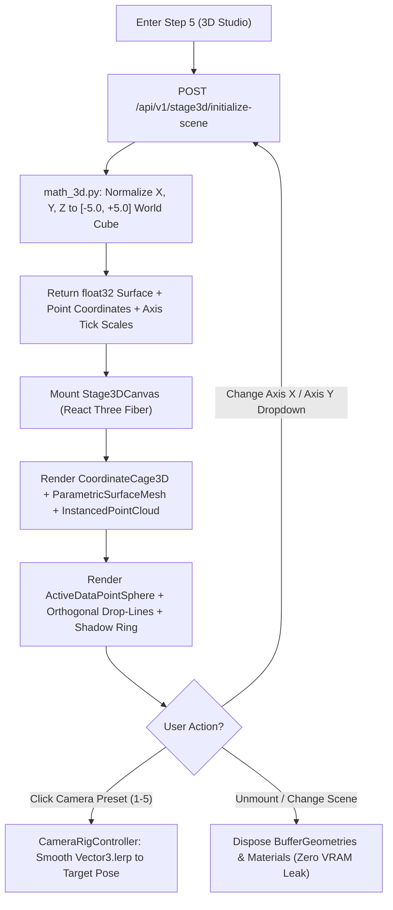

# Phase 08: 3D Stage Core — React Three Fiber Setup, Camera Presets, Drop-Lines, Shadows & Grid

## 1. วัตถุประสงค์และขอบเขตของเฟส (Objective & Scope)
สร้างเครื่องยนต์แสดงผล 3 มิติหลักของระบบ (**3D Coordinate Stage Engine & Spatial Orientation System**) ในฝั่ง Frontend (`frontend/src/domains/stage3d/`) และบริการคำนวณพิกัดมาตรฐานในฝั่ง Backend (`backend/app/core/math_3d.py`) ด้วย **Three.js + React Three Fiber (`@react-three/fiber`) + `@react-three/drei`** ที่ทำงานแบบ **100% Offline (Zero External Font/HDR CDN Requests)** โดยออกแบบภายใต้ปรัชญา **"ดูง่าย ไม่เวียนหัว ไม่หลงทิศ อ่านค่าจริงได้ทันที"** ด้วยระบบกล่องพิกัดมาตรฐาน `[-5.0, +5.0]` (**Normalized World Cube**), ปุ่มสลับมุมกล้องมาตรฐาน 5 มุมมอง (**1-Click Smooth Camera Presets**), เส้นประทิ้งดิ่งพร้อมเงาวงแหวนบนพื้น (**Orthogonal Drop-Lines & Ground Target Shadow**), และการวาดกลุ่มจุดข้อมูลพื้นหลังสูงสุด `50,000 จุด` ใน `1 Draw Call` ด้วย `THREE.InstancedMesh` ที่ความลื่นไหลระดับ **60 FPS**

### ขอบเขตงานในเฟสนี้ (In-Scope)
- การพัฒนาโมดูล `math_3d.py` สำหรับแปลงค่าข้อมูลจริงที่มีสเกลต่างกัน (เช่น `area_sqm: 20..450` และ `price: 1M..45M`) ให้เป็นพิกัดโลก 3 มิติมาตรฐาน `[-5.0, +5.0]` พร้อมเก็บค่าจริง (`raw_value`) สำหรับแสดงบนป้ายกำกับแกน (`Tick Labels`)
- การสร้างฉาก 3D Stage (`Stage3DCanvas.tsx`) พร้อมไฟส่องสว่างแบบ Local (`ambientLight`, `directionalLight`, `hemisphereLight`) โดยไม่อาศัยไฟล์ `.hdr` จากอินเทอร์เน็ต
- การสร้างระบบกล้องอัจฉริยะ (`CameraRigController.tsx`) รองรับมุมมอง `Isometric 3D`, `Top-Down 2D (X-Y)`, `Front Profile (X-Z)`, `Side Profile (Y-Z)`, และ `Follow Ball Camera` ด้วยการเคลื่อนที่แบบ `Vector3.lerp` นุ่มนวล
- การสร้างลูกบอลข้อมูลแถวปัจจุบัน (`ActiveDataPointSphere.tsx`) พร้อมเส้นประทิ้งดิ่งตั้งฉาก 3 แกน (`Orthogonal Drop-Lines`), เงาวงแหวนบนพื้น (`Ground Shadow Ring`), และเส้นเชื่อมความคลาดเคลื่อนสีแดง/เขียว (`Residual Error Drop-Line` ระหว่างจุดทำนาย $\hat{y}$ กับจุดคำตอบจริง $y_{\text{actual}}$)
- การสร้าง `InstancedPointCloud.tsx` สำหรับวาดจุดข้อมูลในคิวทั้งหมดเป็นฉากหลังด้วย `THREE.InstancedMesh`

---

## 2. UI Feature List อย่างละเอียด (Detailed UI Feature List)

### 2.1 3D Axis Assignment & Surface Control Bar (`StageAxisControlBar.tsx`)
- **Axis Dropdown Selectors**:
  - `X-Axis Feature (Red Axis)`: เลือกตัวแปรแกนแนวนอน (เช่น `area_sqm`)
  - `Y-Axis Feature (Cyan/Green Axis)`: เลือกตัวแปรแกนลึก (เช่น `distance_bts_km`)
  - `Z-Axis Output (Vertical Height)`: แสดงค่าทำนายของโมเดล ($\hat{y}$ เช่น `Predicted selling_price`)
- **Layer Visibility Toggles**:
  - ปุ่มเปิด/ปิดชั้นข้อมูล (`Toggle Pills`): `[x] 3D Model Surface`, `[x] Drop-Lines & Shadows`, `[x] Residual Error Bars`, `[x] Background Point Cloud`, `[x] Axis Tick Labels`

### 2.2 1-Click Camera Preset HUD (`CameraPresetHUD.tsx`)
- แถบปุ่มลอยมุมขวาบนของจอ 3D สำหรับสลับมุมมองทันทีโดยไม่หลงทิศ:
  - `[1] Isometric 3D (Default 45°)`: มุมมองสามมิติสมดุลเห็นทั้งพื้นผิวและความสูง
  - `[2] Top-Down 2D (X-Y Map)`: มองลงมาจากด้านบนตั้งฉาก เหมือนแผนที่ 2 มิติ
  - `[3] Front View (X vs Z)`: มองด้านหน้าตรงๆ เพื่อดูความชันระหว่างตัวแปรแกน $X$ กับค่าทำนาย $Z$
  - `[4] Side View (Y vs Z)`: มองด้านข้างเพื่อดูความสัมพันธ์ระหว่างตัวแปรแกน $Y$ กับค่าทำนาย $Z$
  - `[5] Follow Active Ball (Auto-Track)`: ล็อกเป้าหมุนตามลูกบอลข้อมูลขณะเล่นแอนิเมชัน
  - `[R] Reset Camera Zoom & Pan`

### 2.3 Spatial Orientation Aids in 3D Scene (`CoordinateCage3D.tsx` & `ActiveDataPointSphere.tsx`)
- **Normalized `[-5, +5]` Coordinate Cage & Ground Grid**:
  - ตารางกริดบนพื้นระนาบล่างสุด ($Z_{\text{world}} = -5.0$) พร้อมเส้นแกนหลัก 3 สี และป้ายชื่อตัวแปร + สเกลตัวเลขจริง 5 ระดับต่อแกน (เรนเดอร์ด้วย `<Html>` ของ `drei` ที่คมชัดและไม่ต้องโหลดฟอนต์ `.woff` จากเน็ต)
- **Active Row Data Sphere & Orthogonal Drop-Lines**:
  - ลูกบอลเรืองแสงแสดงตำแหน่งของแถวปัจจุบัน $(x_t, y_t, \hat{z}_t)$
  - **Vertical Ground Drop-Line**: เส้นประพุ่งดิ่งจากลูกบอลลงมายังพื้น $(x_t, y_t, -5)$ พร้อมวงแหวนเรืองแสง (`Target Reticle Ring`) ที่พื้นเพื่อให้รู้ว่าลูกบอลลอยอยู่เหนือพิกัด $(X, Y)$ ใดแน่ชัด
  - **Axis Projection Lines**: เส้นประพุ่งไปตั้งฉากกับแกน $X$, แกน $Y$, และแกนความสูง $Z$ พร้อมป้ายตัวเลขค่าจริงลอยกำกับ
  - **Actual Ground-Truth Pin & Residual Connector**: หากแถวนั้นมีค่าคำตอบจริง ($y_{\text{actual}}$) จะวาดหมุดทรงเพชรที่ความสูงจริง และลากท่อเรืองแสงเชื่อมระหว่าง $\hat{y}$ กับ $y_{\text{actual}}$ (สีเขียวหากคลาดเคลื่อนต่ำ, สีแดงสดหากคลาดเคลื่อนสูง)

### 2.4 States & Keyboard Shortcuts
- **WebGL Context Lost Recovery Overlay**: หากการ์ดจอรีเซ็ตจะมีปุ่ม `Restore 3D Context` กู้คืนฉากอัตโนมัติ
- **Keyboard Shortcuts**:
  - ปุ่มตัวเลข `1`, `2`, `3`, `4`, `5`: สลับมุมกล้องทั้ง 5 โหมดทันที
  - `R`: รีเซ็ตมุมกล้องกลับสู่ค่าเริ่มต้น
  - `G`: เปิด/ปิดเส้นประ Drop-Lines และตาราง Grid

---

## 3. UX Flow & User Journey (Step-by-Step UX Flow & ASCII Wireframe)

### 3.1 ลำดับการทำงาน (Step-by-Step User Journey)
1. **การเตรียมฉากและแปลงพิกัดมาตรฐาน (Scene Initialization & World Normalization)**:
   - เมื่อเข้าสู่ Step 5 Frontend ส่ง `dataset_id`, `model_id`, `mapping_id`, `selected_row_indices`, และคู่แกน `(axis_x, axis_y)` ไปยัง `POST /api/v1/stage3d/initialize-scene`
   - Backend คำนวณขอบเขต `min/max` ของแกน $X, Y, Z$ แปลงพิกัดของทั้งพื้นผิว `SurfaceMesh3D` (`50x50`) และจุดข้อมูลในคิวให้เป็นพิกัดโลก `[-5.0, +5.0]` ชนิด `float32` พร้อมแนบสเกลค่าจริง (`AxisScaleMeta`) ส่งกลับมา
2. **การเรนเดอร์ฉาก 3 มิติ (60 FPS Instanced & Surface Rendering)**:
   - `ParametricSurfaceMesh` วาดแผ่นระนาบโปร่งแสงของโมเดล Linear Regression
   - `InstancedPointCloud` วาดจุดข้อมูลทั้งหมดในคิวด้วย `THREE.InstancedMesh` เพียง 1 Draw Call
   - `ActiveDataPointSphere` วาดลูกบอลของเฟรมที่ 0 พร้อมเส้นประทิ้งดิ่งลงพื้นและป้ายบอกค่า
3. **การสำรวจมุมมองด้วย 1-Click Camera Presets**:
   - เมื่อผู้ใช้กดปุ่ม `[3] Front View (X vs Z)` กล้องจะเคลื่อนที่แบบ Smooth Lerp ลงมามองระนาบด้านหน้า ทำให้เห็นความชันของเส้นสมการเชิงเส้นเทียบกับจุดข้อมูลได้ชัดเจนเหมือนกราฟ 2D ทันที

### 3.2 ASCII Wireframe: Step 5 3D Stage Engine, Drop-Lines & Camera Preset HUD
```text
+--------------------------------------------------------------------------------------------------+
| 3D STAGE STUDIO | X:[area_sqm v] Y:[distance_bts_km v] Z:[Predicted Price] | [x]Surface [x]Drops |
+--------------------------------------------------------------------------------------------------+
|                                                                CAMERA PRESETS (Keys 1-5, R):     |
|                  Z (Predicted Price: 1.2M .. 18.9M THB)        [● 1: Iso 3D] [2: Top X-Y]        |
|                  ^                                             [3: Front X-Z] [4: Side Y-Z]      |
|        15.0M ----|               /==================/          [5: Follow Ball] [R: Reset]       |
|                  |              /  Tilted Linear   /                                             |
|        10.0M ----|             /   Hyperplane     /     ◆ Actual y = 3.90M                       |
|                  |            /       ● <-------------- | Residual e = +57k                      |
|         5.0M ----|- - - - - -/- - - - | - - - - /       (Active Sphere: ŷ = 3.84M)               |
|                  |          /=========|========/                                                 |
|                  |                    |  (Vertical Orthogonal Drop-Line)                         |
|         1.2M ----+--------------------|----------------------------> X (area_sqm: 22 .. 450)     |
|                 /                    (◎) <- Ground Target Shadow Ring at (x=80.0, y=2.2)         |
|                /                      :                                                          |
|               v Y (distance_bts_km)   :.. [80.0 sqm, 2.2 km]                                     |
|                                                                                                  |
| FPS: 60.0 | Draw Calls: 6 | Geometries: 4 | Instanced Points: 100 | WebGL2 Memory: 8.4 MB        |
+--------------------------------------------------------------------------------------------------+
```

### 3.3 State Transition Diagram (Mermaid Flowchart)


---

## 4. สถาปัตยกรรม DDD แยกรายชั้นพร้อมชื่อไฟล์และ Class/Method Signatures (DDD Architecture & Code Blueprint)

### 4.1 โครงสร้างไฟล์ในเฟสที่ 8 (Directory Structure)
```text
backend/app/
├── core/
│   └── math_3d.py
├── application/
│   └── stage3d_use_case.py
└── presentation/
    └── endpoints/
        └── stage3d_endpoints.py

frontend/src/domains/stage3d/
├── components/
│   ├── Stage3DCanvas.tsx
│   ├── StageAxisControlBar.tsx
│   ├── CameraPresetHUD.tsx
│   ├── CameraRigController.tsx
│   ├── CoordinateCage3D.tsx
│   ├── ParametricSurfaceMesh.tsx
│   ├── InstancedPointCloud.tsx
│   └── ActiveDataPointSphere.tsx
├── hooks/
│   └── useDisposableThreeResources.ts
└── store/
    └── useStage3DStore.ts
```

### 4.2 Backend 3D Coordinate Normalizer (`backend/app/core/math_3d.py`)
```python
# backend/app/core/math_3d.py
import numpy as np
from pydantic import BaseModel

WORLD_MIN: float = -5.0
WORLD_MAX: float = 5.0
WORLD_SPAN: float = 10.0

class AxisScaleMeta(BaseModel):
    axis_name: str
    feature_index: int | None
    raw_min: float
    raw_max: float
    tick_world_positions: list[float]
    tick_raw_labels: list[float]

class WorldCoordinateScaler:
    @staticmethod
    def build_axis_scale(name: str, values: np.ndarray, feature_idx: int | None = None, n_ticks: int = 5) -> AxisScaleMeta:
        clean = values[~np.isnan(values)]
        raw_min = float(np.min(clean)) if len(clean) > 0 else 0.0
        raw_max = float(np.max(clean)) if len(clean) > 0 else 1.0
        if abs(raw_max - raw_min) < 1e-7:
            raw_min -= 1.0
            raw_max += 1.0

        world_ticks = np.linspace(WORLD_MIN, WORLD_MAX, n_ticks, dtype=np.float32)
        raw_ticks = np.linspace(raw_min, raw_max, n_ticks, dtype=np.float32)
        return AxisScaleMeta(
            axis_name=name,
            feature_index=feature_idx,
            raw_min=raw_min,
            raw_max=raw_max,
            tick_world_positions=[round(float(w), 3) for w in world_ticks],
            tick_raw_labels=[round(float(r), 4) for r in raw_ticks],
        )

    @staticmethod
    def to_world_coords(values: np.ndarray, scale: AxisScaleMeta) -> np.ndarray:
        span = max(scale.raw_max - scale.raw_min, 1e-7)
        norm_01 = (np.asarray(values, dtype=np.float32) - np.float32(scale.raw_min)) / np.float32(span)
        world = np.float32(WORLD_MIN) + norm_01 * np.float32(WORLD_SPAN)
        return np.clip(world, WORLD_MIN - 2.0, WORLD_MAX + 2.0).astype(np.float32)
```

### 4.3 Presentation REST API Layer (`backend/app/presentation/endpoints/stage3d_endpoints.py`)
- **`POST /api/v1/stage3d/initialize-scene`**
  - **Request JSON**:
    ```json
    {
      "dataset_id": "ds_8f92a1c4",
      "model_id": "mdl_3c71e80b",
      "mapping_id": "map_109a",
      "axis_x_feature_index": 0,
      "axis_y_feature_index": 2,
      "selected_row_indices": [14, 89, 412],
      "grid_resolution": 50
    }
    ```
  - **Response `200 OK` Schema**:
    ```json
    {
      "axes": {
        "x": {"axis_name": "area_sqm", "feature_index": 0, "raw_min": 22.0, "raw_max": 450.0, "tick_world_positions": [-5.0, -2.5, 0.0, 2.5, 5.0], "tick_raw_labels": [22.0, 129.0, 236.0, 343.0, 450.0]},
        "y": {"axis_name": "distance_bts_km", "feature_index": 2, "raw_min": 0.1, "raw_max": 25.4, "tick_world_positions": [-5.0, -2.5, 0.0, 2.5, 5.0], "tick_raw_labels": [0.1, 6.42, 12.75, 19.07, 25.4]},
        "z": {"axis_name": "Predicted selling_price", "feature_index": null, "raw_min": 410000.0, "raw_max": 18950000.0, "tick_world_positions": [-5.0, -2.5, 0.0, 2.5, 5.0], "tick_raw_labels": [410000.0, 5045000.0, 9680000.0, 14315000.0, 18950000.0]}
      },
      "surface": {
        "visual_type": "flat_hyperplane",
        "resolution": 50,
        "world_vertices_xyz": [-5.0, -5.0, -4.12, -4.79, -5.0, -3.95]
      },
      "trajectory_points": [
        {
          "frame_index": 0,
          "original_row_index": 14,
          "world_x": -3.64,
          "world_y": -3.42,
          "world_z_pred": -3.15,
          "world_z_actual": -3.11,
          "raw_x": 80.0,
          "raw_y": 4.1,
          "raw_z_pred": 3843000.0,
          "raw_z_actual": 3900000.0,
          "residual_error": 57000.0
        }
      ]
    }
    ```

### 4.4 Frontend 3D Store & Camera Controller (`frontend/src/domains/stage3d/`)
```typescript
// frontend/src/domains/stage3d/store/useStage3DStore.ts
import { create } from 'zustand';

export type CameraPresetMode = 'isometric' | 'top_xy' | 'front_xz' | 'side_yz' | 'follow_ball';

export interface TrajectoryPoint3D {
  frame_index: number;
  original_row_index: number;
  world_x: number;
  world_y: number;
  world_z_pred: number;
  world_z_actual: number | null;
  raw_x: number;
  raw_y: number;
  raw_z_pred: number;
  raw_z_actual: number | null;
  residual_error: number | null;
}

interface Stage3DState {
  axisXFeatureIndex: number;
  axisYFeatureIndex: number;
  cameraPreset: CameraPresetMode;
  showSurface: boolean;
  showDropLines: boolean;
  showResidualBars: boolean;
  showBackgroundCloud: boolean;
  activeFrameIndex: number;
  surfaceVerticesFloat32: Float32Array | null;
  points: TrajectoryPoint3D[];
  setCameraPreset: (preset: CameraPresetMode) => void;
  setActiveFrameIndex: (frameIdx: number) => void;
  setAxes: (xIdx: number, yIdx: number) => Promise<void>;
}
```

---

## 5. แผนการตรวจสอบหน่วยความจำและเพิ่มประสิทธิภาพทรัพยากรเครื่อง (Memory Check Plan & Process Resource Optimization)

### 5.1 Backend Memory Check & Flat Array Serialization
- **Pre-Flattened Interleaved Vertex Buffer**: คำนวณพิกัด `[x0, y0, z0, x1, y1, z1, ...]` ชนิด `float32` ใน NumPy ให้เสร็จเรียบร้อยในครั้งเดียว เพื่อลดความซับซ้อนของ Nested Objects ใน JSON

### 5.2 Frontend & WebGL Memory Optimization (`Zero VRAM Leak Policy`)
- **Explicit GPU Buffer Disposal (`geometry.dispose()` & `material.dispose()`)**:
  - ใน React Three Fiber เมื่อผู้ใช้เปลี่ยนแกน $X/Y$ หรือเปลี่ยนโมเดล จะต้องเรียก `geometry.dispose()` และ `material.dispose()` ใน `useEffect` cleanup เสมอ เพื่อคืนหน่วยความจำการ์ดจอ (VRAM) ทันที
- **Single Draw Call via `THREE.InstancedMesh`**:
  - ห้ามสร้าง `<mesh>` แยกทีละจุดด้วย `.map()` เกิน 50 จุดเด็ดขาด จุดข้อมูลพื้นหลังทั้งหมด (`สูงสุด 50,000 จุด`) ต้องเรนเดอร์ผ่าน `<instancedMesh args={[sphereGeo, mat, count]}>` เพียงโหนดเดียว โดยอัปเดต `instanceMatrix` และ `instanceColor` ด้วย `Float32Array`
- **Re-use Scratch `THREE.Vector3` & `THREE.Matrix4` Outside `useFrame`**:
  - ห้ามเขียน `new THREE.Vector3()` ภายในลูป `useFrame((state, delta) => ...)` ที่ถูกเรียก 60 ครั้งต่อวินาที เพราะจะสร้างขยะใน JS Heap จนเกิดอาการกระตุกจาก Garbage Collection (GC Stutter) ให้ประกาศ `const _scratchVec = new THREE.Vector3()` ไว้นอกฟังก์ชัน Component เสมอ

### 5.3 Process & CPU/GPU Resource Optimization
- **Device Pixel Ratio Cap (`dpr={[1, 2]}`)**: จำกัดความละเอียด `<Canvas dpr={[1, Math.min(window.devicePixelRatio, 2)]}>` เพื่อป้องกันไม่ให้หน้าจอ 4K/Retina ใช้ภาระ GPU Shader สูงเกินความจำเป็น

---

## 6. ไลบรารีที่ใช้และการตั้งค่า Offline 100% (Libraries & Offline Configuration)
- **Frontend**:
  - `three@^0.170.0`, `@types/three@^0.170.0`, `@react-three/fiber@^9.0.0` (รองรับ React 19), `@react-three/drei@^10.0.0`
- **กฎเหล็กสำหรับ `@react-three/drei` ในโหมด Offline 100%**:
  - **ห้ามใช้ `<Environment preset="..." />`** เด็ดขาด เพราะ `drei` จะดึงไฟล์ `.hdr` จาก `raw.githubusercontent.com` ซึ่งจะทำให้ฉาก 3D พังทันทีเมื่อไม่มีอินเทอร์เน็ต ให้จัดไฟด้วย `<ambientLight intensity={0.7} />`, `<directionalLight position={[10, 15, 10]} intensity={1.2} />`, และ `<hemisphereLight />` เท่านั้น
  - **การใช้ป้ายตัวอักษรใน 3D**: ใช้ `<Html center distanceFactor={15}>` ของ `drei` ซึ่งเรนเดอร์ด้วย CSS DOM และฟอนต์ในเครื่องที่โหลดไว้แล้วใน Phase 01 คมชัด 100% และไม่ดึงฟอนต์ Troika `.woff` จาก `cdn.jsdelivr.net`

---

## 7. ตารางข้อควรระวังและ Edge Cases (Caveats & Edge Case Matrix)

| ลำดับ | เคสปัญหา (Edge Case) | สาเหตุทางเทคนิค (Root Cause) | วิธีป้องกันและแก้ไขแบบเจาะจง (Mitigation Strategy) |
| :--- | :--- | :--- | :--- |
| **1** | **ฉาก 3D มืดสนิทหรือค้างในเครื่องที่ไม่มีอินเทอร์เน็ต** | เผลอใช้ `<Environment>` หรือ `<Text>` ของ `drei` โดยไม่ระบุ Local Font Path ทำให้ติด CORS/Network Error | ใช้ `<Html>` สำหรับป้ายกำกับแกน และใช้ไฟ `<ambientLight>` + `<directionalLight>` ล้วน 100% |
| **2** | **ข้อมูลจริงมีสเกลต่างกันล้านเท่า (เช่น `bedrooms: 1..5` vs `price: 1M..50M`)** | หากพล็อตค่าดิบลงใน Three.js ตรงๆ แกนหนึ่งจะแคบเป็นเส้นด้ายในขณะที่อีกแกนยาวทะลุกล้อง (`Frustum Clipping`) | บังคับแปลงทุกแกนเข้าสู่ `Normalized World Cube [-5.0, +5.0]` ด้วย `WorldCoordinateScaler` แต่แสดงตัวเลขจริง (`tick_raw_labels`) บนเส้นแกนและ Tooltip |
| **3** | **ข้อมูลในคอลัมน์ที่เลือกเป็นแกนมีค่าเท่ากันทุกแถว (`raw_max == raw_min`)** | ทำให้เกิดการหารด้วยศูนย์ `(v - min) / (max - min)` ได้ค่า `NaN` ส่งเข้า `BufferAttribute` จน WebGL พัง | ใน `build_axis_scale()` เช็ก `if abs(raw_max - raw_min) < 1e-7` ให้ขยายขอบเขตเป็น `[raw_min - 1.0, raw_max + 1.0]` เสมอ |
| **4** | **จุดข้อมูล Outlier มีค่าทะลุสเกลจนลูกบอลลอยหลุดออกจากจอ** | แถวที่เป็น Outlier รุนแรงอาจมีพิกัดโลกเป็น `+45.0` เลยกรอบกล่อง `[-5, +5]` | ใช้ `np.clip(world, -7.0, +7.0)` จำกัดขอบเขตสูงสุดและแสดงป้ายเตือน `[Out-of-Bounds Clamped]` บนลูกบอลนั้น |
| **5** | **ผู้ใช้งงทิศทางและความลึกในอวกาศ 3 มิติ (Parallax Illusion)** | การมองจุดลอยอยู่ในอวกาศ 3 มิติโดยไม่มีสิ่งอ้างอิงทำให้ดูไม่ออกว่าตรงกับค่า $X, Y$ เท่าไหร่ | วาดเส้นประตั้งฉาก (`Orthogonal Drop-Lines`) พุ่งจากลูกบอลลงมายังพื้นพร้อมวงแหวนเงา (`Shadow Ring`) และมีปุ่ม `1-Click Camera Presets (1-5)` ให้สลับดูมุมตรงได้ทันที |
| **6** | **VRAM รั่วไหล (Memory Leak) เมื่อผู้ใช้สลับแกน $X/Y$ ไปมาหลายครั้ง** | Three.js ไม่ลบ `BufferGeometry` ใน GPU อัตโนมัติเมื่อ React Component Unmount | สร้าง Hook `useDisposableThreeResources` เพื่อสั่ง `.dispose()` ทุกครั้งที่มีการเปลี่ยนชุด Vertex Array |

---

## 8. เกณฑ์การตรวจรับงาน (Definition of Done Checklist)
- [ ] ฉาก 3D Stage เรนเดอร์กล่องพิกัด `[-5, +5]`, พื้นผิวโมเดล (`ParametricSurfaceMesh`), และจุดข้อมูลพื้นหลัง (`InstancedPointCloud`) ได้ที่ 60 FPS แบบ Offline 100%
- [ ] ปุ่มสลับมุมกล้องทั้ง 5 โหมด (`Isometric`, `Top X-Y`, `Front X-Z`, `Side Y-Z`, `Follow Ball`) เคลื่อนที่แบบ Smooth Lerp และกดคีย์ลัด `1-5, R` ใช้งานได้จริง
- [ ] ลูกบอลแถวปัจจุบันแสดงเส้นประทิ้งดิ่งตั้งฉากลงพื้น, วงแหวนเงาบนพื้น, และเส้นเชื่อม Residual Error ระหว่างจุดทำนาย ($\hat{y}$) กับจุดคำตอบจริง ($y_{\text{actual}}$)
- [ ] ป้ายกำกับแกนแสดงค่าจริงตามสเกลข้อมูลต้นฉบับ (`tick_raw_labels`) และไม่มีการรั่วไหลของหน่วยความจำ WebGL (VRAM) เมื่อสลับแกนหรือเปลี่ยนโมเดล
