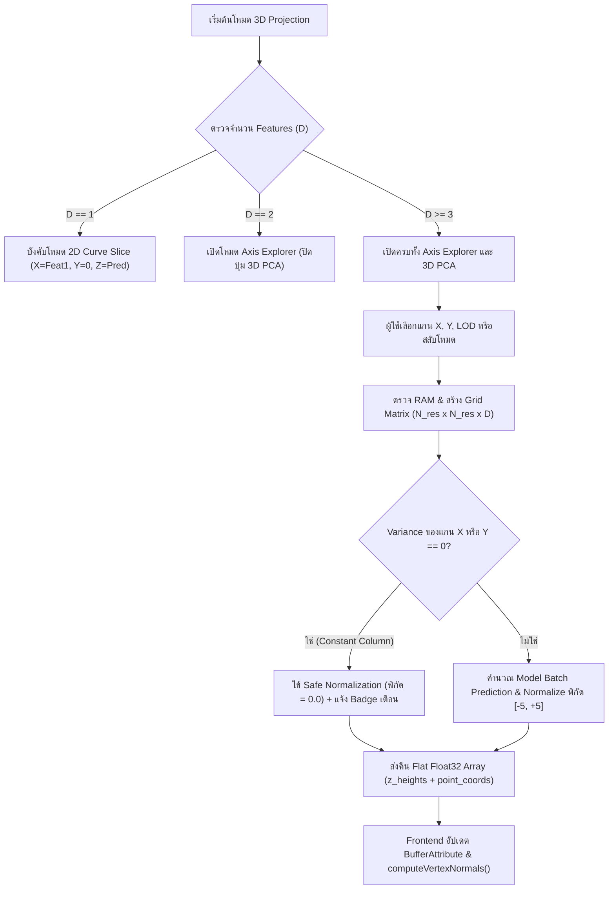

# Phase 09: 3D Math Core — Axis Explorer Slice Generator, 3D PCA Projection & LOD Surface Mesh

## 1. วัตถุประสงค์และขอบเขตของเฟส (Objective & Scope)
พัฒนาระบบคำนวณทางคณิตศาสตร์ 3 มิติ (`backend/app/core/math_3d.py` และโดเมน `spatial_projection`) เพื่อแปลงข้อมูลตารางที่มีหลายคอลัมน์ (High-Dimensional Features, $D \ge 1$) และสมการการตัดสินใจของโมเดล Machine Learning ให้กลายเป็น **พื้นผิวภูมิประเทศ 3 มิติ (3D Decision Surface Mesh)** และ **พิกัดจุดข้อมูล 3 มิติ ($X, Y, Z$)** ที่พร้อมเรนเดอร์บน WebGL / Three.js ที่ความเร็ว 60 FPS

### ขอบเขตการทำงาน (Scope)
- **Mode 1: Axis Explorer & 2D-Slice Surface Generator**: ผู้ใช้เลือก Feature สำหรับแกน $X$ และแกน $Y$ (ระบบตั้งค่าเริ่มต้นให้เป็น Top 2 Features ที่มีค่าความสำคัญสูงสุดโดยอัตโนมัติ) ส่วนแกน $Z$ แสดงผลทำนายของโมเดล (Predicted Value สำหรับ Regression หรือ Class Probability สำหรับ Classification) พร้อมโหมดตรึงค่า Feature อื่นๆ ที่ไม่ได้เลือก (`Non-Axis Features Pinning`):
  - `Median / Mean Static Slice`: ตรึงค่า Feature อื่นไว้ที่ค่ามัธยฐานหรือค่าเฉลี่ยของ Dataset ทำให้พื้นผิว 3D นิ่งคงที่ตลอดการเล่น
  - `Dynamic Current Frame Slice`: พื้นผิว 3D ปรับเปลี่ยนรูปร่างตามค่า Feature อื่นๆ ของแถวปัจจุบัน ($t$) แบบ Real-time
- **Mode 2: 3D PCA / SVD Manifold Projection**: ใช้ `sklearn.decomposition.PCA(n_components=3)` ร่วมกับ `StandardScaler` ย่อทุก Feature ลงมาเป็นแกน $PC_1, PC_2, PC_3$ พร้อมคำนวณสัดส่วนความแปรปรวนที่อธิบายได้ (`explained_variance_ratio_`)
- **LOD (Level-of-Detail) Grid Mesh Generator**: สร้างกริดความละเอียดปรับระดับได้ (`Low: 30x30 = 900 จุด`, `Standard: 60x60 = 3,600 จุด`, `High: 100x100 = 10,000 จุด`) พร้อมคำนวณ Vertex Color และ Surface Normal

---

## 2. UI Feature List อย่างละเอียด (Detailed UI Feature List)
1. **3D Projection Control Bar (`ProjectionControlToolbar.tsx`)**:
   - **Projection Mode Segmented Toggle**: ปุ่มสลับโหมดระหว่าง `[ 🏔️ Axis Explorer (2D Slice + Z Pred) ]` และ `[ 🌌 3D PCA Manifold (PC1/PC2/PC3) ]`
   - **Axis X Selector Dropdown**: รายการเลือก Feature สำหรับแกนแนวนอน $X$ พร้อมแสดง Badge อันดับความสำคัญ เช่น `[#1] income (float64)` และค้นหาชื่อคอลัมน์ได้
   - **Axis Y Selector Dropdown**: รายการเลือก Feature สำหรับแกนลึก $Y$ พร้อมปุ่ม `⇄ Swap X/Y` สำหรับสลับแกนทันที
   - **Axis Z Target Mode Selector**: เลือกสิ่งที่แสดงบนความสูงแกน $Z$ (`Predicted Value`, `Class Probability [Class k]`, `Prediction Error |y - y_hat|`, หรือ `Feature 3`)
   - **Background Feature Pinning Selector**: Dropdown เลือกวิธีตรึงค่าคอลัมน์อื่นที่ไม่ได้อยู่บนแกน $X, Y$ (`Dataset Median (Recommended)`, `Dataset Mean`, `Zero Baseline`, `Dynamic Current Row Follow`)
   - **LOD Resolution Selector Badge**: ปุ่มเลือกความละเอียดพื้นผิว `Low (30×30)` | `Std (60×60)` | `High (100×100)` พร้อมแสดงจำนวน Triangles และเวลาคำนวณล่าสุด (เช่น `3.6k pts • 14ms`)
2. **PCA Variance Explained HUD Card (`PcaVarianceBadge.tsx`)**:
   - แสดงเมื่ออยู่ในโหมด 3D PCA: แสดงค่า `% Variance Explained` ของแต่ละแกน เช่น `PC1: 48.2% | PC2: 24.5% | PC3: 11.8% (Total: 84.5%)`
   - ปุ่ม `View PCA Loadings Matrix` เปิด Popover แสดงตารางน้ำหนักของแต่ละ Feature ที่มีผลต่อแกน $PC_1, PC_2, PC_3$
3. **Surface Mesh Appearance Popover (`SurfaceAppearancePopover.tsx`)**:
   - **Colormap Selector**: `Viridis`, `Plasma`, `CoolWarm (Blue-Red)`, `RdYlGn`, `Cyberpunk Neon`
   - **Opacity Slider**: ปรับความโปร่งใสของพื้นผิว `0.10` ถึง `1.00` (ค่าเริ่มต้น `0.78`)
   - **Wireframe Overlay Toggle**: เปิด/ปิดเส้นตารางกริดบนพื้นผิวภูเขา 3D
   - **Iso-Contour Lines Toggle**: แสดงเส้นชั้นความสูงและเส้นแบ่งเขตการตัดสินใจ (`P = 0.50 Decision Boundary Contour`)
4. **States & Feedback**:
   - **Empty State**: แสดงโครงตาราง Wireframe ราบเรียบพร้อมข้อความ `"เลือกโมเดลและชุดข้อมูลเพื่อสร้างพื้นผิวการตัดสินใจ 3 มิติ"`
   - **Loading Skeleton**: แสดงแอนิเมชันคลื่น Sine Wave สีฟ้าอ่อนบนพื้นผิวกริดระหว่างรอผลคำนวณพื้นผิวใหม่จาก Backend
   - **Error State Banner**: แจ้งเตือนพร้อมปุ่ม `Reset to Default Axes` เมื่อคอลัมน์ที่เลือกมีค่าเป็น `NaN` ทั้งหมดหรือโมเดลไม่รองรับการทำนายแบบ Grid
   - **Keyboard Shortcuts**:
     - `G`: เปิด/ปิดการแสดงพื้นผิว 3D Surface Mesh
     - `W`: เปิด/ปิดโหมดเส้นโครงตาข่าย (Wireframe Mode)
     - `P`: สลับระหว่างโหมด `Axis Explorer` และ `3D PCA`
   - **Tooltips**: อธิบายความหมายของ `Non-Axis Features Pinning` และข้อจำกัดของโหมด PCA เมื่อจำนวน Feature น้อยกว่า 3

---

## 3. UX Flow & User Journey (Step-by-Step UX Flow & ASCII Wireframe)

### ลำดับการทำงาน (Step-by-Step User Journey)
1. **Initial Auto-Configuration**: เมื่อผู้ใช้โหลดโมเดลและข้อมูลสำเร็จ ระบบวิเคราะห์ Feature Importance เบื้องต้น และเลือก Feature อันดับ 1 เป็นแกน $X$ และอันดับ 2 เป็นแกน $Y$ โดยอัตโนมัติที่ความละเอียด `Standard LOD (60x60)`
2. **User Interaction (การเปลี่ยนแกนหรือความละเอียด)**: ผู้ใช้คลิก Dropdown เปลี่ยนแกน $X$ จาก `age` เป็น `credit_score` หรือเปลี่ยน LOD เป็น `High (100x100)`
3. **System Validation & Request**:
   - Frontend ตรวจสอบว่าแกน $X$ และ $Y$ ไม่ใช่คอลัมน์เดียวกัน (หากเลือกซ้ำกันจะสลับแกนให้อัตโนมัติหรือขึ้นข้อความแจ้งเตือน)
   - ส่งคำขอ `POST /api/v1/projection/surface-mesh` พร้อมพารามิเตอร์แกนและโหมด Pinning
4. **Backend Grid Synthesis & Evaluation**:
   - Backend สร้างเมทริกซ์ตารางพิกัด $(X_{grid}, Y_{grid})$ ขนาด $N_{res} \times N_{res}$ และเติมค่าคอลัมน์อื่นๆ ด้วยค่า Median ของ Dataset
   - ส่งเมทริกซ์ทั้งหมดเข้า `model_adapter.predict_batch()` ในครั้งเดียว (Vectorized Batch Prediction) แล้ว Normalize พิกัดให้อยู่ในกรอบ `[-5.0, +5.0]` ของฉาก 3D
5. **Smooth 3D Surface Morphing**:
   - เมื่อ Frontend ได้รับ `Float32Array` ของความสูงแกน $Z$ ระบบจะทำ Vertex Morphing (Interpolate ความสูงเดิมไปยังความสูงใหม่ภายใน 250ms) และคำนวณ `computeVertexNormals()` ใหม่โดยไม่สร้าง Geometry ใหม่ซ้ำซ้อน

### ASCII Wireframe
```text
+--------------------------------------------------------------------------------------------------+
| [🏔️ Axis Explorer | 🌌 3D PCA]  X:[#1 credit_score v] [⇄] Y:[#2 annual_income v]  Z:[Prob(1) v] |
| Pin Others:[Median (Static) v]  LOD:[Low|●Std 60x60|High]  [🎨 Colormap: CoolWarm v] [Wireframe] |
+--------------------------------------------------------------------------------------------------+
|                                                                                  | PCA / Surface |
|                              Z (Predicted Prob)                                  | Stats Card    |
|                                     ^                                            |---------------|
|                                 1.0 |         _.-""-._                           | Grid: 60 x 60 |
|                                     |      .-"  /  \  "-.                        | Verts: 3,600  |
|                                 0.5 |----/----/------\----\---- [Contour P=0.5]  | Calc: 12.4 ms |
|                                     |  /    /    ●     \    \                    |               |
|                                 0.0 +----------------------------> X (credit)    | Z Min: 0.012  |
|                                    /      / (Current Pt)                         | Z Max: 0.989  |
|                                   /     /                                        | Boundary: ON  |
|                                  v Y (annual_income)                             | Opacity: 78%  |
+--------------------------------------------------------------------------------------------------+
```

### Mermaid Flowchart: State Transition


---

## 4. สถาปัตยกรรม DDD แยกรายชั้นพร้อมชื่อไฟล์และ Class/Method Signatures (DDD Architecture & Code Blueprint)

### โครงสร้างไฟล์ (Directory Structure)
```text
backend/app/
├── core/
│   └── math_3d.py
├── domains/
│   └── spatial_projection/
│       ├── entities.py
│       ├── value_objects.py
│       ├── services.py
│       └── repository.py
├── application/
│   └── projection_orchestrator.py
├── infrastructure/
│   └── projection_cache_store.py
└── presentation/
    └── api/
        └── v1/
            └── projection_router.py

frontend/src/domains/projection3d/
├── types/projection.types.ts
├── store/useProjectionStore.ts
├── hooks/useSurfaceMeshGeometry.ts
└── components/
    ├── ProjectionControlToolbar.tsx
    ├── DecisionSurfaceMesh.tsx
    └── PcaVarianceBadge.tsx
```

### 4.1 `backend/app/core/math_3d.py` (Core Mathematical Utilities)
```python
from typing import Literal, Tuple
import numpy as np
from sklearn.decomposition import PCA
from sklearn.preprocessing import StandardScaler

 WORLD_BOUNDS_HALF_SIZE: float = 5.0  # พิกัดฉาก 3D มาตรฐานอยู่ในช่วง [-5.0, +5.0]

def safe_min_max_normalize(
    values: np.ndarray,
    v_min: float,
    v_max: float,
    target_min: float = -WORLD_BOUNDS_HALF_SIZE,
    target_max: float = WORLD_BOUNDS_HALF_SIZE,
) -> np.ndarray:
    """แปลงค่าข้อมูลให้อยู่ในช่วงพิกัดฉาก 3D [-5, +5] พร้อมป้องกัน ZeroDivisionError"""
    span = float(v_max - v_min)
    if abs(span) < 1e-9:
        return np.zeros_like(values, dtype=np.float32)
    normalized_01 = (values.astype(np.float32) - np.float32(v_min)) / np.float32(span)
    normalized_01 = np.clip(normalized_01, -0.5, 1.5)  # อนุญาตให้จุด Out-of-bounds เลยขอบได้เล็กน้อย
    return (normalized_01 * (target_max - target_min) + target_min).astype(np.float32)

def build_slice_grid_matrix(
    reference_X: np.ndarray,
    x_col_idx: int,
    y_col_idx: int,
    grid_resolution: int,
    pinning_mode: Literal["median", "mean", "zero", "current_row"],
    current_row_values: np.ndarray | None = None,
) -> Tuple[np.ndarray, Tuple[float, float], Tuple[float, float]]:
    """สร้างเมทริกซ์ขนาด (grid_res * grid_res, num_features) สำหรับส่งให้โมเดลทำนายพื้นผิว 3D"""
    num_samples, num_features = reference_X.shape
    total_grid_points = grid_resolution * grid_resolution

    if pinning_mode == "median":
        base_vector = np.nanmedian(reference_X, axis=0).astype(np.float32)
    elif pinning_mode == "mean":
        base_vector = np.nanmean(reference_X, axis=0).astype(np.float32)
    elif pinning_mode == "current_row" and current_row_values is not None:
        base_vector = current_row_values.astype(np.float32)
    else:
        base_vector = np.zeros(num_features, dtype=np.float32)

    x_min, x_max = float(np.nanmin(reference_X[:, x_col_idx])), float(np.nanmax(reference_X[:, x_col_idx]))
    y_min, y_max = float(np.nanmin(reference_X[:, y_col_idx])), float(np.nanmax(reference_X[:, y_col_idx]))

    x_lin = np.linspace(x_min, x_max, grid_resolution, dtype=np.float32)
    y_lin = np.linspace(y_min, y_max, grid_resolution, dtype=np.float32)
    xx, yy = np.meshgrid(x_lin, y_lin, indexing="xy")

    grid_matrix = np.tile(base_vector, (total_grid_points, 1))
    grid_matrix[:, x_col_idx] = xx.ravel()
    if x_col_idx != y_col_idx:
        grid_matrix[:, y_col_idx] = yy.ravel()

    return grid_matrix, (x_min, x_max), (y_min, y_max)

def compute_3d_pca_projection(
    X: np.ndarray,
) -> Tuple[np.ndarray, list[float], np.ndarray]:
    """ย่อมิติข้อมูลด้วย StandardScaler + PCA(n_components=3) และ Normalize พิกัดเป็น float32"""
    n_samples, n_features = X.shape
    scaler = StandardScaler()
    X_scaled = scaler.fit_transform(np.nan_to_num(X, nan=0.0))

    n_comp = min(3, n_features, n_samples)
    pca = PCA(n_components=n_comp, svd_solver="auto", random_state=42)
    coords_raw = pca.fit_transform(X_scaled).astype(np.float32)

    coords_3d = np.zeros((n_samples, 3), dtype=np.float32)
    for dim in range(n_comp):
        col = coords_raw[:, dim]
        coords_3d[:, dim] = safe_min_max_normalize(col, float(col.min()), float(col.max()))

    variance_ratios = [round(float(v), 4) for v in pca.explained_variance_ratio_]
    while len(variance_ratios) < 3:
        variance_ratios.append(0.0)

    return coords_3d, variance_ratios, pca.components_.astype(np.float32)
```

### 4.2 `backend/app/domains/spatial_projection/` (Entities, Value Objects & Services)
```python
# backend/app/domains/spatial_projection/value_objects.py
from typing import Literal
from pydantic import BaseModel, Field

class ProjectionConfigVO(BaseModel):
    mode: Literal["axis_explorer", "pca_3d"] = "axis_explorer"
    x_feature: str
    y_feature: str
    z_mode: Literal["prediction", "probability", "residual_error"] = "prediction"
    target_class_index: int = 0
    pinning_mode: Literal["median", "mean", "zero", "current_row"] = "median"
    lod_level: Literal["low", "standard", "high"] = "standard"
    current_frame_index: int | None = None

    @property
    def grid_resolution(self) -> int:
        return {"low": 30, "standard": 60, "high": 100}[self.lod_level]

# backend/app/domains/spatial_projection/entities.py
class SurfaceMesh3DEntity(BaseModel):
    grid_resolution: int
    x_feature: str
    y_feature: str
    x_range: tuple[float, float]
    y_range: tuple[float, float]
    z_range: tuple[float, float]
    z_heights_world: list[float]       # ความสูงแกน Z ในพิกัดฉาก [-3.0, +3.0] ขนาด res * res
    raw_predictions: list[float]       # ค่าทำนายจริงของแต่ละจุดบนกริด
    point_positions_world: list[list[float]]  # พิกัด [x, y, z] ของแถวข้อมูลในคิว
    pca_variance_ratio: list[float] | None = None
    has_constant_axis_warning: bool = False
    computation_time_ms: float
```

### 4.3 `backend/app/presentation/api/v1/projection_router.py` (REST API Endpoints)
- **Endpoint**: `POST /api/v1/projection/surface-mesh`
- **Request JSON Schema**:
```json
{
  "session_id": "sess_98a7bc12",
  "mode": "axis_explorer",
  "x_feature": "credit_score",
  "y_feature": "annual_income",
  "z_mode": "probability",
  "target_class_index": 1,
  "pinning_mode": "median",
  "lod_level": "standard",
  "current_frame_index": 0
}
```
- **Response JSON Schema (`200 OK`)**:
```json
{
  "grid_resolution": 60,
  "x_feature": "credit_score",
  "y_feature": "annual_income",
  "x_range": [300.0, 850.0],
  "y_range": [15000.0, 250000.0],
  "z_range": [0.012, 0.988],
  "z_heights_world": [-2.85, -2.81, -2.74, "... (3,600 floats)"],
  "raw_predictions": [0.02, 0.03, 0.05, "... (3,600 floats)"],
  "point_positions_world": [[-1.24, 0.45, 2.10], [3.12, -2.05, -1.80]],
  "pca_variance_ratio": null,
  "has_constant_axis_warning": false,
  "computation_time_ms": 13.8
}
```

### 4.4 `frontend/src/domains/projection3d/` (TypeScript Interfaces, Store & Hook)
```typescript
// frontend/src/domains/projection3d/types/projection.types.ts
export type ProjectionMode = 'axis_explorer' | 'pca_3d';
export type LodLevel = 'low' | 'standard' | 'high';
export type PinningMode = 'median' | 'mean' | 'zero' | 'current_row';

export interface SurfaceMeshPayload {
  grid_resolution: number;
  x_feature: string;
  y_feature: string;
  x_range: [number, number];
  y_range: [number, number];
  z_range: [number, number];
  z_heights_world: Float32Array;
  raw_predictions: Float32Array;
  point_positions_world: Float32Array; // Flattened [x0,y0,z0, x1,y1,z1, ...]
  pca_variance_ratio: [number, number, number] | null;
  has_constant_axis_warning: boolean;
  computation_time_ms: number;
}

// frontend/src/domains/projection3d/store/useProjectionStore.ts
import { create } from 'zustand';

interface ProjectionState {
  mode: ProjectionMode;
  xFeature: string;
  yFeature: string;
  lodLevel: LodLevel;
  pinningMode: PinningMode;
  wireframe: boolean;
  opacity: number;
  surfaceData: SurfaceMeshPayload | null;
  isLoading: boolean;
  setAxes: (x: string, y: string) => void;
  swapAxes: () => void;
  setLodLevel: (lod: LodLevel) => void;
  setSurfaceData: (data: SurfaceMeshPayload) => void;
}
```

---

## 5. แผนการตรวจสอบหน่วยความจำและเพิ่มประสิทธิภาพทรัพยากรเครื่อง (Memory Check Plan & Process Resource Optimization)

### 5.1 Backend Memory Check (`psutil` & Memory Budget)
- **Pre-allocation Memory Guard**: ก่อนสร้าง `grid_matrix` ขนาด `grid_res * grid_res * num_features` ระบบจะเรียก `psutil.virtual_memory().available` เพื่อตรวจเช็กว่ามี RAM ว่างอย่างน้อย `256 MB`
- **Strict `float32` Downcasting**: บังคับแปลงอาเรย์ `grid_matrix`, `z_heights`, และ `coords_3d` ให้เป็น `np.float32` เสมอ (ลดขนาดหน่วยความจำลง 50% เมื่อเทียบกับ `float64` มาตรฐานของ NumPy)
- **Wide-Column Dataset Guard ($D > 500$ Features)**: หาก Dataset มีจำนวนคอลัมน์สูงมาก (เช่น 2,000 Features) และผู้ใช้เลือก `High LOD (10,000 จุด)` เมทริกซ์ชั่วคราวจะมีขนาด $10,000 \times 2,000 \times 4\text{ bytes} \approx 80\text{ MB}$ ระบบจะแบ่งส่งเข้าโมเดลทีละ `2,500 จุด` (Mini-batch Grid Evaluation) แล้วสั่ง `del grid_chunk` เพื่อไม่ให้เกิด Memory Spike
- **LRU Surface Cache**: เก็บ Cache ผลลัพธ์ `SurfaceMesh3DEntity` ด้วยกุญแจ `(session_id, x_feature, y_feature, lod_level, pinning_mode)` สูงสุดไม่เกิน `8 รายการ` (ใช้ RAM รวมไม่เกิน 5 MB) เมื่อสลับแกนกลับมาคู่เดิมจะตอบกลับใน `< 1ms`

### 5.2 Frontend & WebGL Memory Optimization
- **In-Place BufferAttribute Mutation**: เมื่อเปลี่ยนแกนหรือเปลี่ยนเฟรมในโหมด `Dynamic Current Frame Slice` ที่ `grid_resolution` เท่าเดิม ห้ามสร้าง `new THREE.PlaneGeometry()` ใหม่ทุกครั้ง แต่ให้เขียนทับค่าแกน Z ลงใน `geometry.attributes.position.array` (`Float32Array`) เดิมโดยตรง แล้วตั้ง `geometry.attributes.position.needsUpdate = true` และเรียก `geometry.computeVertexNormals()`
- **Strict WebGL Disposal**: เมื่อผู้ใช้เปลี่ยน `lodLevel` (เช่น จาก `60x60` เป็น `100x100`) ซึ่งจำนวน Vertex เปลี่ยนไป ต้องเรียก `oldGeometry.dispose()` และ `oldMaterial.dispose()` ใน Cleanup Effect ทันทีเพื่อป้องกัน WebGL GPU Memory Leak

### 5.3 Process & CPU/GPU Resource Optimization
- **Non-Blocking ThreadPool Execution**: การคำนวณ `PCA.fit_transform` และการทำนายกริด 10,000 จุด ต้องรันผ่าน `await asyncio.to_thread(...)` เพื่อไม่ให้บล็อก FastAPI Event Loop
- **Dynamic LOD Downgrade during Scrubbing**: หากผู้ใช้เปิดโหมด `Dynamic Current Row Slice` พร้อมลากแถบเวลาอย่างรวดเร็ว ระบบจะลดความละเอียดพื้นผิวเป็น `Low LOD (30x30 = 900 จุด)` ชั่วคราวขณะเมาส์กำลังลาก และอัปเกรดกลับเป็น `Standard/High LOD` ทันทีเมื่อปล่อยเมาส์ (Debounce `150ms`)

---

## 6. ไลบรารีที่ใช้และการตั้งค่า Offline 100% (Libraries & Offline Configuration)
- **Backend**:
  - `numpy >= 1.26` (`np.meshgrid`, `np.nanmedian`, `np.clip`, `float32` vectorization)
  - `scikit-learn >= 1.5` (`PCA`, `StandardScaler`)
  - `psutil >= 5.9` (ตรวจสอบหน่วยความจำก่อนคำนวณกริด)
- **Frontend**:
  - `three >= 0.170` (`PlaneGeometry`, `BufferAttribute`, `Color`)
  - `@react-three/fiber`, `@react-three/drei`
  - `zustand`
- **การตั้งค่า Offline 100%**:
  - ชุดสี Colormap (`Viridis`, `CoolWarm`, `Plasma`) เขียนเป็น Lookup Table (LUT) ในไฟล์ TypeScript ภายในโปรเจกต์โดยตรง ไม่มีการโหลด Texture หรือ Shader จาก CDN ภายนอก

---

## 7. ตารางข้อควรระวังและ Edge Cases (Caveats & Edge Case Matrix)

| ลำดับ | เคสปัญหา (Edge Case) | สาเหตุทางเทคนิค (Root Cause) | วิธีป้องกันและแก้ไขในโค้ด (Mitigation Strategy) |
| :---: | :--- | :--- | :--- |
| 1 | **Constant Column (Variance = 0)** | คอลัมน์ที่เลือกมีค่าเท่ากันทุกแถว (`min == max`) ทำให้การหาร `(x - min) / (max - min)` เกิด `ZeroDivisionError` หรือได้ค่า `NaN` | ใช้ฟังก์ชัน `safe_min_max_normalize()` เช็ก `if abs(v_max - v_min) < 1e-9:` ให้คืนค่าอาเรย์ `0.0` และส่ง Flag `has_constant_axis_warning = True` แจ้งเตือนบน UI |
| 2 | **จำนวน Feature น้อยกว่า 3 ($D < 3$)** | โมเดลมีเพียง 1 หรือ 2 คอลัมน์ แต่ผู้ใช้กดเลือก `PCA(n_components=3)` ทำให้ `scikit-learn` โยน `ValueError` | จำกัด `n_comp = min(3, n_features, n_samples)` และเติมแกนที่เหลือด้วย `0.0` พร้อม Disable ปุ่ม 3D PCA บน UI เมื่อ $D < 3$ |
| 3 | **ผู้ใช้เลือกแกน X และแกน Y เป็นคอลัมน์เดียวกัน** | การกำหนด `grid_matrix[:, x_idx]` และ `grid_matrix[:, y_idx]` ทับคอลัมน์เดียวกันทำให้พื้นผิวบิดเบี้ยวเป็นระนาบ 1 มิติ | เมื่อผู้ใช้เลือกแกน X ซ้ำกับแกน Y ใน UI ให้สลับแกนอัตโนมัติ (`swapAxes()`) และใน Backend เช็ก `if x_col_idx != y_col_idx:` เสมอ |
| 4 | **ค่า `NaN` หรือ `Inf` ใน Dataset** | ข้อมูล CSV ดิบมี Missing Values ทำให้ `np.min()` หรือ `PCA.fit()` คืนค่าเป็น `NaN` ทั้งเมทริกซ์ | ใช้ `np.nanmin()`, `np.nanmax()`, `np.nanmedian()` และผ่าน `np.nan_to_num(X, nan=0.0, posinf=0.0, neginf=0.0)` ก่อนเข้า PCA เสมอ |
| 5 | **Outlier สุดโต่งบีบพื้นผิว 3D จนแบน** | หากมีข้อมูล 1 แถวที่ค่ากระโดดไป 1,000,000 ขณะที่แถวอื่นอยู่ในช่วง 0-100 จะทำให้จุด 99% กระจุกตัวอยู่ตรงกลางจุดเดียว | เพิ่มตัวเลือก `Robust Percentile Range (1st - 99th Percentile)` สำหรับกำหนดขอบเขตกริดแกน X, Y เพื่อไม่ให้ Outlier ตัวเดียวดึงสเกลพัง |
| 6 | **โมเดลไม่มี `predict_proba` (เช่น SVR / Ridge)** | ผู้ใช้เลือก `z_mode = "probability"` กับโมเดล Regression หรือ SVM ที่ไม่ได้เปิด probability | ตรวจสอบ `model_adapter.supports_probability` ก่อนเสมอ หากไม่รองรับให้ Fallback กลับเป็น `z_mode = "prediction"` อัตโนมัติ |
| 7 | **WebGL Context Lost จากการสลับ LOD รัวๆ** | การกดสลับ Low/Std/High รัวๆ สร้าง Geometry ค้างใน VRAM | ใช้ `AbortController` ยกเลิก Request เก่า และใช้ `geometry.dispose()` ทุกครั้งที่เปลี่ยนขนาด Buffer |

---

## 8. เกณฑ์การตรวจรับงาน (Definition of Done Checklist)
- [ ] ระบบสามารถสร้างพื้นผิว 3D Decision Surface ในโหมด Axis Explorer ได้ทั้ง `Low (30x30)`, `Standard (60x60)`, และ `High (100x100)` โดยใช้เวลาคำนวณฝั่ง Backend สำหรับ Standard LOD น้อยกว่า `50 ms`
- [ ] ระบบรองรับการสลับโหมด `Pinning Mode` ทั้งแบบ `Median Static` และ `Dynamic Current Frame Slice` ได้อย่างถูกต้อง
- [ ] โหมด `3D PCA Manifold` สามารถย่อมิติข้อมูลและแสดงค่า `% Variance Explained` ของแกน $PC_1, PC_2, PC_3$ ได้ถูกต้อง พร้อมจัดการกรณี $D < 3$ โดยไม่เกิด Crash
- [ ] ทดสอบกับคอลัมน์ที่มีค่าคงที่ทุกแถว (Variance = 0) และคอลัมน์ที่มีค่า `NaN` ปะปน โดยไม่มีค่า `NaN` หรือ `Infinity` หลุดไปยัง `THREE.BufferAttribute`
- [ ] ตรวจสอบ WebGL Memory (`renderer.info.memory.geometries`) หลังสลับแกน X/Y ไปมา 50 ครั้ง จำนวน Geometries ในหน่วยความจำต้องคงที่ (ไม่มี Memory Leak)
