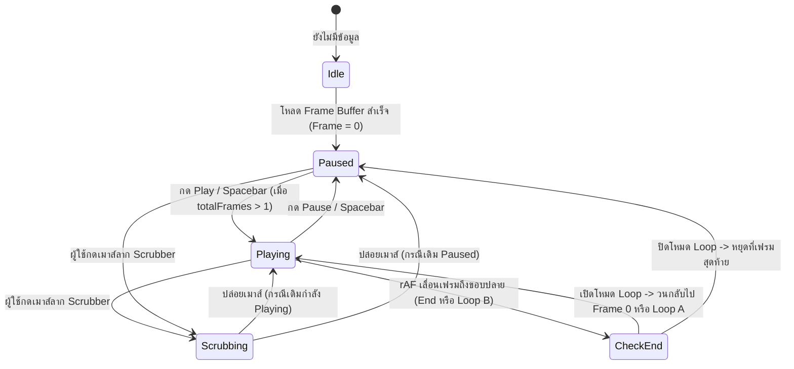

# Phase 10: VCR Playback Studio — 60FPS Scrubber, Play/Pause/Step/Speed/Loop & Motion Trail

## 1. วัตถุประสงค์และขอบเขตของเฟส (Objective & Scope)
สร้างระบบควบคุมการเล่นลำดับข้อมูล (**VCR Video Player Studio**) ในฝั่ง Frontend (`frontend/src/domains/playback/`) และระบบจัดเตรียมชุดข้อมูลลำดับเฟรม (`PlaybackSequenceBuffer`) เพื่อให้ผู้ใช้สามารถกด **Play, Pause, ย้อนกลับ, เดินหน้าทีละเฟรม, ปรับความเร็ว, กำหนดช่วง A-B Loop, และลากแถบ Scrubber** เพื่อดูพฤติกรรมการทำงานของโมเดลต่อเนื่องเหมือนกรอวิดีโอที่ความลื่นไหลระดับ **60 FPS** โดยไม่กระตุก

### ขอบเขตการทำงาน (Scope)
- **High-Precision `requestAnimationFrame` Engine**: ระบบเดินเวลาด้วย `requestAnimationFrame` ที่คำนวณ `deltaTime` และค่าเศษส่วนระหว่างเฟรม (`fractionalProgress` $\in [0, 1)$) เพื่อทำ **Smooth 3D Position Interpolation (Lerp/Catmull-Rom)** ระหว่างเฟรม $t$ ไปยัง $t+1$
- **Zero-React-Re-render 60FPS Architecture**: แยกสัญญาณความถี่สูง (60Hz WebGL Transform & Canvas Playhead) ออกจาก React Component State เพื่อป้องกันไม่ให้ตารางข้อมูลและแผงควบคุมทั้งหมดเกิด Re-render ทุกๆ 16.67 มิลลิวินาที
- **Transport Controls, Speed Presets & A-B Sub-range Loop**: รองรับความเร็วตั้งแต่ `0.1x` ถึง `20x` (หรือ `0.5 FPS` ถึง `60 FPS`), โหมดเล่นวนซ้ำทั้งคิว (`Full Loop`), และโหมดปักหมุดจุดเริ่มต้น-สิ้นสุด (`A-B Loop Range`)
- **3D Glowing Motion Trail (หางแสงการเดินทางของลูกบอลข้อมูล)**: วาดเส้นโค้งเรืองแสงเชื่อมโยงตำแหน่งข้อมูลย้อนหลัง $K$ เฟรม ($t-K \dots t$) พร้อมไล่ระดับความโปร่งใส (Alpha Fade)

---

## 2. UI Feature List อย่างละเอียด (Detailed UI Feature List)
1. **VCR Transport Control Deck (`VcrTransportDeck.tsx`)**:
   - **Primary Play/Pause Button**: ปุ่มขนาดใหญ่ตรงกลาง สลับไอคอน `▶ Play` / `⏸ Pause` พร้อมไฟสถานะสีเขียวเรืองแสงเมื่อกำลังเล่น
   - **Frame Step Buttons**:
     - `⏮ First Frame (Home)`: กระโดดไปเฟรมที่ `0`
     - `⏪ Step Back (-1 Frame)`: ถอยหลังทีละ 1 เฟรม (กดค้างเพื่อกรอถอยหลังต่อเนื่อง)
     - `⏩ Step Forward (+1 Frame)`: เดินหน้าทีละ 1 เฟรม
     - `⏭ Last Frame (End)`: กระโดดไปเฟรมสุดท้าย `N - 1`
   - **Frame Counter & Timecode Readout (`FrameReadoutBadge.tsx`)**:
     - แสดงหมายเลขเฟรมปัจจุบันและจำนวนทั้งหมดในรูปแบบฟอนต์ Monospace: `FRAME 0042 / 1,500 (Row ID: #1042)`
     - คลิกที่ตัวเลขเฟรมเพื่อพิมพ์หมายเลขเฟรมที่ต้องการกระโดดไปได้ทันที (`Inline Frame Jump Input`)
2. **Interactive High-Precision Scrubber Bar (`TimelineScrubberBar.tsx`)**:
   - **Playhead Handle & Vertical Guide Line**: หัวอ่านสีฟ้าเรืองแสงที่ลากด้วยเมาส์หรือทัชสกรีนได้ลื่นไหล 60 FPS
   - **Hover Preview Ghost Tooltip**: เมื่อเลื่อนเมาส์ชี้เหนือแถบ Scrubber (โดยยังไม่ต้องคลิก) จะแสดงป้าย Tooltip บอก `Frame #idx | Row #id | Pred: 0.84`
   - **A-B Loop Range Brackets (`[ A` ... `B ]`)**: หมุดปีกกาคู่สีเหลืองอำพันสำหรับลากกำหนดช่วงเฟรมที่ต้องการเล่นวนซ้ำเฉพาะส่วน
3. **Speed, Loop & Motion Trail Settings Bar (`PlaybackOptionsBar.tsx`)**:
   - **Playback Speed Dropdown / Pill Selector**: `0.25x (1 FPS)`, `0.5x (2 FPS)`, `1.0x (5 FPS - Default)`, `2.0x (10 FPS)`, `5.0x (25 FPS)`, `10.0x (60 FPS)`
   - **Loop Mode Toggle Button**: สลับ 3 สถานะ: `No Loop (Stop at End)` $\to$ `Loop All` $\to$ `A-B Range Loop`
   - **Motion Trail Length Selector**: เลือกความยาวหางแสงในฉาก 3D: `Off (0)`, `Short (10 frames)`, `Medium (25 frames)`, `Long (50 frames)`, `Full Path`
4. **States & Keyboard Shortcuts**:
   - **Empty State**: แถบ Scrubber สีเทาจางพร้อมป้าย `"No frames loaded in playback queue"` และปุ่มทั้งหมดอยู่ในสถานะ `disabled`
   - **Single-Row State ($N = 1$)**: แสดงข้อมูลเฟรมที่ `0` ทันที ล็อกแถบ Slider ไว้ที่ 100% และปิดปุ่ม Play/Step พร้อม Tooltip `"เลือกข้อมูลมากกว่า 1 แถวเพื่อเล่นแอนิเมชันต่อเนื่อง"`
   - **Keyboard Shortcuts**:
     - `Space`: Play / Pause
     - `Left Arrow` / `Right Arrow`: ถอยหลัง / เดินหน้าทีละ 1 เฟรม (กด `Shift + Arrow` เพื่อข้ามทีละ 10 เฟรม)
     - `Home` / `End`: ไปยังเฟรมแรกสุด / สุดท้าย
     - `[` และ `]`: ตั้งจุดเริ่มต้น `Loop A` และจุดสิ้นสุด `Loop B` ที่เฟรมปัจจุบัน
     - `L`: สลับโหมดการวนซ้ำ (Loop Toggle)

---

## 3. UX Flow & User Journey (Step-by-Step UX Flow & ASCII Wireframe)

### ลำดับการทำงาน (Step-by-Step User Journey)
1. **Queue Ready & Pre-buffer**: เมื่อข้อมูลชุดที่เลือกและพิกัด 3D โหลดเข้าสู่ `usePlaybackStore` ระบบตั้งค่าเริ่มต้นที่ `currentFrameIndex = 0`, `status = 'paused'`
2. **User Presses Play (`Space`)**:
   - สถานะเปลี่ยนเป็น `status = 'playing'`
   - `PlaybackAnimationEngine` เริ่มรัน `requestAnimationFrame` คำนวณ `elapsedMs` และเลื่อนค่า `exactFrameFloat` (เช่น `12.45`)
3. **60FPS 3D Interpolation & Motion Trail**:
   - ภายใน `useFrame()` ของ React Three Fiber ลูกบอลข้อมูล (`ActiveSampleSphere`) อ่านค่า `exactFrameFloat` จาก Store โดยตรง (ไม่ผ่าน React Props) และคำนวณตำแหน่งกึ่งกลางระหว่างเฟรม `12` กับ `13` ทำให้ลูกบอลเคลื่อนที่นุ่มนวลที่ 60 FPS แม้ตั้งความเร็วแค่ 2 เฟรมต่อวินาที
   - เส้นหางแสง (`MotionTrail3D`) อัปเดตจุดย้อนหลัง 25 เฟรมตามตำแหน่งลูกบอล
4. **User Scrubs Timeline or Jumps Far**:
   - ทันทีที่ผู้ใช้กดเมาส์ลากแถบ Scrubber ระบบบันทึกสถานะก่อนหน้า (`wasPlaying`) แล้วหยุดการเดินเวลาอัตโนมัติชั่วคราว (`status = 'scrubbing'`)
   - หากกระโดดข้ามเฟรมเกิน `> 5 เฟรม` ระบบสั่ง `resetMotionTrail()` เพื่อตัดหางแสงเก่าทิ้งทันที ไม่ให้เกิดเส้นตรงลากยาวข้ามฉาก 3D

### ASCII Wireframe
```text
+--------------------------------------------------------------------------------------------------+
|                                      3D STAGE VIEWPORT                                           |
|                                                                                                  |
|                         . - ~ ~ - .                                                              |
|                     . '             ' .       (Motion Trail: last 25 frames)                     |
|                   /                     \          \                                             |
|                  ;                       :          * ====> (( ● )) [Active Frame #0042]         |
|                                                                Pred: 0.912 (Class 1)             |
+--------------------------------------------------------------------------------------------------+
|  Hover: [Frame #0120 | Pred: 0.34]                                                               |
|  0000 ========[A===================|● Playhead (0042)============B]======================== 0499 |
+--------------------------------------------------------------------------------------------------+
|  [⏮] [⏪ -1]  [ ⏸ PAUSE ]  [+1 ⏩] [⏭]  |  FRAME: [0042] / 0500 (Row #42)                       |
|  Speed: [1.0x (5 fps) v]   Loop: [🔁 A-B Range (15-180)]   Trail: [✨ 25 Frames v]   [Interpolate]|
+--------------------------------------------------------------------------------------------------+
```

### Mermaid Flowchart: State Transition


---

## 4. สถาปัตยกรรม DDD แยกรายชั้นพร้อมชื่อไฟล์และ Class/Method Signatures (DDD Architecture & Code Blueprint)

### โครงสร้างไฟล์ (Directory Structure)
```text
backend/app/
├── domains/
│   └── playback/
│       ├── entities.py
│       ├── value_objects.py
│       └── services.py
├── application/
│   └── playback_orchestrator.py
└── presentation/
    └── api/
        └── v1/
            └── playback_router.py

frontend/src/domains/playback/
├── types/playback.types.ts
├── store/usePlaybackStore.ts
├── hooks/
│   ├── usePlaybackRafLoop.ts
│   └── usePlaybackKeyboardShortcuts.ts
└── components/
    ├── VcrTransportDeck.tsx
    ├── TimelineScrubberBar.tsx
    ├── ActiveSampleSphere3D.tsx
    └── MotionTrail3D.tsx
```

### 4.1 `backend/app/domains/playback/` (Entities, Value Objects & Services)
```python
# backend/app/domains/playback/value_objects.py
from pydantic import BaseModel, Field

class FrameTrajectoryPointVO(BaseModel):
    frame_index: int
    dataset_row_index: int
    position_world: tuple[float, float, float]
    prediction: float
    confidence: float
    actual_target: float | None = None

# backend/app/domains/playback/entities.py
class PlaybackSequenceManifestEntity(BaseModel):
    session_id: str
    total_frames: int
    default_fps: float = 5.0
    frames_summary: list[FrameTrajectoryPointVO]

# backend/app/domains/playback/services.py
import numpy as np

class TrajectoryInterpolationService:
    @staticmethod
    def detect_discontinuity_jumps(positions: np.ndarray, threshold_world_dist: float = 4.5) -> list[int]:
        """ค้นหาดัชนีเฟรมที่มีการกระโดดข้ามพื้นที่ไกลผิดปกติ เพื่อแจ้งเตือนบน Scrubber"""
        if len(positions) < 2:
            return []
        diffs = np.linalg.norm(np.diff(positions, axis=0), axis=1)
        return [int(idx + 1) for idx in np.where(diffs > threshold_world_dist)[0]]
```

### 4.2 `backend/app/presentation/api/v1/playback_router.py` (REST API Endpoints)
- **Endpoint**: `GET /api/v1/playback/{session_id}/manifest`
- **Response JSON Schema (`200 OK`)**:
```json
{
  "session_id": "sess_98a7bc12",
  "total_frames": 500,
  "default_fps": 5.0,
  "discontinuity_frames": [42, 198],
  "frames_summary": [
    {
      "frame_index": 0,
      "dataset_row_index": 0,
      "position_world": [-1.25, 0.80, 2.15],
      "prediction": 1.0,
      "confidence": 0.942,
      "actual_target": 1.0
    }
  ]
}
```

### 4.3 `frontend/src/domains/playback/store/usePlaybackStore.ts` (Zustand High-Frequency Store)
```typescript
import { create } from 'zustand';
import { subscribeWithSelector } from 'zustand/middleware';

export type PlaybackStatus = 'idle' | 'playing' | 'paused' | 'scrubbing';
export type LoopMode = 'none' | 'all' | 'ab_range';

export interface PlaybackStoreState {
  status: PlaybackStatus;
  totalFrames: number;
  currentFrameIndex: number;        // Integer frame index (0 .. totalFrames - 1) สำหรับ UI ทั่วไป
  exactFrameFloat: number;          // Float frame index (เช่น 42.65) สำหรับ WebGL 60FPS Lerp
  baseFps: number;                  // ค่าเริ่มต้น 5 FPS
  speedMultiplier: number;          // 0.25x .. 10x
  loopMode: LoopMode;
  loopRange: [number, number] | null;
  trailLength: number;              // 0, 10, 25, 50
  smoothInterpolation: boolean;
  wasPlayingBeforeScrub: boolean;
  trailResetCounter: number;        // เพิ่มค่าเมื่อกระโดดข้ามเฟรมเพื่อล้างหางแสง

  // Actions
  initializeQueue: (totalFrames: number) => void;
  play: () => void;
  pause: () => void;
  togglePlayPause: () => void;
  stepFrame: (delta: number) => void;
  seekToFrame: (frameIndex: number, isJump?: boolean) => void;
  advanceByDeltaMs: (deltaMs: number) => void;
  startScrubbing: () => void;
  endScrubbing: () => void;
  setLoopRangePoint: (point: 'A' | 'B', frameIndex: number) => void;
}

export const usePlaybackStore = create<PlaybackStoreState>()(
  subscribeWithSelector((set, get) => ({
    status: 'idle',
    totalFrames: 0,
    currentFrameIndex: 0,
    exactFrameFloat: 0,
    baseFps: 5,
    speedMultiplier: 1.0,
    loopMode: 'all',
    loopRange: null,
    trailLength: 25,
    smoothInterpolation: true,
    wasPlayingBeforeScrub: false,
    trailResetCounter: 0,

    initializeQueue: (totalFrames) =>
      set({
        totalFrames,
        currentFrameIndex: 0,
        exactFrameFloat: 0,
        status: totalFrames > 0 ? 'paused' : 'idle',
        loopRange: totalFrames > 1 ? [0, totalFrames - 1] : null,
      }),

    play: () => {
      const { totalFrames, currentFrameIndex } = get();
      if (totalFrames <= 1) return;
      if (currentFrameIndex >= totalFrames - 1) {
        set({ currentFrameIndex: 0, exactFrameFloat: 0, status: 'playing', trailResetCounter: get().trailResetCounter + 1 });
      } else {
        set({ status: 'playing' });
      }
    },

    pause: () => set({ status: 'paused' }),

    togglePlayPause: () => {
      const { status, play, pause } = get();
      if (status === 'playing') pause();
      else play();
    },

    stepFrame: (delta) => {
      const { totalFrames, currentFrameIndex, trailResetCounter } = get();
      if (totalFrames <= 1) return;
      const next = Math.max(0, Math.min(totalFrames - 1, currentFrameIndex + delta));
      const isLargeJump = Math.abs(next - currentFrameIndex) > 5;
      set({
        status: 'paused',
        currentFrameIndex: next,
        exactFrameFloat: next,
        trailResetCounter: isLargeJump ? trailResetCounter + 1 : trailResetCounter,
      });
    },

    seekToFrame: (frameIndex, isJump = true) => {
      const { totalFrames, currentFrameIndex, trailResetCounter } = get();
      if (totalFrames <= 0) return;
      const clamped = Math.max(0, Math.min(totalFrames - 1, Math.round(frameIndex)));
      const isFar = isJump && Math.abs(clamped - currentFrameIndex) > 5;
      set({
        currentFrameIndex: clamped,
        exactFrameFloat: clamped,
        trailResetCounter: isFar ? trailResetCounter + 1 : trailResetCounter,
      });
    },

    advanceByDeltaMs: (deltaMs) => {
      const { status, totalFrames, exactFrameFloat, baseFps, speedMultiplier, loopMode, loopRange, trailResetCounter } = get();
      if (status !== 'playing' || totalFrames <= 1) return;

      const safeDeltaSec = Math.min(deltaMs, 100) / 1000.0; // ป้องกันการกระโดดเมื่อสลับแท็บเบราว์เซอร์
      const frameAdvance = safeDeltaSec * baseFps * speedMultiplier;
      let nextFloat = exactFrameFloat + frameAdvance;

      const minBound = loopMode === 'ab_range' && loopRange ? loopRange[0] : 0;
      const maxBound = loopMode === 'ab_range' && loopRange ? loopRange[1] : totalFrames - 1;

      if (nextFloat >= maxBound) {
        if (loopMode === 'none') {
          set({ status: 'paused', currentFrameIndex: maxBound, exactFrameFloat: maxBound });
          return;
        }
        nextFloat = minBound;
        set({
          exactFrameFloat: nextFloat,
          currentFrameIndex: Math.floor(nextFloat),
          trailResetCounter: trailResetCounter + 1,
        });
        return;
      }

      set({
        exactFrameFloat: nextFloat,
        currentFrameIndex: Math.floor(nextFloat),
      });
    },

    startScrubbing: () => {
      const { status } = get();
      set({ status: 'scrubbing', wasPlayingBeforeScrub: status === 'playing' });
    },

    endScrubbing: () => {
      const { wasPlayingBeforeScrub } = get();
      set({ status: wasPlayingBeforeScrub ? 'playing' : 'paused', wasPlayingBeforeScrub: false });
    },

    setLoopRangePoint: (point, frameIndex) => {
      const { totalFrames, loopRange } = get();
      const currentA = loopRange ? loopRange[0] : 0;
      const currentB = loopRange ? loopRange[1] : Math.max(0, totalFrames - 1);
      if (point === 'A') {
        set({ loopRange: [Math.min(frameIndex, currentB - 1), currentB], loopMode: 'ab_range' });
      } else {
        set({ loopRange: [currentA, Math.max(frameIndex, currentA + 1)], loopMode: 'ab_range' });
      }
    },
  }))
);
```

---

## 5. แผนการตรวจสอบหน่วยความจำและเพิ่มประสิทธิภาพทรัพยากรเครื่อง (Memory Check Plan & Process Resource Optimization)

### 5.1 Backend Memory Check
- **Compact Trajectory Buffer**: ข้อมูลพิกัดทุกเฟรมในคิว (`point_positions_world`) ถูกส่งและจัดเก็บในหน่วยความจำแบบ Flat `float32` Array (3 ค่าต่อเฟรม = 12 bytes/เฟรม) ดังนั้นแม้มีข้อมูล `100,000 เฟรม` จะใช้ RAM เพียง `1.2 MB` เท่านั้น

### 5.2 Frontend & WebGL Memory Optimization (60FPS Zero-Re-render Rule)
- **Direct Imperative `useFrame` Subscription**:
  - คอมโพเนนต์ 3D (`ActiveSampleSphere3D.tsx` และ `MotionTrail3D.tsx`) **ห้าม** subscribe ค่า `exactFrameFloat` ผ่าน React Hook `usePlaybackStore(s => s.exactFrameFloat)` เพราะจะทำให้ React Re-render 60 ครั้งต่อวินาที!
  - ให้ใช้ `useFrame((_, delta) => { const state = usePlaybackStore.getState(); ... })` เพื่ออ่านค่าล่าสุดและอัปเดต `meshRef.current.position.lerpVectors(posA, posB, alpha)` โดยตรงใน WebGL Loop
- **Pre-allocated Ring Buffer สำหรับ Motion Trail**:
  - จอง `Float32Array(MAX_TRAIL_POINTS * 3)` สำหรับเส้นหางแสงไว้ครั้งเดียวตอน Mount และอัปเดตจุดใน Buffer เดิมแทนการสร้าง `new THREE.Vector3()` หรือ `<CatmullRomLine>` ใหม่ทุกเฟรม (Zero Garbage Collection Pressure)

### 5.3 Process & CPU/GPU Resource Optimization
- **Page Visibility API Pause Guard**: เมื่อผู้ใช้สลับแท็บเบราว์เซอร์หรือย่อหน้าต่างลง (`document.hidden === true`) ระบบจำกัด `safeDeltaSec = Math.min(deltaMs, 100) / 1000` เพื่อป้องกันไม่ให้ `requestAnimationFrame` คำนวณ `deltaMs` สะสมหลายวินาทีแล้วกระโดดข้ามเฟรมทันทีที่กลับมาเปิดหน้าจอ
- **Pointer Capture Scrubbing**: ใช้ `element.setPointerCapture(e.pointerId)` บนแถบ Scrubber เพื่อให้การลากเมาส์ออกนอกขอบแถบยังคงเลื่อนเฟรมได้อย่างต่อเนื่องและแม่นยำ

---

## 6. ไลบรารีที่ใช้และการตั้งค่า Offline 100% (Libraries & Offline Configuration)
- **Frontend**:
  - `zustand` (`subscribeWithSelector` middleware สำหรับแยกการอัปเดตความถี่สูงออกจากความถี่ต่ำ)
  - `three` (`Vector3.lerpVectors`, `BufferGeometry`, `LineBasicMaterial`)
  - `@react-three/fiber` (`useFrame`)
  - `lucide-react` (ไอคอนปุ่ม VCR Transport ทั้งหมดฝังอยู่ใน Bundle ไม่ต้องโหลดฟอนต์ไอคอนจากอินเทอร์เน็ต)

---

## 7. ตารางข้อควรระวังและ Edge Cases (Caveats & Edge Case Matrix)

| ลำดับ | เคสปัญหา (Edge Case) | สาเหตุทางเทคนิค (Root Cause) | วิธีป้องกันและแก้ไขในโค้ด (Mitigation Strategy) |
| :---: | :--- | :--- | :--- |
| 1 | **การกระโดดข้ามเฟรมไกลๆ ตอนลาก Scrubber** | ผู้ใช้คลิกกระโดดจากเฟรมที่ `5` ไปเฟรมที่ `800` ทำให้เส้นหางแสงลากตัดกลางฉาก 3D จากเฟรม 5 ไป 800 | ใน `seekToFrame()` หาก `Math.abs(clamped - currentFrameIndex) > 5` ให้เพิ่มค่า `trailResetCounter` เพื่อล้างและดึงเฉพาะ $K$ เฟรมก่อนหน้าเฟรมที่ 800 มาวาดใหม่ |
| 2 | **คิวข้อมูลมีเพียง 1 แถว (`totalFrames === 1`)** | การคำนวณเปอร์เซ็นต์ตำแหน่งหัวอ่าน `currentFrame / (totalFrames - 1)` เกิด `0 / 0 = NaN` | เช็ก `totalFrames <= 1 ? 0 : currentFrameIndex / (totalFrames - 1)` เสมอ และ Disable ปุ่ม Play/Loop |
| 3 | **กด `Spacebar` เพื่อ Play แต่เคอร์เซอร์อยู่ในช่อง `<input>`** | ผู้ใช้กำลังพิมพ์ค้นหาชื่อคอลัมน์หรือพิมพ์โน้ต Bookmark แล้วกด Spacebar ทำให้วิดีโอเล่น/หยุดโดยไม่ตั้งใจ | ใน `usePlaybackKeyboardShortcuts.ts` เช็ก `if (['INPUT', 'TEXTAREA', 'SELECT'].includes(e.target.tagName)) return;` ก่อนประมวลผลคีย์ลัดเสมอ |
| 4 | **จุดเริ่มต้น `Loop A` ถูกตั้งค่ามากกว่า `Loop B`** | ผู้ใช้เลื่อนไปเฟรมที่ 200 แล้วกดตั้ง `Loop A` ทั้งที่ `Loop B` อยู่ที่เฟรม 100 | ใน `setLoopRangePoint` บังคับจัดเรียง `Math.min` / `Math.max` และเว้นระยะห่างอย่างน้อย 1 เฟรมเสมอ |
| 5 | **ตารางและแผงกราฟกระตุกเมื่อตั้งความเร็ว `10x (60 FPS)`** | แผง Inspector ด้านข้างพยายาม Re-render ตารางข้อมูลทุกๆ 16ms | ให้แผง UI ด้านข้าง subscribe เฉพาะ `currentFrameIndex` และใช้ `useDeferredValue(currentFrameIndex)` ของ React 19 เพื่อให้ฉาก 3D มีลำดับความสำคัญสูงสุด |
| 6 | **ลูกบอลหลุดออกนอกช่วงเมื่อวนจบ Loop** | `exactFrameFloat` มีค่าเป็น `499.8` ทำให้การหาเฟรมถัดไป `Math.floor(exactFrameFloat) + 1` เกินขนาดอาเรย์ (`500`) | ใช้ `Math.min(totalFrames - 1, Math.floor(exactFrameFloat) + 1)` ป้องกัน Index Out of Bounds ในทุกจุดที่อ่าน TypedArray |

---

## 8. เกณฑ์การตรวจรับงาน (Definition of Done Checklist)
- [ ] ผู้ใช้สามารถกด Play, Pause, Step Forward/Backward (`+1/-1`), First/Last Frame ทั้งจากการคลิกปุ่มและคีย์ลัด (`Space`, `Arrow Keys`, `Home`, `End`) ได้อย่างถูกต้อง
- [ ] การลากแถบ Scrubber ไปมาอย่างรวดเร็วที่ความละเอียด 10,000 เฟรม ต้องรักษาอัตราเฟรมเรตของฉาก 3D ได้ที่ `55 - 60 FPS` โดยไม่มีอาการค้าง
- [ ] ลูกบอลข้อมูลในฉาก 3D เคลื่อนที่อย่างนุ่มนวลด้วย `lerpVectors` ระหว่างเฟรม $t$ และ $t+1$ พร้อมวาดเส้นหางแสง (`MotionTrail3D`) ที่รีเซ็ตตัวเองถูกต้องเมื่อกระโดดข้ามเฟรม
- [ ] ระบบรองรับโหมด `A-B Sub-range Loop` โดยเมื่อเล่นถึงจุด `B` จะวนกลับมายังจุด `A` ทันที
- [ ] ทดสอบกรณี `totalFrames = 0` และ `totalFrames = 1` โดยไม่มีค่า `NaN` บนแถบ Scrubber หรือ Console Error
