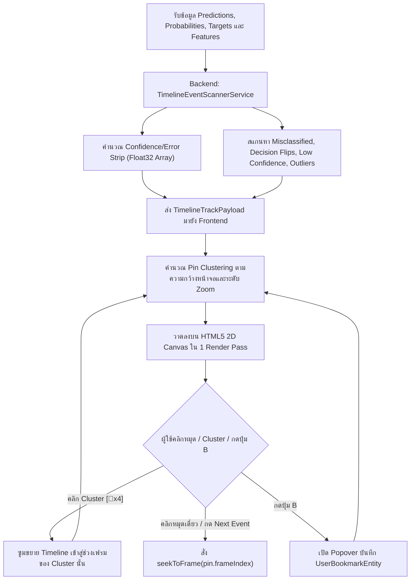

# Phase 11: Smart Multi-Track Timeline — Auto-Anomaly Markers, Confidence Strip & Frame Bookmarks

## 1. วัตถุประสงค์และขอบเขตของเฟส (Objective & Scope)
ยกระดับแถบเลื่อนเวลาพื้นฐานจาก Phase 10 ให้เป็น **Smart Multi-Track Video Timeline** (ได้รับแรงบันดาลใจจากโปรแกรมตัดต่อระดับมืออาชีพอย่าง *DaVinci Resolve* และ *Blender Dope Sheet*) ที่สามารถวิเคราะห์และปักหมุดจุดสำคัญของโมเดลให้อัตโนมัติ (**Auto-Anomaly & Event Detection**) เพื่อให้ผู้ใช้ที่มีข้อมูลหลายพันหรือหลายหมื่นแถวรู้ทันทีว่าควรกรอวิดีโอไปดูที่เฟรมไหน โดยไม่ต้องนั่งไล่ดูทีละเฟรมตั้งแต่ต้นจนจบ

### ขอบเขตการทำงาน (Scope)
- **3-Track High-Density Canvas Timeline**:
  - **Track 1 (Prediction & Target Sparkline Curve)**: เส้นกราฟเปรียบเทียบค่าทำนายของโมเดล (`y_pred`) เทียบกับค่าจริง (`y_true` ถ้ามี) ตลอดทั้งคิว
  - **Track 2 (Confidence / Residual Error Heatmap Strip)**: แถบสีต่อเนื่องแสดงระดับความมั่นใจของโมเดล (สีเขียว = มั่นใจสูง / คลาดเคลื่อนต่ำ, สีเหลือง = ก้ำกึ่ง возле Decision Boundary, สีส้ม/แดง = ทายผิดหรือความคลาดเคลื่อนสูง)
  - **Track 3 (Auto-Detected Event Pins & User Bookmarks)**: หมุดเหตุการณ์สำคัญพร้อมระบบรวมกลุ่มอัตโนมัติ (Pin Clustering) เมื่อซูมออก
- **Automated Event Scanner Engine (`backend/app/domains/timeline/`)**: สแกนหา 4 เหตุการณ์สำคัญทันทีหลังโหลดข้อมูล:
  1. 🔴 `misclassified` / `high_residual`: เฟรมที่โมเดลทายผิดคลาส หรือมีค่า Residual Error $|y - \hat{y}| > 2\sigma$
  2. ⚡ `decision_flip`: เฟรมที่โมเดลเปลี่ยนคำตัดสินจากเฟรมก่อนหน้า ($y_{t} \neq y_{t-1}$)
  3. 🟡 `low_confidence`: เฟรมที่โมเดลลังเลสูง (เช่น ความน่าจะเป็นอยู่ใกล้เส้นแบ่งเขต $0.45 \le P \le 0.55$)
  4. 🟣 `input_outlier`: เฟรมที่ค่า Feature ต้นทางมีค่า Z-score เกิน $3.0\sigma$
- **User Frame Bookmarks & Annotation Notes**: กดปุ่ม `B` เพื่อปักหมุดที่เฟรมปัจจุบันพร้อมเขียนบันทึกข้อความสั้นๆ ซึ่งจะถูกบันทึกติดไปกับไฟล์ `.mlv` และไฟล์ CSV ที่ส่งออก

---

## 2. UI Feature List อย่างละเอียด (Detailed UI Feature List)
1. **Multi-Track Canvas Viewport (`MultiTrackTimelineCanvas.tsx`)**:
   - **Timeline Zoom & Pan Controls**: รองรับการหมุนลูกกลิ้งเมาส์ (`Ctrl + Wheel`) เพื่อซูมขยายดูช่วงเฟรมแคบๆ (ตั้งแต่ `1x Full View` ไปจนถึง `50x Frame-by-Frame View`) พร้อมแถบ Minimap Overview ด้านบน
   - **Track Visibility & Filter Checkboxes**: ปุ่มเปิด/ปิดการแสดงหมุดแต่ละประเภท: `[🔴 Errors (14)]`, `[⚡ Flips (8)]`, `[🟡 Boundary (23)]`, `[🟣 Outliers (5)]`, `[🔖 Bookmarks (3)]`
   - **Cluster Badge Rendering**: เมื่อหมุดอยู่ใกล้กันเกิน `< 14px` บนหน้าจอ ระบบจะยุบรวมเป็นแคปซูลตัวเลข เช่น `[🔴 12]` เมื่อคลิกที่แคปซูลจะซูมขยายแถบ Timeline เข้าไปหาช่วงเฟรมนั้นทันที
2. **Jump-to-Event Navigation Bar (`EventJumpNavigator.tsx`)**:
   - ปุ่ม `[ |< Prev Event ]` และ `[ Next Event >| ]`: กระโดดข้ามจากหมุดเหตุการณ์หนึ่งไปยังหมุดถัดไปตามประเภทที่เปิดกรองไว้ทันที
   - Dropdown เลือกประเภทการกระโดด: `All Events`, `Errors Only`, `Decision Flips Only`, `My Bookmarks Only`
3. **Bookmark & Note Popover Modal (`BookmarkEditorPopover.tsx`)**:
   - ปุ่ม `[ 🔖 Bookmark Frame (B) ]` บนแถบควบคุม
   - ช่องกรอกข้อความหมายเหตุ (`Note Title & Description` สูงสุด 280 ตัวอักษร)
   - ตัวเลือกสีหมุด Bookmark (`Amber`, `Cyan`, `Emerald`, `Rose`, `Purple`)
   - ปุ่ม `Save Bookmark` และ `Delete Bookmark`
4. **Bookmark Drawer List (`BookmarkListSidebar.tsx`)**:
   - รายการรวมหมุด Bookmark และ Auto-Events ทั้งหมดในรูปแบบการ์ดที่คลิกเพื่อกระโดดไปยังเฟรมนั้นได้ทันที พร้อมช่องค้นหาข้อความโน้ต
5. **States & Keyboard Shortcuts**:
   - **Empty State**: แสดงเส้นประแนวนอนพร้อมข้อความ `"กำลังรอข้อมูลผลทำนายเพื่อสร้างกราฟ Multi-Track Timeline"`
   - **Zero-Anomaly State**: เมื่อโมเดลทำนายถูก 100% แถบ Heatmap จะเป็นสีเขียวตลอดแนวพร้อมป้าย Badge `"✨ 0 Misclassifications Detected"`
   - **Keyboard Shortcuts**:
     - `B`: เปิดหน้าต่างปักหมุด / แก้ไข Bookmark ที่เฟรมปัจจุบัน
     - `N` หรือ `Period (.)`: กระโดดไปยัง Event / Anomaly ถัดไป (`Next Event`)
     - `P` หรือ `Comma (,)`: กระโดดไปยัง Event / Anomaly ก่อนหน้า (`Prev Event`)
     - `Ctrl + =` / `Ctrl + -`: ซูมเข้า / ซูมออกแถบ Timeline (`Ctrl + 0` เพื่อ Reset Zoom)

---

## 3. UX Flow & User Journey (Step-by-Step UX Flow & ASCII Wireframe)

### ลำดับการทำงาน (Step-by-Step User Journey)
1. **Timeline Analysis Generation**: เมื่อคิวการเล่นพร้อมใช้งาน Backend คำนวณอาเรย์ `confidence_strip`, `prediction_curve`, และสแกนหารายการ `TimelineEventPin` ทั้งหมดในครั้งเดียวแล้วส่งให้ Frontend
2. **Single-Pass HTML5 Canvas Rendering**:
   - Frontend วาดทั้ง 3 แทร็กลงบน `<canvas>` 2D ความละเอียดสูง (รองรับ `window.devicePixelRatio` สำหรับจอ Retina/4K)
   - คำนวณ Spatial Clustering สำหรับหมุดที่ซ้อนทับกันตามระดับ `zoomLevel` ปัจจุบัน
3. **Anomaly Investigation Flow**:
   - ผู้ใช้สังเกตเห็นแถบสีแดงใน Track 2 และหมุด `🔴` ที่เฟรม `248` จึงกดปุ่ม `Next Event (>|)` หรือคลิกที่หมุดโดยตรง
   - Playhead กระโดดไปที่เฟรม `248` ทันที ฉาก 3D หมุนโฟกัสไปที่ลูกบอลของเฟรม `248`
4. **Bookmarking & Note Taking**:
   - ผู้ใช้ตรวจสอบสาเหตุแล้วกดปุ่ม `B` พิมพ์โน้ตว่า `"ข้อมูลรายได้เป็น 0 แต่ยอดหนี้สูง โมเดลจึงปัดตก"` แล้วกด Enter
   - หมุด `🔖` สีเหลืองอำพันปรากฏขึ้นบนแทร็กที่เฟรม `248` ทันที

### ASCII Wireframe
```text
+--------------------------------------------------------------------------------------------------+
| Filters: [✓ 🔴 Errors(12)] [✓ ⚡ Flips(6)] [✓ 🟡 LowConf(19)] [✓ 🟣 Outliers(4)] [✓ 🔖 Notes(2)]  |
| Jump: [|< Prev Event (,)] [Next Event (.) >|]   Zoom: [1x ========●======= 20x] [🔖 Add Note (B)] |
+--------------------------------------------------------------------------------------------------+
| Minimap: [░░░░░█░░░░░░░░░░░░░░███░░░░░░░░░░░░░░░░░░░░░░░░░░░░░░░░░░░░░░░░░░░░░] (View: 200..350) |
|--------------------------------------------------------------------------------------------------|
| Track 1 (Pred Curve) :  _.--"-.____.---._          _.--------.___         |● Playhead (#0248)    |
|                        /                 "-.____.-"              "-.______|                      |
| Track 2 (Confidence) : [🟩🟩🟩🟩🟨🟨🟥🟥🟥🟩🟩🟩🟩🟨🟨🟨🟩🟩🟩🟩🟩🟩🟩🟩|🟥🟥🟩🟩🟩🟩🟩🟩🟩] |
| Track 3 (Event Pins) :        ⚡   🔴 [🔴x4]          🟡                  |🔴🔖(Note)            |
+---------------------------------------------------------------------------+----------------------+
| 0200                  0220                  0240                       0248                 0350 |
+--------------------------------------------------------------------------------------------------+
|                              [🔖 Frame #0248 Note: "ข้อมูลรายได้เป็น 0 แต่ยอดหนี้สูง..."] [Edit] |
+--------------------------------------------------------------------------------------------------+
```

### Mermaid Flowchart: State Transition


---

## 4. สถาปัตยกรรม DDD แยกรายชั้นพร้อมชื่อไฟล์และ Class/Method Signatures (DDD Architecture & Code Blueprint)

### โครงสร้างไฟล์ (Directory Structure)
```text
backend/app/
├── domains/
│   └── timeline/
│       ├── entities.py
│       ├── value_objects.py
│       └── services.py
├── application/
│   └── timeline_orchestrator.py
└── presentation/
    └── api/
        └── v1/
            └── timeline_router.py

frontend/src/domains/timeline/
├── types/timeline.types.ts
├── store/useTimelineStore.ts
├── utils/pinClusterEngine.ts
└── components/
    ├── MultiTrackTimelineCanvas.tsx
    ├── EventJumpNavigator.tsx
    └── BookmarkEditorPopover.tsx
```

### 4.1 `backend/app/domains/timeline/` (Entities, Value Objects & Domain Services)
```python
# backend/app/domains/timeline/value_objects.py
from typing import Literal
from pydantic import BaseModel, Field

EventType = Literal["misclassified", "decision_flip", "low_confidence", "input_outlier"]

class AutoEventPinVO(BaseModel):
    frame_index: int
    dataset_row_index: int
    event_type: EventType
    severity: float = Field(ge=0.0, le=1.0)
    title: str
    detail: str

# backend/app/domains/timeline/entities.py
class UserBookmarkEntity(BaseModel):
    bookmark_id: str
    frame_index: int
    dataset_row_index: int
    color: Literal["amber", "cyan", "emerald", "rose", "purple"] = "amber"
    note_text: str = Field(max_length=280)
    created_at_iso: str

class MultiTrackTimelineEntity(BaseModel):
    session_id: str
    total_frames: int
    prediction_curve: list[float]
    actual_curve: list[float] | None = None
    confidence_scores: list[float]  # 0.0 (แย่/แดง) ถึง 1.0 (มั่นใจสูง/เขียว)
    auto_events: list[AutoEventPinVO]
    bookmarks: list[UserBookmarkEntity]

# backend/app/domains/timeline/services.py
import numpy as np

class TimelineEventScannerService:
    @staticmethod
    def scan_events(
        X: np.ndarray,
        predictions: np.ndarray,
        confidences: np.ndarray,
        actual_targets: np.ndarray | None,
        is_classification: bool,
        row_indices: list[int],
    ) -> list[AutoEventPinVO]:
        events: list[AutoEventPinVO] = []
        n_frames = len(predictions)
        if n_frames == 0:
            return events

        # 1. สแกนหา Input Outliers ด้วย Robust Z-Score
        std_X = np.nanstd(X, axis=0)
        std_X[std_X < 1e-9] = 1.0
        z_scores = np.abs((X - np.nanmean(X, axis=0)) / std_X)
        max_z_per_row = np.nanmax(z_scores, axis=1)

        # 2. สำหรับ Regression คำนวณเกณฑ์ Residual Error
        residual_threshold = 0.0
        if not is_classification and actual_targets is not None:
            residuals = np.abs(predictions - actual_targets)
            residual_threshold = float(np.nanmean(residuals) + 2.0 * np.nanstd(residuals))

        for i in range(n_frames):
            row_id = int(row_indices[i])
            # Check Misclassified or High Residual Error
            if actual_targets is not None and not np.isnan(actual_targets[i]):
                if is_classification and int(round(predictions[i])) != int(round(actual_targets[i])):
                    events.append(AutoEventPinVO(
                        frame_index=i,
                        dataset_row_index=row_id,
                        event_type="misclassified",
                        severity=1.0,
                        title=f"ทายผิดที่เฟรม #{i}",
                        detail=f"Pred: {int(predictions[i])} vs Actual: {int(actual_targets[i])}",
                    ))
                elif not is_classification and abs(predictions[i] - actual_targets[i]) > residual_threshold:
                    err_val = abs(float(predictions[i] - actual_targets[i]))
                    events.append(AutoEventPinVO(
                        frame_index=i,
                        dataset_row_index=row_id,
                        event_type="misclassified",
                        severity=0.9,
                        title=f"คลาดเคลื่อนสูงที่เฟรม #{i}",
                        detail=f"|y - y_hat| = {err_val:.4f}",
                    ))

            # Check Decision Flip
            if is_classification and i > 0 and int(round(predictions[i])) != int(round(predictions[i - 1])):
                events.append(AutoEventPinVO(
                    frame_index=i,
                    dataset_row_index=row_id,
                    event_type="decision_flip",
                    severity=0.75,
                    title=f"เปลี่ยนคำตัดสิน ({int(predictions[i-1])} → {int(predictions[i])})",
                    detail=f"สลับคลาสจากเฟรม #{i-1}",
                ))

            # Check Low Confidence near boundary
            if is_classification and 0.45 <= float(confidences[i]) <= 0.55:
                events.append(AutoEventPinVO(
                    frame_index=i,
                    dataset_row_index=row_id,
                    event_type="low_confidence",
                    severity=0.6,
                    title=f"ความมั่นใจก้ำกึ่ง ({confidences[i]*100:.1f}%)",
                    detail="อยู่ใกล้เส้นแบ่งเขตการตัดสินใจ (Decision Boundary)",
                ))

            # Check Input Outlier
            if float(max_z_per_row[i]) > 3.2:
                events.append(AutoEventPinVO(
                    frame_index=i,
                    dataset_row_index=row_id,
                    event_type="input_outlier",
                    severity=0.7,
                    title=f"ค่า Input สูงสุดโต่ง (Z={max_z_per_row[i]:.1f}σ)",
                    detail="ค่า Feature ต้นทางเบี่ยงเบนจากค่าเฉลี่ยเกิน 3.2 SD",
                ))

        return events
```

### 4.2 `backend/app/presentation/api/v1/timeline_router.py` (REST API Endpoints)
- **Endpoint 1**: `GET /api/v1/timeline/{session_id}/tracks`
- **Endpoint 2**: `POST /api/v1/timeline/{session_id}/bookmarks`
  - **Request JSON**:
```json
{
  "frame_index": 248,
  "dataset_row_index": 248,
  "color": "amber",
  "note_text": "ข้อมูลรายได้เป็น 0 แต่ยอดหนี้สูง โมเดลจึงปัดตก"
}
```
  - **Response JSON (`201 Created`)**:
```json
{
  "bookmark_id": "bm_7f91a2",
  "frame_index": 248,
  "dataset_row_index": 248,
  "color": "amber",
  "note_text": "ข้อมูลรายได้เป็น 0 แต่ยอดหนี้สูง โมเดลจึงปัดตก",
  "created_at_iso": "2026-10-21T14:25:00Z"
}
```

### 4.3 `frontend/src/domains/timeline/utils/pinClusterEngine.ts` (Spatial Clustering Algorithm)
```typescript
import { AutoEventPin, PinClusterNode } from '../types/timeline.types';

export function computeScreenPinClusters(
  pins: AutoEventPin[],
  visibleStartFrame: number,
  visibleEndFrame: number,
  canvasWidthPx: number,
  minPinSeparationPx: number = 14
): PinClusterNode[] {
  const spanFrames = Math.max(1, visibleEndFrame - visibleStartFrame);
  const visiblePins = pins.filter(
    (p) => p.frame_index >= visibleStartFrame && p.frame_index <= visibleEndFrame
  );

  const clusters: PinClusterNode[] = [];
  for (const pin of visiblePins) {
    const xPx = ((pin.frame_index - visibleStartFrame) / spanFrames) * canvasWidthPx;
    const lastCluster = clusters[clusters.length - 1];

    if (lastCluster && Math.abs(xPx - lastCluster.centerXPx) < minPinSeparationPx) {
      lastCluster.pins.push(pin);
      lastCluster.endFrame = pin.frame_index;
      lastCluster.centerXPx =
        (lastCluster.centerXPx * (lastCluster.pins.length - 1) + xPx) / lastCluster.pins.length;
    } else {
      clusters.push({
        startFrame: pin.frame_index,
        endFrame: pin.frame_index,
        centerXPx: xPx,
        pins: [pin],
      });
    }
  }
  return clusters;
}
```

---

## 5. แผนการตรวจสอบหน่วยความจำและเพิ่มประสิทธิภาพทรัพยากรเครื่อง (Memory Check Plan & Process Resource Optimization)

### 5.1 Backend Memory Check
- **Event Cap & Severity Ranking**: หากชุดข้อมูลขนาดใหญ่ (เช่น 50,000 แถว) มีจุดที่เข้าข่าย `decision_flip` หรือ `low_confidence` นับหมื่นจุด การส่ง JSON ของทุกหมุดจะทำให้ Payload ใหญ่เกินความจำเป็น ระบบจะจัดเรียงตาม `severity` และจำกัดจำนวน Auto-Event Pins สูงสุดไม่เกิน `2,500 หมุดที่สำคัญที่สุด` ส่วนแถบ Heatmap Strip ใช้ `Float32` Downsampled Array ขนาดไม่เกิน `2,048 buckets`

### 5.2 Frontend & WebGL/Canvas Memory Optimization
- **Zero-DOM Pin Architecture**: ห้ามเรนเดอร์หมุดแต่ละอันเป็น `<div className="pin">` หรือ `<svg>` เด็ดขาด เพราะหากมี 1,500 หมุดจะทำให้ DOM Tree หน่วงทันทีขณะลาก Playhead ให้วาดทั้งเส้นกราฟ แถบ Heatmap และหมุดทั้งหมดลงบน `<canvas>` แผ่นเดียวด้วย `CanvasRenderingContext2D`
- ** Dual-Layer Canvas Split (Static Background vs Dynamic Playhead)**:
  - ชั้นที่ 1 (`StaticTrackCanvas`): วาดเส้นกราฟ Prediction Curve, แถบสี Heatmap, และหมุด Event ซึ่งจะวาดใหม่เฉพาะตอนผู้ใช้กด Zoom/Pan หรือเพิ่ม Bookmark เท่านั้น
  - ชั้นที่ 2 (`DynamicPlayheadCanvas`): วาดเฉพาะเส้นหัวอ่าน Playhead และกรอบ Hover Tooltip ที่วิ่ง 60 FPS ทำให้ขณะเล่นวิดีโอไม่ต้องวาดกราฟหลายพันจุดซ้ำทุกเฟรม!

### 5.3 Process & CPU/GPU Resource Optimization
- **Vectorized NumPy Event Scanning**: ใน `TimelineEventScannerService` คำนวณ Z-score และ Residual Error ด้วย Vectorized NumPy Array Operations ก่อนเข้าลูปตรวจสอบ ทำให้สแกนข้อมูล 20,000 แถวเสร็จภายใน `< 15 มิลลิวินาที`

---

## 6. ไลบรารีที่ใช้และการตั้งค่า Offline 100% (Libraries & Offline Configuration)
- **Backend**: `numpy` (Vectorized Z-score, `np.diff`, `np.nanstd`), `pydantic`
- **Frontend**: Native HTML5 `CanvasRenderingContext2D` API, `zustand`, `lucide-react`, Tailwind CSS v4 (100% Offline)

---

## 7. ตารางข้อควรระวังและ Edge Cases (Caveats & Edge Case Matrix)

| ลำดับ | เคสปัญหา (Edge Case) | สาเหตุทางเทคนิค (Root Cause) | วิธีป้องกันและแก้ไขในโค้ด (Mitigation Strategy) |
| :---: | :--- | :--- | :--- |
| 1 | **หมุดซ้อนทับกันแน่นเมื่อมีหลายหมื่นเฟรม (Pin Overcrowding)** | หมุดหลายร้อยจุดถูกวาดทับตำแหน่งพิกเซลเดียวกันจนอ่านไม่ออกและคลิกเลือกไม่ได้ | ใช้ `computeScreenPinClusters()` รวมหมุดที่ห่างกันน้อยกว่า `14px` เป็นป้าย `[🔴 12]` และเมื่อคลิกจะซูมขยาย Timeline เข้าสู่ช่วงนั้นอัตโนมัติ |
| 2 | **ชุดข้อมูลไม่มีคอลัมน์เฉลย (`actual_target is None`)** | ผู้ใช้นำข้อมูล Unlabeled Test Set มาเปิดดู ทำให้ไม่สามารถคำนวณ `misclassified` ได้ | ปิดการสแกน `misclassified` อัตโนมัติ แต่ยังคงแสดง `decision_flip`, `low_confidence`, และ `input_outlier` ได้ครบถ้วน พร้อมแจ้งบน Badge ว่า `"Unlabeled Dataset"` |
| 3 | **หน้าจอความละเอียดสูง (Retina / HiDPI 150%-200% Scaling) ภาพเบลอ** | `<canvas>` ใช้ขนาด CSS Pixel แทน Device Physical Pixel | คูณ `canvas.width = rect.width * window.devicePixelRatio` และสั่ง `ctx.scale(dpr, dpr)` ทุกครั้งที่ Resize |
| 4 | **ข้อมูลเรียงตามคลาสทำให้เกิด Decision Flip แค่จุดเดียว** | หากข้อมูลถูก Sort ตาม Target มาแล้ว จะมีจุด Flip เพียง 1 จุด แต่ถ้าข้อมูลสุ่มจะ Flip เกือบทุกเฟรม | หากพบอัตราการสลับคลาส (`flip_rate > 0.40`) ระบบจะคัดเฉพาะจุด Flip ที่มีความเปลี่ยนแปลงของ Probability กระโดดแรงที่สุด (`delta_prob > 0.5`) เพื่อไม่ให้หมุดรกเต็มแถบ |
| 5 | **ผู้ใช้กด `Next Event` เมื่ออยู่ที่หมุดสุดท้ายของคิว** | ไม่มีหมุดถัดไปหลังเฟรมปัจจุบัน | ให้วนกลับไปยังหมุดแรกสุดของคิว (`Wrap-around Navigation`) พร้อมแสดง Toast เล็กๆ `"วนกลับไปยังหมุดแรกของคิว"` |
| 6 | **การลบหรือกรองแถวข้อมูลทำให้ `frame_index` ของ Bookmark เลื่อน** | ผู้ใช้เปลี่ยนเงื่อนไขการกรองข้อมูลใน Data Queue | ผูก Bookmark เข้ากับ `dataset_row_index` (หมายเลขแถวจริงในไฟล์ต้นฉบับ) เมื่อคิวเปลี่ยนให้ค้นหา `frame_index` ใหม่จาก `dataset_row_index` อัตโนมัติ |

---

## 8. เกณฑ์การตรวจรับงาน (Definition of Done Checklist)
- [ ] แถบ Multi-Track Timeline แสดงครบทั้ง 3 แทร็ก (Prediction Curve, Confidence/Error Heatmap Strip, และ Event/Bookmark Pins) บน HTML5 Canvas ที่ความคมชัดระดับ HiDPI
- [ ] ระบบสแกนหาหมุด `misclassified`, `decision_flip`, `low_confidence`, และ `input_outlier` ได้อย่างถูกต้องภายใน `< 30 ms`
- [ ] เมื่อหมุดอยู่ใกล้กันเกิน `14px` ระบบแสดงเป็น Cluster Badge และเมื่อคลิกที่ Cluster จะซูมขยายแถบ Timeline เข้าไปหาช่วงเฟรมนั้นทันที
- [ ] ปุ่ม `Prev Event (<|)` และ `Next Event (|>)` สามารถกระโดดข้ามไปยังหมุดที่เปิดกรองไว้ได้อย่างแม่นยำ
- [ ] ผู้ใช้สามารถกดปุ่ม `B` เพื่อเพิ่ม แก้ไข และลบ Bookmark พร้อมข้อความโน้ตได้ และขณะกด Play ที่ 60 FPS จะมีการวาดใหม่เฉพาะชั้น `DynamicPlayheadCanvas` เท่านั้น
