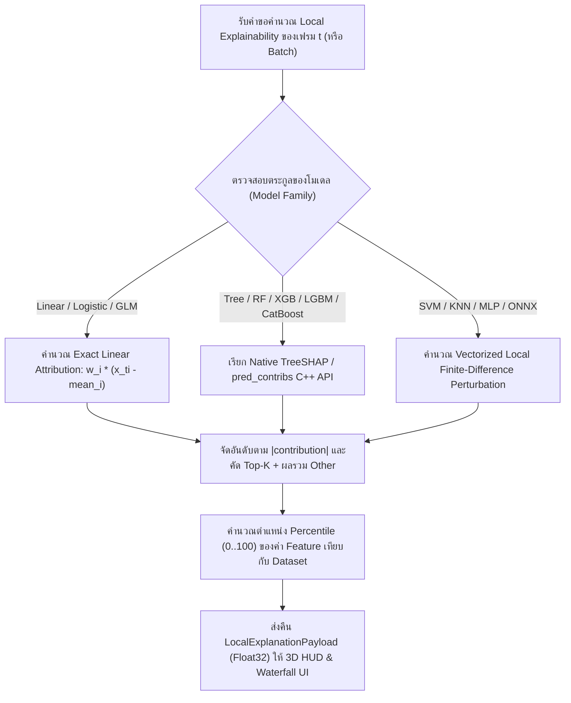

# Phase 12: Explainability & 3D HUD — Floating 3D Badges, Local Feature Contribution & Waterfall Panel

## 1. วัตถุประสงค์และขอบเขตของเฟส (Objective & Scope)
สร้างระบบ **3D Heads-Up Display (HUD)** ที่ลอยติดตามลูกบอลข้อมูลในฉาก 3 มิติ ควบคู่กับแผงอธิบายเหตุผลการตัดสินใจของโมเดลรายเฟรม (**Real-Time Local Explainability & Feature Contribution Waterfall**) เพื่อให้ผู้ใช้ไม่เพียงเห็นลูกบอลวิ่งขึ้นลงบนภูเขา 3D แต่สามารถตอบคำถามได้ทันทีในทุกเฟรมว่า: *"ทำไมในแถวที่ $t$ โมเดลถึงทำนายค่านี้? Feature ตัวไหนเป็นแรงส่งทางบวก ($+$) และตัวไหนเป็นแรงฉุดทางลบ ($-$) เทียบกับค่าเฉลี่ยตั้งต้น ($E[f(X)]$)"*

### ขอบเขตการทำงาน (Scope)
- **Floating 3D Target Reticle & Telemetry Badge (`stage3d/hud/`)**: กรอบเป้าเล็งเรืองแสงและป้ายข้อมูลที่ผูกติดกับตำแหน่งลูกบอลปัจจุบันในฉาก 3D แสดงหมายเลขเฟรม, ค่าทำนาย, ความมั่นใจ, และสถานะถูก/ผิดเทียบกับค่าจริง
- **Fast Exact / Local Feature Contribution Engine (`backend/app/domains/explainability/`)**:
  - **Linear Family**: คำนวณ Exact Linear Attribution $c_{t,i} = w_i \cdot (x_{t,i} - \bar{x}_i)$ ในระดับไมโครวินาที
  - **Tree / GBDT Family**: ใช้ Native TreeSHAP C++ (`pred_contribs=True` ของ XGBoost/LightGBM/CatBoost หรือ Decision Path Contribution ของ Scikit-Learn Trees)
  - **Distance / Kernel / Neural Family**: ใช้ Fast Local First-Order Sensitivity / Marginal Perturbation รอบจุดปัจจุบันโดยไม่ต้องรัน `KernelExplainer` ที่ช้า
- **Real-Time 60FPS Waterfall Chart & Input Percentile Inspector**: กราฟแท่งน้ำตกแนวนอนและตารางแสดงค่า Feature ปัจจุบันเทียบกับตำแหน่ง Percentile ($P_{0} \dots P_{100}$) ของทั้ง Dataset

---

## 2. UI Feature List อย่างละเอียด (Detailed UI Feature List)
1. **3D Floating Target Reticle & HUD Callout (`ActiveBallHudOverlay.tsx`)**:
   - **Animated Target Reticle**: วงแหวนเป้าเล็ง SVG หมุนช้าๆ รอบลูกบอลข้อมูลปัจจุบันในฉาก 3D
   - **Floating Glassmorphism Telemetry Pill**:
     - บรรทัดที่ 1: `FRAME #0042 (Row #1042)` พร้อมป้ายสถานะ `[✓ MATCH]` (สีเขียว) หรือ `[✗ MISCLASSIFIED]` (สีแดง)
     - บรรทัดที่ 2: `Pred: 0.892 (Class 1)` | `Actual: 1`
     - บรรทัดที่ 3: แสดง Top Driver ของเฟรมนั้น เช่น `▲ credit_score (+0.34)`
   - **HUD Compact Mode Toggle**: ปุ่มย่อป้าย HUD ให้เหลือเฉพาะตัวเลขค่าทำนายเมื่อซูมออกไกล หรือปิด HUD ชั่วคราวด้วยคีย์ลัด `H`
2. **Real-Time Feature Contribution Waterfall Panel (`FeatureWaterfallPanel.tsx`)**:
   - **Base Value Header Bar**: แสดงค่าเฉลี่ยตั้งต้นของโมเดล `Base Value E[f(X)] = 0.420` และค่าผลลัพธ์สุทธิของเฟรมปัจจุบัน `f(x_t) = 0.892 (Δ +0.472)`
   - **Horizontal Waterfall Bars (Top-K Features)**:
     - แท่งสีเขียวมรกต/ฟ้านีออน (`+ Positive Contribution`): พุ่งไปทางขวา แสดงค่า เช่น `+0.312`
     - แท่งสีส้ม/แดงคอรัล (`- Negative Contribution`): พุ่งไปทางซ้าย แสดงค่า เช่น `-0.145`
     - แถบสรุปรวม `Other (D - K) Features` สำหรับรวมคอลัมน์ย่อยที่เหลือเมื่อโมเดลมีหลายสิบคอลัมน์
   - **Top-K Selector**: ปุ่มเลือกแสดง `Top 5`, `Top 10`, `Top 15`, หรือ `All Features`
3. **Current Frame Input Inspector & Percentile Table (`FrameFeatureInspector.tsx`)**:
   - ตารางแสดงชื่อคอลัมน์, ค่าดิบในแถวปัจจุบัน (`Raw Value`), ค่า Z-Score, และหลอด **Percentile Mini-Bar (`0% .. 100%`)** พร้อมขีดบอกตำแหน่ง Median (`50%`)
   - ป้ายเตือน `⚠️ Outlier (> P99 / < P01)` เมื่อค่าของ Feature ในแถวปัจจุบันสูงหรือต่ำติดกลุ่ม 1% แรกของ Dataset
4. **States & Keyboard Shortcuts**:
   - **Empty State**: แสดงโครงกราฟ Waterfall สีเทาพร้อมข้อความ `"เลือกแถวข้อมูลหรือกด Play เพื่อดูการแยกส่วนเหตุผลของโมเดล (Local Explainability)"`
   - **Loading Skeleton**: แสดง Shimmer Bar ขณะกำลังคำนวณ Local Attribution ครั้งแรก
   - **Keyboard Shortcuts**:
     - `H`: ซ่อน/แสดงป้าย 3D Floating HUD ในฉาก 3 มิติ
     - `E`: เปิด/ปิดแผง Explainability Waterfall ด้านขวา

---

## 3. UX Flow & User Journey (Step-by-Step UX Flow & ASCII Wireframe)

### ลำดับการทำงาน (Step-by-Step User Journey)
1. **Batch Pre-computation / On-Demand Attribution**:
   - สำหรับคิวข้อมูลขนาดมาตรฐาน ($\le 5,000$ แถว) ระบบคำนวณเมทริกซ์ `local_contributions` ขนาด `(N_frames, Top_K)` เตรียมไว้ใน `Float32Array` ตั้งแต่เริ่มสร้างคิว
   - สำหรับคิวขนาดใหญ่พิเศษ ($> 5,000$ แถว) ระบบคำนวณล่วงหน้าเฉพาะช่วงรอบหัวอ่าน และดึงเพิ่มเติมแบบ Chunked On-Demand
2. **Synchronized 60FPS Playback Update**:
   - ขณะที่วิดีโอกำลังเล่นหรือผู้ใช้ลากแถบ Scrubber ป้าย 3D HUD จะเคลื่อนที่ตามลูกบอลด้วย `<Html transform={false}>` ของ `@react-three/drei`
   - กราฟ Waterfall ด้านขวาอัปเดตความยาวแท่งกราฟด้วย CSS `transform: scaleX(...)` ที่ทำงานบน GPU Compositor ทำให้แท่งกราฟยืดหดตามจังหวะเฟรมได้อย่างลื่นไหล 60 FPS
3. **Interactive Feature Highlighting**:
   - เมื่อผู้ใช้เอาเมาส์ชี้ที่แท่ง Feature ใดในกราฟ Waterfall (เช่น `annual_income`) ระบบจะแสดง Tooltip อธิบายว่า *"annual_income = 145,000 (อยู่ใน Percentile ที่ 92 ของข้อมูลทั้งหมด) ช่วยดันโอกาสอนุมัติขึ้น +0.28"* และหากกดคลิกจะเปลี่ยนแกน X ของฉาก 3D เป็นคอลัมน์นั้นได้ทันที

### ASCII Wireframe
```text
+-------------------------------------------------------+------------------------------------------+
|                   3D STAGE VIEWPORT                   | 🔍 LOCAL EXPLAINABILITY (Frame #0042)    |
|                                                       |------------------------------------------|
|              +-----------------------------+          | Base E[f(x)]: 0.420  -->  Output: 0.892  |
|              | FRAME #0042      [✓ MATCH]  |          |------------------------------------------|
|              | Pred: 0.892  |  Actual: 1   |          | credit_score (780)   |     ████████ +0.31|
|              | Top: ▲ credit_score (+0.31) |          | annual_income (145k) |   ██████ +0.24    |
|              +--------------+--------------+          | debt_ratio (0.42)    | ███ -0.12         |
|                             |                         | loan_term (60m)      |  ██ +0.06         |
|                          (( ● ))                      | num_late_pay (1)     |  █ -0.02          |
|                        /    |    \                    |------------------------------------------|
|            _.-""-._   /     v     \                   | 📊 FEATURE PERCENTILE INSPECTOR          |
|         .-"        "-/-------------\-.                | Feature        Value     Pct   Dist      |
|                                                       | credit_score   780.0     P94  [=======●=]|
|                                                       | annual_income  145,000   P88  [======●==]|
|                                                       | debt_ratio     0.42      P61  [====●====]|
+-------------------------------------------------------+------------------------------------------+
```

### Mermaid Flowchart: State Transition


---

## 4. สถาปัตยกรรม DDD แยกรายชั้นพร้อมชื่อไฟล์และ Class/Method Signatures (DDD Architecture & Code Blueprint)

### โครงสร้างไฟล์ (Directory Structure)
```text
backend/app/
├── domains/
│   └── explainability/
│       ├── entities.py
│       ├── value_objects.py
│       └── services.py
├── application/
│   └── explainability_orchestrator.py
└── presentation/
    └── api/
        └── v1/
            └── explainability_router.py

frontend/src/domains/explainability/
├── types/explainability.types.ts
├── store/useExplainabilityStore.ts
└── components/
    ├── ActiveBallHudOverlay.tsx
    ├── FeatureWaterfallPanel.tsx
    └── FrameFeatureInspector.tsx
```

### 4.1 `backend/app/domains/explainability/` (Entities, Value Objects & Services)
```python
# backend/app/domains/explainability/value_objects.py
from pydantic import BaseModel

class FeatureAttributionItemVO(BaseModel):
    feature_index: int
    feature_name: str
    raw_value: float
    percentile: float          # 0.0 ถึง 100.0
    z_score: float
    contribution: float        # ค่าบวก (+) ดันขึ้น, ค่าลบ (-) ฉุดลง

# backend/app/domains/explainability/entities.py
class FrameExplanationEntity(BaseModel):
    frame_index: int
    dataset_row_index: int
    base_value: float
    output_value: float
    attributions: list[FeatureAttributionItemVO]
    other_contributions_sum: float = 0.0

# backend/app/domains/explainability/services.py
import numpy as np

class FastLocalAttributionService:
    """คำนวณ Local Feature Contribution ความเร็วสูงโดยไม่พึ่งพา KernelExplainer ที่ช้า"""

    @staticmethod
    def compute_linear_contributions(
        X_batch: np.ndarray,
        feature_means: np.ndarray,
        weights: np.ndarray,
        intercept: float,
    ) -> tuple[np.ndarray, float]:
        """Exact Linear SHAP: phi_i = w_i * (x_i - E[x_i])"""
        centered = X_batch.astype(np.float32) - feature_means.astype(np.float32)
        contribs = centered * weights.astype(np.float32).reshape(1, -1)
        base_val = float(intercept + np.dot(feature_means, weights))
        return contribs.astype(np.float32), base_val

    @staticmethod
    def compute_fast_perturbation_contributions(
        predict_fn,
        x_row: np.ndarray,
        feature_medians: np.ndarray,
        base_prediction: float,
    ) -> np.ndarray:
        """สำหรับโมเดล Black-box ทั่วไป: วัดผลกระทบเมื่อแทนที่แต่ละ Feature ด้วยค่า Median ใน 1 Batch Call"""
        num_features = x_row.shape[0]
        # สร้างเมทริกซ์ขนาด (num_features, num_features) เพื่อส่งเข้า predict_fn เพียงครั้งเดียว!
        perturbed_batch = np.tile(x_row, (num_features, 1)).astype(np.float32)
        for i in range(num_features):
            perturbed_batch[i, i] = feature_medians[i]

        current_pred = float(predict_fn(x_row.reshape(1, -1))[0])
        perturbed_preds = predict_fn(perturbed_batch).astype(np.float32)
        raw_diffs = current_pred - perturbed_preds

        # ปรับสเกลให้ผลรวมเท่ากับ (current_pred - base_prediction) พอดี (Additivity Property)
        total_diff = current_pred - base_prediction
        sum_raw = float(np.sum(raw_diffs))
        if abs(sum_raw) > 1e-9:
            raw_diffs = raw_diffs * (total_diff / sum_raw)
        return raw_diffs.astype(np.float32)

    @staticmethod
    def compute_percentiles_for_row(
        x_row: np.ndarray,
        sorted_reference_columns: np.ndarray,
    ) -> np.ndarray:
        """หาตำแหน่ง Percentile (0..100) ของแต่ละ Feature ด้วย Binary Search (searchsorted) ความเร็ว O(D log N)"""
        n_samples, n_features = sorted_reference_columns.shape
        if n_samples == 0:
            return np.full(n_features, 50.0, dtype=np.float32)
        pcts = np.empty(n_features, dtype=np.float32)
        for j in range(n_features):
            idx = np.searchsorted(sorted_reference_columns[:, j], x_row[j], side="right")
            pcts[j] = (idx / n_samples) * 100.0
        return pcts
```

### 4.2 `backend/app/presentation/api/v1/explainability_router.py` (REST API Endpoints)
- **Endpoint**: `GET /api/v1/explainability/{session_id}/frames/{frame_index}?top_k=10`
- **Response JSON Schema (`200 OK`)**:
```json
{
  "frame_index": 42,
  "dataset_row_index": 1042,
  "base_value": 0.42,
  "output_value": 0.892,
  "other_contributions_sum": 0.015,
  "attributions": [
    {
      "feature_index": 0,
      "feature_name": "credit_score",
      "raw_value": 780.0,
      "percentile": 94.2,
      "z_score": 1.85,
      "contribution": 0.312
    },
    {
      "feature_index": 1,
      "feature_name": "annual_income",
      "raw_value": 145000.0,
      "percentile": 88.5,
      "z_score": 1.42,
      "contribution": 0.245
    }
  ]
}
```

### 4.3 `frontend/src/domains/explainability/` (TypeScript Interfaces & Components)
```typescript
// frontend/src/domains/explainability/types/explainability.types.ts
export interface FeatureAttributionItem {
  feature_index: number;
  feature_name: string;
  raw_value: number;
  percentile: number;
  z_score: number;
  contribution: number;
}

export interface FrameExplanation {
  frame_index: number;
  dataset_row_index: number;
  base_value: number;
  output_value: number;
  other_contributions_sum: number;
  attributions: FeatureAttributionItem[];
}
```

---

## 5. แผนการตรวจสอบหน่วยความจำและเพิ่มประสิทธิภาพทรัพยากรเครื่อง (Memory Check Plan & Process Resource Optimization)

### 5.1 Backend Memory Check
- **Sorted Column Reference Cache (`float32`)**: เพื่อคำนวณ Percentile ของทุก Feature ได้ในระดับไมโครวินาทีโดยไม่ต้อง Sort ข้อมูลซ้ำทุกเฟรม ระบบจะเก็บ `sorted_reference_columns` ขนาด `(min(N, 5000), D)` ในชนิด `np.float32` ไว้เพียง 1 ชุดต่อ Session
- **Strict KernelExplainer Ban**: ห้ามเรียกใช้ `shap.KernelExplainer` แบบสุ่มตัวอย่างหลายพันรอบต่อแถวโดยเด็ดขาดเพราะจะทำให้ CPU 100% และกิน RAM สูงมาก ให้ใช้ `FastLocalAttributionService` ที่รวมการวัด Perturbation ของทุก Feature เข้าใน `1 Batch Matrix Call` เท่านั้น

### 5.2 Frontend & WebGL Memory Optimization
- **Single `<Html>` Instance Rule ใน Three.js**:
  - คอมโพเนนต์ `<Html>` ของ `@react-three/drei` จะต้องมีเพียง **1 Instance เดียว** สำหรับลูกบอลของเฟรมปัจจุบัน (`ActiveBallHudOverlay`) ห้ามสร้าง `<Html>` ประจำจุดข้อมูลทั้ง 1,000 จุดในคิวโดยเด็ดขาดเพราะจะสร้าง DOM 1,000 ชุดที่คำนวณ Matrix Projection ทุกเฟรมจนเบราว์เซอร์ค้าง
- **GPU-Accelerated Waterfall Bar Transitions**:
  - แท่งกราฟใน `FeatureWaterfallPanel.tsx` ใช้การกำหนดความกว้างด้วย `style={{ transform: 'scaleX(...)' }}` พร้อม `will-change: transform` แทนการเปลี่ยนค่า `width` เพื่อหลีกเลี่ยง Browser Layout Thrashing ขณะเล่นที่ 60 FPS

### 5.3 Process & CPU/GPU Resource Optimization
- **Pre-baked Contribs Buffer**: เมื่อผู้ใช้โหลดข้อมูลเข้าคิว ระบบจะคำนวณ `top_k_indices` และ `top_k_contribs` เก็บลง Flat `Float32Array` ล่วงหน้า ทำให้ขณะกด Play ไม่จำเป็นต้องยิง HTTP Request ไปถาม Backend รายเฟรมเลยแม้แต่ครั้งเดียว!

---

## 6. ไลบรารีที่ใช้และการตั้งค่า Offline 100% (Libraries & Offline Configuration)
- **Backend**: `numpy` (`np.searchsorted`, Vectorized Batch Perturbation), Native `pred_contribs` ของ XGBoost / LightGBM / CatBoost
- **Frontend**: `@react-three/drei` (`<Html>`), Custom Lightweight SVG/CSS Waterfall Component, `zustand`

---

## 7. ตารางข้อควรระวังและ Edge Cases (Caveats & Edge Case Matrix)

| ลำดับ | เคสปัญหา (Edge Case) | สาเหตุทางเทคนิค (Root Cause) | วิธีป้องกันและแก้ไขในโค้ด (Mitigation Strategy) |
| :---: | :--- | :--- | :--- |
| 1 | **ผลรวม Contribution ทุกตัวเป็น 0.0 (เมื่อแถวปัจจุบันมีค่าเท่ากับค่าเฉลี่ยเป๊ะ)** | ใน `compute_fast_perturbation_contributions` ตัวหาร `sum_raw` มีค่าเข้าใกล้ `0.0` ทำให้เกิด `ZeroDivisionError` | เช็ก `if abs(sum_raw) > 1e-9:` ก่อนปรับสเกลเสมอ หากน้อยกว่านั้นให้คืนค่าอาเรย์ `0.0` |
| 2 | **โมเดลที่มีจำนวน Feature เยอะมาก (เช่น $D = 300$ คอลัมน์)** | การวาดแท่งกราฟ 300 แท่งในแผงด้านข้างทำให้ UI ยาวเกินหน้าจอและหน่วง | แสดงเฉพาะ `Top 10 Features` ที่มีค่า `|contribution|` สูงสุด และยุบรวมที่เหลืออีก 290 คอลัมน์ไว้ในแท่งสรุป `"Other 290 features"` |
| 3 | **ป้าย 3D HUD บังลูกบอลหรือหลุดขอบจอเมื่อหมุนกล้อง** | ป้าย `<Html>` อยู่ตำแหน่งเดียวกับจุดศูนย์กลางลูกบอล | ตั้งค่า Offset แกน Z/Y เหนือลูกบอล `[0, 0.65, 0]` พร้อมเปิด `occlude={false}` และกำหนด `pointer-events-none` เพื่อไม่ให้ป้าย HUD บังการคลิกเมาส์ในฉาก 3D |
| 4 | **Log-Odds vs Probability Scale ใน Classification** | `pred_contribs` ของ XGBoost/LightGBM คืนค่าในสเกล Log-Odds (Margin) ไม่ใช่ Probability $[0, 1]$ | แปลงสเกลด้วย Generalized Shapley Rescaling หรือแสดงป้ายหน่วยชัดเจนว่า `(Log-Odds Impact)` พร้อมแปลงค่าปลายทางผ่าน Sigmoid $\sigma(z)$ ให้ตรงกับ Probability ที่แสดงบนหน้าจอ |
| 5 | **Multi-Class Classification ($C > 2$ คลาส)** | โมเดลคืนค่า Contribution แยกตามจำนวนคลาส $(N, C, D)$ ทำให้เลือกแสดงไม่ถูก | ดึง Contribution เฉพาะของคลาสที่โมเดลทำนายชนะในเฟรมนั้น (`predicted_class_idx`) หรือคลาสที่ผู้ใช้เลือกตรึงไว้ในตัวเลือก `Target Class` |
| 6 | **ตัวเลข Raw Value มีทศนิยมยาวเกินกรอบตาราง** | ค่า Feature หลังผ่านการหารหรือคำนวณมีทศนิยม 12 ตำแหน่ง | จัดรูปแบบด้วย Smart Number Formatter (`Intl.NumberFormat` สูงสุด 4 ตำแหน่ง หรือ Scientific Notation เมื่อค่าน้อยกว่า `1e-4`) |

---

## 8. เกณฑ์การตรวจรับงาน (Definition of Done Checklist)
- [ ] ป้าย 3D HUD ลอยติดตามลูกบอลข้อมูลปัจจุบันในฉาก 3D อย่างแม่นยำที่ 60 FPS โดยใช้ `<Html>` เพียง 1 Instance เดียวในฉาก
- [ ] แผง Feature Contribution Waterfall แสดงค่า `Base Value`, `Output Value`, และแท่งบวก/ลบเรียงตามลำดับความสำคัญ พร้อมรวมค่า `Other Features` ได้ถูกต้อง
- [ ] ตาราง Input Inspector แสดงค่าดิบ ค่า Z-score และหลอด Percentile (`0% - 100%`) ของทุก Feature ในเฟรมปัจจุบันได้ถูกต้อง
- [ ] การคำนวณ Local Explainability รองรับทั้งตระกูล Linear, Tree/Ensemble, และ Black-box ทั่วไป โดยใช้เวลาต่อเฟรมน้อยกว่า `10 ms`
- [ ] คีย์ลัด `H` สามารถซ่อน/แสดงป้าย 3D HUD และ `E` สามารถเปิด/ปิดแผง Explainability ได้ทันที
