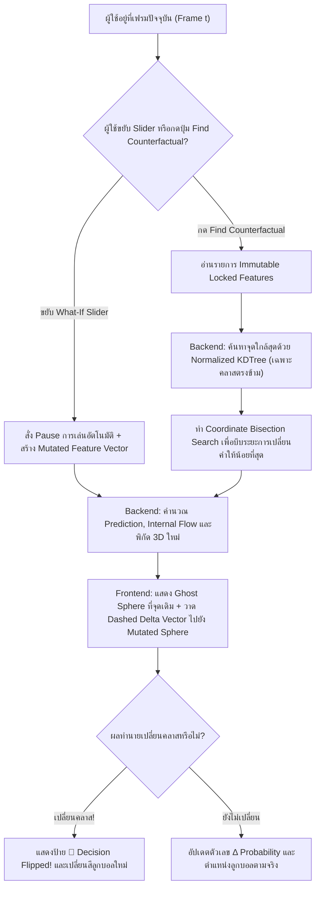

# Phase 13: Interactive "What-If" Sandbox, Counterfactual Finder & 3D Ghost Sphere Comparison

## 1. วัตถุประสงค์และขอบเขตของเฟส (Objective & Scope)
ต่อยอดจากการดูข้อมูลไหลตามไฟล์ CSV แบบทางเดียว (Passive Playback) ให้กลายเป็นห้องทดลองโต้ตอบแบบทันที (**Interactive "What-If" & Counterfactual Sandbox** ได้รับแรงบันดาลใจจาก *Google What-If Tool* และ *PAIR Learning Interpretability Tool*) เมื่อผู้ใช้กด **Pause** ที่เฟรมใดๆ (โดยเฉพาะเฟรมที่โมเดลทายผิดหรือปฏิเสธคำขอ) ผู้ใช้สามารถลองขยับปรับค่า Feature ด้วย Slider หรือกดปุ่มค้นหา **1-Click Nearest Counterfactual** เพื่อดูด้วยตาเปล่าในฉาก 3D ว่าลูกบอลจะเคลื่อนที่จากจุดเดิมไปทางไหน และต้องปรับค่าอะไรน้อยที่สุดโมเดลถึงจะเปลี่ยนคำตัดสิน!

### ขอบเขตการทำงาน (Scope)
- **Live "What-If" Feature Mutation Sliders**: แผงปรับค่า Feature ทุกตัวของแถวปัจจุบันแบบ Real-time พร้อมป้ายแสดงส่วนต่าง (`Δ +15,000`) และการตรวจสอบขอบเขตค่าที่เป็นไปได้จริง (`Feasibility / Out-of-Distribution Guardrails`)
- **3D "Ghost Sphere" & Dashed Delta Vector**:
  - ตรึงลูกบอลต้นฉบับของเฟรมนั้นไว้ที่ตำแหน่งเดิมในรูปแบบ **ลูกบอลเงาโปร่งแสง (Ghost Baseline Sphere)**
  - แสดง **ลูกบอลจำลองใหม่ (Mutated Active Sphere)** ที่วิ่งไปตามค่า Slider ที่ผู้ใช้ปรับ พร้อมวาด **เส้นลูกศรประ 3 มิติ (`Dashed Delta Vector Arrow`)** เชื่อมจากจุดเดิมไปยังจุดใหม่ และอัปเดตโครงสร้างภายในของโมเดล (เช่น เส้นทางไหลใน Decision Tree หรือระยะห่างไปหา Support Vectors) แบบสดๆ
- **1-Click Nearest Counterfactual Finder ("ทำอย่างไรโมเดลถึงจะเปลี่ยนใจ?")**:
  - ค้นหาจุดข้อมูลจริงที่ใกล้ที่สุดใน Dataset (`Empirical KD-Tree Counterfactual`) และปรับแต่งด้วย Local Gradient / Coordinate Search (`Synthetic Minimum-Change Counterfactual`) ที่ทำให้โมเดลเปลี่ยนคลาสคำตอบ (Classification Flip) หรือบรรลุเป้าหมายค่าทำนายที่กำหนด (Regression Goal Seek)

---

## 2. UI Feature List อย่างละเอียด (Detailed UI Feature List)
1. **What-If Sandbox Control Panel (`WhatIfSandboxPanel.tsx`)**:
   - **Sandbox Mode Header & Status Badge**: ป้ายสถานะ `[ 🧪 WHAT-IF SANDBOX ACTIVE ]` เมื่อมีการปรับค่าต่างจากแถวต้นฉบับ พร้อมปุ่ม `[ ↺ Reset All to Original ]`
   - **Before vs After Comparison Scorecard (`ComparisonScorecard.tsx`)**:
     - กล่องซ้าย (`Original Row #42`): แสดงคลาสและค่าทำนายเดิม เช่น `Class 0 (Prob: 0.38)`
     - ลูกศรตรงกลางแสดงการเปลี่ยนแปลง เช่น `➔ Δ +0.34 (🎉 DECISION FLIPPED!)`
     - กล่องขวา (`What-If Simulated`): แสดงคลาสและค่าทำนายใหม่ เช่น `Class 1 (Prob: 0.72)`
   - **Interactive Feature Sliders List (`WhatIfFeatureSliderRow.tsx`)**:
     - แสดงแถบ Slider สำหรับแต่ละ Feature พร้อมช่องพิมพ์ตัวเลขโดยตรง (`Numeric Spinbox`)
     - ขีดบอกตำแหน่งค่าเดิม (`Original Value Tick Mark`) บนราง Slider
     - ป้ายแสดงค่าความเปลี่ยนแปลง `Δ +45.0 (+12.4%)` สีฟ้าเมื่อมีการปรับค่า
     - ปุ่มล็อกกุญแจ `🔒 Immutable Lock` หน้าแต่ละ Feature (เช่น ล็อกคอลัมน์ `age` หรือ `gender` ไม่ให้ระบบ Counterfactual ไปแตะต้องในการค้นหาอัตโนมัติ!)
     - ป้ายเตือน `⚠️ Out-of-Distribution (OOD)` สีส้มเมื่อผู้ใช้พิมพ์ค่าเกินช่วง `[min, max]` ของ Dataset
2. **1-Click Counterfactual Finder Box (`CounterfactualFinderCard.tsx`)**:
   - **Target Goal Selector**:
     - สำหรับ Classification: เลือกคลาสเป้าหมายที่ต้องการให้เปลี่ยนไป เช่น `Flip to Class 1 (Approve)`
     - สำหรับ Regression: กำหนดค่าเป้าหมาย เช่น `Target Prediction >= 500.0`
   - **Primary Action Button**: ปุ่ม `[ ✨ Find Minimum Change to Flip Decision ]`
   - **Counterfactual Recipe Summary**: เมื่อค้นหาสำเร็จจะแสดงสรุปสูตรการปรับค่าที่น้อยที่สุด เช่น *"ปรับเพียง 2 ค่า: เพิ่ม `credit_score` จาก 610 เป็น 655 (+45) และลด `debt_ratio` จาก 0.48 เป็น 0.35 (-0.13)"* พร้อมปุ่ม `Apply Recipe to Sliders`
3. **3D Viewport Visual Elements (`GhostComparisonGroup3D.tsx`)**:
   - **Ghost Baseline Sphere**: ทรงกลมโปร่งแสง (`opacity: 0.35`, เส้นขอบ Wireframe) ค้างอยู่ที่พิกัด `[x_orig, y_orig, z_orig]`
   - **Mutated Sphere**: ทรงกลมเรืองแสงสีตามผลทำนายใหม่ที่พิกัด `[x_new, y_new, z_new]`
   - **3D Dashed Delta Vector & Distance Label**: เส้นลูกศรประเชื่อมจาก Ghost Sphere ไปยัง Mutated Sphere พร้อมป้ายแสดงระยะทางและการเปลี่ยนค่า $\Delta Z$
4. **States & Keyboard Shortcuts**:
   - **Auto-Pause on Edit**: หากวิดีโอกำลังเล่นอยู่แล้วผู้ใช้แตะขยับ Slider ระบบจะสั่ง `pause()` วิดีโอให้อัตโนมัติทันทีเพื่อเข้าสู่โหมด Sandbox
   - **Unreachable Counterfactual State**: แจ้งเตือนพร้อมคำแนะนำเมื่อผู้ใช้ล็อกกุญแจ `🔒` ทุกคอลัมน์ที่สำคัญจนไม่มีทางเปลี่ยนผลทำนายของโมเดลได้
   - **Keyboard Shortcuts**:
     - `W`: เปิด/ปิดแผง What-If Sandbox
     - `R` (ขณะอยู่ในแผง What-If): รีเซ็ตค่าทุก Feature กลับเป็นค่าต้นฉบับของเฟรมปัจจุบัน
     - `F`: สั่งรัน `Find Nearest Counterfactual` ทันที

---

## 3. UX Flow & User Journey (Step-by-Step UX Flow & ASCII Wireframe)

### ลำดับการทำงาน (Step-by-Step User Journey)
1. **Pause & Inspect**: ผู้ใช้หยุดดูที่เฟรม `#248` ซึ่งโมเดลปฏิเสธสินเชื่อ (`Pred: Class 0, Prob(1) = 0.32`)
2. **Manual What-If Exploration**:
   - ผู้ใช้ลาก Slider ของ `credit_score` เพิ่มขึ้นจาก `580` เป็น `660`
   - Frontend ทำ Throttle ที่ `30ms` แล้วส่ง `POST /api/v1/simulation/what-if`
   - ในฉาก 3D ลูกบอลเดิมกลายเป็นเงาโปร่งแสง (`Ghost Sphere`) และมีลูกบอลใหม่วิ่งไต่ขึ้นเนินภูเขา 3D ข้ามเส้นแบ่งเขต `P = 0.50` ไปยังฝั่งอนุมัติ พร้อมเปลี่ยนสีจากสีแดงเป็นสีเขียวทันที!
3. **Automated Counterfactual Discovery (With Immutable Constraints)**:
   - ผู้ใช้กดปุ่ม `Reset` แล้วคลิกไอคอนแม่กุญแจ `🔒` หน้าคอลัมน์ `age` (เพราะลูกค้าไม่สามารถลดอายุตัวเองได้)
   - ผู้ใช้กดปุ่ม `[ ✨ Find Minimum Change to Flip Decision ]`
   - Backend ใช้ `KDTree` ร่วมกับ Coordinate Line Search ค้นหาจุดที่ใกล้ที่สุดที่เปลี่ยนคำตอบโดยไม่แก้คอลัมน์ที่ถูกล็อก แล้วส่งค่ากลับมาเลื่อน Slider และลูกบอล 3D ให้เห็นทันที

### ASCII Wireframe
```text
+-------------------------------------------------------+------------------------------------------+
|                   3D STAGE VIEWPORT                   | 🧪 WHAT-IF & COUNTERFACTUAL SANDBOX      |
|                                                       |------------------------------------------|
|                                                       | [Original #248]  ➔   [Simulated What-If] |
|                       (( ● )) Mutated Sphere          |  Class 0 (0.32)  ➔   🎉 Class 1 (0.68)   |
|                      ↗  Pred: 0.68 (Class 1)          |------------------------------------------|
|                    ↗                                  | [✨ Find Min Change to Flip] [↺ Reset]   |
|    --------------↗-------------- [Boundary P=0.50]    |------------------------------------------|
|                ↗  ΔZ = +0.36                          | 🔓 credit_score  [655.0]  (Δ +75.0)      |
|              ↗ (Dashed Delta Arrow)                   |    300 [=======|====●=======] 850        |
|          (( ◌ )) Ghost Sphere (Original #248)         | 🔓 debt_ratio    [0.31]   (Δ -0.17)      |
|                  Pred: 0.32 (Class 0)                 |    0.0 [======●====|========] 1.0        |
|                                                       | 🔒 age (Locked)  [42.0]   (Immutable)    |
|                                                       |    18  [=========|==========] 80         |
+-------------------------------------------------------+------------------------------------------+
```

### Mermaid Flowchart: State Transition


---

## 4. สถาปัตยกรรม DDD แยกรายชั้นพร้อมชื่อไฟล์และ Class/Method Signatures (DDD Architecture & Code Blueprint)

### โครงสร้างไฟล์ (Directory Structure)
```text
backend/app/
├── domains/
│   └── simulation_whatif/
│       ├── entities.py
│       ├── value_objects.py
│       └── services.py
├── application/
│   └── whatif_orchestrator.py
└── presentation/
    └── api/
        └── v1/
            └── whatif_router.py

frontend/src/domains/whatif/
├── types/whatif.types.ts
├── store/useWhatIfStore.ts
└── components/
    ├── WhatIfSandboxPanel.tsx
    ├── CounterfactualFinderCard.tsx
    └── GhostComparisonGroup3D.tsx
```

### 4.1 `backend/app/domains/simulation_whatif/` (Entities, Value Objects & Domain Services)
```python
# backend/app/domains/simulation_whatif/value_objects.py
from pydantic import BaseModel, Field

class FeatureChangeDeltaVO(BaseModel):
    feature_index: int
    feature_name: str
    original_value: float
    mutated_value: float
    delta_value: float
    is_out_of_distribution: bool = False

# backend/app/domains/simulation_whatif/entities.py
class WhatIfEvaluationResultEntity(BaseModel):
    base_frame_index: int
    original_position_world: tuple[float, float, float]
    mutated_position_world: tuple[float, float, float]
    original_prediction: float
    mutated_prediction: float
    original_confidence: float
    mutated_confidence: float
    decision_flipped: bool
    world_distance: float
    changed_features: list[FeatureChangeDeltaVO]
    internal_model_trace: dict  # โครงสร้างภายในใหม่ เช่น active tree leaf หรือ nearest neighbors ใหม่

class CounterfactualSearchResultEntity(BaseModel):
    found: bool
    status_message: str
    evaluation: WhatIfEvaluationResultEntity | None = None

# backend/app/domains/simulation_whatif/services.py
import numpy as np
from scipy.spatial import KDTree

class CounterfactualFinderService:
    """บริการค้นหาการปรับค่า Feature ที่น้อยที่สุดเพื่อเปลี่ยนคำตัดสินของโมเดล"""

    @staticmethod
    def find_minimum_change_counterfactual(
        predict_fn,
        X_dataset: np.ndarray,
        y_predictions: np.ndarray,
        base_row: np.ndarray,
        locked_feature_indices: list[int],
        target_class_or_threshold: float,
        is_classification: bool = True,
    ) -> tuple[bool, np.ndarray, str]:
        n_samples, n_features = X_dataset.shape
        feature_stds = np.nanstd(X_dataset, axis=0)
        feature_stds[feature_stds < 1e-9] = 1.0

        # 1. คัดกรองแถวใน Dataset ที่มีผลลัพธ์ตรงตามเป้าหมาย (Candidate Pool)
        if is_classification:
            candidate_mask = np.round(y_predictions) == round(target_class_or_threshold)
        else:
            base_pred = float(predict_fn(base_row.reshape(1, -1))[0])
            if target_class_or_threshold >= base_pred:
                candidate_mask = y_predictions >= target_class_or_threshold
            else:
                candidate_mask = y_predictions <= target_class_or_threshold

        candidates_X = X_dataset[candidate_mask]
        if len(candidates_X) == 0:
            return False, base_row.copy(), "ไม่พบตัวอย่างคลาสเป้าหมายในชุดข้อมูลอ้างอิง"

        # 2. บังคับตั้งค่าคอลัมน์ที่ถูกล็อก (Immutable Features) ของ Candidates ให้เท่ากับ base_row
        projected_candidates = candidates_X.copy().astype(np.float32)
        for locked_idx in locked_feature_indices:
            if 0 <= locked_idx < n_features:
                projected_candidates[:, locked_idx] = base_row[locked_idx]

        # 3. ตรวจสอบว่าหลังล็อกค่าแล้ว Candidate ใดยังให้ผลทำนายเป็นคลาสเป้าหมายอยู่บ้าง
        cand_preds = predict_fn(projected_candidates)
        if is_classification:
            valid_mask = np.round(cand_preds) == round(target_class_or_threshold)
        else:
            valid_mask = (cand_preds >= target_class_or_threshold) if target_class_or_threshold >= float(predict_fn(base_row.reshape(1, -1))[0]) else (cand_preds <= target_class_or_threshold)

        valid_candidates = projected_candidates[valid_mask]
        if len(valid_candidates) == 0:
            return False, base_row.copy(), "ไม่สามารถเปลี่ยนคำตัดสินได้เนื่องจากคอลัมน์สำคัญถูกล็อกไว้ (Immutable Lock)"

        # 4. ใช้ Normalized Euclidean Distance (KDTree) หาจุดที่ใกล้ base_row ที่สุด
        norm_candidates = valid_candidates / feature_stds
        norm_base = (base_row / feature_stds).reshape(1, -1)
        tree = KDTree(norm_candidates)
        _, nearest_idx = tree.query(norm_base, k=1)
        best_candidate = valid_candidates[int(nearest_idx[0])].copy()

        # 5. บีบระยะทางด้วย Binary Line Search (12 iterations) เข้าหาเส้น Decision Boundary ให้ใกล้จุดเดิมที่สุด
        low_vec = base_row.copy().astype(np.float32)
        high_vec = best_candidate.copy().astype(np.float32)
        for _ in range(12):
            mid_vec = 0.5 * (low_vec + high_vec)
            mid_pred = float(predict_fn(mid_vec.reshape(1, -1))[0])
            is_flipped = (round(mid_pred) == round(target_class_or_threshold)) if is_classification else (mid_pred >= target_class_or_threshold)
            if is_flipped:
                high_vec = mid_vec
            else:
                low_vec = mid_vec

        return True, high_vec, "ค้นหาจุด Counterfactual ที่ใช้การปรับค่าน้อยที่สุดสำเร็จ"
```

### 4.2 `backend/app/presentation/api/v1/whatif_router.py` (REST API Endpoints)
- **Endpoint 1**: `POST /api/v1/simulation/{session_id}/what-if`
  - **Request JSON**:
```json
{
  "base_frame_index": 248,
  "mutated_feature_values": {
    "credit_score": 655.0,
    "debt_ratio": 0.31
  }
}
```
  - **Response JSON (`200 OK`)**:
```json
{
  "base_frame_index": 248,
  "original_position_world": [-1.85, -0.40, -1.20],
  "mutated_position_world": [0.45, 0.90, 1.35],
  "original_prediction": 0.0,
  "mutated_prediction": 1.0,
  "original_confidence": 0.32,
  "mutated_confidence": 0.68,
  "decision_flipped": true,
  "world_distance": 2.98,
  "changed_features": [
    {
      "feature_index": 0,
      "feature_name": "credit_score",
      "original_value": 580.0,
      "mutated_value": 655.0,
      "delta_value": 75.0,
      "is_out_of_distribution": false
    }
  ],
  "internal_model_trace": {}
}
```
- **Endpoint 2**: `POST /api/v1/simulation/{session_id}/counterfactual`

---

## 5. แผนการตรวจสอบหน่วยความจำและเพิ่มประสิทธิภาพทรัพยากรเครื่อง (Memory Check Plan & Process Resource Optimization)

### 5.1 Backend Memory Check
- **Subsampled KDTree Reference Pool**: หาก Dataset มีขนาดใหญ่เกิน `20,000 แถว` การสร้าง `projected_candidates` และรันโมเดลซ้ำทั้งชุดอาจใช้เวลาและ RAM มาก ระบบจะสุ่มแบบ Stratified Subsample จำนวนสูงสุด `5,000 แถว` มาใช้ค้นหา Counterfactual ทำให้ใช้ RAM ไม่เกิน `4 MB` และตอบกลับภายใน `< 25 ms`

### 5.2 Frontend & WebGL Memory Optimization
- **Reused Ghost & Dashed Line Geometry**: ทรงกลมเงา (`GhostSphere`) และเส้นลูกศรประ (`DashedDeltaArrow`) ถูกสร้างไว้ใน Scene Tree เพียงชุดเดียวโดยสลับค่า `visible = isWhatIfActive` และอัปเดตเฉพาะพิกัดปลายทางเมื่อมีค่าการปรับเปลี่ยน ไม่มีการ Mount/Unmount Geometry ใหม่ทุกครั้งที่เลื่อน Slider

### 5.3 Process & CPU/GPU Resource Optimization
- **30ms Throttled Slider Request + AbortController**: เมื่อผู้ใช้ลาก Slider ไปมาอย่างรวดเร็ว Frontend จะจำกัดอัตราการส่ง Request ไว้ไม่เกิน `30 ครั้งต่อวินาที (33ms Throttle)` และยกเลิก Request ก่อนหน้าที่ยังค้างอยู่ด้วย `AbortController` เสมอ

---

## 6. ไลบรารีที่ใช้และการตั้งค่า Offline 100% (Libraries & Offline Configuration)
- **Backend**: `scipy.spatial.KDTree`, `numpy`
- **Frontend**: `@react-three/drei` (`<Line dashed={true}>`), `zustand`, `lucide-react`

---

## 7. ตารางข้อควรระวังและ Edge Cases (Caveats & Edge Case Matrix)

| ลำดับ | เคสปัญหา (Edge Case) | สาเหตุทางเทคนิค (Root Cause) | วิธีป้องกันและแก้ไขในโค้ด (Mitigation Strategy) |
| :---: | :--- | :--- | :--- |
| 1 | **ผู้ใช้เปลี่ยนเฟรมบน Scrubber ขณะยังค้างอยู่ในโหมด What-If** | ลูกบอล Ghost Sphere ยังค้างอยู่ที่พิกัดของเฟรมเก่า ทำให้เส้น Delta Vector ชี้ผิดจุด | ผูก `useEffect` กับ `currentFrameIndex` เมื่อผู้ใช้เปลี่ยนเฟรมให้ล้างค่า `mutatedValues` (Auto-Reset Sandbox) เพื่อเริ่มต้นใหม่กับเฟรมล่าสุดทันที |
| 2 | **คอลัมน์ที่เป็นจำนวนเต็มหรือ Binary (`0/1`) ถูกลาก Slider เป็นทศนิยม** | คอลัมน์เช่น `num_children` หรือ `has_credit_card` ถูกปรับเป็น `0.47` ซึ่งไม่มีอยู่จริงในโลกความจริง | ตรวจจับชนิดข้อมูล (`is_integer_feature` / `is_binary_feature`) จาก Schema ของ Dataset เพื่อกำหนด `step={1}` บน Slider และปัดเศษ `np.round()` ใน Counterfactual Search อัตโนมัติ |
| 3 | **ผู้ใช้ล็อกกุญแจ `🔒` ทุกคอลัมน์ในแผง What-If** | ไม่เหลือ Feature ใดให้ระบบ Counterfactual ปรับค่าได้เลย | ตรวจสอบก่อนยิง API หากล็อกครบทุกคอลัมน์ให้แจ้งเตือนบน UI ทันทีว่า `"กรุณาปลดล็อกอย่างน้อย 1 Feature เพื่อค้นหา Counterfactual"` |
| 4 | **ผู้ใช้พิมพ์ค่า Out-of-Distribution สูงสุดโต่ง (เช่น รายได้ `999,999,999`)** | พิกัด 3D ที่ Normalize แล้วพุ่งทะลุออกไปนอกกรอบฉาก 3D ไกลมากจนมองไม่เห็นลูกบอล | ใน `safe_min_max_normalize` จำกัดขอบเขตพิกัดฉากไว้ที่ `[-7.5, +7.5]` (Clamp World Coordinates) พร้อมแสดงป้ายเตือน `[Clamped at World Boundary]` บนลูกบอล |
| 5 | **ปรับค่า Feature ที่ไม่ได้อยู่บนแกน X หรือ Y ของฉาก 3D** | ผู้ใช้ปรับ Feature ตัวที่ 5 ทำให้ค่าทำนายแกน $Z$ เปลี่ยน แต่พิกัดแกน $X, Y$ ไม่ขยับ ทำให้งงว่าทำไมลูกบอลลอยขึ้นลงในแนวดิ่งอย่างเดียว | แสดงป้ายกำกับบนเส้นลูกศรประว่า `"ΔZ Vertical Shift (Non-Axis Feature Modified)"` และถ้าเปิดโหมด `Dynamic Slice` พื้นผิวภูเขา 3D จะขยับยุบ/นูนมารับลูกบอลทันที |
| 6 | **Dataset ทั้งชุดมีผลทำนายเป็นคลาสเดียวกันหมด (Single-Class Prediction)** | โมเดลทาย `Class 0` ทุกแถวใน CSV ทำให้ `candidates_X` ของ `Class 1` ว่างเปล่า | หากไม่พบใน CSV ให้สุ่มสร้างจุด Synthetic Grid Search รอบขอบเขต `[min, max]` จำนวน 500 จุดมาช่วยค้นหาเพิ่มเติมก่อนแจ้งว่าไม่พบ |

---

## 8. เกณฑ์การตรวจรับงาน (Definition of Done Checklist)
- [ ] เมื่อผู้ใช้ขยับ Slider ในแผง What-If ระบบจะหยุดการเล่นวิดีโอชั่วคราวอัตโนมัติ และอัปเดตผลทำนายใหม่ภายใน `< 25 ms`
- [ ] ในฉาก 3D แสดงทั้ง `Ghost Baseline Sphere` ที่จุดเดิม และ `Mutated Sphere` ที่จุดใหม่ พร้อมเส้นประ `Dashed Delta Vector` เชื่อมหากันอย่างชัดเจน
- [ ] ระบบตรวจจับชนิดคอลัมน์ (Integer / Float / Binary) และกำหนด `step` ของ Slider ได้ถูกต้อง พร้อมแสดงป้ายเตือน `Out-of-Distribution` เมื่อค่าเกินขอบเขต Dataset
- [ ] ปุ่ม `Find Minimum Change to Flip Decision` สามารถค้นหาการปรับค่าที่น้อยที่สุดเพื่อเปลี่ยนคำตอบของโมเดลได้จริง โดยเคารพการล็อกกุญแจ `🔒 Immutable Lock` ของผู้ใช้
- [ ] เมื่อผู้ใช้เลื่อนไปเฟรมอื่นบนแถบเวลา ระบบรีเซ็ตสถานะ What-If Sandbox กลับสู่ค่าปกติของเฟรมใหม่อย่างถูกต้อง
