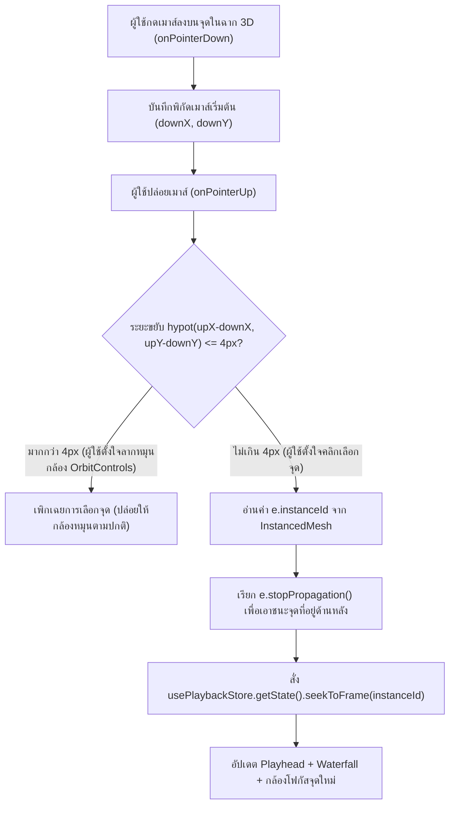

# Phase 14: Modern Studio UX — Bi-Directional 3D Raycast Scrubbing, Command Palette (`Ctrl+K`) & Label Aliasing

## 1. วัตถุประสงค์และขอบเขตของเฟส (Objective & Scope)
ยกระดับประสบการณ์การใช้งานของระบบให้เทียบเท่าซอฟต์แวร์สตูดิโอระดับโลก (*Linear, Figma, Blender, Spline 3D*) ด้วยการเชื่อมโยงฉาก 3D เข้ากับแถบเวลาแบบสองทิศทาง (**Bi-Directional 3D Raycast Click-to-Scrub**), ระบบสั่งงานด่วนด้วยคีย์บอร์ด (**Command Palette `Ctrl+K` / `Cmd+K`**), ระบบแปลงรหัสตัวเลขเป็นภาษาคนที่เข้าใจง่าย (**Human-Readable Class & Feature Aliasing**), และโหมดนำเสนอเต็มจอ (**Cinema Presentation Mode `Tab`**)

### ขอบเขตการทำงาน (Scope)
- **Bi-Directional 3D Raycast Scrubbing**: ผู้ใช้สามารถชี้เมาส์ (Hover) หรือคลิกที่จุดข้อมูลใดก็ได้ที่ลอยอยู่ในอวกาศ 3D (`THREE.InstancedMesh`) แล้วแถบเวลา Playhead, แผง Waterfall, และตารางข้อมูลจะกระโดดไปยังเฟรมของจุดนั้นทันทีภายใน `< 2 มิลลิวินาที` พร้อมระบบแยกแยะการคลิกเลือกจุดออกจากการคลิกค้างเพื่อหมุนกล้อง (`OrbitControls Drag Threshold Guard`)
- **Universal Command Palette (`Ctrl+K` / `Cmd+K`)**: หน้าต่างค้นหาคำสั่งแบบ Fuzzy Search ที่สั่งงานได้ทุกฟังก์ชันของแอปพลิเคชันโดยไม่ต้องจับเมาส์
- **Human-Readable Class Label & Feature Aliasing Studio**: แปลงป้าย `Class 0 / Class 1` หรือชื่อคอลัมน์ย่อใน CSV (เช่น `x_01_inc`) ให้เป็นชื่อภาษาไทย/อังกฤษที่สื่อความหมายพร้อมกำหนดสีประจำคลาส ซึ่งจะมีผลทั่วทั้งแอปพลิเคชันรวมถึงไฟล์ `.mlv` และไฟล์รายงานที่ส่งออก
- **Cinema Fullscreen Presentation Mode (`Tab` Key)**: ซ่อนแผงเครื่องมือด้านข้างทั้งหมดด้วยแอนิเมชันนุ่มนวล เหลือเพียงฉาก 3D เต็มหน้าจอและแถบควบคุมโปร่งแสง (Floating Glassmorphism HUD)

---

## 2. UI Feature List อย่างละเอียด (Detailed UI Feature List)
1. **3D Point Cloud Instanced Hover & Click Layer (`InteractiveQueuePointCloud3D.tsx`)**:
   - **Hover Highlight Ring**: เมื่อชี้เมาส์โดนจุดข้อมูลลำดับที่ $k$ ในฉาก 3D จะแสดงวงแหวนเรืองแสงล้อมรอบจุดนั้น พร้อมเปลี่ยนเคอร์เซอร์เป็น `pointer`
   - **3D Hover Mini-Tooltip**: แสดงป้ายเล็กๆ เหนือจุดที่ชี้ `Frame #0185 • Pred: อนุมัติสินเชื่อ (0.91) • Click to Jump`
   - **Click-to-Scrub Action**: คลิกซ้าย 1 ครั้งที่จุดในฉาก 3D เพื่อย้ายหัวอ่าน Playhead และลูกบอลหลักมายังเฟรม `#0185` ทันที
2. **Command Palette Modal (`CommandPaletteModal.tsx`)**:
   - เปิดด้วย `Ctrl + K` (Windows/Linux) หรือ `Cmd + K` (macOS) หรือคลิกปุ่ม `[ ⌘K Search & Commands... ]` บนแถบด้านบน
   - **Fuzzy Search Input & Category Tabs**: `All`, `Navigation`, `3D Axes & Camera`, `Playback`, `Export & Bake`
   - **Built-in Dynamic Commands**:
     - `Go to Frame / Row #<number>`: พิมพ์ตัวเลข เช่น `"245"` เพื่อกระโดดไปเฟรมที่ 245 ทันที
     - `Set X Axis: <feature_name>` / `Set Y Axis: <feature_name>`: เปลี่ยนแกน 3D ทันที
     - `Camera Preset: Isometric / Top-Down 2D / Front / Side / Reset`: หมุนมุมกล้องไปยังมุมมาตรฐาน
     - `Toggle 3D PCA Mode` / `Toggle Wireframe` / `Find Counterfactual` / `Bake .mlv File`
3. **Label & Feature Aliasing Manager Modal (`AliasSettingsModal.tsx`)**:
   - **Class Label Aliasing Table**:
     - แปลงค่าตัวเลขคลาส เช่น `0` $\to$ ชื่อที่แสดง `"อนุมัติปกติ (Low Risk)"` + ตัวเลือกสี `Emerald (#10B981)`
     - แปลงค่า `1` $\to$ ชื่อที่แสดง `"ปฏิเสธ / เสี่ยงผิดนัด (High Risk)"` + ตัวเลือกสี `Rose (#F43F5E)`
   - **Feature Display Name & Unit Editor**:
     - แปลงชื่อคอลัมน์ดิบ `rev_util_pct` $\to$ ชื่อแสดงผล `"อัตราใช้วงเงินหมุนเวียน"` + หน่วย `"%"`
   - ปุ่ม `Auto-Suggest Aliases` และ `Export / Import Alias JSON`
4. **Cinema Presentation Mode (`CinemaModeOverlay.tsx`)**:
   - กดปุ่ม `Tab` เพื่อพับเก็บ Left/Right Sidebars และ Top Header
   - แสดงแถบ Floating Glassmorphism Control Pill ลอยอยู่ด้านล่างกึ่งกลางจอพร้อมปุ่ม `Exit Cinema Mode (Tab / Esc)`
5. **States & Keyboard Shortcuts**:
   - `Ctrl + K` / `Cmd + K`: เปิด/ปิด Command Palette
   - `Tab`: สลับโหมด Cinema Fullscreen Presentation
   - `1`, `2`, `3`, `0`: สลับมุมกล้อง 3D (`1 = Isometric`, `2 = Top-Down X-Y Plane`, `3 = Front X-Z Plane`, `0 = Focus Active Ball`)

---

## 3. UX Flow & User Journey (Step-by-Step UX Flow & ASCII Wireframe)

### ลำดับการทำงาน (Step-by-Step User Journey)
1. **3D Raycast Click-to-Scrub Flow**:
   - ผู้ใช้หมุนดูฉาก 3D แล้วสังเกตเห็นจุดข้อมูลสีแดงจุดหนึ่งกระเด็นไปอยู่ในดงสีเขียว
   - ผู้ใช้เลื่อนเมาส์ไปชี้ที่จุดนั้น $\to$ `Raycaster` ของ Three.js คืนค่า `instanceId = 312`
   - ผู้ใช้คลิกซ้าย (โดยขยับเมาส์ระหว่างกดและปล่อยไม่เกิน `4 พิกเซล`) $\to$ ระบบเรียก `usePlaybackStore.getState().seekToFrame(312)` ทันที
   - ลูกบอลหลัก, กราฟ Waterfall, และแถบ Scrubber วิ่งมาที่เฟรม `#0312` พร้อมกันในพริบตา
2. **Command Palette Rapid Execution**:
   - ผู้ใช้กด `Ctrl + K` พิมพ์ `"top"` แล้วกด `Enter` $\to$ กล้อง 3D หมุนแบบ Smooth Slerp ไปยังมุมมองด้านบน (`Top-Down 2D Contour View`) ทันที
3. **Human-Readable Aliasing Flow**:
   - ผู้ใช้ตั้งค่า `0 = "ผ่านเกณฑ์"`, `1 = "ไม่ผ่านเกณฑ์"` ในหน้าต่าง Alias Settings $\to$ ป้าย 3D HUD และกราฟทั้งหมดเปลี่ยนจากคำว่า `Class 0 / 1` เป็น `"ผ่านเกณฑ์" / "ไม่ผ่านเกณฑ์"` ทันทีโดยไม่ต้องคำนวณโมเดลใหม่

### ASCII Wireframe
```text
+--------------------------------------------------------------------------------------------------+
|  Easy ML Viewer Studio                  [ 🔍 ⌘K Search commands, jump to row, change axes... ]   |
+--------------------------------------------------------------------------------------------------+
|                                 +----------------------------------------------+                 |
|       3D POINT CLOUD            | > axis x inc                                 |                 |
|                                 |----------------------------------------------|                 |
|        •    •     •             | [🏔️] Set Axis X -> annual_income      [Enter]|                 |
|      •   [◎ #312]   •           | [🏔️] Set Axis Y -> annual_income             |                 |
|          ┌───────────────────┐  | [🎯] Go to Frame #312                        |                 |
|          │ Frame #0312       │  | [📷] Camera Preset: Top-Down 2D (Key: 2)     |                 |
|          │ ปฏิเสธสินเชื่อ (0.88)│  | [🏷️] Edit Class & Feature Aliases...         |                 |
|          │ [Click to Scrub]  │  +----------------------------------------------+                 |
|          └───────────────────┘                                                                   |
+--------------------------------------------------------------------------------------------------+
|                  [ 🎬 Cinema Mode (Tab) ]    Camera: [1:Iso] [2:Top] [3:Front] [0:Focus]          |
+--------------------------------------------------------------------------------------------------+
```

### Mermaid Flowchart: State Transition


---

## 4. สถาปัตยกรรม DDD แยกรายชั้นพร้อมชื่อไฟล์และ Class/Method Signatures (DDD Architecture & Code Blueprint)

### โครงสร้างไฟล์ (Directory Structure)
```text
backend/app/
├── domains/
│   └── studio_metadata/
│       ├── entities.py
│       └── value_objects.py
└── presentation/
    └── api/
        └── v1/
            └── alias_router.py

frontend/src/domains/studio-ux/
├── types/studioUx.types.ts
├── store/
│   ├── useAliasStore.ts
│   └── useStudioLayoutStore.ts
├── hooks/
│   └── useCommandPaletteRegistry.ts
└── components/
    ├── InteractiveQueuePointCloud3D.tsx
    ├── CommandPaletteModal.tsx
    ├── AliasSettingsModal.tsx
    └── CameraPresetToolbar.tsx
```

### 4.1 `backend/app/domains/studio_metadata/` (Entities & Value Objects)
```python
from pydantic import BaseModel, Field

class ClassAliasVO(BaseModel):
    raw_class_value: str | int
    display_label: str = Field(max_length=64)
    hex_color: str = Field(pattern=r"^#[0-9A-Fa-f]{6}$")

class FeatureAliasVO(BaseModel):
    raw_feature_name: str
    display_name: str = Field(max_length=64)
    unit_suffix: str = Field(default="", max_length=16)

class SessionAliasConfigEntity(BaseModel):
    session_id: str
    class_aliases: dict[str, ClassAliasVO] = {}
    feature_aliases: dict[str, FeatureAliasVO] = {}
```

### 4.2 `frontend/src/domains/studio-ux/components/InteractiveQueuePointCloud3D.tsx` (Instanced Raycast Scrubbing)
```typescript
import React, { useRef, useMemo, useEffect } from 'react';
import * as THREE from 'three';
import { ThreeEvent } from '@react-three/fiber';
import { usePlaybackStore } from '../../playback/store/usePlaybackStore';

interface Props {
  positionsBuffer: Float32Array; // ขนาด totalFrames * 3
  totalFrames: number;
}

export const InteractiveQueuePointCloud3D: React.FC<Props> = ({ positionsBuffer, totalFrames }) => {
  const meshRef = useRef<THREE.InstancedMesh>(null);
  const pointerDownPosRef = useRef<{ x: number; y: number }>({ x: 0, y: 0 });
  const dummyObj = useMemo(() => new THREE.Object3D(), []);

  useEffect(() => {
    if (!meshRef.current || totalFrames === 0) return;
    for (let i = 0; i < totalFrames; i++) {
      dummyObj.position.set(
        positionsBuffer[i * 3],
        positionsBuffer[i * 3 + 1],
        positionsBuffer[i * 3 + 2]
      );
      dummyObj.updateMatrix();
      meshRef.current.setMatrixAt(i, dummyObj.matrix);
    }
    meshRef.current.instanceMatrix.needsUpdate = true;
    meshRef.current.computeBoundingSphere(); // สำคัญมากเพื่อให้ Raycaster ตรวจจับทุก Instance ได้แม่นยำ!
  }, [positionsBuffer, totalFrames, dummyObj]);

  const handlePointerDown = (e: ThreeEvent<PointerEvent>) => {
    pointerDownPosRef.current = { x: e.clientX, y: e.clientY };
  };

  const handlePointerUp = (e: ThreeEvent<PointerEvent>) => {
    const dx = e.clientX - pointerDownPosRef.current.x;
    const dy = e.clientY - pointerDownPosRef.current.y;
    const dragDistancePx = Math.hypot(dx, dy);

    // แยกแยะการคลิกเลือกจุด (< 4px) ออกจาก OrbitControls Drag
    if (dragDistancePx <= 4.0 && typeof e.instanceId === 'number') {
      e.stopPropagation();
      usePlaybackStore.getState().seekToFrame(e.instanceId, true);
    }
  };

  if (totalFrames === 0) return null;

  return (
    <instancedMesh
      ref={meshRef}
      args={[undefined, undefined, totalFrames]}
      onPointerDown={handlePointerDown}
      onPointerUp={handlePointerUp}
    >
      <sphereGeometry args={[0.09, 12, 12]} />
      <meshStandardMaterial Roughness={0.3} metalness={0.2} />
    </instancedMesh>
  );
};
```

---

## 5. แผนการตรวจสอบหน่วยความจำและเพิ่มประสิทธิภาพทรัพยากรเครื่อง (Memory Check Plan & Process Resource Optimization)

### 5.1 Frontend & WebGL Memory Optimization (`THREE.InstancedMesh` Mandate)
- **Single Draw Call for All Queue Points**: จุดข้อมูลทั้งหมดในคิว (เช่น 10,000 จุด) ต้องเรนเดอร์ด้วย `THREE.InstancedMesh` เพียง **1 Draw Call** เดียวเท่านั้น ห้ามวนลูปสร้าง `<mesh>` 10,000 ตัวเด็ดขาด
- **Reusable `THREE.Object3D` Dummy Matrix**: ในการคำนวณ `setMatrixAt(i, dummyObj.matrix)` ต้องสร้าง `dummyObj` เพียงตัวเดียวผ่าน `useMemo` แล้ววนใช้ซ้ำ ห้าม `new THREE.Matrix4()` ในลูป 10,000 รอบ
- **Raycast Bounding Sphere Update**: ทุกครั้งที่อัปเดต `instanceMatrix` ต้องเรียก `meshRef.current.computeBoundingSphere()` เสมอ มิฉะนั้น Three.js Raycaster จะใช้ Bounding Sphere เดิมที่ขนาดเป็น 0 และคลิกไม่ติดเมื่อจุดอยู่นอกจุดศูนย์กลางฉาก

### 5.2 Process & CPU/GPU Resource Optimization
- **Throttled PointerMove Raycasting (`50ms`)**: การตรวจจับ Hover บน `InstancedMesh` ที่มีหลายพันจุด หากทำทุกพิกเซลที่เมาส์ขยับจะกิน CPU สูง จึงทำ Throttle การอัปเดต Hover Tooltip ไว้ที่ทุกๆ `50ms` (20Hz) ส่วนการคลิก (`onPointerUp`) ทำงานทันทีแบบ 0ms Latency

---

## 6. ไลบรารีที่ใช้และการตั้งค่า Offline 100% (Libraries & Offline Configuration)
- **Frontend**: `three` (`InstancedMesh`, `Raycaster`), `@react-three/fiber`, `zustand` (พร้อม `persist` middleware ลง `localStorage` สำหรับจำค่า Alias ของผู้ใช้), Tailwind CSS v4

---

## 7. ตารางข้อควรระวังและ Edge Cases (Caveats & Edge Case Matrix)

| ลำดับ | เคสปัญหา (Edge Case) | สาเหตุทางเทคนิค (Root Cause) | วิธีป้องกันและแก้ไขในโค้ด (Mitigation Strategy) |
| :---: | :--- | :--- | :--- |
| 1 | **คลิกค้างเพื่อหมุนมุมกล้อง 3D แต่เผลอไปโดนจุดข้อมูลทำให้เฟรมกระโดดเอง** | `onClick` มาตรฐานของ R3F ทำงานแม้ผู้ใช้ลากเมาส์หมุนกล้องแล้วปล่อยเมาส์ตรงจุดข้อมูล | วัดระยะ `Math.hypot(upX - downX, upY - downY) <= 4.0` ใน `onPointerUp` หากขยับเมาส์เกิน 4 พิกเซลให้ถือเป็นการหมุนกล้อง ไม่สั่งเปลี่ยนเฟรม |
| 2 | **คลิกที่จุดด้านหน้าแต่ Raycaster ทะลุไปเลือกจุดด้านหลังด้วย** | ลำแสง Raycast ทะลุผ่านทรงกลมหลายลูกที่ซ้อนกันในแนวสายตา | เรียก `e.stopPropagation()` ทันทีที่จับเหตุการณ์ของจุดแรกที่อยู่ใกล้กล้องที่สุด (`e.intersections[0]`) |
| 3 | **จุดข้อมูลมีพิกัดซ้อนทับกันสนิทหลายเฟรม (Overlapping Identical Rows)** | ใน CSV มีแถวที่มีค่า Feature เหมือนกันทุกประการ ทำให้ลูกบอลอยู่ทับพิกัดเดียวกัน | เมื่อคลิกซ้ำที่ตำแหน่งเดิม ระบบจะวนเลือกเฟรมถัดไปที่อยู่ในกลุ่มพิกัดเดียวกัน (`Cycle Overlapping Instances`) พร้อมแสดงป้าย `[3 frames at this point]` |
| 4 | **กดปุ่ม `Tab` เพื่อเข้าโหมด Cinema ขณะเปิด Modal ตั้งค่าอยู่** | ปุ่ม `Tab` เป็นปุ่มมาตรฐานสำหรับเลื่อน Focus ระหว่างช่อง Input ในฟอร์ม | เช็กว่าหากมี Modal เปิดอยู่ (`isModalOpen === true`) หรือโฟกัสอยู่ใน `<input>` ให้ใช้ `Tab` เพื่อเลื่อน Focus ตามปกติ ไม่สลับโหมด Cinema |
| 5 | **ตั้งชื่อ Alias ยาวมากจนล้นป้าย 3D HUD และกราฟ Waterfall** | ผู้ใช้ตั้งชื่อคลาสยาว 100 ตัวอักษร | จำกัด `maxLength={64}` และใช้ CSS `truncate max-w-[180px]` พร้อมแสดงชื่อเต็มใน Tooltip เมื่อชี้เมาส์ |
| 6 | **ค้นหาคำสั่งใน Command Palette ด้วยตัวพิมพ์เล็ก/ใหญ่หรือพิมพ์ผิดเล็กน้อย** | ผู้ใช้พิมพ์ `"incme"` แทน `"income"` | ใช้อัลกอริทึม Subsequence Fuzzy Matching ที่ไม่สนใจตัวพิมพ์เล็ก-ใหญ่และจัดคะแนนความใกล้เคียง |

---

## 8. เกณฑ์การตรวจรับงาน (Definition of Done Checklist)
- [ ] ผู้ใช้สามารถคลิกที่จุดใดๆ ในฉาก 3D เพื่อกระโดดไปยังเฟรมของจุดนั้นได้ทันที โดยไม่ชนกับการคลิกค้างเพื่อหมุนมุมกล้อง (`<= 4px` drag guard)
- [ ] จุดข้อมูลทั้งหมดในคิวถูกเรนเดอร์ด้วย `THREE.InstancedMesh` เพียง 1 Draw Call และเรียก `computeBoundingSphere()` ถูกต้อง
- [ ] กด `Ctrl+K` / `Cmd+K` เพื่อเปิด Command Palette และสั่งกระโดดไปเฟรมที่ต้องการ, เปลี่ยนแกน X/Y, หรือเปลี่ยนมุมกล้องได้โดยไม่ต้องใช้เมาส์
- [ ] ระบบตั้งชื่อแทน (Class & Feature Aliasing) อัปเดตชื่อและสีของคลาสทั่วทั้งป้าย 3D HUD, แผง Waterfall, และตารางข้อมูลทันที
- [ ] กดปุ่ม `Tab` (เมื่อไม่ได้อยู่ในฟอร์ม Input) เพื่อเปิด/ปิดโหมด Cinema Fullscreen Presentation ได้อย่างราบรื่น
