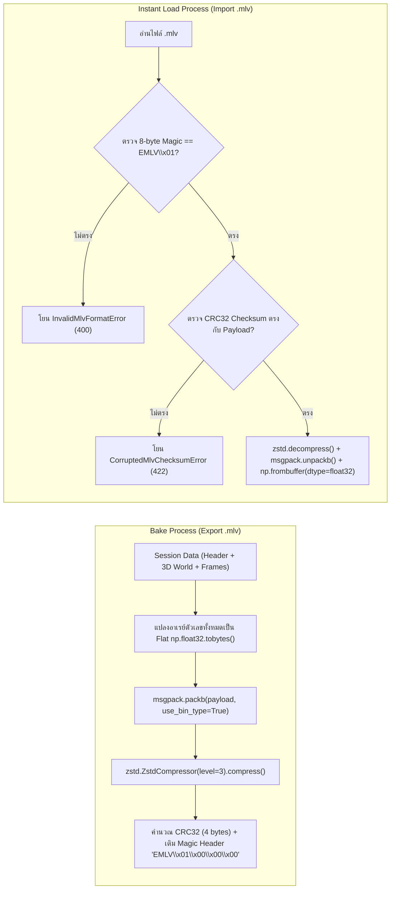

# Phase 15: `.mlv` Recording Format — MsgPack + Zstandard Baker, Streaming Writer & Instant Loader

## 1. วัตถุประสงค์และขอบเขตของเฟส (Objective & Scope)
ออกแบบและพัฒนาระบบไฟล์มาตรฐานเฉพาะของแพลตฟอร์มในนามสกุล **`.mlv` (Machine Learning Video Package v1.0)** เพื่อบันทึก (Bake) ผลการคำนวณพื้นผิว 3D, โครงสร้างภายในของโมเดล, เส้นทางการเคลื่อนที่และผลทำนายรายเฟรม, ค่า Feature Contribution Waterfall, หมุด Anomaly, และโน้ต Bookmark ทั้งหมดลงเป็นไฟล์ Binary บีบอัดความเร็วสูง ทำให้ผู้ใช้สามารถเปิดดูซ้ำหรือส่งไฟล์ `.mlv` เพียงไฟล์เดียวให้เพื่อนร่วมงาน/ผู้บริหารเปิดดูแอนิเมชัน 3D ที่ 60 FPS ได้ทันทีภายใน `< 1 วินาที` โดยไม่ต้องติดตั้งไลบรารีของโมเดลนั้นหรือแนบไฟล์โมเดล/CSV ต้นฉบับอีกต่อไป!

### ขอบเขตการทำงาน (Scope)
- **`.mlv` Binary Specification v1.0 (`backend/app/core/binary_codec.py`)**:
  - โครงสร้างไฟล์ประกอบด้วย 8-byte Magic Header (`b"EMLV\x01\x00\x00\x00"`), 4-byte CRC32 Checksum, และ Payload ที่ Serialize ด้วย **MessagePack (`msgpack`)** ควบคู่กับการแปลงอาเรย์ตัวเลขเป็น Flat `float32` Binary Buffers แล้วบีบอัดด้วย **Zstandard (`zstandard` Level 3)**
  - แบ่งข้อมูลภายในเป็น 3 ส่วน: `header` (Metadata, Aliases, Bookmarks, Auto-Events), `static_world` (3D Surface Mesh, Tree Nodes / Support Vectors / Centroids / Neural Layers), และ `frames_track` (Columnar Binary Arrays ของพิกัด 3D, ผลทำนาย, และ Top-K Contributions)
- **Bake & Download Service (`POST /api/v1/recordings/bake`)**: คำนวณและแพ็กข้อมูลส่งกลับเป็น Binary Stream พร้อมรายงานความคืบหน้า (`Baking Progress %`)
- **Instant `.mlv` Player Loader (`POST /api/v1/recordings/load`)**: โหลดไฟล์ `.mlv` ตรวจสอบ Magic Header & Checksum แตกไฟล์ด้วย Zstandard ใน `< 30ms` และเปิดเข้าสู่หน้า 3D Studio Player ทันทีในโหมด **Read-Only Replay Studio**

---

## 2. UI Feature List อย่างละเอียด (Detailed UI Feature List)
1. **Bake `.mlv` Recording Modal (`BakeMlvModal.tsx`)**:
   - ปุ่ม `[ 📦 Bake .mlv Recording ]` บนแถบ Header ด้านบน
   - **Recording Metadata Form**:
     - `Recording Title`: ชื่อชุดการทดลอง เช่น `"Credit Scoring XGBoost - Q3 Audit"`
     - `Author / Analyst Notes`: คำอธิบายประกอบไฟล์บันทึก
   - **Bake Quality & Size Options**:
     - `Surface Mesh Resolution`: เลือกฝังพื้นผิวระดับ `Standard (60x60)` หรือ `High (100x100)`
     - `Include Local Explainability Track`: สวิตช์เลือกฝังข้อมูลกราฟ Waterfall รายเฟรม (`Top 10 Features`)
     - `Include User Bookmarks & Auto-Events`: สวิตช์ฝังหมุดและโน้ตทั้งหมด (เปิดเป็นค่าเริ่มต้น)
   - **Estimated File Size Badge**: แสดงขนาดไฟล์ `.mlv` โดยประมาณก่อนกดสร้าง เช่น `"Est. Compressed Size: ~1.8 MB (2,500 frames)"`
   - **Baking Progress Bar**: แถบสถานะขณะกำลังแพ็กไฟล์ `Baking Frames & Compressing (Zstd L3)... 85%`
2. **Instant `.mlv` Dropzone & Quick-Open Card (`MlvInstantDropzone.tsx`)**:
   - บนหน้าแรก (Landing / Launchpad) และในเมนู `File -> Open .mlv Recording`:
   - กล่องลากวางไฟล์ `.mlv` พร้อมป้าย `"⚡ Instant 60FPS Replay — ไม่ต้องใช้ไฟล์โมเดลหรือ CSV"`
3. **Replay Mode Status Banner (`MlvReplayModeBanner.tsx`)**:
   - เมื่อเปิดทำงานจากไฟล์ `.mlv` จะแสดงป้าย Badge สีม่วงครามบนแถบด้านบน: `[ 📼 REPLAY MODE: credit_audit_q3.mlv (v1.0 • 2,500 Frames) ]`
   - ปุ่ม `[ ℹ️ Recording Info ]` ดูรายละเอียดโมเดลต้นฉบับ วันเวลาที่ Bake และชื่อผู้สร้าง
   - ในโหมด Replay (ที่ไม่มีโมเดลจริงโหลดอยู่) ปุ่มแก้ไขค่า Slider ใน What-If Sandbox จะแสดง Tooltip แจ้งว่า `"โหมดเปิดไฟล์บันทึก .mlv (Pre-baked Replay) — หากต้องการจำลองค่า What-If ใหม่ กรุณาโหลดไฟล์โมเดลต้นฉบับ"` (แต่ยังสามารถดู 3D, กรอวิดีโอ, ดู Waterfall, และเพิ่ม Bookmark ใหม่แล้วบันทึก `.mlv` ทับได้!)
4. **States & Error Feedback**:
   - **Corrupted / Invalid File Error Modal**: แจ้งเตือนชัดเจนเมื่อผู้ใช้อัปโหลดไฟล์ที่ไม่ใช่ `.mlv` (Magic Header ไม่ตรง) หรือไฟล์เสียหาย (CRC32 Mismatch)
   - **Schema Version Mismatch Warning**: แจ้งเตือนเมื่อเปิดไฟล์ `.mlv` ที่สร้างจากเวอร์ชันใหม่กว่า

---

## 3. UX Flow & User Journey (Step-by-Step UX Flow & ASCII Wireframe)

### ลำดับการทำงาน (Step-by-Step User Journey)
1. **Baking Flow (การบันทึกไฟล์ `.mlv`)**:
   - ผู้ใช้ตั้งค่าแกน 3D, ตั้งชื่อ Alias, และปักหมุด Bookmark เสร็จเรียบร้อย แล้วคลิก `[ 📦 Bake .mlv Recording ]`
   - ผู้ใช้ตั้งชื่อไฟล์แล้วกด `Start Baking & Download`
   - Backend รวบรวม `header`, `static_world`, และแปลง `frames_track` เป็น Columnar `float32` Byte Buffers $\to$ แพ็กด้วย `msgpack.packb()` $\to$ บีบอัดด้วย `zstandard.ZstdCompressor(level=3)` $\to$ เติมหัวไฟล์ `EMLV\x01\x00\x00\x00` + `CRC32` แล้วส่งให้เบราว์เซอร์ดาวน์โหลดทันที
2. **Instant Loading Flow (การเปิดไฟล์ `.mlv` ทันที)**:
   - ผู้ใช้ลากไฟล์ `credit_audit.mlv` มาวางในหน้าแอปพลิเคชัน
   - Backend ตรวจเช็ก 8 ไบต์แรก (`EMLV\x01\x00\x00\x00`) และตรวจค่า `zlib.crc32`
   - แตกไฟล์ด้วย `ZstdDecompressor` และ `msgpack.unpackb()` คืนค่าเป็น Session พิเศษประเภท `PrebakedMlvSession`
   - หน้าจอตัดเข้าสู่ห้อง 3D VCR Studio พร้อมพื้นผิวภูเขา 3D และคิวเฟรมทั้งหมดในเวลา `< 0.5 วินาที`!

### ASCII Wireframe
```text
+--------------------------------------------------------------------------------------------------+
|  📦 BAKE .MLV 3D RECORDING PACKAGE                                                         [✕]   |
+--------------------------------------------------------------------------------------------------+
|  Recording Title : [ Credit Scoring XGBoost - Q3 Audit_v2                              ]         |
|  Analyst Notes   : [ ตรวจสอบเคสลูกค้ากลุ่มรายได้แปรผันที่ถูกปัดตกในช่วงเฟรม 200-350       ]         |
|--------------------------------------------------------------------------------------------------|
|  Included Tracks & Assets:                                                                       |
|   [✓] 3D Decision Surface Mesh (Standard 60x60 LOD)                                              |
|   [✓] Internal Model Architecture Geometry (XGBoost Trees & Split Nodes)                         |
|   [✓] Frame-by-Frame 3D Trajectory & Predictions (2,500 Frames)                                  |
|   [✓] Local Feature Contributions Waterfall (Top 10 Features / Frame)                            |
|   [✓] Auto-Anomaly Pins (42 events) & User Bookmarks (5 notes)                                   |
|--------------------------------------------------------------------------------------------------|
|  Format: EMLV v1.0 (MsgPack + Zstd Level 3 + Float32 Columnar)   Est. Size: ~2.1 MB              |
|  [██████████████████████████████████████░░░░░░] 86% — Compressing binary payload...              |
|                                                              [ Cancel ]  [ ⬇ Bake & Download ]   |
+--------------------------------------------------------------------------------------------------+
```

### Mermaid Flowchart: `.mlv` Binary Codec Pipeline


---

## 4. สถาปัตยกรรม DDD แยกรายชั้นพร้อมชื่อไฟล์และ Class/Method Signatures (DDD Architecture & Code Blueprint)

### โครงสร้างไฟล์ (Directory Structure)
```text
backend/app/
├── core/
│   └── binary_codec.py
├── domains/
│   └── recording_mlv/
│       ├── entities.py
│       ├── value_objects.py
│       └── services.py
├── application/
│   └── mlv_recording_orchestrator.py
└── presentation/
    └── api/
        └── v1/
            └── recording_router.py

frontend/src/domains/recording/
├── types/recording.types.ts
├── store/useRecordingStore.ts
└── components/
    ├── BakeMlvModal.tsx
    ├── MlvInstantDropzone.tsx
    └── MlvReplayModeBanner.tsx
```

### 4.1 `backend/app/core/binary_codec.py` (Core Binary Specification v1.0)
```python
import struct
import zlib
from typing import Any
import msgpack
import numpy as np
import zstandard as zstd

MLV_MAGIC_HEADER: bytes = b"EMLV\x01\x00\x00\x00"  # 8 bytes: Magic 'EMLV' + Version 1.0.0
HEADER_PREFIX_SIZE: int = 12                        # 8 bytes Magic + 4 bytes uint32 CRC32
MAX_DECOMPRESSED_BYTES: int = 250 * 1024 * 1024     # จำกัดขนาดหลังแตกไฟล์ไม่เกิน 250 MB (Zip Bomb Guard)

class MlvFormatError(ValueError):
    """ข้อผิดพลาดเมื่อไฟล์ .mlv มีรูปแบบไม่ถูกต้องหรือเสียหาย"""

def _msgpack_default_encoder(obj: Any) -> Any:
    """แปลง NumPy scalar และ ndarray ให้เป็นชนิดที่ MessagePack รองรับโดยอัตโนมัติ"""
    if isinstance(obj, np.ndarray):
        arr_f32 = np.ascontiguousarray(obj, dtype=np.float32)
        return {
            "__nd__": True,
            "dtype": "float32",
            "shape": list(arr_f32.shape),
            "bytes": arr_f32.tobytes(),
        }
    if isinstance(obj, (np.floating, np.float32, np.float64)):
        return float(obj)
    if isinstance(obj, (np.integer, np.int32, np.int64)):
        return int(obj)
    if isinstance(obj, np.bool_):
        return bool(obj)
    raise TypeError(f"Object of type {type(obj).__name__} is not Mlv-serializable")

def _msgpack_object_hook(obj: dict[Any, Any]) -> Any:
    """แปลง Binary buffer กลับเป็น NumPy float32 array ตอนโหลดไฟล์"""
    if obj.get("__nd__") is True:
        raw_bytes: bytes = obj["bytes"]
        shape: tuple[int, ...] = tuple(obj["shape"])
        return np.frombuffer(raw_bytes, dtype=np.float32).reshape(shape).copy()
    return obj

def encode_mlv_package(payload_dict: dict[str, Any], compression_level: int = 3) -> bytes:
    """แพ็กข้อมูล Dictionary เป็นไฟล์ Binary .mlv พร้อม Magic Header และ CRC32"""
    packed_msg = msgpack.packb(payload_dict, default=_msgpack_default_encoder, use_bin_type=True)
    compressor = zstd.ZstdCompressor(level=compression_level, threads=-1)
    compressed_payload = compressor.compress(packed_msg)
    del packed_msg  # คืนหน่วยความจำ Buffer ก่อนบีบอัดทันที

    crc_val = zlib.crc32(compressed_payload) & 0xFFFFFFFF
    crc_bytes = struct.pack("<I", crc_val)
    return MLV_MAGIC_HEADER + crc_bytes + compressed_payload

def decode_mlv_package(file_bytes: bytes) -> dict[str, Any]:
    """ตรวจสอบความถูกต้องของไฟล์ .mlv และแตกไฟล์กลับเป็นโครงสร้างข้อมูล Python"""
    if len(file_bytes) < HEADER_PREFIX_SIZE:
        raise MlvFormatError("ไฟล์มีขนาดเล็กเกินกว่ามาตรฐาน .mlv (Truncated File)")

    magic = file_bytes[:8]
    if magic != MLV_MAGIC_HEADER:
        raise MlvFormatError("หัวไฟล์ไม่ใช่รูปแบบ .mlv v1.0 ที่ถูกต้อง (Invalid Magic Header)")

    expected_crc = struct.unpack("<I", file_bytes[8:12])[0]
    compressed_payload = file_bytes[12:]
    actual_crc = zlib.crc32(compressed_payload) & 0xFFFFFFFF

    if actual_crc != expected_crc:
        raise MlvFormatError(f"ไฟล์ .mlv เสียหายระหว่างจัดเก็บหรือดาวน์โหลด (CRC32 Mismatch: {actual_crc:#x} != {expected_crc:#x})")

    decompressor = zstd.ZstdDecompressor()
    uncompressed_msg = decompressor.decompress(compressed_payload, max_output_size=MAX_DECOMPRESSED_BYTES)
    return msgpack.unpackb(uncompressed_msg, object_hook=_msgpack_object_hook, raw=False)
```

### 4.2 `backend/app/domains/recording_mlv/entities.py` (Mlv Package Structure)
```python
from pydantic import BaseModel

class MlvHeaderSection(BaseModel):
    schema_version: str = "1.0"
    title: str
    notes: str = ""
    created_at_iso: str
    model_type: str
    model_family: str
    is_classification: bool
    feature_names: list[str]
    total_frames: int
    class_aliases: dict = {}
    feature_aliases: dict = {}
    bookmarks: list[dict] = []
    auto_events: list[dict] = []
```

### 4.3 `backend/app/presentation/api/v1/recording_router.py` (REST API Endpoints)
- **Endpoint 1**: `POST /api/v1/recordings/{session_id}/bake`
  - คืนค่า `StreamingResponse` ชนิด `application/octet-stream` พร้อม Header `Content-Disposition: attachment; filename="recording.mlv"`
- **Endpoint 2**: `POST /api/v1/recordings/load`
  - รับไฟล์ `UploadFile` (`.mlv`), ถอดรหัสด้วย `decode_mlv_package()`, สร้าง Session ใหม่ในสถานะ `is_prebaked_replay = True`, และส่ง `session_id` พร้อม `MlvHeaderSection` กลับให้ Frontend เปิดหน้า 3D Studio ทันที

---

## 5. แผนการตรวจสอบหน่วยความจำและเพิ่มประสิทธิภาพทรัพยากรเครื่อง (Memory Check Plan & Process Resource Optimization)

### 5.1 Backend Memory Check
- **Columnar Binary Packing (Struct-of-Arrays แทน Array-of-Structs)**:
  - ห้ามเก็บ `frames_track` เป็น `list[dict]` จำนวน 50,000 ตัวใน MessagePack เพราะการซ้ำชื่อ Key (`"position_3d"`, `"prediction"`) 50,000 รอบจะเปลือง RAM และขนาดไฟล์มหาศาล
  - ให้เก็บแยกคอลัมน์เป็น NumPy 2D/1D Contiguous `float32` Arrays เช่น `positions_world: ndarray(N, 3)`, `predictions: ndarray(N,)`, `top_k_contribs: ndarray(N, 10)` ซึ่งแปลงเป็น Binary `tobytes()` ได้โดยตรงในเสี้ยววินาที!
- **Decompression Bomb Guard**: กำหนด `max_output_size = 250 * 1024 * 1024` (250 MB) ใน `zstd.ZstdDecompressor().decompress()` เพื่อป้องกันไม่ให้ไฟล์ `.mlv` ที่ถูกดัดแปลงประสงค์ร้ายขยายตัวจนกิน RAM เซิร์ฟเวอร์เต็ม (`Out-Of-Memory Protection`)
- **Explicit Buffer Cleanup**: ทันทีที่บีบอัดเสร็จใน `encode_mlv_package` สั่ง `del packed_msg` และเรียก `gc.collect()` หลังส่ง Stream เสร็จ

### 5.2 Frontend & WebGL Memory Optimization
- **Direct TypedArray Hydration**: ข้อมูลพิกัด 3D และพื้นผิวที่โหลดจาก `.mlv` ถูกแปลงเข้า `Float32Array` ใน Frontend Store โดยตรงพร้อมส่งเข้า `THREE.BufferAttribute` ทันทีโดยไม่ผ่านการสร้าง Array ของ Object ย่อย

### 5.3 Process & CPU/GPU Resource Optimization
- **Multi-Threaded Zstandard Compression**: เปิด `threads=-1` ใน `zstd.ZstdCompressor(level=3, threads=-1)` เพื่อให้ C-extension ของ Zstandard ใช้ทุกคอร์ของ CPU บีบอัดข้อมูลในระดับความเร็ว `> 800 MB/s`

---

## 6. ไลบรารีที่ใช้และการตั้งค่า Offline 100% (Libraries & Offline Configuration)
- **Backend**:
  - `msgpack >= 1.0` (C-extension binary serialization)
  - `zstandard >= 0.22` (Facebook Zstd fast compression)
  - `numpy >= 1.26`
  - `zlib`, `struct` (Python Standard Library สำหรับตรวจ CRC32 และ Binary Struct)
- **Frontend**: Browser `Blob`, `URL.createObjectURL`, `FileReader` / `fetch` Binary ArrayBuffer

---

## 7. ตารางข้อควรระวังและ Edge Cases (Caveats & Edge Case Matrix)

| ลำดับ | เคสปัญหา (Edge Case) | สาเหตุทางเทคนิค (Root Cause) | วิธีป้องกันและแก้ไขในโค้ด (Mitigation Strategy) |
| :---: | :--- | :--- | :--- |
| 1 | **`msgpack` โยน `TypeError` เมื่อเจอ `np.float32` หรือ `np.int64`** | ไลบรารี `msgpack` มาตรฐานรู้จักเฉพาะ Python `float`, `int`, `bytes` เท่านั้น | เขียน `_msgpack_default_encoder` ดักจับ `np.ndarray`, `np.floating`, `np.integer`, และ `np.bool_` แปลงเป็นชนิดมาตรฐานหรือ Binary Buffer เสมอ |
| 2 | **NumPy Array ที่ได้จาก `np.frombuffer` เป็น Read-Only** | `np.frombuffer(raw_bytes)` สร้าง View ที่ชี้ไปยัง Memory ของ `bytes` ซึ่งแก้ไขค่าไม่ได้ (`WRITEABLE=False`) | เรียก `.copy()` ท้าย `np.frombuffer(...).reshape(shape).copy()` หรือใช้เฉพาะกับการอ่านเพื่อส่งออก API |
| 3 | **ผู้ใช้อัปโหลดไฟล์ `.csv` หรือ `.pkl` ที่เปลี่ยนนามสกุลเป็น `.mlv`** | ชื่อไฟล์ลงท้ายด้วย `.mlv` แต่ไบต์ข้างในไม่ใช่รูปแบบ EMLV | ตรวจเช็ก 8 ไบต์แรก (`file_bytes[:8] == b"EMLV\x01\x00\x00\x00"`) ก่อนส่งเข้า Zstandard เสมอ และคืน HTTP 400 พร้อมข้อความภาษาไทยที่ชัดเจน |
| 4 | **ไฟล์ `.mlv` ดาวน์โหลดมาไม่ครบ (Truncated / Corrupted Download)** | เน็ตหลุดหรือดิสก์เต็มระหว่างคัดลอกไฟล์ข้ามเครื่อง | ตรวจสอบค่า 4-byte `CRC32` ที่ส่วนหัวเทียบกับ `zlib.crc32(compressed_payload)` ก่อนแตกไฟล์ทุกครั้ง |
| 5 | **ผู้ใช้เพิ่ม Bookmark ใหม่ขณะกำลังดูไฟล์ในโหมด Replay (`.mlv`)** | ในโหมด Replay ไม่มีโมเดลจริง แต่ผู้ใช้ปักหมุดจดโน้ตเพิ่มแล้วอยากบันทึกเก็บไว้ | อนุญาตให้กดปุ่ม `Update & Re-bake .mlv` เพื่ออัปเดตเฉพาะส่วน `header.bookmarks` แล้วบีบอัดไฟล์ `.mlv` ใหม่ได้ทันทีโดยไม่ต้องใช้โมเดล! |
| 6 | **Non-Contiguous NumPy Array Slice ทำให้ `.tobytes()` เพี้ยน** | อาเรย์ที่ผ่านการ Transpose หรือ Slice แบบข้ามแถวไม่ได้เรียงตัวติดกันในหน่วยความจำ (Non-C-contiguous) | บังคับผ่าน `np.ascontiguousarray(obj, dtype=np.float32)` ก่อนเรียก `.tobytes()` ทุกครั้ง |

---

## 8. เกณฑ์การตรวจรับงาน (Definition of Done Checklist)
- [ ] `encode_mlv_package` และ `decode_mlv_package` สามารถแพ็กและแตกไฟล์ข้อมูลที่มีทั้ง NumPy `ndarray`, `float32`, `int64`, และข้อความภาษาไทย (UTF-8) กลับมาได้ตรงกัน 100%
- [ ] ไฟล์ `.mlv` ทุกไฟล์มี Magic Header `EMLV\x01\x00\x00\x00` และตรวจสอบ `CRC32` Checksum ผ่านก่อนแตกไฟล์
- [ ] ขนาดไฟล์ `.mlv` สำหรับคิวข้อมูล 10,000 เฟรมพร้อมพื้นผิว 3D Standard LOD มีขนาดเล็กกว่า `5 MB` และใช้เวลาโหลดกลับมาพร้อมแสดงผลน้อยกว่า `500 ms`
- [ ] ผู้ใช้สามารถเปิดไฟล์ `.mlv` จากหน้าแรกเพื่อเข้าสู่หน้า 3D Studio Player ได้ทันทีโดยไม่ต้องอัปโหลดไฟล์โมเดลหรือไฟล์ CSV
- [ ] ในโหมด Replay ผู้ใช้สามารถเพิ่ม/แก้ไข Bookmark และกดบันทึกทับออกเป็นไฟล์ `.mlv` ใหม่ได้สำเร็จ
