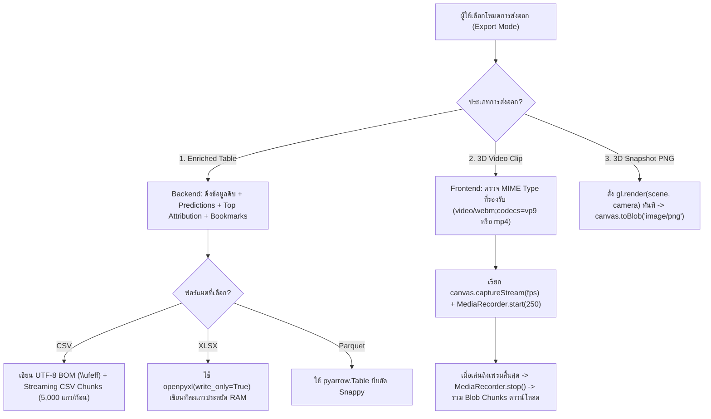

# Phase 16: Rich Export Suite — Enriched CSV/Excel Exporter, Offline WebM 3D Video Recorder & Snapshot

## 1. วัตถุประสงค์และขอบเขตของเฟส (Objective & Scope)
เติมเต็มขั้นตอนการส่งออกผลลัพธ์และการทำรายงาน (**Rich Export & Reporting Suite**) เพื่อให้ผู้ใช้สามารถนำข้อมูลการวิเคราะห์จากฉาก 3D และแผง Explainability ออกไปใช้งานต่อในสไลด์นำเสนอผู้บริหาร (PowerPoint / Keynote), รายงานการตรวจสอบโมเดล (Model Audit Report), หรือนำเข้าฐานข้อมูลได้ทันทีแบบ **Offline 100%** โดยไม่ต้องพึ่งพาเซิร์ฟเวอร์เรนเดอร์ภายนอก

### ขอบเขตการทำงาน (Scope)
- **Enriched Dataset Exporter (`.csv`, `.xlsx`, `.parquet`)**: ส่งออกตารางข้อมูลต้นฉบับพร้อมต่อท้ายคอลัมน์ผลลัพธ์ที่ได้จากโมเดลและการวิเคราะห์ในสตูดิโอโดยอัตโนมัติ ได้แก่:
  - `model_prediction`, `model_prediction_label` (ชื่อ Alias ที่ตั้งไว้), `model_confidence`
  - `residual_error` / `is_misclassified`
  - `top_1_positive_feature`, `top_1_positive_impact`, `top_1_negative_feature`, `top_1_negative_impact`
  - `auto_anomaly_flags` (เช่น `misclassified|decision_flip`)
  - `user_bookmark_note` (ข้อความโน้ตที่ผู้ใช้ปักหมุดไว้ใน Phase 11)
- **Offline 3D Video Clip Recorder (`.webm` / `.mp4`)**: อัดวิดีโอการเคลื่อนไหวของฉาก 3D ขณะกำลังเล่นจาก WebGL `<canvas>` โดยตรงด้วย `captureStream(60)` และ `MediaRecorder` API ความละเอียดสูง 60 FPS พร้อมตัวเลือกซ้อนทับป้าย HUD Telemetry ลงในวิดีโอ
- **High-Resolution 3D Studio Snapshot (`.png`)**: ถ่ายภาพนิ่งของฉาก 3D ความละเอียดสูง (รองรับ `1x`, `2x Super-Sampling` สำหรับงานพิมพ์/สไลด์) พร้อมพื้นหลังโปร่งใส (`Transparent PNG`) หรือพื้นหลังธีมมืด

---

## 2. UI Feature List อย่างละเอียด (Detailed UI Feature List)
1. **Unified Export Studio Modal (`ExportStudioModal.tsx`)**:
   - ปุ่ม `[ 📤 Export & Share ]` บนแถบเมนูหลัก แบ่งออกเป็น 3 แท็บ:
   - **Tab 1: Enriched Data Table (`.csv` / `.xlsx` / `.parquet`)**:
     - **Format Selector Cards**: `CSV (UTF-8 with BOM สำหรับเปิดใน Excel ภาษาไทยไม่เพี้ยน)`, `Excel Workbook (.xlsx พร้อมจัดสีหัวตาราง)`, `Apache Parquet (.parquet ความเร็วสูง)`
     - **Row Scope Radio**: `All Rows in Playback Queue (N rows)`, `Only Bookmarked & Anomaly Rows`, `Sub-range Loop [A .. B]`
     - **Enrichment Columns Checkboxes**: เลือกคอลัมน์เสริมที่จะแนบต่อท้าย (`Predictions & Labels`, `Confidence / Error`, `Top Positive/Negative SHAP Drivers`, `Bookmark Notes`)
   - **Tab 2: 3D Video Clip Recorder (`.webm` / `.mp4`)**:
     - **Recording Scope**: `Record Current A-B Loop Range (Auto-Start & Auto-Stop)` หรือ `Manual Start / Stop Recording`
     - **Frame Rate & Quality Selector**: `30 FPS (Standard - 8 Mbps)` | `60 FPS (Smooth Studio - 16 Mbps)`
     - **HUD Watermark Overlay Toggle**: เลือกฝังแถบข้อมูลหมายเลขเฟรม ชื่อโมเดล และค่าทำนายไว้ที่มุมล่างของวิดีโอ
   - **Tab 3: High-Res 3D Snapshot (`.png`)**:
     - **Resolution Scale**: `1x Native Viewport`, `2x Crisp Presentation (Retina)`
     - **Background Style**: `Studio Dark Background` หรือ `Transparent Background (Alpha PNG)`
2. **Floating Video Recording HUD Bar (`VideoRecordingIndicatorBar.tsx`)**:
   - เมื่อเริ่มอัดวิดีโอ จะแสดงป้ายไฟกะพริบสีแดง `[ 🔴 REC 00:08.4 (Frame 0042 / 0200) ]` พร้อมปุ่ม `[ ⏹ Stop & Save Video ]`
3. **States & Keyboard Shortcuts**:
   - **Export Progress Indicator**: แถบโหลดขณะสร้างไฟล์ `.xlsx` หรือกำลัง Finalize ไฟล์วิดีโอ
   - **Keyboard Shortcuts**:
     - `Ctrl + Shift + S`: ถ่ายภาพด่วน `Quick 3D Snapshot (.png)` ลงเครื่องทันทีในคลิกเดียว
     - `Ctrl + Shift + R`: เริ่ม / หยุดการอัดวิดีโอฉาก 3D ด่วน
     - `Ctrl + E`: เปิดหน้าต่าง `ExportStudioModal`

---

## 3. UX Flow & User Journey (Step-by-Step UX Flow & ASCII Wireframe)

### ลำดับการทำงาน (Step-by-Step User Journey)
1. **Enriched CSV / Excel Export Flow**:
   - ผู้ใช้เปิดแท็บ `Enriched Data Table` เลือกฟอร์แมต `.xlsx` และติ๊กเลือก `Include Top Positive/Negative Drivers` และ `Bookmark Notes`
   - Backend ใช้ Streaming Generator (สำหรับ CSV) หรือ `openpyxl` Write-Only Mode (สำหรับ Excel) ผสานตารางต้นฉบับเข้ากับผลลัพธ์และโน้ต Bookmark แล้วส่งไฟล์กลับมาดาวน์โหลด
2. **Automated Loop Video Recording Flow**:
   - ผู้ใช้ต้องการอัดคลิปวิดีโอสั้นๆ ช่วงเฟรมที่ `100` ถึง `200` ไปใส่สไลด์ PowerPoint
   - ผู้ใช้ตั้งช่วง `Loop A = 100, Loop B = 200` แล้วกดปุ่ม `[ 🎬 Record A-B Sequence ]`
   - ระบบย้ายหัวอ่านไปที่เฟรม `100`, เริ่ม `MediaRecorder.start()`, สั่งเล่นวิดีโอไปจนถึงเฟรม `200`, แล้วสั่ง `MediaRecorder.stop()` อัตโนมัติ พร้อมดาวน์โหลดไฟล์ `ml-simulation-frames-100-200.webm` ให้ทันที!
3. **One-Click High-Res PNG Snapshot Flow**:
   - ผู้ใช้หมุนมุมกล้อง 3D ได้มุมที่สวยงามแล้วกด `Ctrl + Shift + S`
   - ระบบสั่ง `gl.render(scene, camera)` ทันที 1 เฟรมในจังหวะเดียวกัน (เพื่อให้ WebGL Drawing Buffer มีภาพล่าสุดโดยไม่ต้องเปิด `preserveDrawingBuffer` ค้างไว้ตลอดเวลา) แล้วดึง `canvas.toBlob()` บันทึกเป็นไฟล์ `.png`

### ASCII Wireframe
```text
+--------------------------------------------------------------------------------------------------+
|  📤 EXPORT & REPORTING STUDIO                                                              [✕]   |
+--------------------------------------------------------------------------------------------------+
|  [ 📊 1. Enriched Data (.csv/.xlsx) ]   [ 🎬 2. 3D Video Clip (.webm) ]   [ 📸 3. 3D Snapshot ]  |
|--------------------------------------------------------------------------------------------------|
|  Select Output Format:                                                                           |
|   (●) CSV (UTF-8 with BOM - เปิดใน Microsoft Excel ภาษาไทยไม่เพี้ยน)                               |
|   ( ) Excel Workbook (.xlsx - พร้อมไฮไลต์สีแถวที่ทายผิดอัตโนมัติ)                                   |
|   ( ) Apache Parquet (.parquet - สำหรับงาน Data Engineering / Python)                             |
|                                                                                                  |
|  Row Filter Scope:                                                                               |
|   (●) All Queued Frames (1,500 rows)   ( ) Only Anomaly & Bookmarked Rows (18 rows)              |
|                                                                                                  |
|  Appended Model Intelligence Columns:                                                            |
|   [✓] model_prediction & human_alias_label      [✓] model_confidence & residual_error            |
|   [✓] top_positive_feature & impact_score       [✓] top_negative_feature & impact_score          |
|   [✓] auto_anomaly_flags                        [✓] user_bookmark_note                           |
|--------------------------------------------------------------------------------------------------|
|                                                    [ Cancel ]   [ ⬇ Export Enriched Table ]      |
+--------------------------------------------------------------------------------------------------+
```

### Mermaid Flowchart: State Transition


---

## 4. สถาปัตยกรรม DDD แยกรายชั้นพร้อมชื่อไฟล์และ Class/Method Signatures (DDD Architecture & Code Blueprint)

### โครงสร้างไฟล์ (Directory Structure)
```text
backend/app/
├── domains/
│   └── export_reporting/
│       ├── entities.py
│       ├── value_objects.py
│       └── services.py
├── application/
│   └── export_orchestrator.py
└── presentation/
    └── api/
        └── v1/
            └── export_router.py

frontend/src/domains/export-studio/
├── types/export.types.ts
├── hooks/
│   ├── useWebGLVideoRecorder.ts
│   └── useWebGLSnapshot.ts
└── components/
    ├── ExportStudioModal.tsx
    └── VideoRecordingIndicatorBar.tsx
```

### 4.1 `backend/app/domains/export_reporting/services.py` (Streaming Enriched Exporter)
```python
import csv
import io
from typing import Iterator, Literal
import numpy as np
import openpyxl
import pandas as pd

class EnrichedDatasetExportService:
    """บริการสร้างไฟล์ตารางข้อมูลที่ผสานผลลัพธ์จากโมเดลและโน้ตของผู้ใช้แบบประหยัดหน่วยความจำ"""

    @staticmethod
    def stream_enriched_csv_chunks(
        df_features: pd.DataFrame,
        row_indices: list[int],
        predictions: np.ndarray,
        confidences: np.ndarray,
        class_aliases: dict[str, str],
        top_pos_features: list[str],
        top_pos_scores: np.ndarray,
        top_neg_features: list[str],
        top_neg_scores: np.ndarray,
        bookmarks_by_frame: dict[int, str],
        chunk_size: int = 5000,
    ) -> Iterator[bytes]:
        # เขียน UTF-8 BOM (\xef\xbb\xbf) เป็นไบต์แรกเพื่อให้ Microsoft Excel บน Windows อ่านภาษาไทยได้ถูกต้อง 100%
        yield b"\xef\xbb\xbf"

        base_cols = list(df_features.columns)
        enriched_cols = [
            "frame_index",
            "dataset_row_index",
            *base_cols,
            "model_prediction",
            "model_prediction_label",
            "model_confidence",
            "top_positive_feature",
            "top_positive_impact",
            "top_negative_feature",
            "top_negative_impact",
            "user_bookmark_note",
        ]

        buffer = io.StringIO()
        writer = csv.writer(buffer, lineterminator="\r\n")
        writer.writerow(enriched_cols)
        yield buffer.getvalue().encode("utf-8")
        buffer.seek(0)
        buffer.truncate(0)

        total_frames = len(predictions)
        for start_idx in range(0, total_frames, chunk_size):
            end_idx = min(total_frames, start_idx + chunk_size)
            for frame_i in range(start_idx, end_idx):
                orig_row_idx = int(row_indices[frame_i])
                raw_vals = df_features.iloc[frame_i].tolist()
                pred_val = float(predictions[frame_i])
                pred_key = str(int(round(pred_val)))
                label_str = class_aliases.get(pred_key, f"Class {pred_key}")

                row_out = [
                    frame_i,
                    orig_row_idx,
                    *raw_vals,
                    round(pred_val, 6),
                    label_str,
                    round(float(confidences[frame_i]), 6),
                    top_pos_features[frame_i],
                    round(float(top_pos_scores[frame_i]), 6),
                    top_neg_features[frame_i],
                    round(float(top_neg_scores[frame_i]), 6),
                    bookmarks_by_frame.get(frame_i, ""),
                ]
                writer.writerow(row_out)

            yield buffer.getvalue().encode("utf-8")
            buffer.seek(0)
            buffer.truncate(0)
```

### 4.2 `backend/app/presentation/api/v1/export_router.py` (REST API Endpoints)
- **Endpoint**: `POST /api/v1/exports/{session_id}/enriched-table`
- **Request JSON Schema**:
```json
{
  "format": "csv",
  "scope": "all_queued",
  "include_attribution_columns": true,
  "include_bookmarks": true
}
```
- **Response**: `StreamingResponse` พร้อม Header `Content-Type: text/csv; charset=utf-8`

### 4.3 `frontend/src/domains/export-studio/hooks/useWebGLVideoRecorder.ts` (Offline 60FPS Video Recorder)
```typescript
import { useRef, useState, useCallback } from 'react';

export function useWebGLVideoRecorder() {
  const mediaRecorderRef = useRef<MediaRecorder | null>(null);
  const recordedChunksRef = useRef<Blob[]>([]);
  const [isRecording, setIsRecording] = useState(false);

  const getSupportedMimeType = (): string => {
    const candidates = [
      'video/webm;codecs=vp9',
      'video/webm;codecs=vp8',
      'video/webm',
      'video/mp4',
    ];
    return candidates.find((mime) => MediaRecorder.isTypeSupported(mime)) || '';
  };

  const startRecording = useCallback((canvasElement: HTMLCanvasElement, fps: number = 60) => {
    const mimeType = getSupportedMimeType();
    if (!mimeType) {
      throw new Error('เบราว์เซอร์นี้ไม่รองรับการบันทึกวิดีโอด้วย MediaRecorder API');
    }

    recordedChunksRef.current = [];
    const stream = canvasElement.captureStream(fps);
    const recorder = new MediaRecorder(stream, {
      mimeType,
      videoBitsPerSecond: 16_000_000, // 16 Mbps สำหรับความคมชัดสูงของเส้นกริด 3D
    });

    recorder.ondataavailable = (event: BlobEvent) => {
      if (event.data && event.data.size > 0) {
        recordedChunksRef.current.push(event.data);
      }
    };

    recorder.onstop = () => {
      const ext = mimeType.includes('mp4') ? 'mp4' : 'webm';
      const blob = new Blob(recordedChunksRef.current, { type: mimeType });
      const url = URL.createObjectURL(blob);
      const a = document.createElement('a');
      a.href = url;
      a.download = `easy-ml-3d-recording-${Date.now()}.${ext}`;
      a.click();
      setTimeout(() => URL.revokeObjectURL(url), 5000);
      recordedChunksRef.current = [];
      setIsRecording(false);
    };

    mediaRecorderRef.current = recorder;
    recorder.start(250); // เก็บข้อมูลทุก 250ms
    setIsRecording(true);
  }, []);

  const stopRecording = useCallback(() => {
    if (mediaRecorderRef.current && mediaRecorderRef.current.state !== 'inactive') {
      mediaRecorderRef.current.stop();
    }
  }, []);

  return { isRecording, startRecording, stopRecording };
}
```

---

## 5. แผนการตรวจสอบหน่วยความจำและเพิ่มประสิทธิภาพทรัพยากรเครื่อง (Memory Check Plan & Process Resource Optimization)

### 5.1 Backend Memory Check
- **Zero-Full-Copy Streaming CSV**: ใน `stream_enriched_csv_chunks` ใช้ Generator ส่งข้อมูลออกไปทีละ `5,000 แถว` แล้วสั่ง `buffer.truncate(0)` ทันที ทำให้ไม่ว่าจะส่งออก 5,000 หรือ 100,000 แถว เซิร์ฟเวอร์จะใช้ RAM เพิ่มขึ้นไม่เกิน `2 MB`
- **Excel Write-Only Mode (`openpyxl.Workbook(write_only=True)`)**: เมื่อส่งออกเป็น `.xlsx` บังคับเปิดโหมด `write_only=True` เสมอ ซึ่งจะเขียน XML row ลงไฟล์ชั่วคราวแบบสตรีมโดยไม่สร้าง Cell Object ค้างใน RAM (ลดการใช้ RAM ของ `openpyxl` ลงถึง 85%)

### 5.2 Frontend & WebGL Memory Optimization
- **On-Demand Synchronous Render before Snapshot (`preserveDrawingBuffer: false`)**:
  - การตั้ง `preserveDrawingBuffer: true` บน `<Canvas>` ตลอดเวลาจะบังคับให้ GPU ก๊อปปี้ Framebuffer แทนการทำ Double-buffer Swap ซึ่งลด FPS บนการ์ดจอออนบอร์ด
  - แก้ไขโดยคงค่า `preserveDrawingBuffer: false` ไว้ตามมาตรฐาน แต่ในฟังก์ชันถ่ายภาพ `captureSnapshot()` ให้สั่ง `gl.render(scene, camera)` แล้วเรียก `gl.domElement.toBlob(...)` ต่อกันใน Synchronous Execution Tick เดียวกันทันที!
- **Immediate `URL.revokeObjectURL` & Blob Cleanup**: หลังดาวน์โหลดไฟล์วิดีโอหรือภาพนิ่งเสร็จ ต้องเรียก `URL.revokeObjectURL(url)` และล้าง `recordedChunksRef.current = []` ทันทีเพื่อคืนหน่วยความจำให้กับเบราว์เซอร์

### 5.3 Process & CPU/GPU Resource Optimization
- **Max Recording Duration Guard (`120 วินาที`)**: จำกัดเวลาอัดวิดีโอต่อเนื่องสูงสุดต่อคลิปไว้ที่ `120 วินาที` (พร้อมตัวเลขนับถอยหลัง) เพื่อป้องกันไม่ให้ `recordedChunksRef` ใน RAM ของเบราว์เซอร์โตเกิน 250 MB

---

## 6. ไลบรารีที่ใช้และการตั้งค่า Offline 100% (Libraries & Offline Configuration)
- **Backend**: `pandas`, `openpyxl` (สำหรับ `.xlsx`), `pyarrow` (สำหรับ `.parquet`), `csv` & `io` (Standard Library)
- **Frontend**: Native Browser `HTMLCanvasElement.captureStream()`, `MediaRecorder`, และ `canvas.toBlob()` (ทำงานแบบ Offline 100% ในเบราว์เซอร์โดยไม่ต้องใช้ `ffmpeg.wasm` หรือส่งไปประมวลผลภายนอก)

---

## 7. ตารางข้อควรระวังและ Edge Cases (Caveats & Edge Case Matrix)

| ลำดับ | เคสปัญหา (Edge Case) | สาเหตุทางเทคนิค (Root Cause) | วิธีป้องกันและแก้ไขในโค้ด (Mitigation Strategy) |
| :---: | :--- | :--- | :--- |
| 1 | **ถ่ายภาพ PNG ออกมาแล้วได้ภาพดำสนิท (Blank Black Image)** | เรียก `canvas.toBlob()` หลังจากเบราว์เซอร์เคลียร์ WebGL Drawing Buffer ไปแล้ว | ต้องเรียก `gl.render(scene, camera)` บังคับเรนเดอร์ 1 เฟรมในบรรทัดก่อนหน้า `gl.domElement.toBlob()` ทันทีโดยห้ามมี `await` คั่นกลาง |
| 2 | **เปิดไฟล์ CSV ที่ส่งออกใน Microsoft Excel แล้วโน้ตภาษาไทยกลายเป็นภาษาต่างดาว** | Excel บน Windows อ่านไฟล์ UTF-8 ที่ไม่มี Byte Order Mark (BOM) เป็นรหัส ANSI | เขียนไบต์ `b"\xef\xbb\xbf"` (UTF-8 BOM) เป็นไบต์แรกสุดของไฟล์ CSV เสมอ |
| 3 | **เบราว์เซอร์ Safari / Firefox ไม่รองรับ `video/webm;codecs=vp9`** | แต่ละเบราว์เซอร์รองรับ Video Codec ใน `MediaRecorder` ต่างกัน | ใช้ฟังก์ชัน `getSupportedMimeType()` ไล่เช็กด้วย `MediaRecorder.isTypeSupported()` จาก `vp9` $\to$ `vp8` $\to$ `webm` $\to$ `mp4` ตามลำดับ |
| 4 | **ป้าย HTML HUD (`<Html>` ของ Drei) ไม่ติดเข้าไปในไฟล์วิดีโอที่อัดจาก `<canvas>`** | `canvas.captureStream()` ดึงเฉพาะพิกเซลที่วาดใน WebGL Context เท่านั้น ไม่รวม DOM `<div>` ที่ลอยทับอยู่ข้างบน | เมื่อเปิดตัวเลือก `HUD Watermark Overlay` ระบบจะวาดแถบข้อมูลเฟรมและค่าทำนายลงบน Composite 2D Canvas หรือ Sprite ในฉาก WebGL เพื่อให้ติดเข้าไปในไฟล์วิดีโอและภาพ PNG 100% |
| 5 | **ผู้ใช้กดอัดวิดีโอค้างไว้แล้วปิดหน้าต่างหรือเปลี่ยนหน้า** | `MediaRecorder` และ MediaStream Tracks ยังทำงานค้างอยู่เบื้องหลัง | ใน `useEffect` cleanup สั่ง `recorder.stop()` และวนเรียก `stream.getTracks().forEach(t => t.stop())` เสมอ |
| 6 | **โน้ต Bookmark มีเครื่องหมายขึ้นบรรทัดใหม่ (`\n`) หรือลูกน้ำ (`,`) ทำให้คอลัมน์ CSV เคลื่อน** | การต่อสตริง CSV เองโดยไม่ใช้มาตรฐาน RFC 4180 | ใช้ `csv.writer` ของ Python Standard Library ซึ่งครอบเครื่องหมาย `"` (Quote) อัตโนมัติเมื่อข้อความมี `,` หรือ `\n` |

---

## 8. เกณฑ์การตรวจรับงาน (Definition of Done Checklist)
- [ ] ส่งออกไฟล์ Enriched CSV, Excel (`.xlsx`), และ Parquet (`.parquet`) ได้สำเร็จ โดยมีคอลัมน์ผลทำนาย, ความมั่นใจ, Top Positive/Negative Features, และโน้ต Bookmark ครบถ้วน
- [ ] เปิดไฟล์ CSV ที่ส่งออกในโปรแกรม Microsoft Excel บน Windows แล้วแสดงข้อความภาษาไทยในคอลัมน์ Label Alias และ Bookmark Note ได้ถูกต้อง 100% (มี UTF-8 BOM)
- [ ] ปุ่ม `Quick 3D Snapshot` สามารถบันทึกภาพฉาก 3D เป็นไฟล์ `.png` ที่คมชัดโดยไม่มีปัญหาภาพดำ (`gl.render` synchronous pre-capture)
- [ ] ระบบ `3D Video Clip Recorder` สามารถอัดวิดีโอการเคลื่อนที่ของลูกบอลในฉาก 3D ออกมาเป็นไฟล์ `.webm` / `.mp4` ที่เปิดเล่นได้จริงที่ 60 FPS
- [ ] ทดสอบส่งออกตารางขนาด 50,000 แถวแบบ Streaming CSV โดยที่หน่วยความจำฝั่ง Backend เพิ่มขึ้นไม่เกิน `15 MB`
