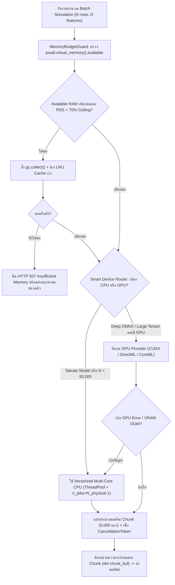

# Phase 17: Compute & Performance Core — Multi-Core CPU Pool, GPU Detection & Chunked Processing

## 1. วัตถุประสงค์และขอบเขตของเฟส (Objective & Scope)
ปิดท้ายส่วนโครงสร้างพื้นฐานหลัก (**Base Platform: Phases 01 - 17**) ด้วยการพัฒนาระบบบริหารจัดการทรัพยากรการคำนวณระดับ Production (**`backend/app/core/compute_pool.py`** และโดเมน `compute_engine`) เพื่อควบคุมการใช้งาน **Multi-Core CPU**, **GPU Hardware Acceleration (CUDA / DirectML / CoreML)**, **เพดานหน่วยความจำ (Memory Ceiling Guard)**, และการประมวลผลแบบแบ่งก้อนพร้อมรายงานความคืบหน้า (**Chunked Generator Pipeline & Job Cancellation**) ให้พร้อมรองรับการจำลองโมเดลหนักๆ ทั้ง 20 ตระกูลใน Phase 18 ถึง Phase 39 อย่างมีเสถียรภาพสูงสุดบนระบบปฏิบัติการ Windows, macOS, และ Linux

### ขอบเขตการทำงาน (Scope)
- **Adaptive Hardware Probe & Execution Manager**:
  - ตรวจจับจำนวน Physical / Logical CPU Cores (`psutil.cpu_count`), ความจุ RAM ที่ใช้งานได้จริง (`psutil.virtual_memory().available`), และตั้งค่า `OMP_NUM_THREADS` / `MKL_NUM_THREADS` อย่างเหมาะสมเพื่อป้องกันปัญหา Thread Oversubscription
  - ตรวจจับ GPU Providers อัตโนมัติสำหรับ ONNX Runtime (`CUDAExecutionProvider`, `DmlExecutionProvider` บน Windows DirectX 12, `CoreMLExecutionProvider` บน Apple Silicon) และ GPU Hist สำหรับ XGBoost / LightGBM
- **Smart CPU vs GPU Workload Router**:
  - สำหรับงาน Tabular Batch ขนาดเล็กถึงกลาง ($N < 50,000$ แถว) บังคับใช้ **Vectorized Multi-Core CPU (`ThreadPoolExecutor` + Cython/C++ `n_jobs`)** เพื่อหลีกเลี่ยง Overhead ในการคัดลอกข้อมูลข้าม PCIe Bus ไปยัง VRAM
  - สำหรับงาน ONNX Deep Learning หรือการคำนวณพื้นผิว 3D ความละเอียดสูงที่มีการคูณเมทริกซ์ขนาดใหญ่ ให้สลับไปใช้ GPU Execution Provider อัตโนมัติพร้อมระบบ Fallback กลับสู่ CPU ทันทีหากเกิดข้อผิดพลาด (`GPU OOM Fallback`)
- **Chunked Simulation Pipeline, Live Progress & Job Cancellation**:
  - แบ่งการประมวลผลชุดข้อมูลขนาดใหญ่ออกเป็นก้อนละ `CHUNK_SIZE = 5,000` แถว พร้อมตรวจสอบ `CancellationToken` และเพดาน RAM ก่อนเริ่มทุกก้อน

---

## 2. UI Feature List อย่างละเอียด (Detailed UI Feature List)
1. **Hardware Telemetry & Compute Status Pill (`HardwareStatusPill.tsx`)**:
   - แสดงบนมุมขวาของแถบ Status Bar ด้านล่างสุดของหน้าจอ:
   - แสดงโหมดการประมวลผลที่ใช้งานอยู่ เช่น `[ ⚡ CPU: 8 Cores (16 Threads) • RAM: 412 MB / 16 GB • GPU: DirectML Ready ]`
   - สีไฟสถานะหน่วยความจำ:
     - 🟢 สีเขียว (`Normal`): ใช้ RAM น้อยกว่า 60% ของงบประมาณที่กำหนด
     - 🟡 สีเหลือง (`Elevated`): ใช้ RAM 60% - 80% (เริ่มเปิดระบบ Auto GC Cleanup เข้มงวด)
     - 🔴 สีแดง (`Memory Guard Active`): ใช้ RAM เกิน 80% (บล็อกการสร้างงานใหม่ขนาดใหญ่และแจ้งปุ่ม `Purge Unused Session Cache`)
2. **Compute Engine Settings & Diagnostics Modal (`ComputeDiagnosticsModal.tsx`)**:
   - คลิกที่ `HardwareStatusPill` เพื่อเปิดหน้าต่างรายละเอียดฮาร์ดแวร์และการตั้งค่า:
   - **Execution Device Preference Selector**: `Auto Smart Router (Recommended)`, `Force Multi-Core CPU Only`, `Prefer GPU Acceleration (CUDA / DirectML)`
   - **Worker Threads Slider**: กำหนดจำนวน CPU Threads สูงสุดที่ยอมให้ใช้คำนวณ (`1` ถึง `psutil.cpu_count(logical=False)`, ค่าเริ่มต้น: `Physical Cores - 1` เพื่อเหลือ 1 คอร์ให้ UI และ OS ลื่นไหลเสมอ!)
   - **Chunk Size Selector**: `2,500 rows (Low RAM)`, `5,000 rows (Balanced - Default)`, `10,000 rows (High Throughput)`
   - **Memory Cache Purge Button**: ปุ่ม `[ 🧹 Clear Inactive Model & Surface Caches ]` คืน RAM ทันที
3. **Chunked Job Progress & Cancel Banner (`ChunkedJobProgressBanner.tsx`)**:
   - แสดงเมื่อสั่งรันงานที่มีขนาดเกิน 5,000 แถว:
   - แถบความคืบหน้าแบบละเอียด: `Processing Chunk 3 / 10 (Rows 10,000 .. 15,000) — 30% • Speed: 42,000 rows/sec • ETA: 1.2s`
   - ปุ่ม `[ ⏹ Cancel Job (Esc) ]` สำหรับยกเลิกการคำนวณกลางคันและคืนหน่วยความจำทันที

---

## 3. UX Flow & User Journey (Step-by-Step UX Flow & ASCII Wireframe)

### ลำดับการทำงาน (Step-by-Step User Journey)
1. **Startup Hardware Discovery**:
   - เมื่อ Backend เริ่มทำงาน `HardwareProbeService` จะสแกน CPU Cores, Available RAM, และทดสอบสร้าง Session ขนาดจิ๋วบน ONNX Runtime / XGBoost เพื่อยืนยันรายการ Execution Providers ที่ใช้งานได้จริงบนเครื่องนั้น
2. **Pre-Flight Memory Check**:
   - เมื่อผู้ใช้สั่งประมวลผลข้อมูลชุดใหญ่ (เช่น 50,000 แถว) `MemoryBudgetGuard` จะคำนวณขนาดหน่วยความจำที่ต้องใช้เทียบกับ `psutil.virtual_memory().available`
   - หาก RAM ว่างไม่พอ ระบบจะแจ้งเตือนก่อนเริ่มงานทันทีโดยไม่ปล่อยให้โปรเซสแครชกลางคัน
3. **Chunked Execution & Live Progress**:
   - `ChunkedComputeEngine` แบ่งข้อมูลเป็น 10 ก้อน (ก้อนละ 5,000 แถว) ส่งเข้า `ThreadPoolExecutor`
   - หลังจบแต่ละก้อน ระบบอัปเดตเปอร์เซ็นต์ความคืบหน้า (`10% -> 20% -> ...`) เช็กว่าผู้ใช้กดปุ่ม `Cancel` หรือไม่ และลบตัวแปรชั่วคราวของก้อนก่อนหน้าทิ้งทันที (`Flat Memory Profile`)

### ASCII Wireframe
```text
+--------------------------------------------------------------------------------------------------+
|  ⚙️ COMPUTE ENGINE & HARDWARE DIAGNOSTICS                                                  [✕]   |
+--------------------------------------------------------------------------------------------------+
|  System CPU       : AMD Ryzen / Intel Core (8 Physical Cores / 16 Logical Threads)               |
|  GPU Accelerators : [✓] DmlExecutionProvider (DirectX 12 GPU)   [✓] CPUExecutionProvider         |
|  Process Memory   : [████████░░░░░░░░░░░░░░░░░░░░] 418 MB RSS  (System Available: 11.4 GB)       |
|--------------------------------------------------------------------------------------------------|
|  Execution Mode   : (●) Smart Auto-Router   ( ) Force CPU Vectorized   ( ) Prefer GPU            |
|  Worker Threads   : [=======●===] 7 Threads (Reserved 1 core for UI & OS responsiveness)         |
|  Batch Chunk Size : [ 5,000 rows / chunk v ]          [ 🧹 Purge Inactive Caches (Free 145 MB) ] |
+--------------------------------------------------------------------------------------------------+
|  Active Job: [████████████░░░░░░░░░░░░░] 48% (Chunk 5/10 • 25,000/50,000 rows)   [ ⏹ Cancel ]   |
+--------------------------------------------------------------------------------------------------+
```

### Mermaid Flowchart: Smart Workload Router & Memory Guard


---

## 4. สถาปัตยกรรม DDD แยกรายชั้นพร้อมชื่อไฟล์และ Class/Method Signatures (DDD Architecture & Code Blueprint)

### โครงสร้างไฟล์ (Directory Structure)
```text
backend/app/
├── core/
│   └── compute_pool.py
├── domains/
│   └── compute_engine/
│       ├── entities.py
│       ├── value_objects.py
│       └── services.py
├── application/
│   └── compute_job_orchestrator.py
└── presentation/
    └── api/
        └── v1/
            └── compute_router.py

frontend/src/domains/compute/
├── types/compute.types.ts
├── store/useComputeStatusStore.ts
└── components/
    ├── HardwareStatusPill.tsx
    ├── ComputeDiagnosticsModal.tsx
    └── ChunkedJobProgressBanner.tsx
```

### 4.1 `backend/app/core/compute_pool.py` (Core Multi-Core Pool, GPU Probe & Memory Guard)
```python
import gc
import os
import threading
from concurrent.futures import ThreadPoolExecutor
from typing import Callable, Iterator, Literal, TypeVar
import numpy as np
import psutil

T = TypeVar("T")

class InsufficientMemoryBudgetError(MemoryError):
    """โยนเมื่อหน่วยความจำที่ว่างของเครื่องต่ำกว่าเกณฑ์ปลอดภัย"""

class JobCancelledError(RuntimeError):
    """โยนเมื่อผู้ใช้กดยกเลิกงานคำนวณกลางคัน"""

class CancellationToken:
    def __init__(self) -> None:
        self._event = threading.Event()

    def cancel(self) -> None:
        self._event.set()

    @property
    def is_cancelled(self) -> bool:
        return self._event.is_set()

    def raise_if_cancelled(self) -> None:
        if self._event.is_set():
            raise JobCancelledError("งานคำนวณถูกยกเลิกโดยผู้ใช้")

class AdaptiveComputeEngine:
    """ศูนย์กลางบริหารจัดการ CPU Threads, GPU Providers และ Memory Ceiling Guard"""

    def __init__(self, max_memory_usage_ratio: float = 0.75) -> None:
        self.physical_cores: int = psutil.cpu_count(logical=False) or 2
        self.logical_cores: int = psutil.cpu_count(logical=True) or 4
        # เว้นอย่างน้อย 1 คอร์ไว้ให้ FastAPI Event Loop และ OS UI เสมอ
        self.optimal_workers: int = max(1, self.physical_cores - 1)
        self.max_memory_usage_ratio: float = max_memory_usage_ratio

        # ป้องกัน Thread Oversubscription ระหว่าง OpenMP/MKL กับ ThreadPool
        os.environ.setdefault("OMP_NUM_THREADS", str(self.optimal_workers))
        os.environ.setdefault("MKL_NUM_THREADS", str(self.optimal_workers))
        os.environ.setdefault("OPENBLAS_NUM_THREADS", str(self.optimal_workers))

        self.executor = ThreadPoolExecutor(
            max_workers=self.optimal_workers,
            thread_name_prefix="emlv_compute_worker",
        )
        self.available_onnx_providers: list[str] = self._probe_onnx_providers()

    @staticmethod
    def _probe_onnx_providers() -> list[str]:
        try:
            import onnxruntime as ort
            return list(ort.get_available_providers())
        except Exception:
            return ["CPUExecutionProvider"]

    def get_preferred_onnx_providers(self, prefer_gpu: bool = True) -> list[str]:
        if not prefer_gpu:
            return ["CPUExecutionProvider"]
        priority_order = [
            "CUDAExecutionProvider",
            "DmlExecutionProvider",
            "CoreMLExecutionProvider",
            "CPUExecutionProvider",
        ]
        return [p for p in priority_order if p in self.available_onnx_providers] or ["CPUExecutionProvider"]

    def check_memory_budget(self, required_extra_bytes: int = 64 * 1024 * 1024) -> dict[str, float]:
        """ตรวจสอบหน่วยความจำของระบบและโปรเซสก่อนเริ่มประมวลผลแต่ละ Chunk"""
        vm = psutil.virtual_memory()
        proc = psutil.Process(os.getpid())
        rss_bytes = proc.memory_info().rss

        if vm.percent >= (self.max_memory_usage_ratio * 100.0) or vm.available < required_extra_bytes:
            gc.collect()
            vm = psutil.virtual_memory()
            if vm.available < required_extra_bytes:
                avail_mb = vm.available / (1024 * 1024)
                req_mb = required_extra_bytes / (1024 * 1024)
                raise InsufficientMemoryBudgetError(
                    f"หน่วยความจำระบบไม่เพียงพอ (ต้องการอย่างน้อย {req_mb:.0f} MB แต่เหลือว่าง {avail_mb:.0f} MB)"
                )

        return {
            "process_rss_mb": round(rss_bytes / (1024 * 1024), 2),
            "system_available_mb": round(vm.available / (1024 * 1024), 2),
            "system_percent": float(vm.percent),
        }

    def process_in_chunks(
        self,
        X: np.ndarray,
        chunk_fn: Callable[[np.ndarray, int, int], T],
        chunk_size: int = 5000,
        cancel_token: CancellationToken | None = None,
        on_progress: Callable[[int, int, float], None] | None = None,
    ) -> Iterator[T]:
        """ประมวลผลอาเรย์ขนาดใหญ่ทีละก้อน (Chunked Generator) พร้อมตรวจ RAM และ CancellationToken"""
        total_rows = X.shape[0]
        if total_rows == 0:
            return

        bytes_per_chunk = chunk_size * X.shape[1] * 4 * 4  # ประเมินเผื่อ Buffer 4 เท่าของ float32
        for start_idx in range(0, total_rows, chunk_size):
            if cancel_token is not None:
                cancel_token.raise_if_cancelled()

            self.check_memory_budget(required_extra_bytes=max(32 * 1024 * 1024, bytes_per_chunk))

            end_idx = min(total_rows, start_idx + chunk_size)
            chunk_view = np.ascontiguousarray(X[start_idx:end_idx], dtype=np.float32)
            result = chunk_fn(chunk_view, start_idx, end_idx)
            del chunk_view

            if on_progress is not None:
                pct = round((end_idx / total_rows) * 100.0, 1)
                on_progress(end_idx, total_rows, pct)

            yield result
```

### 4.2 `backend/app/presentation/api/v1/compute_router.py` (REST API Endpoints)
- **Endpoint 1**: `GET /api/v1/compute/telemetry`
  - **Response JSON Schema (`200 OK`)**:
```json
{
  "physical_cores": 8,
  "logical_cores": 16,
  "optimal_workers": 7,
  "available_onnx_providers": ["DmlExecutionProvider", "CPUExecutionProvider"],
  "active_device_mode": "auto_smart_router",
  "process_rss_mb": 412.5,
  "system_available_mb": 11680.0,
  "system_memory_percent": 58.4,
  "active_jobs_count": 0
}
```
- **Endpoint 2**: `POST /api/v1/compute/jobs/{job_id}/cancel`
  - สั่ง `cancel_token.cancel()` เพื่อหยุดลูป Chunked Processing ทันทีและคืนสถานะ `200 OK`
- **Endpoint 3**: `POST /api/v1/compute/cache/purge`
  - ล้าง LRU Cache ของพื้นผิว 3D และ Session ที่ไม่ได้ใช้งาน พร้อมเรียก `gc.collect()` และส่งจำนวน MB ที่คืนได้กลับไปยัง UI

---

## 5. แผนการตรวจสอบหน่วยความจำและเพิ่มประสิทธิภาพทรัพยากรเครื่อง (Memory Check Plan & Process Resource Optimization)

### 5.1 Backend Memory Check (`Flat Memory Profile` Guarantee)
- **Chunked Generator Lifecycle**: การใช้ `process_in_chunks` แบบ `yield` ทีละ 5,000 แถวควบคู่กับ `del chunk_view` ทำให้การใช้หน่วยความจำของระบบคงที่ (Flat Memory Line) แม้ประมวลผลข้อมูล 100,000 แถว
- **Proactive OOM Prevention (HTTP 507)**: แทนที่จะปล่อยให้ Python จองเมทริกซ์ขนาดใหญ่จนเกิด `MemoryError` หรือถูก OS สั่ง Kill Process ระบบจะตรวจ `check_memory_budget()` ก่อนทุกก้อน หาก RAM ว่างเหลือน้อยกว่าเกณฑ์จะรัน `gc.collect()` อัตโนมัติ และหากยังไม่พอจะหยุดอย่างปลอดภัยพร้อมแจ้งผู้ใช้ทันที

### 5.2 Process & CPU/GPU Resource Optimization (Windows Compatibility Mandate)
- **ห้ามใช้ `ProcessPoolExecutor` (`multiprocessing` Spawn) กับการรันโมเดลบน Windows**:
  - บน Windows การสร้าง Process ใหม่ต้อง Import โมดูลทั้งหมดใหม่และ Serialize (`pickle`) โมเดลขนาดใหญ่ข้าม Process ซึ่งช้ามากและกิน RAM คูณจำนวนคอร์ (`N_cores * Model_Size`)
  - **สถาปัตยกรรมที่ถูกต้อง**: ไลบรารีคำนวณทั้งหมดในโปรเจกต์ (`numpy`, `scipy`, `scikit-learn`, `xgboost`, `lightgbm`, `catboost`, `onnxruntime`) ทำงานในระดับ C/C++/Cython ที่ **ปล่อย GIL (Global Interpreter Lock)** อยู่แล้ว จึงใช้ **`ThreadPoolExecutor` ร่วมกับพารามิเตอร์ `n_jobs = self.optimal_workers`** ซึ่งแชร์โมเดลตัวเดียวกันใน RAM ได้โดยตรง (Zero-Copy Shared Model Memory)!
- **Thread Oversubscription Guard**: กำหนดค่า `OMP_NUM_THREADS` และ `MKL_NUM_THREADS` ไม่ให้ชนกับการตั้งค่า `n_jobs` ของ Scikit-Learn/GBDT เพื่อป้องกันไม่ให้เกิดการสร้าง Thread ซ้อนกัน ($16 \times 16 = 256$ Threads) ที่ทำให้ Context Switching ช้าลง

---

## 6. ไลบรารีที่ใช้และการตั้งค่า Offline 100% (Libraries & Offline Configuration)
- **Backend**:
  - `psutil >= 5.9` (ตรวจสอบ CPU Cores, Process RSS Memory, และ System Available Memory)
  - `concurrent.futures.ThreadPoolExecutor` (Standard Library)
  - `joblib >= 1.4` (`parallel_backend("threading", n_jobs=...)`)
  - `onnxruntime` / `onnxruntime-directml` (ทำงานแบบ Local Offline 100% บน CPU และการ์ดจอทุกค่ายบน Windows)
- **Frontend**: `zustand`, `lucide-react`

---

## 7. ตารางข้อควรระวังและ Edge Cases (Caveats & Edge Case Matrix)

| ลำดับ | เคสปัญหา (Edge Case) | สาเหตุทางเทคนิค (Root Cause) | วิธีป้องกันและแก้ไขในโค้ด (Mitigation Strategy) |
| :---: | :--- | :--- | :--- |
| 1 | **การใช้ `ProcessPoolExecutor` บน Windows ทำให้ RAM พุ่งเต็มและค้างนาน** | Windows ใช้โหมด `spawn` ซึ่งคัดลอกโมเดลและตั้งค่า Python Interpreter ใหม่ทุกโปรเซส | ใช้ `ThreadPoolExecutor` คู่กับ C++/Cython `n_jobs=optimal_workers` ซึ่งปล่อย GIL และแชร์ Memory ของโมเดลชุดเดียวกัน 100% |
| 2 | **Thread Oversubscription ทำให้ CPU 100% แต่งานเสร็จช้าลง** | เรียก `ThreadPoolExecutor(8)` แล้วแต่ละ Thread ไปเรียก `XGBoost(nthread=8)` เกิดเป็น 64 Threads แย่งคอร์กันเอง | หากงานรันผ่าน `ThreadPoolExecutor` หลายงานพร้อมกัน ให้จำกัด `nthread` ภายใน หรือรัน Batch Vectorized ทีละ Chunk ด้วย `n_jobs = optimal_workers` |
| 3 | **เครื่องผู้ใช้มี GPU แต่ไม่มีไดรเวอร์ CUDA ที่ตรงเวอร์ชัน** | `onnxruntime-gpu` พยายามโหลด `cudart64_*.dll` แล้วล้มเหลว | หุ้มการสร้าง Session ด้วย `try...except` หาก GPU Provider ล้มเหลวให้ Fallback มาใช้ `DmlExecutionProvider` หรือ `CPUExecutionProvider` โดยอัตโนมัติโดยไม่แครช |
| 4 | **ผู้ใช้กดปุ่ม Cancel Job แต่ Thread ใน C++ กำลังรันค้างอยู่** | Python ไม่สามารถสั่ง Kill Thread กลางคันขณะอยู่ในฟังก์ชัน C++ ได้ทันที | การแบ่งข้อมูลเป็นก้อนย่อยละ `5,000 แถว` (ใช้เวลาต่อก้อนเพียง `~20-50ms`) ทำให้ตรวจ `cancel_token.raise_if_cancelled()` ได้ทุกๆ 50ms และหยุดงานได้ทันทีในความรู้สึกของผู้ใช้ |
| 5 | **`psutil.cpu_count(logical=False)` คืนค่าเป็น `None` บน VM หรือ Container บางชนิด** | ระบบเสมือนบางตัวไม่เปิดเผยข้อมูล Physical CPU Topology | ใช้ Fallback `(psutil.cpu_count(logical=False) or psutil.cpu_count(logical=True) or 2)` เสมอ |
| 6 | **ส่งข้อมูลตารางขนาดเล็ก (เช่น 100 แถว) ไปรันบน GPU แล้วช้ากว่า CPU** | เวลาในการคัดลอกข้อมูลขึ้นการ์ดจอ (Host-to-Device Copy) นานกว่าเวลาคำนวณจริง | ใน Smart Router กำหนดเกณฑ์ขั้นต่ำว่าหากจำนวนจุดข้อมูล `< 10,000 จุด` สำหรับโมเดลตาราง ให้รันบน Vectorized CPU เสมอ |

---

## 8. เกณฑ์การตรวจรับงาน (Definition of Done Checklist)
- [ ] `AdaptiveComputeEngine` สามารถตรวจจับจำนวน Physical/Logical CPU Cores, ปริมาณ RAM ที่ว่าง (`psutil`), และรายการ GPU Providers ที่พร้อมใช้งานได้ถูกต้อง
- [ ] ระบบตั้งค่า `optimal_workers = max(1, physical_cores - 1)` เพื่อเว้นอย่างน้อย 1 คอร์ไว้ให้ระบบ UI และ OS ตอบสนองได้ลื่นไหลตลอดเวลา
- [ ] `process_in_chunks` สามารถแบ่งการประมวลผลข้อมูลขนาดใหญ่ออกเป็นก้อนละ 5,000 แถว รายงานเปอร์เซ็นต์ความคืบหน้า และหยุดทำงานได้ทันทีเมื่อ `CancellationToken` ถูกสั่งยกเลิก
- [ ] `check_memory_budget` ตรวจสอบเพดานหน่วยความจำก่อนเริ่มทุกก้อน และสั่ง `gc.collect()` อัตโนมัติเมื่อหน่วยความจำตึงตัว
- [ ] แถบ `HardwareStatusPill` บนหน้าเว็บแสดงสถานะ CPU, RAM RSS ของโปรเซส, และปุ่มล้าง Cache คืนหน่วยความจำได้อย่างถูกต้อง
