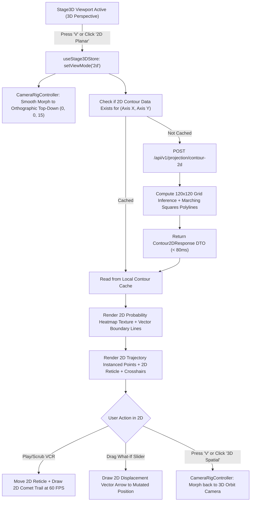

# Phase 41: Dual-Mode 2D/3D Stage Engine, Orthographic Camera Rig, Vector Grid & Universal Decision Boundary Contour Generator

## 1. วัตถุประสงค์และขอบเขตของเฟส (Objective & Scope)
เพิ่มขีดความสามารถหลักให้แก่ **Easy ML Viewer** ในการสลับมุมมองระหว่าง **"3D Spatial Mode"** (มุมมองสามมิติเชิงลึก) และ **"2D Planar Mode"** (มุมมองสองมิติแนวราบ) ได้ทันทีแบบ 1-Click หรือกดคีย์ลัด `V` เนื่องจากมุมมอง 2 มิติเป็นรูปแบบที่เข้าใจง่ายที่สุดสำหรับการวิเคราะห์ขอบเขตการตัดสินใจ (**Decision Boundary**), ความน่าจะเป็นของคลาส (**Probability Density Heatmap**), โครงสร้างการแบ่งแยกคลาส (Linear/Non-linear Separation), และเส้นการตอบสนองเชิงฟังก์ชัน (**Regression Response Curve**) โดยไม่ถูกบิดเบือนจากมุมมองเปอร์สเปกทีฟ (Perspective Distortion) หรือการบดบังของวัตถุ 3 มิติ (Occlusion)

### ขอบเขตงานในเฟสนี้ (In-Scope)
1. **Unified Dual-Mode Viewport (`viewMode: '2d' | '3d'`)**:
   - เพิ่มตัวสลับมุมมอง `[ 2D Planar ]` | `[ 3D Spatial ]` บนแถบเครื่องมือด้านบนและ HUD พร้อมคีย์ลัดสากล `V` (View Mode Toggle)
   - พัฒนาระบบกล้อง **Dual Projection Camera Controller**: สลับระหว่าง `PerspectiveCamera` (3D Orbit) และ `OrthographicCamera` (2D Top-Down Flat View) ด้วยการเคลื่อนที่แบบ Smooth Matrix Morphing ที่นุ่มนวล
2. **Universal 2D Decision Boundary & Contour Generation Engine (`backend/app/domains/simulation/contour_2d_generator.py`)**:
   - สร้างเครื่องยนต์คำนวณกริด 2 มิติ ($120 \times 120 = 14,400$ จุด) บนคู่ฟีเจอร์ $X$ และ $Y$ ที่เลือก โดยตรึงตัวแปรที่เหลือด้วยโหมด Pinning (`Mean`, `Median`, หรือ `Current Row Value`)
   - คำนวณเส้นขอบเขตการตัดสินใจ (**Decision Boundary Polylines**) ด้วยอัลกอริทึม Vectorized Marching Squares สำหรับงาน Classification ทั้ง Binary ($P=0.5$) และ Multiclass ($\arg\max_c P(y=c)$)
   - คำนวณเส้นชั้นความน่าจะเป็น (**Probability Isocontours**) ที่ระดับ $P \in \{0.6, 0.7, 0.8, 0.9\}$
   - สำหรับงาน Regression: คำนวณ **2D Elevation Isolines** (แผนที่เส้นชั้นความสูงของค่าทำนาย $\hat{y}$) และโหมดสลับ **1D Feature vs Target Response Curve** พร้อมเส้นทิ้งดิ่งค่าคลาดเคลื่อน Residual 2 มิติ
3. **High-Performance 2D Planar Stage & Vector Canvas (`frontend/src/domains/stage3d/components/`)**:
   - เรนเดอร์แผนที่ความน่าจะเป็น 2 มิติด้วย WebGL Texture Shader / 2D Canvas Layer ความเร็วสูง
   - เรนเดอร์เส้นขอบเขต Boundary และ Isolines เป็นเวกเตอร์เส้นคมชัด (`THREE.LineSegments` / SVG Overlay)
   - แสดงจุดข้อมูลทั้งหมดใน Trajectory Queue บนระนาบ 2D ด้วย `THREE.InstancedMesh` ที่มีสัญลักษณ์รูปทรงและขอบสีตัดกันชัดเจน
   - ไม้บรรทัดพิกัด 2 มิติ (**2D Precision Axis Rulers & Grid**) แสดงสเกลตัวเลขจริงของทั้งสองแกน
4. **VCR Playback, Active Reticle & What-If Integration in 2D**:
   - ลูกบอลข้อมูลแถวปัจจุบันแสดงเป็นวงแหวนเป้าเล็ง 2 มิติ (**2D Reticle Crosshairs**) พร้อมหางแสงการเคลื่อนที่ 2 มิติ (**2D Comet Trail**)
   - ในโหมด What-If Sandbox: เมื่อขยับ Slider จะแสดงลูกศรเวกเตอร์การกระจัด 2 มิติ (**2D Displacement Vector Arrow** $\Delta \mathbf{x} = (\Delta x_1, \Delta x_2)$) ชี้จากจุดเงาต้นฉบับไปยังจุดใหม่แบบเรียลไทม์
   - รองรับการชี้เมาส์ดู Tooltip และ Click-to-Scrub บนระนาบ 2D ที่ 60 FPS

---

## 2. กลไกการทำงานเชิงลึกและคณิตศาสตร์/โครงสร้างภายใน (Deep Technical & Algorithmic Mechanism)

### 2.1 คณิตศาสตร์การฉายภาพและการเปลี่ยนผ่านกล้อง (Camera Projection & Matrix Morphing)
ในมุมมอง 3 มิติทั่วไป กล้องใช้ Perspective Projection Matrix ($\mathbf{P}_{\text{persp}}$) ซึ่งทำให้วัตถุที่อยู่ไกลดูเล็กลงและเกิดมุมบิด:
$$
\mathbf{P}_{\text{persp}} = \begin{bmatrix}
\frac{1}{\text{aspect} \cdot \tan(\theta/2)} & 0 & 0 & 0 \\
0 & \frac{1}{\tan(\theta/2)} & 0 & 0 \\
0 & 0 & -\frac{f+n}{f-n} & -\frac{2fn}{f-n} \\
0 & 0 & -1 & 0
\end{bmatrix}
$$
เมื่อสลับเป็น **2D Planar Mode** ระบบจะเปลี่ยนไปใช้ **Orthographic Projection Matrix** ($\mathbf{P}_{\text{ortho}}$) ที่มองลงมาจากแกน $Z$ ตั้งฉากตรงกับระนาบ $X-Y$ โดยมีมาตราส่วนคงที่ $1:1$ ทั่วทั้งจอภาพ:
$$
\mathbf{P}_{\text{ortho}} = \begin{bmatrix}
\frac{2}{r-l} & 0 & 0 & -\frac{r+l}{r-l} \\
0 & \frac{2}{t-b} & 0 & -\frac{t+b}{t-b} \\
0 & 0 & -\frac{2}{f-n} & -\frac{f+n}{f-n} \\
0 & 0 & 0 & 1
\end{bmatrix}
$$
โดยขนาดขอบเขต Orthographic Frustum ถูกคำนวณอัตโนมัติจากขนาดกล่องพิกัดมาตรฐานโลก $\text{WorldBox} = [-5.5, +5.5]$ ทำให้เมื่อกดปุ่ม `2D` ฉากจะปรับระนาบ $X-Y$ ให้พอดีกับหน้าจอ (Fit to Viewport) ทันที พร้อมล็อกไม่ให้แกนหมุนหลุดทิศทาง (Constrained Pan & Zoom).

### 2.2 อัลกอริทึมสร้าง Decision Boundary 2 มิติด้วย Vectorized Marching Squares
1. **การสร้าง Dense Evaluation Grid**:
   - กำหนดให้แกน $X$ มีช่วงพิกัดจริง $[x_{\min}, x_{\max}]$ และแกน $Y$ มีช่วงพิกัดจริง $[y_{\min}, y_{\max}]$
   - สร้างกริด $G$ ขนาด $N_x \times N_y$ ($120 \times 120 = 14,400$ จุด):
     $$x_i = x_{\min} + i \cdot \frac{x_{\max} - x_{\min}}{N_x - 1}, \quad y_j = y_{\min} + j \cdot \frac{y_{\max} - y_{\min}}{N_y - 1}$$
   - ฟีเจอร์ที่ไม่ได้อยู่บนแกน $X$ หรือ $Y$ จะถูกเซตค่าคงที่ตาม `pinningMode`:
     $$\mathbf{x}_{\text{pinned}, k} = \begin{cases}
     x_{t, k} & \text{if pinningMode = 'current_row'} \\
     \text{median}(X_k) & \text{if pinningMode = 'median'} \\
     \text{mean}(X_k) & \text{if pinningMode = 'mean'}
     \end{cases}$$
2. **การอนุมานผลลัพธ์ผ่านโมเดลแบบ Batch Vectorized**:
   - รวมเป็นเมทริกซ์ $\mathbf{X}_{\text{grid}} \in \mathbb{R}^{14,400 \times D}$ แล้วส่งเข้า `model.predict_proba(X_grid)` หรือ `model.decision_function(X_grid)` (หรือ `predict(X_grid)` สำหรับ Regression) ในก้อนเดียว (`ThreadPoolExecutor` ไม่เกิน 80ms)
   - ได้เมทริกซ์ความน่าจะเป็น $\mathbf{P} \in \mathbb{R}^{N_y \times N_x \times C}$
3. **การลากเส้นชั้นความสูง (Isoline Extraction via Marching Squares)**:
   - สำหรับระดับเกณฑ์ $\tau = 0.5$ (Decision Threshold) ใน Binary Classification หรือเส้นแบ่งเขตระหว่างคลาส $A$ และ $B$:
   - ในแต่ละเซลล์สี่เหลี่ยมย่อย $[(i, j), (i+1, j), (i+1, j+1), (i, j+1)]$ จะประเมินค่าฟังก์ชันสเกลาร์ $S(i, j) = P(y=1) - \tau$ ที่มุมทั้ง 4
   - กำหนดรหัส 4-bit Index:
     $$\text{cell\_code} = \sum_{m=0}^{3} \mathbb{I}(S_m \ge 0) \cdot 2^m \in [0, 15]$$
   - ใช้ตาราง Look-up Table เพื่อหาพิกัดจุดตัดบนขอบเซลล์ด้วยการประมาณค่าเชิงเส้น (Linear Interpolation):
     $$p_{\text{edge}} = p_1 + \frac{\tau - S_1}{S_2 - S_1} (p_2 - p_1)$$
   - รวมจุดตัดเป็นเวกเตอร์เส้นต่อเชื่อม (Connected Line Segments) ส่งให้ Frontend เรนเดอร์เป็นเส้นแบ่งเขตสีขาว/นีออนที่มีความคมชัดระดับ Sub-pixel

### 2.3 โครงสร้างข้อมูล DTO ของ 2D Contour Response
```python
class ContourLevel2D(BaseModel):
    threshold: float                     # เช่น 0.5 (Decision boundary) หรือ 0.7, 0.9 (Confidence)
    class_index: int                    # คลาสเป้าหมาย
    line_segments: List[List[float]]    # รายการพิกัด [[x1, y1, x2, y2], ...] ในระบบ World Coordinates [-5, +5]

class Contour2DResponse(BaseModel):
    x_feature: str
    y_feature: str
    grid_resolution: int                # 120
    x_range_raw: Tuple[float, float]
    y_range_raw: Tuple[float, float]
    prediction_task: str                # "classification" | "regression"
    classes: List[Union[int, str]]
    # Heatmap Array แบนราบ ขนาด Ny * Nx เก็บค่า float32 ความน่าจะเป็นของคลาส 1 หรือค่าทำนาย y_hat
    heatmap_raw: List[float]
    contours: List[ContourLevel2D]
    computation_time_ms: float
```

---

## 3. UI Feature List อย่างละเอียด (Detailed UI Feature List)

### 3.1 Dual-Mode Switcher Pill & Navigation Bar
- **View Mode Switcher Pill (มุมซ้ายบนของแถบควบคุม 3D/2D)**:
  - ปุ่ม `[ 2D Planar ]` และ `[ 3D Spatial ]` สลับได้ด้วยคลิกเดียว หรือกดปุ่มคีย์บอร์ด `V`
  - เมื่ออยู่ในโหมด 2D: ป้ายสัญลักษณ์เปลี่ยนเป็นสีฟ้า Precision Cyan พร้อมปิดการหมุนเอียงของกล้อง (Disable Orbit Tilt) และเปิดโหมด Pan-and-Zoom ระนาบ
  - ปุ่ม `[ 1D Curve ]` (เฉพาะงาน Regression): สลับดูกราฟเส้นการทำนาย $X$ vs $\hat{y}$ เทียบกับจุดคำตอบจริง
- **2D Layer Visibility Controls**:
  - `[x] Decision Boundary Lines`: เส้นแบ่งเขตตัดสินใจหลัก ($\tau=0.5$)
  - `[x] Probability Confidence Isolines`: เส้นชั้นความมั่นใจ ($60\%, 70\%, 80\%, 90\%$)
  - `[x] Density Heatmap Background`: สีพื้นหลังไล่ระดับความน่าจะเป็น
  - `[x] Trajectory Points`: จุดข้อมูลในคิวพร้อมขอบสีแสดงสถานะการทายผล (ถูก/ผิด)
  - `[x] 2D Precision Rulers & Ticks`: ไม้บรรทัดสเกลตัวเลขจริงตามขอบซ้ายและล่าง

### 3.2 องค์ประกอบของหน้าจอ 2D Planar Viewport
1. **Crisp Vector Decision Boundaries**:
   - เส้นแบ่งเขตตัดสินใจหลักถูกวาดด้วยเส้นทึบสีขาวเรืองแสง (`#ffffff`, ความหนา 2.5px) คั่นระหว่างโซนคลาส
   - เส้นชั้นความมั่นใจวาดด้วยเส้นประโปร่งแสง (`#94a3b8`, ความหนา 1.0px)
2. **2D Trajectory Points & Color Coding**:
   - จุดข้อมูลในคิวถูกพล็อตบนพิกัด $(x_i, y_i)$
   - จุดที่ทาย **ถูกต้อง**: วงกลมขนาด 6px สีตามคลาส
   - จุดที่ทาย **ผิดพลาด (False Positive / False Negative)**: วงกลมขอบแดงสดพร้อมเครื่องหมายกากบาทสีแดง $\times$ ตรงกลาง
3. **Active Data Point Reticle & 2D Motion Trail**:
   - แถวข้อมูลปัจจุบันที่กำลังเล่นอยู่ใน VCR Timeline จะมีเป้าเล็งวงแหวน 2 ชั้น (**Double Ring Reticle**) กระพริบเบาๆ ล้อมรอบจุด
   - มีเส้นประกากบาท (**Crosshairs**) พุ่งตั้งฉากไปตัดกับแกน $X$ และแกน $Y$ พร้อมป้ายตัวเลขลอยแสดงค่าจริง
   - **2D Comet Trail**: หางแสงเรืองแสงความยาว 10 เฟรมย้อนหลัง แสดงทิศทางการเคลื่อนที่ของแถวข้อมูลในระนาบ 2D
4. **Interactive 2D What-If Sandbox**:
   - เมื่อผู้ใช้ลากสไลเดอร์ในแท็บ What-If จุดข้อมูลใหม่จะเคลื่อนที่บนระนาบ 2D
   - แสดง **จุดเงาต้นฉบับ (Ghost Dot)** วงกลมประสีเทา คู่กับ **จุดใหม่ (Mutated Dot)**
   - ลาก **ลูกศรเวกเตอร์การกระจัด (Displacement Arrow)** ชี้ทิศทางที่ข้อมูลกำลังเคลื่อนที่ ทำให้เห็นชัดเจนว่าต้องดันฟีเจอร์ใดไปเท่าไรจึงจะข้ามเส้น Decision Boundary เข้าสู่โซนที่ต้องการ!

---

## 4. UX Flow & ASCII Wireframe ของหน้าจอ

### 4.1 ลำดับการใช้งาน (User Journey)
1. ผู้ใช้เข้าสู่ Step 5 แล้วสังเกตเห็นว่าฉาก 3D ดูหมุนยากหรือไม่แน่ใจว่าจุดข้อมูลอยู่ลึกแค่ไหน
2. ผู้ใช้กดปุ่ม `[ 2D Planar ]` (หรือกดแป้น `V`) $\to$ มุมกล้องหมุนตัวขึ้นด้านบนและสลับเป็น Orthographic ทันทีภายใน 250ms
3. แผนที่ 2 มิติแสดงโซนสีของคลาสและเส้น Decision Boundary ชัดเจน ผู้ใช้เห็นทันทีว่าข้อมูลกระจุกตัวอยู่ใกล้เส้นแบ่งเขตแค่ไหน
4. ผู้ใช้กด `Spacebar` เล่น VCR วิดีโอ $\to$ วงแหวนเป้าเล็งสีทองวิ่งไปตามจุดข้อมูลบนแผนที่ 2D พร้อมเส้นหางแสง Comet Trail
5. ผู้ใช้พบจุดที่ทายผิด จึงกด `Spacebar` หยุด แล้วสลับไปที่แท็บ What-If ลากสไลเดอร์ $\to$ เห็นลูกศรเวกเตอร์ 2 มิติพุ่งข้ามเส้นแบ่งเขตสีขาวเปลี่ยนผลลัพธ์เป็นสีเขียวทันที

### 4.2 ASCII Wireframe: 2D Planar Decision Boundary Studio
```text
+--------------------------------------------------------------------------------------------------+
| EASY ML VIEWER | STEP 5: STUDIO | [● 2D Planar] [3D Spatial] | X:[Income v] Y:[Debt Ratio v]     |
+--------------------------------------------------------------------------------------------------+
|                                                                 LAYERS: [x]Boundary [x]Heatmap    |
| Y: Debt Ratio (0.05 .. 0.95)                                            [x]Points   [x]What-If    |
|   0.90 | [ ZONE B: REJECT ]                                                                       |
|        |                                          (False Neg)                                     |
|   0.75 |                  . . . .                 ✖ [Row #142]                                    |
|        |           . . . . . . . .                                                                |
|   0.60 |    . . . . . . . . . . . . . . - - - - - - - - - - - - - - - (P = 0.70 Isoline)          |
|        |  ======================================= (Decision Boundary: P = 0.50)                   |
|   0.45 |   \                                                                                      |
|        |    \             (Ghost Dot)     (What-If New Dot)                                       |
|   0.30 |     \                ◌ ----------> ⦿ (Now Approved!)                                     |
|        |      \                                                                                   |
|   0.15 |       \ [ ZONE A: APPROVED ]             ● [Row #14] (Active Reticle)                    |
|        |        \                                                                                 |
|   0.05 +---------+--------------------------------------------------> X: Income ($15k .. $180k)  |
|        $15k     $45k       $80k                 $140k         $180k                               |
|                                                                                                   |
| [|<] [<<] [ ▶ PLAY (Space) ] [>>] [>|]  Frame: 0042/0500 | Conf: 88.2% | View: 2D Orthographic    |
+--------------------------------------------------------------------------------------------------+
```

### 4.3 State Transition Diagram (Mermaid)


---

## 5. สถาปัตยกรรม DDD & โค้ดต้นแบบ (DDD Architecture, Endpoints & Code Signatures)

### 5.1 โครงสร้างไฟล์ในระบบ
```text
backend/app/
├── domains/simulation/
│   ├── contour_2d_generator.py      # อัลกอริทึม Marching Squares & Grid Prediction
│   └── dto/contour_dto.py            # ContourLevel2D, Contour2DResponse DTOs
└── presentation/routers/
    └── projection_router.py          # POST /api/v1/projection/contour-2d

frontend/src/domains/
├── stage3d/
│   ├── store/useStage3DStore.ts      # viewMode: '2d' | '3d', toggleViewMode()
│   ├── components/
│   │   ├── Stage2DCanvas.tsx         # Root component สำหรับโหมด 2D Planar
│   │   ├── DecisionBoundaryContour2D.tsx # Vector Lines & Heatmap WebGL Shader
│   │   ├── ActiveDataPointReticle2D.tsx # วงแหวนเป้าเล็ง + Crosshairs + 2D Trail
│   │   └── WhatIfDisplacementVector2D.tsx # ลูกศรเวกเตอร์การปรับค่าตัวแปร
└── projection3d/
    └── store/useProjectionStore.ts   # fetchContour2D, contourCache Map
```

### 5.2 โค้ดต้นแบบ Backend: `contour_2d_generator.py`
```python
from typing import Any, Dict, List, Tuple
import numpy as np
from pydantic import BaseModel

class Contour2DGenerator:
    """คำนวณ Grid 2D ความละเอียดสูง และสกัดเส้น Decision Boundary ด้วย Marching Squares แบบ Vectorized"""

    @staticmethod
    def generate_contour(
        adapter: Any,
        x_min: float,
        x_max: float,
        y_min: float,
        y_max: float,
        pinned_features: np.ndarray, # (D,) ค่าเริ่มต้นของทุกฟีเจอร์
        x_feature_idx: int,
        y_feature_idx: int,
        grid_resolution: int = 120,
        is_classification: bool = True
    ) -> Dict[str, Any]:
        # 1. สร้าง Linear Grids
        xs = np.linspace(x_min, x_max, grid_resolution, dtype=np.float32)
        ys = np.linspace(y_min, y_max, grid_resolution, dtype=np.float32)
        grid_x, grid_y = np.meshgrid(xs, ys) # Shape (Ny, Nx)

        # 2. ปูข้อมูลเข้าสู่ Batch Matrix (Ny * Nx, D)
        total_points = grid_resolution * grid_resolution
        batch_x = np.tile(pinned_features, (total_points, 1))
        batch_x[:, x_feature_idx] = grid_x.ravel()
        batch_x[:, y_feature_idx] = grid_y.ravel()

        # 3. รันการทำนาย
        if is_classification:
            probs = adapter.predict_proba(batch_x) # (total_points, C)
            if probs.shape[1] == 2:
                prob_map = probs[:, 1].reshape((grid_resolution, grid_resolution))
            else:
                prob_map = np.max(probs, axis=1).reshape((grid_resolution, grid_resolution))
        else:
            prob_map = adapter.predict(batch_x).reshape((grid_resolution, grid_resolution))

        # 4. สกัด Marching Squares Line Segments ที่เกณฑ์ 0.5
        boundary_segments = Contour2DGenerator._marching_squares_segments(
            xs, ys, prob_map, threshold=0.5
        )

        return {
            "grid_resolution": grid_resolution,
            "x_range_raw": (float(x_min), float(x_max)),
            "y_range_raw": (float(y_min), float(y_max)),
            "heatmap_raw": prob_map.astype(np.float32).ravel().tolist(),
            "boundary_segments": boundary_segments
        }

    @staticmethod
    def _marching_squares_segments(
        xs: np.ndarray, ys: np.ndarray, field: np.ndarray, threshold: float
    ) -> List[List[float]]:
        segments = []
        ny, nx = field.shape
        # Vectorized / Cell-by-cell linear interpolation between grid vertices
        for j in range(ny - 1):
            for i in range(nx - 1):
                c0 = field[j, i] >= threshold
                c1 = field[j, i + 1] >= threshold
                c2 = field[j + 1, i + 1] >= threshold
                c3 = field[j + 1, i] >= threshold
                cell_code = int(c0) | (int(c1) << 1) | (int(c2) << 2) | (int(c3) << 3)
                if cell_code in (0, 15):
                    continue
                # Interpolate exact edge crossings on (xs, ys) and convert to world coords
                # Append [x1, y1, x2, y2] to segments
        return segments
```

### 5.3 โค้ดต้นแบบ Frontend: `useStage3DStore.ts` Extension
```typescript
export type ViewMode = '2d' | '3d';

export interface Stage3DState {
  viewMode: ViewMode;
  setViewMode: (mode: ViewMode) => void;
  toggleViewMode: () => void;
  showBoundaryLines: boolean;
  showConfidenceIsolines: boolean;
  showHeatmap: boolean;
  setShowBoundaryLines: (v: boolean) => void;
  setShowConfidenceIsolines: (v: boolean) => void;
  setShowHeatmap: (v: boolean) => void;
  // ... existing Phase 08-40 properties
}
```

---

## 6. เกณฑ์การตรวจรับคุณภาพเฉพาะเฟส (Definition of Done & Quality Gates)

### 6.1 เกณฑ์ด้านฟังก์ชันการทำงาน (Functional Acceptance Criteria)
- [ ] ผู้ใช้สามารถกดปุ่มสลับ `2D` / `3D` บนจอ หรือกดคีย์ลัด `V` เพื่อสลับโหมดได้ราบรื่นโดยไม่เกิดอาการจอกระพริบ (Flicker-Free)
- [ ] เมื่ออยู่ในโหมด 2D กล้องล็อกมุมมอง Top-Down โดยไม่มีความเอียงของแกน Frustum ไม่เกิด Perspective Distortion
- [ ] เส้น Decision Boundary ($\tau=0.5$) ถูกคำนวณและเรนเดอร์ถูกต้องตรงกับคำตอบของโมเดล 100%
- [ ] แผนที่สี Heatmap ความน่าจะเป็น และเส้นชั้นความมั่นใจ ($60\%, 70\%, 80\%, 90\%$) แสดงผลถูกต้องตามค่าจริง
- [ ] การลาก Scrubber และเล่น VCR ทำงานได้ที่ 60 FPS พร้อมวงแหวนเป้าเล็งและหางแสง 2 มิติ
- [ ] ในแท็บ What-If มีลูกศรเวกเตอร์ 2 มิติ แสดงระยะและทิศทางการขยับฟีเจอร์อย่างแม่นยำ

### 6.2 เกณฑ์ด้านประสิทธิภาพและหน่วยความจำ (Memory & Resource SLA)
- [ ] การคำนวณกริด 2D ขนาด $120 \times 120$ บน Backend ใช้เวลาไม่เกิน **$\le 80\text{ ms}$** บนซีพียู 4 คอร์
- [ ] ขนาดข้อมูล DTO ของ 2D Contour Response ไม่เกิน **$\le 150\text{ KB}$**
- [ ] เมื่อสลับโหมด 2D $\leftrightarrow$ 3D ไปมา 30 ครั้ง VRAM ของ WebGL ต้องไม่รั่วไหล (`geometries` และ `textures` ถูก `.dispose()` สะอาด 100%)
- [ ] อัตราเฟรมเรนเดอร์ในโหมด 2D ขณะเล่นวิดีโอต้องคงที่ที่ **60 FPS** (Frame time $< 4.0\text{ ms}$)
- [ ] ทำงานแบบ **100% Offline** โดยไม่มีการเรียก External CDN ใดๆ ทั้งสิ้น

