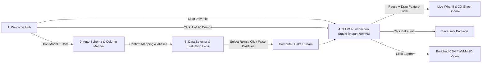

# Easy ML Viewer — Master Feature List, UX Flows, Memory & Resource Optimization Blueprint

> **Project Vision**: เครื่องมือ Interactive 3D Machine Learning Model Runner & Debugging Studio แบบ **100% Offline** ที่เปรียบเสมือน **"เครื่องเล่นวิดีโอ 3 มิติ (3D VCR Player) สำหรับโมเดล AI"** ผู้ใช้สามารถอัปโหลดไฟล์โมเดล + ไฟล์ข้อมูลตาราง (`.csv`, `.xlsx`, `.parquet`) จับคู่คอลัมน์ เลือกแถวข้อมูลที่ต้องการ แล้วกด **Play / Pause / กรอแถบเวลา (Scrubbing)** เพื่อดูกลไกการตัดสินใจภายในของโมเดลทั้ง 20+ ตระกูลยอดนิยมในรูปแบบ 3D Real-time (60 FPS) พร้อมโหมดจำลอง **What-If / Counterfactuals** และระบบบันทึกไฟล์ **`.mlv` (Machine Learning Video)** เพื่อเปิดดูซ้ำทันทีโดยไม่ต้องคำนวณใหม่

---

## 1. Core Architectural Principles (หลักการสถาปัตยกรรมหลัก)

1. **100% Offline-First & Zero External Dependency**:
   - ทำงานแบบ Localhost 100% (`127.0.0.1`) ไม่มีการเรียก External API, CDN, Google Fonts ออนไลน์ หรือ Telemetry ใดๆ
   - ฟอนต์ (`Inter`, `JetBrains Mono`), ไอคอน (`lucide-react`), 3D Shaders, และไลบรารีทั้งหมดถูก Bundle อยู่ในโฟลเดอร์โปรเจกต์
2. **Cross-Platform Compatibility (Windows, macOS, Linux)**:
   - ใช้ Path มาตรฐานผ่าน `pathlib.Path` (Backend) และ Vite/Node.js มาตรฐาน (Frontend)
   - มีสคริปต์รันอัตโนมัติสำหรับทุก OS (`start-windows.ps1`, `start-windows.bat`, `start-unix.sh`) ที่จัดการเปิด-ปิด 2 พอร์ตอย่างสะอาด
3. **2 Folders & 2 Ports Separation**:
   - `backend/` (Port `30211`): Python 3.11+ + FastAPI + Uvicorn (REST API + Binary MsgPack/Zstd Streaming)
   - `frontend/` (Port `30222`): React 19 (Latest) + Vite + TypeScript + Tailwind CSS v4 + React Three Fiber (`Three.js`)
4. **Domain-Driven Design (DDD) with Shared `Core` Kernel**:
   - มี **`core/`** เป็นรากฐานกลาง (Shared Kernel: Config, Exceptions, Memory Guard, Compute Pool, Binary Codec, 3D Math/Mesh Engine)
   - แยก Bounded Contexts ชัดเจน (`dataset`, `model_engine`, `mapping`, `simulation`, `recording`) เพื่อให้การเพิ่มโมเดลใหม่ทำได้โดยเขียน Adapter เสียบเข้า `ModelRegistry` เพียงไฟล์เดียว (Open-Closed Principle)

---

## 2. DDD Directory Structure (`backend/` & `frontend/`)

```text
easy-ml-viewer/
├── ai-dev-plan/
│   ├── feature-list.md                 # รายการฟีเจอร์, UX Flow, Memory & Resource Plan (ไฟล์นี้)
│   ├── design-system-ci.md             # CI & Visual Design Tokens (Precision Lab, Dark/Light Mode)
│   ├── dev/                            # แผนการพัฒนาเชิงลึกแยกตาม Phase (Phase 01 - Phase 48)
│   └── test/                           # แผนการทดสอบและเกณฑ์รับรองคุณภาพ (Test Phase 01 - Phase 40)
│
├── backend/                            # Port 30211 (FastAPI + DDD + Shared Core)
│   ├── app/
│   │   ├── core/                       # [Shared Core] ระบบพื้นฐานที่ใช้ร่วมกันทั้งระบบ
│   │   │   ├── config.py               # ตั้งค่าพอร์ต, โฟลเดอร์ .cache, ลิมิต Memory & Chunk size
│   │   │   ├── exceptions.py           # Custom Domain Exceptions & Error Codes
│   │   │   ├── memory_guard.py         # ระบบตรวจเช็ก RAM, แปลง float32, LRU Eviction, GC Guard
│   │   │   ├── compute_pool.py         # Multi-core CPU ThreadPool & Optional GPU Detector
│   │   │   ├── binary_codec.py         # MsgPack + Zstandard Serializer สำหรับไฟล์ .mlv
│   │   │   └── math_3d.py              # คำนวณ Grid Mesh 3D, PCA 3D, World Coordinate Normalization
│   │   │
│   │   ├── domains/                    # [DDD Bounded Contexts]
│   │   │   ├── dataset/                # 1. Dataset Context (CSV, XLSX, Parquet, Profiling, Query)
│   │   │   ├── model_engine/           # 2. Model Engine Context (BaseAdapter + 20+ Model Adapters)
│   │   │   │   ├── base_adapter.py     # Abstract Base Class สำหรับทุกโมเดล
│   │   │   │   ├── registry.py         # Plugin Registry ลงทะเบียนโมเดลทั้ง 20+ ตัว
│   │   │   │   ├── schema_detector.py  # ดึง Feature Names, Types, Target Classes, Fallback Names
│   │   │   │   └── adapters/           # โฟลเดอร์เก็บ Adapter แยกตามตระกูลโมเดล
│   │   │   │       ├── linear/         # Linear, Logistic, Ridge, Lasso, ElasticNet, SGD
│   │   │   │       ├── distance/       # KNN, SVM (SVC/SVR)
│   │   │   │       ├── probabilistic/  # GaussianNB, MultinomialNB, BernoulliNB, LDA, QDA
│   │   │   │       ├── trees/          # DecisionTree, RandomForest, ExtraTrees, AdaBoost
│   │   │   │       ├── boosting/       # Sklearn GBM, HistGBM, XGBoost, LightGBM, CatBoost
│   │   │   │       └── neural_onnx/    # MLP, Sklearn Pipeline, ONNX Classical, ONNX Deep Learning
│   │   │   ├── mapping/                # 3. Mapping Context (Fuzzy Match, Type Cast, Imputation)
│   │   │   ├── simulation/             # 4. Simulation, Evaluation, What-If & Counterfactual Context
│   │   │   └── recording/              # 5. .mlv Recording Baker, Bookmark & Export Context
│   │   │
│   │   ├── application/                # [Application Layer] Use Cases, DTOs & Job Orchestrators
│   │   ├── infrastructure/             # [Infrastructure Layer] Arrow/Parquet Cache, File I/O
│   │   └── presentation/               # [Presentation Layer] FastAPI Routers, SSE Progress & Schemas
│   ├── scripts/
│   │   └── generate_all_20_demos.py    # สคริปต์สร้างโมเดลและไฟล์ .mlv ตัวอย่างครบ 20+ ตระกูล
│   ├── pyproject.toml
│   └── main.py
│
└── frontend/                           # Port 30222 (React 19 + Tailwind v4 + Three.js)
    ├── public/
    │   └── fonts/                      # Bundled local fonts (Inter, JetBrains Mono .woff2)
    ├── src/
    │   ├── core/                       # [Frontend Core] API Client, Binary Decoder, WebGL Disposer
    │   ├── domains/                    # [Frontend DDD Modules]
    │   │   ├── onboarding/             # Welcome Screen, 1-Click 20-Model Demo Gallery, .mlv Dropzone
    │   │   ├── dataset/                # Upload Data, Sheet Picker, Virtualized Table, Filter Builder
    │   │   ├── model/                  # Upload Model, Schema Inspector, Hyperparameter Card
    │   │   ├── mapping/                # Visual Column-to-Feature Mapper, Type & NaN Strategy UI
    │   │   ├── evaluation/             # Interactive Confusion Matrix, Residual Plot, Error Slicer
    │   │   ├── playback/               # VCR Transport Bar, Multi-Track Timeline, Bookmark Manager
    │   │   ├── whatif/                 # Live Mutation Sliders, Counterfactual Finder, Diff Card
    │   │   ├── stage3d/                # 3D WebGL Engine (React Three Fiber + Model Visualizers)
    │   │   │   ├── canvas/             # Camera Presets, Lights, Grid, Shadows, Drop-lines, Raycaster
    │   │   │   ├── surfaces/           # Hyperplane, Sigmoid, Voxel Terraces, Saddle, Bell Hills
    │   │   │   ├── actors/             # Data Sphere, Ghost Sphere, Motion Trail, KNN Radar, Tree Glow
    │   │   │   └── hud/                # Floating 3D Reticle, Waterfall SHAP Chart, Telemetry Badge
    │   │   └── recording/              # Bake .mlv Modal, Enriched CSV Exporter, WebM Video Recorder
    │   ├── App.tsx
    │   └── main.tsx
    ├── package.json
    └── vite.config.ts
```

---

## 3. Detailed UI Feature List (รายการฟีเจอร์หน้าจอ UI อย่างละเอียด)

### Screen 1: Welcome & Quick-Start Hub (`src/domains/onboarding/`)
- **U1.1 Dual Upload Dropzones**:
  - กล่องซ้าย: **Drop Model File** (`.pkl`, `.joblib`, `.onnx`, `.json`, `.ubj`, `.model`, `.txt`, `.cbm`) พร้อมแสดงไอคอนตระกูลโมเดลทันทีที่ตรวจพบ
  - กล่องขวา: **Drop Dataset File** (`.csv`, `.tsv`, `.xlsx`, `.parquet`) พร้อม Dropdown เลือก Sheet กรณีเป็นไฟล์ Excel ที่มีหลายหน้า
- **U1.2 Instant `.mlv` Replay Dropzone**:
  - ปุ่มลัด **"Open `.mlv` Recording"**: ลากไฟล์ `.mlv` มาวางเพื่อข้ามขั้นตอนตั้งค่าทั้งหมดแล้วเข้าสู่หน้า 3D VCR Player ทันทีใน 0.5 วินาที
- **U1.3 1-Click 20-Model Interactive Demo Gallery**:
  - แกลเลอรีการ์ดตัวอย่างโมเดลทั้ง 20+ ตระกูล (เช่น *XGBoost Credit Risk*, *KNN Iris 3D Radar*, *SVM RBF Moon Surface*, *Random Forest Housing*) ให้ผู้ใช้คลิกทดลองเล่นได้ทันทีโดยไม่ต้องหาไฟล์มาเอง
- **U1.4 System Resource Status Bar (Top Right)**:
  - แสดงสถานะ `Offline Mode: Active (127.0.0.1)`, จำนวน CPU Cores, ปริมาณ RAM ที่ใช้/ว่าง (`RAM: 340 MB / 16 GB`), และสถานะตัวเร่งความเร็ว (`Compute: CPU 16-Threads` หรือ `GPU: CUDA Active`)

### Screen 2: Intelligent Column Mapping & Label Aliasing Studio (`src/domains/mapping/`)
- **U2.1 Auto-Match Confidence Banner**:
  - แถบสรุปผลการจับคู่อัตโนมัติ เช่น `Auto-matched 12/12 features (10 Exact, 2 Fuzzy Matches)` พร้อมปุ่ม `Auto-Map All` และ `Reset`
- **U2.2 Two-Column Interactive Mapping Rows**:
  - **ฝั่งซ้าย (Model Feature Requirement)**: ลำดับฟีเจอร์ `#0, #1, ...`, ชื่อฟีเจอร์ที่โมเดลต้องการ (หรือช่องแก้ไขชื่อ Alias กรณีโมเดลตั้งชื่อมาเป็น `feature_0`), ป้ายชนิดข้อมูล (`float32`, `categorical`)
  - **ฝั่งขวา (Dataset Column Selector)**: Dropdown เลือกคอลัมน์จาก CSV พร้อมช่องค้นหา, แถบแสดงค่าตัวอย่าง 3 ค่าแรก (`e.g. 35.0, 42.5, 28.0`), ป้ายจำนวนค่าว่าง (`0 NaNs` สีเขียว หรือ `14 NaNs` สีเหลือง)
- **U2.3 Per-Column Type Casting & Missing Value Control**:
  - ตัวเลือกวิธีแปลงค่า (`Float32`, `Category Code`, `Boolean 0/1`)
  - ตัวเลือกจัดการค่าว่าง (`Fill Mean`, `Fill Median`, `Fill Zero`, `Pass NaN to Model`, `Drop Row`)
- **U2.4 Target Ground-Truth Column & Class Label Aliasing Panel**:
  - Dropdown เลือกคอลัมน์คำตอบจริง (`Actual Target Column - Optional`) เพื่อเปิดใช้งาน Confusion Matrix และการตรวจจับแถวที่ทายผิด
  - ช่องตั้งชื่อแทนรหัสคลาส เช่น เปลี่ยน `0` $\to$ `"ปกติ (Normal)"` (สีเขียวมรกต), `1` $\to$ `"ทุจริต (Fraud)"` (สีแดงนีออน)

### Screen 3: Data Selector, Query Builder & Global Evaluation Lens (`src/domains/dataset/` & `evaluation/`)
- **U3.1 Virtualized 60FPS Data Table**:
  - ตารางข้อมูลความเร็วสูงที่เลื่อนดูข้อมูล 100,000 แถวได้โดยไม่กระตุก มี Checkbox เลือกทีละแถว, กด `Shift+Click` เลือกเป็นช่วง, และแสดงคอลัมน์ `Original Row #` เสมอ
- **U3.2 Smart Filter & Trajectory Sort Bar**:
  - ช่องกรองเงื่อนไขเร็ว (เช่น `income > 50000`, `prediction_confidence < 0.65`)
  - ปุ่มเรียงลำดับคิวการเล่น (`Order by CSV Row`, `Order by Prediction Low->High`, `Order by Feature X`)
- **U3.3 Interactive Confusion Matrix & Error Slicer Card**:
  - ตาราง Confusion Matrix (TP, TN, FP, FN) ที่แต่ละช่องคลิกได้: คลิกช่อง **False Positives (18 rows)** เพื่อคัดเฉพาะ 18 แถวนั้นเข้าคิวเล่นวิดีโอ 3D ทันที!
  - สำหรับ Regression: กราฟ Scatter `Actual vs Predicted` พร้อมปุ่มลัด **"Queue Top 50 Worst Errors"** และ **"Queue Outliers (>3 SD)"**

### Screen 4: Main Dual-Mode 2D/3D VCR Inspection Studio (`src/domains/stage3d/`, `playback/`, `whatif/`)
- **U4.0 Dual-Mode 2D/3D Viewport Switcher & Projection Rig**:
  - สวิตช์สลับมุมมอง `[● 2D Planar Mode]` $\leftrightarrow$ `[3D Spatial Mode]` (คีย์ลัดสากล `V`)
  - **2D Planar Mode**: กล้อง Orthographic มองตรงตั้งฉาก ไม่บิดเบี้ยวจากเปอร์สเปกทีฟ เหมาะที่สุดสำหรับอ่านเส้น Decision Boundary, พื้นที่ความน่าจะเป็น, และทิศทางเวกเตอร์
  - **3D Spatial Mode**: กล้อง Perspective Orbit 3 มิติ สำหรับสำรวจมิติความสูงของพื้นผิว (Z-Height / Landscape)
  - **Universal 2D Decision Geometry Suite**: รองรับการแสดงผล 2 มิติเฉพาะทางครบทั้ง 20+ ตระกูลโมเดล (เส้นตรง Linear, วงแหวน Margin SGD/SVM, วงกลมเรดาร์ KNN, วงรีเกาส์เซียน GNB/QDA, เส้นตัดตั้งฉากแกน Decision Tree และตารางหมากรุก CatBoost)
- **U4.1 Top Studio Toolbar**:
  - Breadcrumb สลับขั้นตอน, ปุ่มสลับ `2D/3D` (`V`), ปุ่มเลือกแกน `Axis X`, `Axis Y`, `Axis Z` (หรือสลับโหมด `3D PCA Manifold`), ตัวเลือกความละเอียดพื้นผิว (`LOD: 30x30 / 60x60 / 100x100`), ปุ่ม `Bake .mlv`, ปุ่ม `Export SVG / CSV / Video`, และปุ่ม `Compare 2 Models`
- **U4.2 Center Dual-Mode Viewport (`stage3d/`)**:
  - **Camera Preset Pill Bar (มุมบนซ้ายของจอ)**: ปุ่ม `2D Top (X-Y)`, `Isometric 3D`, `Front (X-Z)`, `Side (Y-Z)`, `Follow Ball`, `Reset View (R)`
  - **2D/3D Spatial & Planar Orientation Guides**:
    - ใน 2D: วงแหวนเป้าเล็ง 2 มิติ (**2D Reticle Crosshairs**) ชี้พิกัด $(x, y)$ บนไม้บรรทัด + หางแสง 2D Comet Trail
    - ใน 3D: ลูกบอลเรืองแสง + เส้นประทิ้งดิ่งลงพื้น Grid $X-Y$ พร้อมเงาวงแหวน + เส้นประชี้แกน $X, Y, Z$ + Motion Trail 3D
  - **Floating HUD & 2D Tooltip**: ป้ายโปร่งแสงแสดง `Frame #14 (CSV Row #108)` | `Pred: Fraud (92.4%)` | `Actual: Fraud (✓)`
  - **Direct Click-to-Scrub**: เอาเมาส์ชี้จุดใดในระนาบ 2D หรืออวกาศ 3D เพื่อดู Tooltip และคลิกเพื่อกรอแถบเวลาวิดีโอไปยังเฟรมของจุดนั้นทันที
- **U4.3 Left Dock: Model Mechanics & Input Inspector**:
  - แสดงค่า Input ของแถวปัจจุบันเทียบกับค่า Min/Max ของทั้งชุดข้อมูล
  - แผงควบคุมเฉพาะโมเดล เช่น:
    - ตระกูล Tree/Boosting: แผนผังกิ่งไม้ที่เรืองแสงเฉพาะกิ่งที่แถวนี้ไหลผ่าน + ตัวเลือกดูต้นไม้ต้นที่ `#1 - #100`
    - ตระกูล KNN/SVM: รายชื่อจุดเพื่อนบ้าน $K$ จุดที่เส้นใยแมงมุมพุ่งไปจับ พร้อมระยะห่างจริง
    - ตระกูล MLP/ONNX: แผนผังชั้น Layer Activation และจำนวน Dead Neurons
- **U4.4 Right Dock: Local Waterfall Explainability & Live "What-If" Sandbox**:
  - **Tab 1 — Waterfall Contribution Chart**: กราฟแท่งแนวนอนแสดงว่าในเฟรมนี้ Feature ไหนบวกคะแนนเพิ่ม (สีเขียว) หรือฉุดคะแนนลง (สีแดง) เท่าไหร่จากค่าเฉลี่ยเริ่มต้น (`Base Value`)
  - **Tab 2 — Live "What-If" & Counterfactual Sandbox**:
    - แถบ Slider สำหรับลองขยับค่า Feature ของเฟรมปัจจุบันสดๆ
    - แสดง **ลูกบอลเงาต้นฉบับ (Ghost Sphere)** คู่กับ **ลูกบอลใหม่ที่ปรับค่าแล้ว** พร้อมเส้นลูกศรประในฉาก 3D
    - ปุ่ม **"Find Nearest Counterfactual (Flip Decision)"**: คำนวณการปรับค่าน้อยที่สุดที่จะทำให้โมเดลเปลี่ยนคำตัดสิน
- **U4.5 Bottom Dock: Multi-Track VCR Video Timeline (`playback/`)**:
  - **Transport Controls**: ปุ่ม `|< First`, `< Step Back`, `Play / Pause (Space)`, `Step Next >`, `Last >|`, ปุ่ม `Prev/Next Anomaly (!)`, ตัวเลือกความเร็ว (`0.25x` - `10x`), ปุ่ม `Loop`, ปุ่มปักหมุด `Bookmark (B)`
  - **3-Track Timeline Scrubber Canvas**:
    - *Track 1*: กราฟเส้นค่า Prediction ตลอดทั้งคิว พร้อมจุดตัด A-B Loop Range
    - *Track 2*: แถบสี **Confidence Heatmap Strip** (เขียวมั่นใจสูง / เหลืองลังเล 50-50 / แดงทายผิด)
    - *Track 3*: หมุดเหตุการณ์อัตโนมัติ (🔴 ทายผิด, ⚡ จุดเปลี่ยนคำตอบ Class Flip, 🟣 Outlier, 🔖 Bookmark ของผู้ใช้พร้อมโน้ต)
- **U4.6 Global Command Palette (`Ctrl+K`) & Cinema Mode (`Tab`)**:
  - กด `Ctrl+K` เปิดหน้าต่างค้นหาคำสั่งด่วนด้วยคีย์บอร์ด
  - กด `Tab` ซ่อนแผงซ้าย-ขวาทั้งหมดเพื่อเข้าสู่โหมด **Cinema Fullscreen 3D**

---

## 4. End-to-End UX Flows (ลำดับการทำงานและประสบการณ์ผู้ใช้)



### UX Flow 1: การเริ่มใช้งานจากไฟล์ดิบ (Model + CSV $\to$ 3D Studio)
1. **Drop & Auto-Inspect**: ผู้ใช้ลากไฟล์ `xgboost_credit.json` และ `customers.csv` ลงในหน้าแรก $\to$ ระบบตรวจสอบ Schema ภายใน 300ms แสดงป้าย `"Detected: XGBoost Classifier (10 Features, Binary Classification)"`
2. **Zero-Friction Mapping**: ระบบพาเข้าหน้า Mapping โดยจับคู่คอลัมน์ที่ชื่อตรงกันหรือคล้ายกันให้แล้วอัตโนมัติ 100% ผู้ใช้เพียงตรวจสอบแถบสีเขียว เลือกคอลัมน์คำตอบจริง `is_default` (ถ้ามี) และกด `Next: Select Data`
3. **Smart Error Selection**: ในหน้า Data Selector ระบบแสดง Confusion Matrix ทันที ผู้ใช้เห็นว่ามีเคสที่โมเดลทายผิดอยู่ 24 แถว จึงคลิกที่ช่อง `False Negatives (24)` $\to$ ทั้ง 24 แถวถูกบรรจุเข้าคิวการเล่นทันที
4. **3D VCR Playback**: เข้าสู่หน้า 3D Studio เห็นภูมิประเทศขั้นบันได 3D ของ XGBoost กด `Spacebar` เพื่อเล่นวิดีโอ ลูกบอลวิ่งไปตามเส้นทางพร้อมกิ่งไม้เรืองแสงและกราฟ Waterfall ที่ขยับตามทุกเฟรมที่ 60 FPS

### UX Flow 2: การวิเคราะห์หาสาเหตุด้วย What-If & Counterfactuals
1. ขณะดูวิดีโอ ผู้ใช้สังเกตเห็นหมุดสีแดง 🔴 บนแถบ Timeline ที่เฟรม `#12` จึงคลิกที่หมุดนั้น (หรือคลิกที่ลูกบอลในฉาก 3D โดยตรง)
2. กด `Spacebar` เพื่อ Pause แล้วดูกราฟ Waterfall ด้านขวา เห็นว่าฟีเจอร์ `debt_ratio = 0.68` เป็นแท่งสีแดงยาวที่สุดที่ฉุดให้ลูกค้าคนนี้ถูกปฏิเสธ
3. ผู้ใช้สลับไปที่แท็บ **What-If Sandbox** แล้วลาก Slider ลด `debt_ratio` ลงมาที่ `0.42` $\to$ ในฉาก 3D ลูกบอลใหม่วิ่งออกจาก **ลูกบอลเงาต้นฉบับ (Ghost Sphere)** ข้ามเส้นแบ่งเขตสีเหลืองไปสู่โซนอนุมัติสีเขียวทันที!
4. ผู้ใช้กดปุ่ม `B` ปักหมุด Bookmark พิมพ์โน้ตว่า *"ถ้าลดภาระหนี้ต่ำกว่า 45% จะผ่านเกณฑ์"* แล้วกด **Bake `.mlv`** ส่งไฟล์ให้ทีมสินเชื่อเปิดดูต่อได้ทันที

---

## 5. Memory Check Plan & Process Resource Optimization Blueprint

เพื่อรับประกันว่าระบบจะทำงานได้ลื่นไหลบนเครื่องทั่วไป (เช่น โน้ตบุ๊ก RAM 8GB - 16GB ไม่มี GPU แยก) แม้ผู้ใช้อัปโหลดไฟล์ขนาดใหญ่ ระบบจึงมีสถาปัตยกรรมควบคุมทรัพยากรอย่างเข้มงวดดังนี้:

### 5.1 Backend Memory Budget & Guardrails (`app/core/memory_guard.py`)
| กลไกการจัดการหน่วยความจำ | รายละเอียดการทำงานเชิงเทคนิค | เป้าหมายผลลัพธ์ |
| :--- | :--- | :--- |
| **1. Pre-Flight RAM Check** | ก่อนโหลดไฟล์หรือเริ่มงาน Simulation จะเรียก `psutil.virtual_memory().available` เทียบกับขนาดไฟล์คูณตัวคูณปลอดภัย (`file_size * 3.5`) หากเกิน 75% ของ RAM ที่ว่าง จะสลับเข้าโหมด Streaming ทันทีหรือแจ้งเตือนก่อนรัน | ป้องกันอาการเครื่องค้าง (OS Swap Thrashing / OOM Crash) 100% |
| **2. Immediate `float32` / `int32` Downcasting** | ทันทีที่อ่าน CSV/Excel/Parquet ทุกคอลัมน์ `float64` จะถูกแปลงเป็น `np.float32` และ `int64` ที่ไม่เกินลิมิตจะถูกแปลงเป็น `np.int32` | **ลดการใช้ RAM ลงทันที 50%** และตรงกับชนิดข้อมูลของ WebGL |
| **3. Arrow/Parquet On-Disk Cache** | ไม่เก็บ `pd.DataFrame` ดิบหลายชุดค้างไว้ใน Python RAM แต่บันทึกเป็นไฟล์ `.parquet` ใน `.cache/` แล้วใช้ Memory-mapped (`mmap`) ดึงเฉพาะคอลัมน์และช่วงแถวที่ใช้งาน | ใช้ RAM ในโหมด Idle น้อยกว่า **150 MB** |
| **4. Bounded Chunk Generator (`CHUNK_SIZE = 5,000`)** | การรันโมเดลและแกะ Internal Flow ทำทีละก้อนละ 5,000 แถว เมื่อเขียนลงไฟล์ `.mlv` เสร็จจะลบตัวแปรชั่วคราวและคืนหน่วยความจำทันที | กราฟการใช้ RAM แบนราบ (Flat Memory Profile $< 450\text{ MB}$ แม้รัน 100,000 แถว) |
| **5. Sparse & Top-K Flow Pruning** | • เส้นทางต้นไม้ (`decision_path`) เก็บเฉพาะหมายเลขโหนดที่ผ่านจริง (เช่น `[0, 2, 6]`) แทน Dense Matrix<br>• ป่าที่มี 1,000 ต้น เก็บผลโหวตรายต้นสูงสุด 100 ต้นแรก + ค่าสถิติรวม (`mean`, `std`)<br>• โครงข่ายประสาทเทียม เก็บเฉพาะ Top-32 Active Neurons ต่อชั้น | ลดขนาดไฟล์ `.mlv` และ RAM ลง **10 - 50 เท่า** โดยไม่เสียสาระสำคัญในการแสดงผล 3D |

### 5.2 Frontend & WebGL GPU Memory Optimization (`src/core/webgl/`)
| กลไกการจัดการ WebGL & UI | รายละเอียดการทำงานเชิงเทคนิค | เป้าหมายผลลัพธ์ |
| :--- | :--- | :--- |
| **1. `THREE.InstancedMesh` สำหรับจุดข้อมูลและป่าต้นไม้** | การวาดจุดข้อมูล 50,000 จุด หรือแท่งคริสตัลต้นไม้ 100 ต้น ใช้ `InstancedMesh` เพียงชิ้นเดียว อัปเดตเฉพาะเมทริกซ์และสีใน GPU Buffer | ใช้เพียง **1 Draw Call** เรนเดอร์ที่ **60 FPS นิ่งสนิท** |
| **2. Explicit Geometry & Material Disposal** | เมื่อเปลี่ยนโมเดลหรือเปลี่ยนความละเอียดพื้นผิว (LOD) จะเรียก `geometry.dispose()` และ `material.dispose()` เสมอ พร้อมตรวจเช็ก `renderer.info.memory.geometries` | ป้องกัน **WebGL Context Lost** และ VRAM Leak เมื่อเปิดใช้งานต่อเนื่องหลายชั่วโมง |
| **3. Bypass React Re-render ในลูป 60FPS** | ขณะกด Play หรือรูด Scrubber ตัวละคร 3D ใน Three.js จะอ่านสถานะจาก `usePlaybackStore.getState()` ภายใน `useFrame()` โดยตรง ไม่สั่ง Re-render ตาราง DOM ทั้งหน้าทุกๆ 16ms | เวลาเรนเดอร์ต่อเฟรม $< 4\text{ ms}$ (ลื่นไหลระดับเกมเอนจิน) |
| **4. Virtualized DOM Table & Canvas Timeline** | ตารางข้อมูลใช้ `@tanstack/react-virtual` (มี `<tr>` ใน DOM ไม่เกิน 40 แถวเสมอ) และแถบ Timeline หมุดหลายพันจุดวาดด้วย `<canvas>` 2D ชิ้นเดียว | หน้าเว็บเบาและตอบสนองทันทีแม้มีข้อมูลหลักแสนแถว |

### 5.3 Process & CPU/GPU Resource Optimization (`app/core/compute_pool.py`)
- **หลีกเลี่ยง `multiprocessing` Spawn Overhead บน Windows**: ใช้ `ThreadPoolExecutor` ร่วมกับ C/C++/Cython Vectorized Backend (`numpy`, `scipy`, `scikit-learn`, `xgboost`, `lightgbm`, `onnxruntime` ซึ่งปลดล็อก GIL ในระดับ C อยู่แล้ว) ทำให้แชร์โมเดลในหน่วยความจำเดียวกันได้ทันทีโดยไม่ต้องก๊อปปี้โมเดลซ้ำลง RAM ตามจำนวนคอร์
- **Smart CPU vs. GPU Routing**:
  - ข้อมูลตารางทั่วไป ($< 100,000$ แถว): รันบน Multi-core CPU ด้วย AVX2/OpenMP เพราะเร็วกว่าการเสียเวลาโยนข้อมูลข้ามสาย PCIe ไปยังการ์ดจอ
  - โมเดล ONNX Deep Learning หรือการคำนวณพื้นผิว Grid $100 \times 100$ ที่ซับซ้อน: สลับไปใช้ GPU (`CUDAExecutionProvider` / `DmlExecutionProvider` / `CoreMLExecutionProvider`) อัตโนมัติหากตรวจพบในเครื่อง

---

## 6. รายชื่อ 20+ โมเดลที่รองรับ (เรียงจากพื้นฐานไปขั้นสูง)

| ลำดับ | ชื่อโมเดล (Model Family) | ไลบรารี / นามสกุลไฟล์ | วิธีแกะ Flow ภายใน (Tracing Mechanism) | รูปแบบ 3D Visualization | รูปแบบ 2D Planar Visualization | Phase |
| :---: | :--- | :--- | :--- | :--- | :--- | :---: |
| **1** | **Linear Regression (OLS)** | `sklearn` (`.pkl`, `.joblib`) | แยกสมการ $y = \sum w_i x_i + b$ และระยะห่าง Residual | **3D Flat Tilted Glass Plane** + เส้นดิ่ง Residual | **2D Slope Line & Residual Bars** | Phase 04, 42 |
| **2** | **Logistic Regression** | `sklearn` (`.pkl`, `.joblib`) | คำนวณ Log-odds $z = w^Tx+b \to \sigma(z)$ | **3D Sigmoid S-Surface** + เส้นแบ่งเขต Class | **2D Sigmoid Density Heatmap & 0.5 Boundary** | Phase 18, 42 |
| **3** | **Ridge Regression (L2)** | `sklearn` (`.pkl`, `.joblib`) | เวกเตอร์น้ำหนัก $w_i x_i$ ที่ถูกย่อด้วย L2 Penalty | **3D Hyperplane + Force Vector Arrows** | **2D Regularized Line + Weight Dial** | Phase 19, 42 |
| **4** | **Lasso Regression (L1)** | `sklearn` (`.pkl`, `.joblib`) | ตรวจจับ Feature ที่ถูกตัดเป็นศูนย์ ($w_i = 0$) | **3D Sparse Plane** (ไฮไลต์แกนที่ถูกตัดทิ้ง) | **2D Zero-Axis Boundary (เส้นขนานแกนศูนย์)** | Phase 19, 42 |
| **5** | **ElasticNet** | `sklearn` (`.pkl`, `.joblib`) | ผสมสัดส่วน L1/L2 Contribution รายฟีเจอร์ | **3D Regularized Surface + Weight Ring** | **2D L1/L2 Balance Contours** | Phase 20, 42 |
| **6** | **SGD Classifier / Regressor** | `sklearn` (`.pkl`, `.joblib`) | คำนวณ `decision_function` และ Loss Margin | **3D Linear Margin Boundary Plane** | **2D Decision Line + Margin Band ($\pm 1$)** | Phase 21, 42 |
| **7** | **K-Nearest Neighbors (KNN)** | `sklearn` (`.pkl`, `.joblib`) | ใช้ `model.kneighbors(X)` ดึงพิกัดเพื่อนบ้าน $K$ จุด | **3D Expanding Radar Sphere + Spider Lines** | **2D Radar Circle ($R_t=d_K$) + 2D Spider Web** | Phase 22, 42 |
| **8** | **Support Vector Machine (SVM)** | `sklearn` (`.pkl`, `.joblib`) | ดึง `support_vectors_` และระยะห่างจาก Margin | **3D Curved RBF Saddle Surface + Margin Pillars** | **2D RBF Boundary Curve + Support Vector Halos** | Phase 23, 42 |
| **9** | **Gaussian Naive Bayes** | `sklearn` (`.pkl`, `.joblib`) | ดึง `theta_` (Mean) และ `var_` คำนวณ Gaussian PDF | **3D Bivariate Gaussian Bell Hills** | **2D Equiprobability Ellipses ($1\sigma, 2\sigma, 3\sigma$)** | Phase 24, 42 |
| **10** | **Multinomial / Bernoulli NB** | `sklearn` (`.pkl`, `.joblib`) | คำนวณ `feature_log_prob_` รายฟีเจอร์ | **3D Log-Likelihood Probability Towers** | **2D Log-Likelihood Step Contours** | Phase 25, 42 |
| **11** | **LDA & QDA** | `sklearn` (`.pkl`, `.joblib`) | คำนวณ Mahalanobis Distance และ Covariance Matrix | **3D Covariance Ellipsoids (ทรงรี 3 มิติ)** | **2D Linear/Quadratic Line + Covariance Ellipses** | Phase 26, 42 |
| **12** | **Decision Tree** | `sklearn` (`.pkl`, `.joblib`) | ใช้ `model.decision_path(X)` ดึงลำดับ Node Split | **3D Voxel Stepped Terraces + Glowing Tree** | **2D Orthogonal Partitions + Active Leaf Box** | Phase 27, 42 |
| **13** | **Random Forest** | `sklearn` (`.pkl`, `.joblib`) | ดึงผลโหวตและ `decision_path` จากทุกต้นไม้ย่อย | **3D Multi-Tree Voting Arena + Stepped Mesh** | **2D Ensemble Vote Consensus Heatmap** | Phase 28, 42 |
| **14** | **Extra Trees** | `sklearn` (`.pkl`, `.joblib`) | ดึงผลโหวตและ Variance ของจุดตัดแบบสุ่ม | **3D Randomized Ensemble Terrace + Halo** | **2D Softened Stepped Boundaries + Variance Band** | Phase 29, 42 |
| **15** | **AdaBoost** | `sklearn` (`.pkl`, `.joblib`) | ใช้ `staged_predict(X)` ดูการแก้ค่าผิดพลาดทีละขั้น | **3D Sequential Booster Cascade** | **2D Weak Learner Evolution Slider & Boundary** | Phase 30, 42 |
| **16** | **Gradient Boosting (GBM)** | `sklearn` (`.pkl`, `.joblib`) | ใช้ `staged_decision_function(X)` ตามลำดับ Tree | **3D Residual Accumulation Landscape** | **2D Additive Residual Decision Gradient** | Phase 31, 42 |
| **17** | **HistGradientBoosting** | `sklearn` (`.pkl`, `.joblib`) | แกะโครงสร้าง Bin Thresholds และ Tree Predictors | **3D Histogram Bin Terraces** | **2D Quantized Bin Grid Lines (255 Bins)** | Phase 32, 42 |
| **18** | **XGBoost** | `xgboost` (`.json`, `.ubj`, `.pkl`) | ใช้ `pred_leaf=True` + `pred_contribs=True` + JSON Dump | **3D Boosted Leaf Path + Stepped Terrain** | **2D Leaf Polygons + 2D TreeSHAP Push Vectors** | Phase 33, 42 |
| **19** | **LightGBM** | `lightgbm` (`.txt`, `.model`, `.pkl`) | ใช้ `pred_leaf=True` + `pred_contrib=True` + `dump_model()` | **3D Asymmetric Leaf-Wise Split Terrain** | **2D Asymmetric Leaf Polygons & TreeSHAP** | Phase 34, 42 |
| **20** | **CatBoost** | `catboost` (`.cbm`, `.pkl`) | ใช้ `calc_leaf_indexes()` + `ShapValues` บน Oblivious Trees | **3D Symmetric Oblivious Hypercube Grid** | **2D Symmetric Oblivious Checkerboard Grid** | Phase 35, 42 |
| **+21** | **MLP Neural Network** | `sklearn` (`.pkl`, `.joblib`) | คำนวณ Forward-pass (`coefs_`, `intercepts_`) ทุกชั้น | **3D Floating Synapse Net + Energy Pulse** | **2D Neuron Hyperplane Intersections & Boundary** | Phase 36, 42 |
| **+22** | **Scikit-Learn Pipeline** | `sklearn` (`.pkl`, `.joblib`) | แยกแกะทีละ Step (Scaler $\to$ Encoder $\to$ Estimator) | **3D Data Transformation Tunnel + Model Stage** | **2D [Raw Space] $\leftrightarrow$ [Scaled Space] Toggle** | Phase 37, 42 |
| **+23** | **ONNX Runtime (Classical & DL)** | `onnxruntime` (`.onnx`) | แกะ Graph Operators + ดึง Intermediate Layer Outputs | **Auto-Adaptive 3D Stage (Tree / Plane / Synapse)** | **Universal 2D Contour Map & 2D Latent SVD Plane** | Phase 38-39, 42 |

---
## 7. Master Development Roadmap (43 Phases — เรียงตามลำดับการพัฒนาจริง)

เอกสารพิมพ์เขียวเชิงลึกของแต่ละ Phase อยู่ในโฟลเดอร์ `ai-dev-plan/dev/` ดังนี้:

### ส่วนที่ 1: รากฐานระบบ DDD Core, โมเดลแรก, 3D VCR Studio, What-If, UX, `.mlv` & Compute Engine (Phases 01 - 17)
- **[Phase 01](file:///e:/easy-ml-viewer/ai-dev-plan/dev/phase-01-scaffolding-and-ddd-core.md)**: Project Scaffolding, Monorepo (`backend/` & `frontend/`), 2-Port Config & DDD Shared Core
- **[Phase 02](file:///e:/easy-ml-viewer/ai-dev-plan/dev/phase-02-dataset-ingestion-and-memory-guard.md)**: Dataset Domain — CSV/XLSX/Parquet Ingestion, Profiling & `float32` Memory Guard
- **[Phase 03](file:///e:/easy-ml-viewer/ai-dev-plan/dev/phase-03-model-registry-and-schema-introspection.md)**: Model Engine Core — Abstract Adapter Contract, Plugin Registry & Schema Detector
- **[Phase 04](file:///e:/easy-ml-viewer/ai-dev-plan/dev/phase-04-first-model-linear-regression-slice.md)**: First Simple Model (Linear Regression) — End-to-End Vertical Slice Proof of Concept
- **[Phase 05](file:///e:/easy-ml-viewer/ai-dev-plan/dev/phase-05-column-mapping-and-type-casting.md)**: Mapping Domain — Fuzzy Auto-Matcher, Type Casting Engine & Interactive Mapper UI
- **[Phase 06](file:///e:/easy-ml-viewer/ai-dev-plan/dev/phase-06-data-selector-and-trajectory-queue.md)**: Data Selector Studio — Virtualized Table, Multi-Select, Query Filter & Trajectory Queue
- **[Phase 07](file:///e:/easy-ml-viewer/ai-dev-plan/dev/phase-07-global-evaluation-and-error-slicer.md)**: Global Evaluation Lens — Confusion Matrix, Residual Error Slicer & Misclassified Auto-Queue
- **[Phase 08](file:///e:/easy-ml-viewer/ai-dev-plan/dev/phase-08-3d-stage-engine-and-camera-system.md)**: 3D Stage Core — React Three Fiber Setup, Camera Presets, Drop-Lines, Shadows & Grid
- **[Phase 09](file:///e:/easy-ml-viewer/ai-dev-plan/dev/phase-09-3d-projection-and-surface-mesh-generator.md)**: 3D Math Core — Axis Explorer Slice Generator, 3D PCA Projection & LOD Surface Mesh
- **[Phase 10](file:///e:/easy-ml-viewer/ai-dev-plan/dev/phase-10-vcr-playback-studio-and-scrubber.md)**: VCR Playback Studio — 60FPS Scrubber, Play/Pause/Step/Speed/Loop & Motion Trail
- **[Phase 11](file:///e:/easy-ml-viewer/ai-dev-plan/dev/phase-11-smart-multitrack-timeline-and-bookmarks.md)**: Smart Multi-Track Timeline — Auto-Anomaly Markers, Confidence Strip & Frame Bookmarks
- **[Phase 12](file:///e:/easy-ml-viewer/ai-dev-plan/dev/phase-12-explainability-hud-and-waterfall.md)**: Explainability & 3D HUD — Floating 3D Badges, Local Feature Contribution & Waterfall Panel
- **[Phase 13](file:///e:/easy-ml-viewer/ai-dev-plan/dev/phase-13-what-if-sandbox-and-counterfactuals.md)**: Interactive "What-If" Sandbox, Counterfactual Finder & 3D Ghost Sphere Comparison
- **[Phase 14](file:///e:/easy-ml-viewer/ai-dev-plan/dev/phase-14-modern-studio-ux-and-command-palette.md)**: Modern Studio UX — 3D Click-to-Scrub, Command Palette (`Ctrl+K`), Cinema Mode & Label Aliasing
- **[Phase 15](file:///e:/easy-ml-viewer/ai-dev-plan/dev/phase-15-mlv-file-format-baker-and-loader.md)**: `.mlv` Recording Format — MsgPack + Zstandard Baker, Streaming Writer & Instant Loader
- **[Phase 16](file:///e:/easy-ml-viewer/ai-dev-plan/dev/phase-16-rich-export-video-and-enriched-csv.md)**: Rich Export Suite — Enriched CSV/Excel Exporter, Offline WebM 3D Video Recorder & Snapshot
- **[Phase 17](file:///e:/easy-ml-viewer/ai-dev-plan/dev/phase-17-compute-engine-cpu-gpu-and-chunking.md)**: Compute & Performance Core — Multi-Core CPU Pool, GPU Detection & Chunked Processing

### ส่วนที่ 2: การเชื่อมต่อกลุ่มโมเดล Linear & Generalized Linear (Phases 18 - 21)
- **[Phase 18](file:///e:/easy-ml-viewer/ai-dev-plan/dev/phase-18-model-logistic-regression.md)**: Logistic Regression Adapter & 3D Sigmoid S-Surface Visualizer
- **[Phase 19](file:///e:/easy-ml-viewer/ai-dev-plan/dev/phase-19-model-ridge-and-lasso.md)**: Ridge & Lasso Regression Adapters & 3D Regularized Weight Vectors
- **[Phase 20](file:///e:/easy-ml-viewer/ai-dev-plan/dev/phase-20-model-elasticnet.md)**: ElasticNet Adapter & L1/L2 Penalty Ratio 3D Inspector
- **[Phase 21](file:///e:/easy-ml-viewer/ai-dev-plan/dev/phase-21-model-sgd-classifier-regressor.md)**: SGD Classifier & Regressor Adapter & 3D Margin Boundary Plane

### ส่วนที่ 3: การเชื่อมต่อกลุ่มโมเดล Distance, Kernel & Probabilistic (Phases 22 - 26)
- **[Phase 22](file:///e:/easy-ml-viewer/ai-dev-plan/dev/phase-22-model-knn-radar-sphere.md)**: K-Nearest Neighbors (KNN) Adapter & 3D Expanding Radar Sphere + Spider Lines
- **[Phase 23](file:///e:/easy-ml-viewer/ai-dev-plan/dev/phase-23-model-svm-kernel-surface.md)**: Support Vector Machines (SVC/SVR) Adapter & 3D Kernel Saddle + Support Vector Pillars
- **[Phase 24](file:///e:/easy-ml-viewer/ai-dev-plan/dev/phase-24-model-gaussian-naive-bayes.md)**: Gaussian Naive Bayes Adapter & 3D Bivariate Bell Hills Visualizer
- **[Phase 25](file:///e:/easy-ml-viewer/ai-dev-plan/dev/phase-25-model-multinomial-bernoulli-nb.md)**: Multinomial & Bernoulli Naive Bayes Adapters & 3D Log-Likelihood Towers
- **[Phase 26](file:///e:/easy-ml-viewer/ai-dev-plan/dev/phase-26-model-lda-and-qda.md)**: LDA & QDA Adapters & 3D Covariance Ellipsoid Visualizer

### ส่วนที่ 4: การเชื่อมต่อกลุ่มโมเดล Decision Trees & Bagging Ensembles (Phases 27 - 30)
- **[Phase 27](file:///e:/easy-ml-viewer/ai-dev-plan/dev/phase-27-model-decision-tree-voxel.md)**: Decision Tree Adapter, `decision_path` Tracer & 3D Stepped Voxel Terraces
- **[Phase 28](file:///e:/easy-ml-viewer/ai-dev-plan/dev/phase-28-model-random-forest-consensus.md)**: Random Forest Adapter & 3D Multi-Tree Voting Arena + Active Branch Glow
- **[Phase 29](file:///e:/easy-ml-viewer/ai-dev-plan/dev/phase-29-model-extra-trees.md)**: Extra Trees Adapter & Randomized Split Variance 3D Visualizer
- **[Phase 30](file:///e:/easy-ml-viewer/ai-dev-plan/dev/phase-30-model-adaboost-cascade.md)**: AdaBoost Adapter & 3D Sequential Weak-Learner Cascade

### ส่วนที่ 5: การเชื่อมต่อกลุ่มโมเดล Gradient Boosting ยอดนิยม (Phases 31 - 35)
- **[Phase 31](file:///e:/easy-ml-viewer/ai-dev-plan/dev/phase-31-model-sklearn-gbm.md)**: Scikit-Learn Gradient Boosting (GBM) Adapter & Staged Residual Trajectory
- **[Phase 32](file:///e:/easy-ml-viewer/ai-dev-plan/dev/phase-32-model-hist-gradient-boosting.md)**: HistGradientBoosting Adapter & 3D Quantized Histogram Bin Terraces
- **[Phase 33](file:///e:/easy-ml-viewer/ai-dev-plan/dev/phase-33-model-xgboost.md)**: XGBoost Adapter (`.pkl`, `.json`, `.ubj`), Tree Dump Parser & 3D Boosted Leaf Flow
- **[Phase 34](file:///e:/easy-ml-viewer/ai-dev-plan/dev/phase-34-model-lightgbm.md)**: LightGBM Adapter (`.pkl`, `.txt`, `.model`) & 3D Leaf-Wise Split Hierarchy
- **[Phase 35](file:///e:/easy-ml-viewer/ai-dev-plan/dev/phase-35-model-catboost.md)**: CatBoost Adapter (`.cbm`, `.pkl`) & 3D Symmetric Oblivious Tree Grid

### ส่วนที่ 6: การเชื่อมต่อกลุ่ม Neural Networks, Pipelines & ONNX (Phases 36 - 39)
- **[Phase 36](file:///e:/easy-ml-viewer/ai-dev-plan/dev/phase-36-model-mlp-neural-network.md)**: Multi-Layer Perceptron (MLP) Adapter & 3D Floating Synapse Network + Layer Pulses
- **[Phase 37](file:///e:/easy-ml-viewer/ai-dev-plan/dev/phase-37-sklearn-pipeline-unwrapper.md)**: Scikit-Learn `Pipeline` & `ColumnTransformer` Unwrapper & Multi-Step 3D Tunnel
- **[Phase 38](file:///e:/easy-ml-viewer/ai-dev-plan/dev/phase-38-onnx-classical-ml-engine.md)**: ONNX Runtime Classical ML Inspector (`TreeEnsemble`, `Linear`, `SVM` Operators)
- **[Phase 39](file:///e:/easy-ml-viewer/ai-dev-plan/dev/phase-39-onnx-deep-learning-intermediate.md)**: ONNX Deep Neural Network Intermediate Layer Extractor & 3D Latent Manifold

### ส่วนที่ 7: Final Offline Packaging, 20-Model Demo Suite, Multi-Recording Compare & Hardening (Phase 40)
- **[Phase 40](file:///e:/easy-ml-viewer/ai-dev-plan/dev/phase-40-offline-packaging-and-stress-test.md)**: Cross-Platform Offline Launchers (Windows/Mac/Linux), 20-Model Demo Gallery, Multi-Recording Compare & Hardening

### ส่วนที่ 8: 2D Intuitive Studio & Dual-Mode Visualization Suite (Phases 41 - 48)
- **[Phase 41](file:///e:/easy-ml-viewer/ai-dev-plan/dev/phase-41-dual-mode-2d-3d-stage-engine-and-contour-generator.md)**: Dual-Mode 2D/3D Stage Engine, Orthographic Camera Rig, Vector Grid & Universal Decision Boundary Contour Generator
- **[Phase 42](file:///e:/easy-ml-viewer/ai-dev-plan/dev/phase-42-model-group-linear-2d-geometry.md)**: Model Group 1 (Linear & Generalized Linear) - 2D Decision Geometry & Weight Line Vector Overlays
- **[Phase 43](file:///e:/easy-ml-viewer/ai-dev-plan/dev/phase-43-model-group-distance-kernel-2d-geometry.md)**: Model Group 2 (Distance & Kernel) - 2D Decision Geometry, Radar Circles & Support Vector Halos
- **[Phase 44](file:///e:/easy-ml-viewer/ai-dev-plan/dev/phase-44-model-group-probabilistic-discriminant-2d-geometry.md)**: Model Group 3 (Probabilistic & Discriminant) - 2D Decision Geometry, Iso-Probability Ellipses & Conic Separators
- **[Phase 45](file:///e:/easy-ml-viewer/ai-dev-plan/dev/phase-45-model-group-trees-ensembles-2d-geometry.md)**: Model Group 4 (Trees & Bagging Ensembles) - 2D Partition Boxes, Forest Consensus Heatmaps & AdaBoost Staged Cascade
- **[Phase 46](file:///e:/easy-ml-viewer/ai-dev-plan/dev/phase-46-model-group-gradient-boosting-2d-geometry.md)**: Model Group 5 (Gradient Boosting Heavyweights) - 2D Leaf Polygons, Histogram Terraces, Oblivious Grids & TreeSHAP Vectors
- **[Phase 47](file:///e:/easy-ml-viewer/ai-dev-plan/dev/phase-47-model-group-neural-pipeline-onnx-2d-geometry.md)**: Model Group 6 (Neural Networks, Pipelines & Universal ONNX) - 2D Hyperplane Cuts, Transformed-Space Overlays & Latent 2D Projection
- **[Phase 48](file:///e:/easy-ml-viewer/ai-dev-plan/dev/phase-48-dual-mode-compare-mlv-baker-export-and-hardening.md)**: Dual-Mode Synchronized Compare (2D/3D), 2D .mlv Persistence, High-Res Vector SVG/Video Export & Hardening
