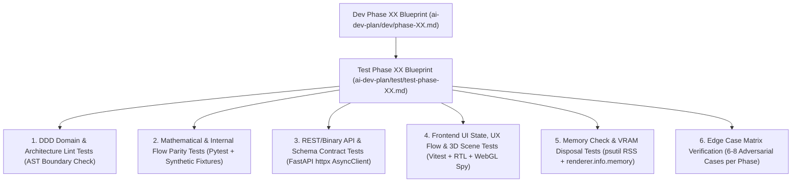

# Master Testing Strategy & 40-Phase Synchronized Quality Assurance Blueprint (`ai-dev-plan/test/`)

> **เป้าหมายสูงสุดของการทดสอบ (Testing Vision)**: รับประกันว่าระบบ **Easy ML Viewer** ในทุกๆ Phase ตั้งแต่ **Phase 01 ถึง Phase 40** มีชุดทดสอบแบบ **1-ต่อ-1 (`test-phase-01` $\leftrightarrow$ `phase-01` จนถึง `test-phase-40` $\leftrightarrow$ `phase-40`)** ที่ตรวจสอบครบทั้ง:
> 1. **ความถูกต้องทางคณิตศาสตร์ 100% (Mathematical & Internal Flow Parity)**
> 2. **ความสมบูรณ์ของ UI Feature List & UX Flows (Component States, Keyboard Shortcuts, 3D Interactions)**
> 3. **การควบคุมหน่วยความจำและ VRAM อย่างเข้มงวด (Memory Check Plan & Zero-Leak Guarantee)**
> 4. **ประสิทธิภาพการใช้ CPU / GPU / Process Lifecycle (Resource Optimization Benchmarks)**
> 5. **การทำงานแบบ 100% Offline (Air-Gapped Zero External Network Dependency) บน Windows, macOS, และ Linux**

---

## 1. สถาปัตยกรรมการทดสอบ 6 มิติในทุก Phase (6-Pillar Test Architecture)

ทุกไฟล์ `test-phase-XX-*.md` ในโฟลเดอร์นี้ถูกออกแบบให้ตรวจสอบ 6 มิติหลักตรงตามไฟล์ `phase-XX-*.md` ใน `ai-dev-plan/dev/`:



---

## 2. เกณฑ์มาตรฐานการตรวจเช็กหน่วยความจำและทรัพยากรเครื่อง (Global Memory & Resource SLA Gates)

ทุก Phase ต้องผ่านเกณฑ์การตรวจสอบทรัพยากร (Resource Gate Criteria) ดังต่อไปนี้ก่อนถือว่าจบเฟส (Definition of Done):

| มิติการตรวจสอบ | เครื่องมือวัดผลในชุดทดสอบ | เกณฑ์ที่ต้องผ่าน (Pass SLA Criteria) |
| :--- | :--- | :--- |
| **1. Downcasting Memory Saving** | `df.memory_usage(deep=True).sum()` | ข้อมูลตัวเลขทุกคอลัมน์เป็น `float32`/`int32` และใช้ RAM ลดลง $\ge 48\%$ เทียบกับ `float64` |
| **2. Chunked Simulation RSS Growth** | `psutil.Process().memory_info().rss` | เมื่อรันข้อมูล 50,000–100,000 แถวแบบแบ่งก้อน (`CHUNK_SIZE = 5,000`) ค่า RAM สะสมระหว่าง Chunk ที่ 2 ถึง Chunk สุดท้ายต้องเพิ่มขึ้นไม่เกิน **$\le 30\text{ MB}$** (Flat Memory Profile) |
| **3. Peak Backend Process RAM** | `psutil` Peak RSS Monitor | ตลอดการทดสอบ 100,000 แถว x 20 คอลัมน์ โปรเซส Backend ใช้ RAM เพิ่มขึ้นไม่เกิน **$\le 450\text{ MB}$** |
| **4. Zero Process Spawn on Windows** | `psutil.Process().children(recursive=True)` | ขณะรัน `ComputePool` หรือ `predict_batch` ต้องไม่มีการ Spawn ลูกโปรเซส Python ใหม่ (`len(children) == 0`) ยืนยันการใช้ `ThreadPoolExecutor` + C++ GIL-free `n_jobs` |
| **5. WebGL Geometry & Material Disposal** | `gl.info.memory.geometries` & `textures` | เมื่อ Unmount Component 3D หรือสลับความละเอียดพื้นผิว (`LOD 30 -> 60 -> 100`) จำนวน `geometries` ค้างใน GPU Memory ต้องกลับเท่าเดิม (**Zero VRAM Leak**) |
| **6. 60 FPS Scrubbing Latency** | `performance.now()` ใน `useFrame` | การอัปเดตเฟรมเมื่อลากแถบ Scrubber หรือกด Play ต้องใช้เวลาต่อเฟรม **$< 4.0\text{ ms}$** (ไม่เกิด React Full-Tree Re-render) |
| **7. `.mlv` Compression & Decode Speed** | `BinaryCodec.encode` / `decode` Benchmark | ข้อมูล 5,000 เฟรมพร้อมพื้นผิว 3D มีขนาดไฟล์ `.mlv` **$\le 2.5\text{ MB}$** และคลายบีบอัดเสร็จใน **$\le 50\text{ ms}$** พร้อมป้องกัน Decompression Bomb ที่ `max_output_size = 250MB` |
| **8. 100% Offline Network Isolation** | Browser Network Spy / Socket Interceptor | ไม่มี HTTP/WebSocket Request ใดเรียกออกนอก `127.0.0.1` / `localhost` (**`0` External Requests**) |

---

## 3. โครงสร้างโฟลเดอร์โค้ดทดสอบจริงในโปรเจกต์ (`backend/tests/` & `frontend/src/__tests__/`)

```text
easy-ml-viewer/
├── backend/
│   └── tests/
│       ├── conftest.py                         # Global Fixtures: Synthetic Datasets & 20+ Trained Mini-Models
│       ├── unit/                               # ทดสอบ Core, Memory Guard, Math 3D, Binary Codec, Fuzzy Mapper
│       ├── adapters/                           # ทดสอบความถูกต้องทางคณิตศาสตร์ของ Adapter ทั้ง 20+ ตระกูล
│       ├── integration/                        # ทดสอบ FastAPI Endpoints, Chunked Streaming, .mlv Baker
│       └── performance/                        # ทดสอบ 100k-Row Memory Ceiling, CPU ThreadPool, Stress Tests
│
└── frontend/
    └── src/
        └── __tests__/
            ├── setup.ts                        # WebGL Canvas Mock, ResizeObserver Mock, Offline URL Guard
            ├── stores/                         # ทดสอบ Zustand Stores (Playback, Mapping, What-If, Studio)
            ├── components/                     # ทดสอบ UI Components, Virtualized Table, Multi-Track Timeline
            └── stage3d/                        # ทดสอบ 3D Actors, Surface Meshes, Raycast Guard & VRAM Disposal
```

---

## 4. สารบัญแผนการทดสอบทั้ง 40 Phases (Synced 1-to-1 กับ `ai-dev-plan/dev/`)

### 🧱 Part 1: Base Platform, DDD Core, First Simple Model, 3D VCR Studio, What-If, `.mlv` & Compute Engine (Phases 01 - 17)

| Test Phase | ไฟล์แผนการทดสอบ (`ai-dev-plan/test/`) | คู่ขนานกับไฟล์ Dev (`ai-dev-plan/dev/`) | จุดเน้นการทดสอบหลัก |
| :---: | :--- | :--- | :--- |
| **01** | **[test-phase-01-scaffolding-and-ddd-core.md](file:///e:/easy-ml-viewer/ai-dev-plan/test/test-phase-01-scaffolding-and-ddd-core.md)** | [phase-01](file:///e:/easy-ml-viewer/ai-dev-plan/dev/phase-01-scaffolding-and-ddd-core.md) | AST DDD Boundary Lint, 2-Port CORS, Cross-OS Path, Studio Shell UI & Local Fonts |
| **02** | **[test-phase-02-dataset-ingestion-and-memory-guard.md](file:///e:/easy-ml-viewer/ai-dev-plan/test/test-phase-02-dataset-ingestion-and-memory-guard.md)** | [phase-02](file:///e:/easy-ml-viewer/ai-dev-plan/dev/phase-02-dataset-ingestion-and-memory-guard.md) | CSV ภาษาไทย `cp874`/`utf-8-sig`, Multi-sheet XLSX, `float32` 50% RAM Save & `±inf` Guard |
| **03** | **[test-phase-03-model-registry-and-schema-introspection.md](file:///e:/easy-ml-viewer/ai-dev-plan/test/test-phase-03-model-registry-and-schema-introspection.md)** | [phase-03](file:///e:/easy-ml-viewer/ai-dev-plan/dev/phase-03-model-registry-and-schema-introspection.md) | `BaseModelAdapter` Contract, `UniversalSchemaDetector`, `feature_0..n` Fallback & `NotFittedError` |
| **04** | **[test-phase-04-first-model-linear-regression-slice.md](file:///e:/easy-ml-viewer/ai-dev-plan/test/test-phase-04-first-model-linear-regression-slice.md)** | [phase-04](file:///e:/easy-ml-viewer/ai-dev-plan/dev/phase-04-first-model-linear-regression-slice.md) | `LinearRegressionAdapter` Exact Parity ($w_i x_i + b$), 3D Flat Plane Mesh & Multi-target |
| **05** | **[test-phase-05-column-mapping-and-type-casting.md](file:///e:/easy-ml-viewer/ai-dev-plan/test/test-phase-05-column-mapping-and-type-casting.md)** | [phase-05](file:///e:/easy-ml-viewer/ai-dev-plan/dev/phase-05-column-mapping-and-type-casting.md) | 3-Tier Fuzzy Matcher, Strict `feature_index` Ordering, Dirty Currency Cast & `NaN` Strategies |
| **06** | **[test-phase-06-data-selector-and-trajectory-queue.md](file:///e:/easy-ml-viewer/ai-dev-plan/test/test-phase-06-data-selector-and-trajectory-queue.md)** | [phase-06](file:///e:/easy-ml-viewer/ai-dev-plan/dev/phase-06-data-selector-and-trajectory-queue.md) | 100k-Row Virtualized Table DOM Count, Shift+Click Range, Safe Filter Rules & `_original_row_index` |
| **07** | **[test-phase-07-global-evaluation-and-error-slicer.md](file:///e:/easy-ml-viewer/ai-dev-plan/test/test-phase-07-global-evaluation-and-error-slicer.md)** | [phase-07](file:///e:/easy-ml-viewer/ai-dev-plan/dev/phase-07-global-evaluation-and-error-slicer.md) | Chunked Metrics, `np.argpartition` Top-50 Worst Errors, Click-to-Queue Confusion Matrix & OOD |
| **08** | **[test-phase-08-3d-stage-engine-and-camera-system.md](file:///e:/easy-ml-viewer/ai-dev-plan/test/test-phase-08-3d-stage-engine-and-camera-system.md)** | [phase-08](file:///e:/easy-ml-viewer/ai-dev-plan/dev/phase-08-3d-stage-engine-and-camera-system.md) | `WorldCoordinateScaler` `[-5,+5]`, 5 Camera Presets, Drop-Lines, `InstancedMesh` 50k Points & VRAM Disposal |
| **09** | **[test-phase-09-3d-projection-and-surface-mesh-generator.md](file:///e:/easy-ml-viewer/ai-dev-plan/test/test-phase-09-3d-projection-and-surface-mesh-generator.md)** | [phase-09](file:///e:/easy-ml-viewer/ai-dev-plan/dev/phase-09-3d-projection-and-surface-mesh-generator.md) | Zero-Variance Guard, 2D-Slice Pinning, 3D PCA Projection Fallback & In-place `BufferAttribute` |
| **10** | **[test-phase-10-vcr-playback-studio-and-scrubber.md](file:///e:/easy-ml-viewer/ai-dev-plan/test/test-phase-10-vcr-playback-studio-and-scrubber.md)** | [phase-10](file:///e:/easy-ml-viewer/ai-dev-plan/dev/phase-10-vcr-playback-studio-and-scrubber.md) | 60FPS `exactFrameFloat` Lerp, A-B Sub-range Loop, Single-Frame Guard & Ring-Buffer Motion Trail |
| **11** | **[test-phase-11-smart-multitrack-timeline-and-bookmarks.md](file:///e:/easy-ml-viewer/ai-dev-plan/test/test-phase-11-smart-multitrack-timeline-and-bookmarks.md)** | [phase-11](file:///e:/easy-ml-viewer/ai-dev-plan/dev/phase-11-smart-multitrack-timeline-and-bookmarks.md) | Dual-Canvas 3-Track Timeline, Vectorized Event Scanner, Pin Clustering & Frame Bookmarks (`B`) |
| **12** | **[test-phase-12-explainability-hud-and-waterfall.md](file:///e:/easy-ml-viewer/ai-dev-plan/test/test-phase-12-explainability-hud-and-waterfall.md)** | [phase-12](file:///e:/easy-ml-viewer/ai-dev-plan/dev/phase-12-explainability-hud-and-waterfall.md) | Single `<Html>` HUD Instance, Fast Local Attribution Additivity & `np.searchsorted` Percentiles |
| **13** | **[test-phase-13-what-if-sandbox-and-counterfactuals.md](file:///e:/easy-ml-viewer/ai-dev-plan/test/test-phase-13-what-if-sandbox-and-counterfactuals.md)** | [phase-13](file:///e:/easy-ml-viewer/ai-dev-plan/dev/phase-13-what-if-sandbox-and-counterfactuals.md) | Live Mutation Sliders, Immutable Feature Lock (`🔒`), 3D Ghost Sphere & KDTree + Binary Search Flip |
| **14** | **[test-phase-14-modern-studio-ux-and-command-palette.md](file:///e:/easy-ml-viewer/ai-dev-plan/test/test-phase-14-modern-studio-ux-and-command-palette.md)** | [phase-14](file:///e:/easy-ml-viewer/ai-dev-plan/dev/phase-14-modern-studio-ux-and-command-palette.md) | 3D Click-to-Scrub (`<= 4px` drag guard), `Ctrl+K` Command Palette, Label Aliasing & Cinema Mode (`Tab`) |
| **15** | **[test-phase-15-mlv-file-format-baker-and-loader.md](file:///e:/easy-ml-viewer/ai-dev-plan/test/test-phase-15-mlv-file-format-baker-and-loader.md)** | [phase-15](file:///e:/easy-ml-viewer/ai-dev-plan/dev/phase-15-mlv-file-format-baker-and-loader.md) | `EMLV\x01` + CRC32 Header, Columnar `float32` MsgPack+Zstd Roundtrip, 250MB Bomb Guard & Instant Replay |
| **16** | **[test-phase-16-rich-export-video-and-enriched-csv.md](file:///e:/easy-ml-viewer/ai-dev-plan/test/test-phase-16-rich-export-video-and-enriched-csv.md)** | [phase-16](file:///e:/easy-ml-viewer/ai-dev-plan/dev/phase-16-rich-export-video-and-enriched-csv.md) | Streaming Enriched CSV (`UTF-8 BOM`), Write-only XLSX, Offline WebM `MediaRecorder` & Sync PNG Snapshot |
| **17** | **[test-phase-17-compute-engine-cpu-gpu-and-chunking.md](file:///e:/easy-ml-viewer/ai-dev-plan/test/test-phase-17-compute-engine-cpu-gpu-and-chunking.md)** | [phase-17](file:///e:/easy-ml-viewer/ai-dev-plan/dev/phase-17-compute-engine-cpu-gpu-and-chunking.md) | `OMP_NUM_THREADS` Guard, Windows Zero-Spawn ThreadPool, GPU Fallback, `process_in_chunks` & Cancel Token |

---

### 📐 Part 2: Linear & Generalized Linear Models Test Suites (Phases 18 - 21)

| Test Phase | ไฟล์แผนการทดสอบ (`ai-dev-plan/test/`) | คู่ขนานกับไฟล์ Dev (`ai-dev-plan/dev/`) | จุดเน้นการทดสอบหลัก |
| :---: | :--- | :--- | :--- |
| **18** | **[test-phase-18-model-logistic-regression.md](file:///e:/easy-ml-viewer/ai-dev-plan/test/test-phase-18-model-logistic-regression.md)** | [phase-18](file:///e:/easy-ml-viewer/ai-dev-plan/dev/phase-18-model-logistic-regression.md) | Binary `(1,D)` vs Multiclass `(C,D)` Softmax, Overflow-safe `expit`, $P=\tau$ Contour & Sigmoid Surface |
| **19** | **[test-phase-19-model-ridge-and-lasso.md](file:///e:/easy-ml-viewer/ai-dev-plan/test/test-phase-19-model-ridge-and-lasso.md)** | [phase-19](file:///e:/easy-ml-viewer/ai-dev-plan/dev/phase-19-model-ridge-and-lasso.md) | `RidgeClassifier` Pseudo-Probability, `Lasso` `ZERO_TOL` Pruned Axis Dimming & All-Zero Weights Guard |
| **20** | **[test-phase-20-model-elasticnet.md](file:///e:/easy-ml-viewer/ai-dev-plan/test/test-phase-20-model-elasticnet.md)** | [phase-20](file:///e:/easy-ml-viewer/ai-dev-plan/dev/phase-20-model-elasticnet.md) | $\lambda_1/\lambda_2$ Decomposition, `MultiTaskElasticNet` $L_{1,2}$ Norm, Superellipse Ring & Convergence Warning |
| **21** | **[test-phase-21-model-sgd-classifier-regressor.md](file:///e:/easy-ml-viewer/ai-dev-plan/test/test-phase-21-model-sgd-classifier-regressor.md)** | [phase-21](file:///e:/easy-ml-viewer/ai-dev-plan/dev/phase-21-model-sgd-classifier-regressor.md) | `loss='hinge'` vs `'log_loss'` vs `'modified_huber'`, Geometric Distance $\frac{w^Tx+b}{\|w\|}$ & Shared Plane Geometry |

---

### 🎯 Part 3: Distance, Kernel & Probabilistic Models Test Suites (Phases 22 - 26)

| Test Phase | ไฟล์แผนการทดสอบ (`ai-dev-plan/test/`) | คู่ขนานกับไฟล์ Dev (`ai-dev-plan/dev/`) | จุดเน้นการทดสอบหลัก |
| :---: | :--- | :--- | :--- |
| **22** | **[test-phase-22-model-knn-radar-sphere.md](file:///e:/easy-ml-viewer/ai-dev-plan/test/test-phase-22-model-knn-radar-sphere.md)** | [phase-22](file:///e:/easy-ml-viewer/ai-dev-plan/dev/phase-22-model-knn-radar-sphere.md) | Mandatory Union + 5,000 Stratified Downsampling, $L_1/L_2/L_\infty$ Radar Geometry & Empty Radius Guard |
| **23** | **[test-phase-23-model-svm-kernel-surface.md](file:///e:/easy-ml-viewer/ai-dev-plan/test/test-phase-23-model-svm-kernel-surface.md)** | [phase-23](file:///e:/easy-ml-viewer/ai-dev-plan/dev/phase-23-model-svm-kernel-surface.md) | 4 Kernels (`rbf`, `poly`, `sigmoid`, `linear`), `probability=False` Guard, Top-1,000 Support Vectors Cap |
| **24** | **[test-phase-24-model-gaussian-naive-bayes.md](file:///e:/easy-ml-viewer/ai-dev-plan/test/test-phase-24-model-gaussian-naive-bayes.md)** | [phase-24](file:///e:/easy-ml-viewer/ai-dev-plan/dev/phase-24-model-gaussian-naive-bayes.md) | `var_` vs `sigma_` Compatibility, Log-Space Underflow Prevention, Log-Bayes Factor & Bell Hills |
| **25** | **[test-phase-25-model-multinomial-bernoulli-nb.md](file:///e:/easy-ml-viewer/ai-dev-plan/test/test-phase-25-model-multinomial-bernoulli-nb.md)** | [phase-25](file:///e:/easy-ml-viewer/ai-dev-plan/dev/phase-25-model-multinomial-bernoulli-nb.md) | Non-Negative Grid Clamp ($\ge 0$), `BernoulliNB` Absence Penalty Term & `CategoricalNB` Unseen Category |
| **26** | **[test-phase-26-model-lda-and-qda.md](file:///e:/easy-ml-viewer/ai-dev-plan/test/test-phase-26-model-lda-and-qda.md)** | [phase-26](file:///e:/easy-ml-viewer/ai-dev-plan/dev/phase-26-model-lda-and-qda.md) | `store_covariance=False` Reconstruction, `pinv` Singular Matrix Guard, $\det(V)=+1$ Quaternion & Ellipsoids |

---

### 🌲 Part 4: Decision Trees & Bagging Ensembles Test Suites (Phases 27 - 30)

| Test Phase | ไฟล์แผนการทดสอบ (`ai-dev-plan/test/`) | คู่ขนานกับไฟล์ Dev (`ai-dev-plan/dev/`) | จุดเน้นการทดสอบหลัก |
| :---: | :--- | :--- | :--- |
| **27** | **[test-phase-27-model-decision-tree-voxel.md](file:///e:/easy-ml-viewer/ai-dev-plan/test/test-phase-27-model-decision-tree-voxel.md)** | [phase-27](file:///e:/easy-ml-viewer/ai-dev-plan/dev/phase-27-model-decision-tree-voxel.md) | CSR Sparse `decision_path` Slice, Exact Node $\Delta$ Contribution, Active Subtree Pruning & Voxel Mesh |
| **28** | **[test-phase-28-model-random-forest-consensus.md](file:///e:/easy-ml-viewer/ai-dev-plan/test/test-phase-28-model-random-forest-consensus.md)** | [phase-28](file:///e:/easy-ml-viewer/ai-dev-plan/dev/phase-28-model-random-forest-consensus.md) | `model.apply(X_f32)` Fast Lookup, Zero `feature_names_in_` Warning, `MAX_EXPORTED_TREES=100` & Voting Ring |
| **29** | **[test-phase-29-model-extra-trees.md](file:///e:/easy-ml-viewer/ai-dev-plan/test/test-phase-29-model-extra-trees.md)** | [phase-29](file:///e:/easy-ml-viewer/ai-dev-plan/dev/phase-29-model-extra-trees.md) | `inter_tree_std` (`ddof=0` Single-Tree Guard), Uncertainty Halo Radius & Cut-Point Density Carpet |
| **30** | **[test-phase-30-model-adaboost-cascade.md](file:///e:/easy-ml-viewer/ai-dev-plan/test/test-phase-30-model-adaboost-cascade.md)** | [phase-30](file:///e:/easy-ml-viewer/ai-dev-plan/dev/phase-30-model-adaboost-cascade.md) | `SAMME` vs `SAMME.R`, `AdaBoost.R2`, Stump Fast Path vs General Base Estimator & Cascade Ladder |

---

### 🚀 Part 5: Gradient Boosting Heavyweights Test Suites (Phases 31 - 35)

| Test Phase | ไฟล์แผนการทดสอบ (`ai-dev-plan/test/`) | คู่ขนานกับไฟล์ Dev (`ai-dev-plan/dev/`) | จุดเน้นการทดสอบหลัก |
| :---: | :--- | :--- | :--- |
| **31** | **[test-phase-31-model-sklearn-gbm.md](file:///e:/easy-ml-viewer/ai-dev-plan/test/test-phase-31-model-sklearn-gbm.md)** | [phase-31](file:///e:/easy-ml-viewer/ai-dev-plan/dev/phase-31-model-sklearn-gbm.md) | `_raw_predict_init` + `learning_rate` Residual Sum, `(M,1)` vs `(M,C)` Shape & Spiral Ladder |
| **32** | **[test-phase-32-model-hist-gradient-boosting.md](file:///e:/easy-ml-viewer/ai-dev-plan/test/test-phase-32-model-hist-gradient-boosting.md)** | [phase-32](file:///e:/easy-ml-viewer/ai-dev-plan/dev/phase-32-model-hist-gradient-boosting.md) | `_bin_mapper` Thresholds, `_predictors` Node Traversal, `missing_go_to_left` (`NaN`) & Gain Importance |
| **33** | **[test-phase-33-model-xgboost.md](file:///e:/easy-ml-viewer/ai-dev-plan/test/test-phase-33-model-xgboost.md)** | [phase-33](file:///e:/easy-ml-viewer/ai-dev-plan/dev/phase-33-model-xgboost.md) | `.pkl`/`.json`/`.ubj` Loading, Single `DMatrix` Reuse, `pred_contribs=True, strict_shape=True` & JSON Dump |
| **34** | **[test-phase-34-model-lightgbm.md](file:///e:/easy-ml-viewer/ai-dev-plan/test/test-phase-34-model-lightgbm.md)** | [phase-34](file:///e:/easy-ml-viewer/ai-dev-plan/dev/phase-34-model-lightgbm.md) | `.pkl`/`.txt`/`.model`, Multiclass `pred_contrib` `.reshape(N,C,F+1)`, Leaf-Wise Dump & Categorical |
| **35** | **[test-phase-35-model-catboost.md](file:///e:/easy-ml-viewer/ai-dev-plan/test/test-phase-35-model-catboost.md)** | [phase-35](file:///e:/easy-ml-viewer/ai-dev-plan/dev/phase-35-model-catboost.md) | `.cbm` 2-Stage Classifier/Regressor Probing, Bitwise Oblivious Leaf Index, Native String `Pool` & `ShapValues` |

---

### 🧠 Part 6: Neural Networks, Pipelines & Universal ONNX Test Suites (Phases 36 - 39)

| Test Phase | ไฟล์แผนการทดสอบ (`ai-dev-plan/test/`) | คู่ขนานกับไฟล์ Dev (`ai-dev-plan/dev/`) | จุดเน้นการทดสอบหลัก |
| :---: | :--- | :--- | :--- |
| **36** | **[test-phase-36-model-mlp-neural-network.md](file:///e:/easy-ml-viewer/ai-dev-plan/test/test-phase-36-model-mlp-neural-network.md)** | [phase-36](file:///e:/easy-ml-viewer/ai-dev-plan/dev/phase-36-model-mlp-neural-network.md) | Layer Forward-Pass Parity, Top-32 Active Neuron Cap, Dead ReLU Ratio & Analytical Input $\times$ Gradient |
| **37** | **[test-phase-37-sklearn-pipeline-unwrapper.md](file:///e:/easy-ml-viewer/ai-dev-plan/test/test-phase-37-sklearn-pipeline-unwrapper.md)** | [phase-37](file:///e:/easy-ml-viewer/ai-dev-plan/dev/phase-37-sklearn-pipeline-unwrapper.md) | Recursive `Pipeline`/`ColumnTransformer` Unwrap, Feature Lineage Aggregation & Raw vs Scaled 3D Space |
| **38** | **[test-phase-38-onnx-classical-ml-engine.md](file:///e:/easy-ml-viewer/ai-dev-plan/test/test-phase-38-onnx-classical-ml-engine.md)** | [phase-38](file:///e:/easy-ml-viewer/ai-dev-plan/dev/phase-38-onnx-classical-ml-engine.md) | `ai.onnx.ml` (`TreeEnsemble`, `Linear`, `SVM`) Inspection, Single vs Multi-Input & `ZipMap` Unpacker |
| **39** | **[test-phase-39-onnx-deep-learning-intermediate.md](file:///e:/easy-ml-viewer/ai-dev-plan/test/test-phase-39-onnx-deep-learning-intermediate.md)** | [phase-39](file:///e:/easy-ml-viewer/ai-dev-plan/dev/phase-39-onnx-deep-learning-intermediate.md) | In-Memory Graph Output Injection, Penultimate 3D Latent PCA Manifold & Static `batch_size=1` Loop |

---

### 🏁 Part 7: Final Offline Packaging, 20-Model Demo Suite, Multi-Compare & Hardening (Phase 40)

| Test Phase | ไฟล์แผนการทดสอบ (`ai-dev-plan/test/`) | คู่ขนานกับไฟล์ Dev (`ai-dev-plan/dev/`) | จุดเน้นการทดสอบหลัก |
| :---: | :--- | :--- | :--- |
| **40** | **[test-phase-40-offline-packaging-and-stress-test.md](file:///e:/easy-ml-viewer/ai-dev-plan/test/test-phase-40-offline-packaging-and-stress-test.md)** | [phase-40](file:///e:/easy-ml-viewer/ai-dev-plan/dev/phase-40-offline-packaging-and-stress-test.md) | Air-Gap Network Test, `generate_all_20_demos.py`, Synchronized Dual `.mlv` Compare, 100k-Row Stress & OS Port Cleanup |
